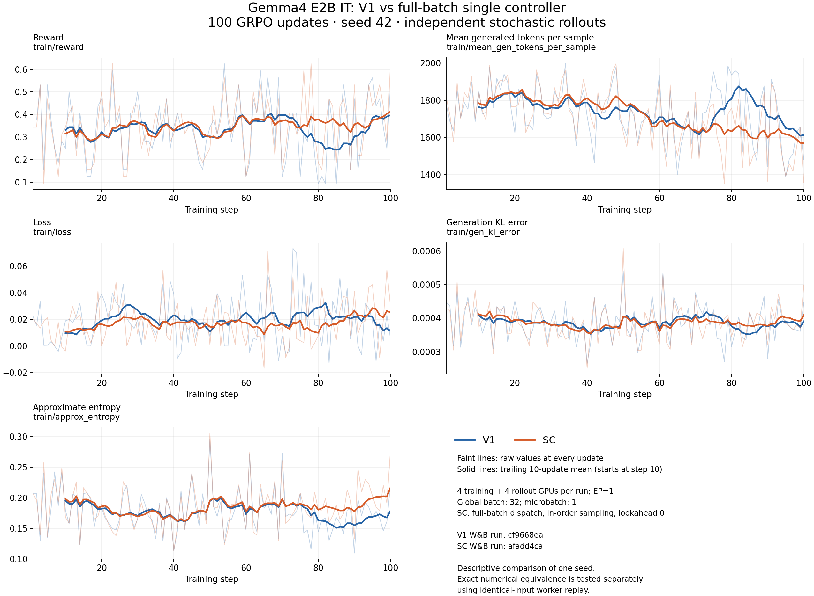
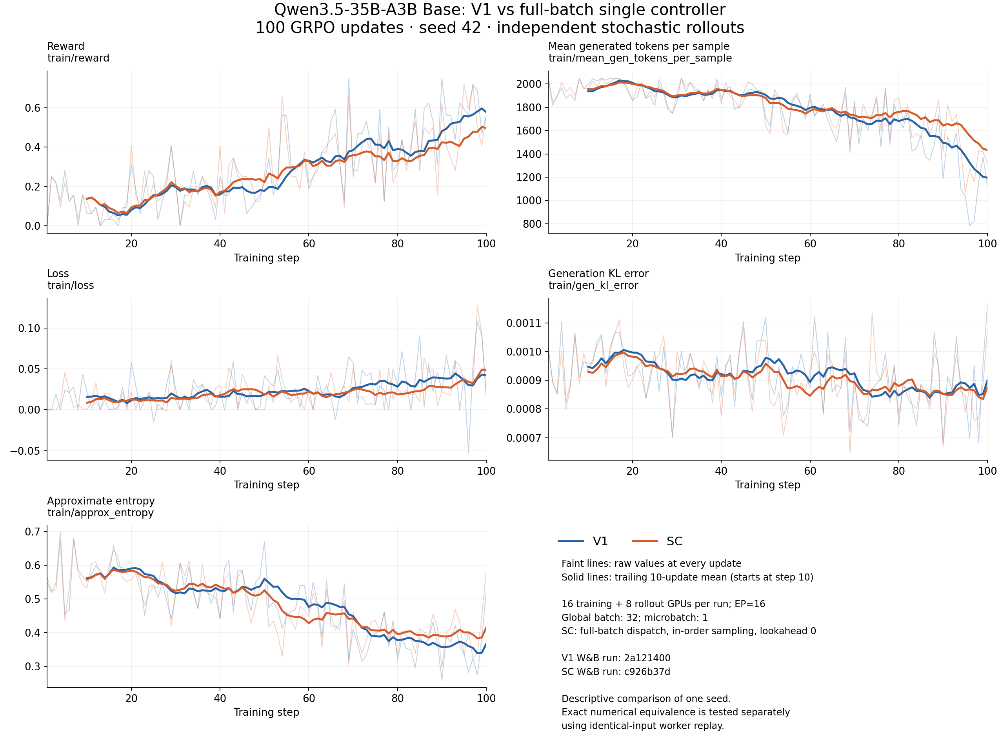

# AutoModel single-controller: full-batch implementation design

## Baseline and scope

Base: upstream `main` at `0e36f2e6a944a2e617fbc1941d57041715a4ac3f`.
This design adds full-batch single-controller (SC) execution to AutoModel. The existing
synchronous `AutomodelPolicyWorkerImpl.train()` remains byte-for-byte unchanged.
The previous experimental branch is preserved separately; its validation results
are not evidence for this revised implementation.

Supported scope is text GRPO, full-parameter FSDP2, TP=CP=1, fixed
microbatches, disaggregated async vLLM, `in_order`, and lookahead zero. Dense and
MoE models use the same lifecycle. Expert parallelism uses AutoModel's existing
MoE mesh, dispatcher, gradient synchronization, and distributed clipping.
The SC lifecycle does not impose an EP=1 restriction. Model and parallelism
qualification is recorded separately below; removing a guard does not establish
correctness for every expert layout or dispatcher.
Model-specific numerical/refit support remains subject to the existing backend.

Packing, dynamic batching, HSDP, CPU offload, LoRA, draft training, VLM,
quantization, PPO, distillation, colocation, and streaming dispatches are outside
the supported scope. Configuration validation rejects unsupported combinations before allocation;
worker guards also protect direct lifecycle callers.

## Configuration entrypoint

Start from `examples/configs/grpo_math_1B_automodel_single_controller.yaml`:

```bash
uv run examples/run_grpo_single_controller.py \
  --config examples/configs/grpo_math_1B_automodel_single_controller.yaml
```

This exemplar inherits `grpo_math_1B.yaml` and supplies the supported AutoModel
SC settings: async vLLM on separate GPUs, TransferQueue, in-order sampling with
zero lookahead, fixed microbatches, and full-batch admission. The default layout
uses one training GPU and one rollout GPU. Global batch size, admission threshold,
and buffer capacities follow the configured prompt/generation counts.
Checkpointing is disabled in the base; enabling it retains optimizer and native
TQ replay state. Configure the run length, model, workload, and resources for
the intended experiment.

The Qwen full-batch regression recipe inherits this exemplar and supplies its
model/workload, checkpoint, and output settings. L1 and nightly continue to use
that recipe with their existing step/checkpoint overrides. Extracting the base
preserves the recipe's fully resolved configuration.

## Interfaces and ownership

`setup_single_controller` already constructs `TQPolicy`. Its existing methods
delegate through `TQWorkerMixin` to the backend's `begin_train_step`,
`train_microbatch`, `finish_train_step`, and `abort_train_step`. Metadata is
sharded by DP, fetched, and materialized by the existing mixin. No new controller,
sampler, metadata schema, or transport API is introduced. These interface names
and the separation of backward from optimizer commit match the MCore path.

An internal `_TrainStepState` holds the loss function, GBS/MBS, dispatch status,
completed metrics, and snapshots of mutable model state needed for cancellation.
It is initialized in the worker constructor. It represents a logical optimizer
step; the one-dispatch restriction is an explicit full-batch execution constraint.

| Operation | Preconditions | Work and ownership |
| --- | --- | --- |
| Begin | Idle, valid capability/batch configuration | Snapshot buffers and router load counters; clear gradients; open state. |
| Dispatch | Open, no attempted dispatch | Check every DP rank has GBS/DP rows; compute all backend microbatches; retain gradients and metrics. |
| Finish | Dispatch completed | Clip, optimizer step, existing MoE gate-bias hook, scheduler step; return metrics; release step. |
| Abort | Open or idle | Restore pre-step buffers/router counters and discard gradients; no optimizer/scheduler update; idempotent. |

Mark dispatch attempted before execution. A failure requires abort before a new
step; a second dispatch cannot double-count gradients. DP row validation uses a
collective minimum/maximum before forward collectives. It rejects short and
oversized batches. Full-batch admission requires the streaming threshold to equal
prompts per step and zero prompt-drop budgets.

Commit failures are not transactional: optimizer updates cannot be rolled back.
The worker becomes unavailable for further SC steps after a failed commit and
requires recovery. Abort never clears that failure. Callers must not interleave
legacy `train()` with an open SC step; V1 is deliberately not modified to enforce
this new caller contract. Abort does not rewind RNG or controller rollout state.

## Numerical implementation

V2 calls established primitives directly, without a shared V1/V2 training wrapper:

| Primitive | Responsibility |
| --- | --- |
| `check_sequence_dim` | Validate sequence axes. |
| `process_global_batch` | Select the complete local batch and collectively compute valid-token/sequence denominators. |
| `get_microbatch_iterator` | Existing batching and input preparation. |
| `LossPostProcessor` | Existing loss, precision-independent normalization, and metrics. |
| `automodel_forward_backward` | Forward/backward microbatches, autocast, FSDP and router-replay contexts. |
| `aggregate_training_statistics` | Existing metric reductions. |
| `scale_grads_and_clip_grad_norm` | Existing distributed clipping and norm calculation. |

The dispatch uses `num_global_batches=1` and known global denominators. It may
perform many forward/backward passes. Gradient clipping, optimizer and scheduler
each happen once at finish. Learning-rate metrics record the pre-update rate,
matching V1. Retained-gradient logprob phases are allowed; finish restores training
mode before the model's gate-bias update hook.

The pinned AutoModel `Gate` accumulates `_cumulative_expert_load` outside registered
buffers. Snapshot and restore that counter explicitly, alongside model buffers,
so aborted samples do not affect the next successful bias update. Dispatcher
temporary tensors are released through the existing `release_moe_dispatcher_state`
utility after completion/cancellation. Gemma4's router has no cumulative load
counter. Arbitrary new model-owned mutable state must be audited when qualifying
additional architectures; parameter rollback after commit is not promised.

## Extension boundaries

Later streaming work replaces the one-dispatch guard with accumulation accounting
and defines cross-chunk normalization/FSDP synchronization. It retains the four
public lifecycle methods and existing numerical primitives. Lookahead and sampler
selection remain controller concerns. Packing/dynamic batching need a distinct
row-count/participation contract. Broader parallelism and model features receive
capability-specific tests rather than dense-versus-MoE implementations.

## Acceptance and evidence

1. Verify the V1 method text against the upstream base.
2. Unit tests cover transitions, failed backward, full-batch guards, commit-once,
   abort restoration, MoE hook ordering, and failed-commit recovery requirements.
3. Distributed fixed-input V1/V2 parity starts from identical model, optimizer,
   scheduler and RNG state. Compare pre-clip gradients, loss/metrics, norm,
   updated parameters/buffers and optimizer/scheduler state for token- and
   sequence-normalized losses over multiple updates. Exercise metadata fetch,
   retained-gradient logprob transitions, and abort. Use `rtol=1e-5`, `atol=1e-6`;
   report observed errors, not only a pass flag.
4. Run dense and MoE initialization, generation/refit, loss/KL and checkpoint
   resume gates at the parallelism layout being qualified before matched
   100-step integration runs. Record source hashes,
   resolved configuration, environment differences, Slurm status and W&B links.
5. Independent rollout curves establish integration behavior, not exact numerical
   parity or learning-quality equivalence. Disclose transport differences if the
   synchronous baseline requires a workaround.

## Automated regression coverage

AutoModel follows the same test layers as MCore; shared controller and TQ
wrapper tests remain backend independent.

| Layer | AutoModel coverage | Discovery |
| --- | --- | --- |
| Worker unit tests | `tests/unit/models/policy/test_automodel_split_state.py`: lifecycle, guards, failure cleanup, buffer and MoE hook behavior | Existing AutoModel L0 policy shards |
| GPU numerical parity | `tests/unit/models/policy/test_automodel_split_parity.py`: tiny Llama at EP=1 and native Qwen3 MoE at EP=2, two ranks, two updates for each loss normalization, masks and gradient accumulation | Existing AutoModel L0 policy shards; HF-gated marker, like MCore's tiny-model fixture |
| Configuration | `tests/unit/single_controller/test_automodel_config.py`: base exemplar, prompt-count overrides, derived regression recipe, and unsupported configurations | Shared L0 controller suite |
| Live integration | `tests/functional/automodel_sc_full_batch_smoke.sh`: Qwen2.5-1.5B, one training and one rollout GPU, timeout checkpoint at step 1, resume through step 4 | `L1_Functional_Tests_Automodel_SingleController.sh`, including FAST |
| Longer regression | `grpo-qwen2.5-1.5b-1n2g-automodel-single-controller-full-batch` recipe and matching driver: 100 updates, finite metrics, zero lag, logprob health and final checkpoint | `tests/test_suites/nightly.txt` |

The L0 test reuses `tests/functional/automodel_sc_full_batch_parity.py`
with strict deterministic kernels and zero tolerances. It compares pre-clip
gradients, returned metrics, model parameters/buffers, optimizer and scheduler
state. It also checks retained gradients across logprob inference and rollback
after an aborted backward. Its local metadata transport isolates worker
numerics; L1 exercises Ray dispatch, network TransferQueue, async vLLM and refit.
The dense test uses the Hugging Face implementation inside AutoModel. A second
parameterization uses native Qwen3 MoE with four experts, two selected per token,
and EP=2 with the HybridEP dispatcher. It exercises the same parity and lifecycle
checks with actual expert communication. Large-model and multi-node qualification
remains separate from these small CI tests.

L1 checks checkpoint artifacts and restore messages, and requires exactly step 1
before restart and steps 2–4 afterward. It tests save/resume mechanics, not
equivalence to uninterrupted training: the controller may drop in-flight
prompts on restart. W&B is optional for L1; the nightly uses the original NeMo RL
metric names in the `nemo-rl-automodel-sc` project.

Validation on 2026-10-30 passed 20 AutoModel worker tests (including the exact
two-GPU parity test), then 37 configuration/shared-wrapper tests. The first job
(`21044661`) passed the worker tests but exposed a config-access error in the
new recipe test assertion; that assertion was corrected. Job `21044947`
passed the 37 tests and the live four-step save/resume smoke, exiting 0.
The smoke had zero policy lag and zero logprob-error-masked sequences;
maximum generation KL was 0.000553 and maximum sequence probability error
was 1.04654. The 100-step nightly was registered and dry-run checked, but was
not executed in this validation pass.

## Validation status

The validation checkout is frozen at `56b4fc2d582c06204fa5f8effceaecb21dd5419c`.
Subsequent configuration type casts do not change runtime behavior; the worker
is identical. Gemma4 E2B passed four distributed comparisons on four H100
80 GB GPUs: two token-normalized and two sequence-normalized updates. Maximum
absolute differences were **0.0** for pre-clip gradients, metrics, updated
parameters/buffers, and optimizer state. Scheduler equality, gradients retained
through a logprob phase, and abort preservation also passed. Slurm job
`20956201` completed with exit code 0.

[W&B parity run](https://wandb.ai/ys_fishcool-nvidia/nemorl-gemma4/runs/uwx3bgek)
and [six-panel comparison dashboard](https://wandb.ai/ys_fishcool-nvidia/nemorl-gemma4?nw=vovwm7ey6oo).
The focused lifecycle suite passed 19 tests, configuration coverage passed 134,
and broader setup/controller/checkpoint regression coverage passed 537.
The fixed-input harness uses deterministic execution, standard AdamW, and a
StepLR schedule to compare complete optimizer state. Live integration runs use
the existing recipes' Transformer Engine FusedAdam and scheduler settings.
MoE live qualification uses sixteen training ranks and eight rollout GPUs
across three nodes, with the recipe's BF16 optimizer moments and GBS=32.
Four training ranks exhausted memory when saving BF16 moments as FP32 copies.
Eight ranks trained two updates and saved full checkpoints, but optimizer restore
exhausted an 80 GB GPU while PyTorch cast state tensors inside FusedAdam's
loader. Using FP32 moments on eight ranks also exhausted memory during restore;
the final sixteen-rank configuration retains the recipe's BF16 moments.
Six ranks failed before training because the native checkpoint adapter
could not load uneven expert shards. Those layouts are not qualified for the
complete training/checkpoint/resume workflow.

The dense three-path logprob gate included the HF reference. Its mean KL values
were 0.0 for HF versus AutoModel, 0.00286 for HF versus vLLM, and 0.00204 for
vLLM versus AutoModel (global mean threshold 0.01; four prompts, 115 tokens).
The live SC checkpoint gate saved at step 2, restored model/optimizer and
controller/data state, and advanced to step 3 with zero policy lag.
[Its W&B run](https://wandb.ai/ys_fishcool-nvidia/nemorl-gemma4/runs/1f964f66)
contains all three steps and is marked finished.

Qwen3-30B-A3B Base passed the same four fixed-input comparisons on eight H100
GPUs at EP=1, again with maximum absolute error **0.0** for gradients, metrics,
parameters/buffers, and optimizer state. Scheduler, retained-gradient logprob,
and abort checks passed as well.
[MoE parity run](https://wandb.ai/ys_fishcool-nvidia/nemorl-gemma4/runs/fntrn5ku)
and [six-panel comparison dashboard](https://wandb.ai/ys_fishcool-nvidia/nemorl-gemma4?nw=ho8jhl0ldq5).

MoE's three-path logprob probe passed on sixteen fixed prompts, including HF,
using eight policy ranks and TP=4 rollout. Global mean KL was 0.00370 for HF
versus AutoModel, 0.00461 for HF versus vLLM, and 0.00511 for vLLM versus
AutoModel (threshold 0.01). This is a global-mean criterion, not a per-prompt
bound. An earlier TP=2 four-prompt probe failed at 0.01277; expanding that
probe to sixteen prompts lowered its global mean but did not change the
original subset's result. The final rollout configuration uses TP=4.

The sixteen-rank live checkpoint/resume gate completed with exit code 0
(Slurm job `20963367`). It saved at step 2, restored model/optimizer and
controller/data state, advanced to step 3, and saved again. Both retained
checkpoints contain sixteen weight and optimizer shards. All three W&B
training records are finite, include a nonzero gradient, and have zero policy
lag. The live generation-KL diagnostic ranged from 0.00147 to 0.00162.
[MoE checkpoint run](https://wandb.ai/ys_fishcool-nvidia/nemorl-gemma4/runs/ab3b3610).

The matched 100-step MoE results are tracked in the
[PR validation record](https://github.com/NVIDIA-NeMo/RL/pull/4963).
The eight-rank scoring probe and sixteen-rank checkpoint gate have distinct
coverage; use the PR record for the completed long-run integration evidence.

The Gemma4 E2B upstream/SC pair completed 100 real GRPO updates, using four
training and four generation H100s per run, GBS=32, MBS=1, and seed 42.
Both runs have 100 finite training records, identical learning-rate sequences,
32 valid samples per update, and complete step-100 weight/optimizer checkpoints.
SC policy-version lag remained zero. Mean reward over these updates was 0.345
for upstream and 0.36875 for SC; a single seed does not establish a quality
difference. [Paired 12-panel dashboard](https://wandb.ai/ys_fishcool-nvidia/nemorl-gemma4?nw=1tuwnil9b0a).

The original dense Slurm wrappers exited 2 **after** training completed because
the shared shell launcher was edited while they ran. These job failures are
preserved, not counted as clean exits. Immutable launcher bundles then restored
each step-100 checkpoint, completed one extra update, and saved step 101.
Both recovery jobs (`20959496`, `20959498`) completed with exit code 0.
The comparison dashboard is restricted to updates 1–100. Upstream uses legacy
Ray data transport because its synchronous TQ path requests absent reference
logprobs when KL is disabled; SC uses TQ. The upstream code is unmodified.

Gemma4 26B-A4B was initially considered for MoE qualification, but two existing
backend failures occurred before any SC call. With the native model at EP=1,
its checkpoint adapter returns local expert tensors and loses their global
shape (`128` experts in the checkpoint versus `16` on each of eight ranks).
With `force_hf=true`, loading succeeds but the existing logprob forward fails
with an FP32/BF16 mismatch at the LM head. Neither configuration is qualified
by this PR. Qwen3 MoE validation uses the existing recipe with the local Base
checkpoint, EP=1, the torch dispatcher, and auxiliary router loss disabled.

Validation uses the existing pipeline container with the pinned AutoModel source
`b916107a5ce8e77a3f18682f8b0eaa46a4b54389`, PyTorch `2.13.0+cu130`, and
Transformers `5.12.1`. The container receives the upstream-pinned Lens and
TransferQueue packages plus MSC `0.51.0` for newer imports; this is not a full
rebuild from the upstream lockfile. Dependency pins in this PR are unchanged.
For TP=4 MoE generation, the validation launcher starts one explicit Ray head
and exports `RAY_ADDRESS` to all children. Without that address, vLLM's spawned
EngineCore started a second cluster and failed to find the original placement
group. This launcher adjustment is shared by the upstream and SC MoE runs.

## Expert-parallel worker qualification

The EP=1-only SC checks have been removed from configuration validation and
`begin_train_step`. The existing V1 `train()` method remains unchanged.
EP dispatch, synchronization, and clipping continue to use the existing
AutoModel numerical primitives.

The live EP=16 gate also exposed an existing TQ padding omission: the metadata
logprob path ignored the consuming model's `make_sequence_length_divisible_by`
when the producer supplied no padding hint. A 2336-token forward then failed
HybridEP's 64-token alignment assertion before training. TQ now includes the
model's configured alignment when minting its shared driver/worker forward
target, for ordinary and pre-placed metadata. This is a backend-independent
padding correction; the AutoModel forward/backward and optimizer code is unchanged.

The regression suite passed 99 tests, including exact distributed V1/SC
comparisons on a tiny dense model at EP=1 and native Qwen3 MoE at EP=2.
Both use two training ranks. The MoE test uses four experts, top-2 routing,
and HybridEP; both loss normalization modes, gradient accumulation, masked
samples, metadata fetch, retained gradients, and abort are covered.
Shared TQ regressions additionally verify configured sequence alignment for
driver reads, worker fetches, and pre-placed metadata, including combinations
with producer hints and dynamic batching.

Qwen3.5-35B-A3B Base additionally passed six consecutive real GRPO updates
on sixteen training GPUs with EP=16 and HybridEP. Under strict deterministic
execution, all 96 rank/update comparisons matched exactly with `rtol=atol=0`:
pre-clipping gradients,
returned metrics, model parameters/buffers, raw FusedAdam state, scheduler,
and RNG state. Each rank accumulated two microbatches per update.
Retained-gradient logprob inference, finish/abort dispatcher cleanup, abort
state restoration, and restoration of the V1 producer trajectory also passed.
These six real batches contained no masked rows; masking coverage comes from
the distributed tiny-model test.
[EP=16 replay run](https://wandb.ai/ys_fishcool-nvidia/nemo-rl-automodel-sc/runs/49e86fc5).

The initial sixteen-rank logprob check also passed: mean KL was 0.0003923
for HF/vLLM, 0.0003598 for HF/AutoModel, and 0.0004114 for vLLM/AutoModel,
using sixteen prompts and a 0.01 threshold. The HF reference was available.
This qualification uses the unmodified AutoModel revision already pinned by
the PR, `b916107a5ce8e77a3f18682f8b0eaa46a4b54389`. It does not use the
external dtype-grouping patch needed by the earlier Qwen3.5 EP=1 experiment.

The live EP=16 V1 and SC checkpoint gates both saved at update 1, restored
in a fresh process, and completed updates 2–3 with finalized model and optimizer
checkpoints. SC policy lag remained zero; resumed updates had nonzero gradients
and finite training metrics. The existing two-GPU dense SC smoke test also
passed save-at-1/resume-through-4 on the shared TQ padding correction.
[EP=16 SC checkpoint run](https://wandb.ai/ys_fishcool-nvidia/nemo-rl-automodel-sc/runs/30751deb).

## Matched 100-update training curves

The following figures compare the newer Gemma4 E2B IT pair and the Qwen3.5
35B-A3B Base EP=16 pair in the `nemo-rl-automodel-sc` W&B project. They are
separate from the earlier runs in `nemorl-gemma4` described above and from the
Qwen3.5 EP=1 experiment that required an external AutoModel patch. The EP=16
pair uses the unmodified pinned AutoModel source.

Each pair uses seed 42, global batch size 32, microbatch size 1, and matched
model, optimizer, and sampling settings. SC uses full-batch dispatch, in-order
sampling, and lookahead zero. V1 uses legacy Ray data transport; SC uses TQ.
Rollouts are sampled independently, so the curves describe training behavior
rather than exact numerical parity or a statistically established quality
difference. Identical-input worker replay provides the separate numerical
equivalence evidence.

All five panels use the original NeMo RL metric names: `train/reward`,
`train/mean_gen_tokens_per_sample`, `train/loss`, `train/gen_kl_error`, and
`train/approx_entropy`. Every metric has 100 finite values per run. Plotted
values come from the complete exported W&B histories and were checked against
the native TensorBoard records. Faint lines show every raw update; solid lines
show trailing 10-update means, starting at update 10. No updates are removed.

### Gemma4 E2B IT

Each run uses four training and four rollout H100 GPUs, with EP=1.
[V1 run](https://wandb.ai/ys_fishcool-nvidia/nemo-rl-automodel-sc/runs/cf9668ea) and
[SC run](https://wandb.ai/ys_fishcool-nvidia/nemo-rl-automodel-sc/runs/afadd4ca).



### Qwen3.5-35B-A3B Base, EP=16

Each run uses sixteen training H100 GPUs with HybridEP and eight rollout H100
GPUs with TP=8. Both completed 100 updates and saved final checkpoints.
The V1 run resumed from update 20 after a storage-quota interruption; the SC
run resumed from update 94 at its allocation boundary. Each plotted history
contains updates 1–100 once, and SC policy-version lag stayed zero.
[V1 run](https://wandb.ai/ys_fishcool-nvidia/nemo-rl-automodel-sc/runs/2a121400) and
[SC run](https://wandb.ai/ys_fishcool-nvidia/nemo-rl-automodel-sc/runs/c926b37d).



The curves do not resolve the outstanding SC logprob-error outlier at update
74: `train/token_mult_prob_error` reached 1.62247 and
`train/max_seq_mult_prob_error` reached 17.41849. Those diagnostics are distinct
from the plotted `train/gen_kl_error`, which remained finite. The outlier needs
investigation before treating this live comparison as fully qualified.

For reference, the means over all 100 updates are:

| Native metric | Gemma4 V1 | Gemma4 SC | Qwen3.5 EP16 V1 | Qwen3.5 EP16 SC |
| --- | ---: | ---: | ---: | ---: |
| `train/reward` | 0.339375 | 0.352188 | 0.291875 | 0.276563 |
| `train/mean_gen_tokens_per_sample` | 1734.29 | 1710.88 | 1755.90 | 1801.75 |
| `train/loss` | 0.019315 | 0.017606 | 0.023737 | 0.021416 |
| `train/gen_kl_error` | 0.00038688 | 0.00038830 | 0.00091623 | 0.00090550 |
| `train/approx_entropy` | 0.177857 | 0.186579 | 0.478026 | 0.479710 |
