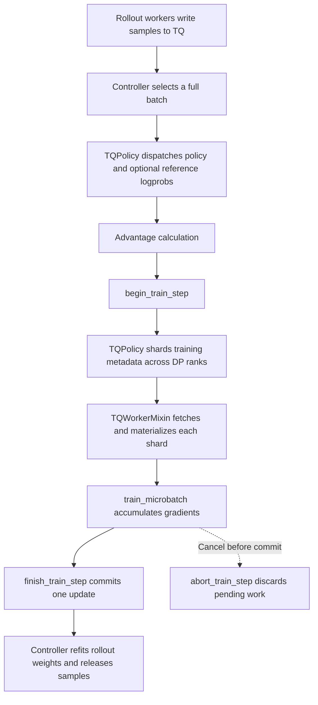
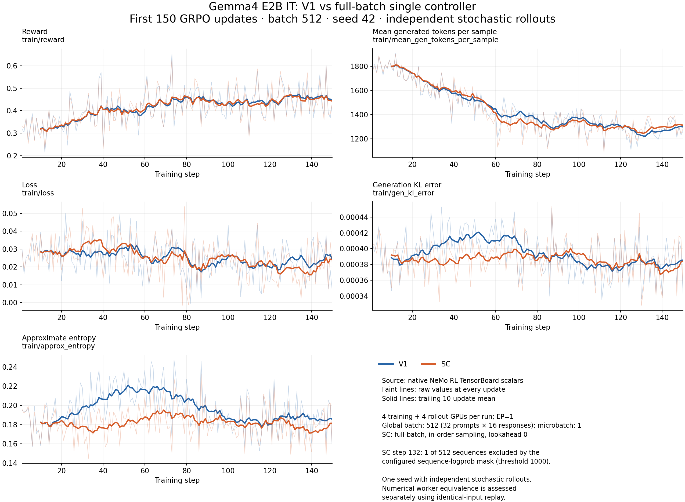
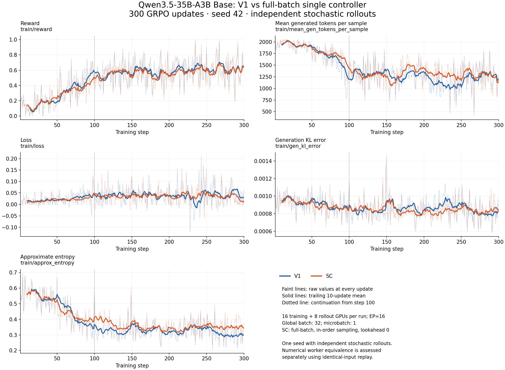

# AutoModel single-controller: full-batch implementation design

## Overview and scope

AutoModel integrates with the single-controller (SC) runtime through a split
training lifecycle: compute gradients, then commit or cancel the optimizer
step. This lets the shared controller own rollout admission, training dispatch,
and weight synchronization while AutoModel owns model execution and optimization.
The [single-controller guide](../guides/single-controller.md) describes the
controller, sampler, and rollout architecture shared with the Megatron backend.
This document describes the AutoModel worker contract and its full-batch execution.

Supported scope is text GRPO, full-parameter FSDP2, TP=CP=1, fixed
microbatches, disaggregated async vLLM, `in_order`, and lookahead zero. Dense and
MoE models use the same lifecycle. Expert parallelism uses AutoModel's existing
MoE mesh, dispatcher, gradient synchronization, and distributed clipping.
Configure expert parallelism and the dispatcher through the existing AutoModel
settings. Supported expert layouts, model architectures, and weight-refit formats
remain subject to the AutoModel and generation backends.

Packing, dynamic batching, HSDP, CPU offload, LoRA, draft training, VLM,
quantization, PPO, distillation, colocation, and streaming dispatches are outside
the supported scope. Configuration validation rejects unsupported combinations before allocation;
worker guards also protect direct lifecycle callers.

## Configuration entrypoint

Start from `examples/configs/grpo_math_1B_automodel_single_controller.yaml`:

```bash
uv run examples/run_grpo_single_controller.py \
  --config examples/configs/grpo_math_1B_automodel_single_controller.yaml
```

This exemplar inherits `grpo_math_1B.yaml` and supplies the supported AutoModel
SC settings: async vLLM on separate GPUs, TransferQueue, in-order sampling with
zero lookahead, fixed microbatches, and full-batch admission. The default layout
uses one training GPU and one rollout GPU. Global batch size, admission threshold,
and buffer capacities follow the configured prompt/generation counts.
Checkpointing is disabled in the base; enabling it retains optimizer and native
TQ replay state. Configure the run length, model, workload, and resources for
the intended experiment.

Model-specific examples inherit the same exemplar:

| Recipe | Training resources | Rollout resources |
| --- | --- | --- |
| [Gemma4 E2B IT](../../examples/configs/recipes/llm/grpo-gemma4-e2b-it-1n8g-automodel-single-controller-full-batch.yaml) | 4 GPUs, EP=1 | 4 GPUs |
| [Qwen3.5-35B-A3B Base](../../examples/configs/recipes/llm/grpo-qwen3.5-35ba3b-base-3n8g-automodel-ep16-single-controller-full-batch.yaml) | 16 GPUs, EP=16 with HybridEP | 8 GPUs, TP=8 |

One rollout batch must supply exactly one global training batch:

```text
GBS = num_prompts_per_step × num_generations_per_prompt
GBS % (DP size × MBS) = 0
```

Full-batch admission waits for all prompt groups before dispatch. The worker then
accumulates gradients over its local microbatches. For example, GBS=32, DP=16,
and MBS=1 gives two forward/backward microbatches per rank and one optimizer
update. The full-batch restriction describes the dispatch boundary, not the
number of model forward/backward calls.

## Interfaces and ownership

`setup_single_controller` constructs `TQPolicy`. Its methods delegate through
`TQWorkerMixin` to the backend's `begin_train_step`, `train_microbatch`,
`finish_train_step`, and `abort_train_step`. These lifecycle interfaces and the
separation of backward from optimizer commit match the Megatron backend.



Logprob calculation uses the existing AutoModel `get_logprobs` and reference
logprob methods through TQ's metadata wrappers. Workers fetch the required input
columns and write logprobs back to TQ for advantage and loss computation. This
phase is separate from the forward/backward calls that accumulate gradients.

An internal `_TrainStepState` holds the loss function, GBS/MBS, dispatch status,
completed metrics, and snapshots of mutable model state needed for cancellation.
The worker creates this state at begin and releases it at finish or abort. At
most one logical optimizer step can be open; the one-dispatch restriction is an
explicit full-batch execution constraint.

| Operation | Preconditions | Work and ownership |
| --- | --- | --- |
| Begin | Idle, valid capability/batch configuration | Snapshot buffers and router load counters; clear gradients; open state. |
| Dispatch | Open, no attempted dispatch | Check every DP rank has GBS/DP rows; compute all backend microbatches; retain gradients and metrics. |
| Finish | Dispatch completed | Clip, optimizer step, existing MoE gate-bias hook, scheduler step; return metrics; release step. |
| Abort | Open or idle | Restore pre-step buffers/router counters and discard gradients; no optimizer/scheduler update; idempotent. |

Mark dispatch attempted before execution. A failure requires abort before a new
step; a second dispatch cannot double-count gradients. DP row validation uses a
collective minimum/maximum before forward collectives. It rejects short and
oversized batches. Full-batch admission requires the streaming threshold to equal
prompts per step and zero prompt-drop budgets.

Commit failures are not transactional: optimizer updates cannot be rolled back.
The worker becomes unavailable for further SC steps after a failed commit and
requires recovery. Abort never clears that failure. Callers must not interleave
legacy `train()` with an open SC step. Abort does not rewind RNG or controller
rollout state.

## Numerical implementation

The synchronous `train()` method owns its complete training loop. SC implements
the split lifecycle using the same numerical primitives, so model execution,
loss normalization, gradient handling, and metrics follow the established
AutoModel implementation:

| Primitive | Responsibility |
| --- | --- |
| `check_sequence_dim` | Validate sequence axes. |
| `process_global_batch` | Select the complete local batch and collectively compute valid-token/sequence denominators. |
| `get_microbatch_iterator` | Existing batching and input preparation. |
| `LossPostProcessor` | Existing loss, precision-independent normalization, and metrics. |
| `automodel_forward_backward` | Forward/backward microbatches, autocast, FSDP and router-replay contexts. |
| `aggregate_training_statistics` | Existing metric reductions. |
| `scale_grads_and_clip_grad_norm` | Existing distributed clipping and norm calculation. |

The dispatch uses `num_global_batches=1` and known global denominators. It may
perform many forward/backward passes. Gradient clipping, optimizer and scheduler
each happen once at finish. Learning-rate metrics record the pre-update rate,
matching V1. Retained-gradient logprob phases are allowed; finish restores training
mode before the model's gate-bias update hook.

AutoModel's `Gate` accumulates `_cumulative_expert_load` outside registered
buffers. Snapshot and restore that counter explicitly, alongside model buffers,
so aborted samples do not affect the next successful bias update. Dispatcher
temporary tensors are released through the existing `release_moe_dispatcher_state`
utility after completion/cancellation. Additional model-owned mutable state
must be accounted for when extending architecture support; parameter rollback
after commit is not promised.

## Forward padding and expert parallelism

TQ stores variable-length token columns and reconstructs padded tensors when
the driver or workers fetch them. Each model dispatch carries a shared
`GLOBAL_FORWARD_PAD_SEQLEN` in its metadata. The target is computed from the
longest valid sequence and all applicable alignment requirements:

```python
alignment = lcm(
    policy["make_sequence_length_divisible_by"],
    producer_padding_multiple,
    dynamic_batching_sequence_round,
)
target_length = round_up(longest_sequence, alignment)
```

`TQDriverMixin._stamp_pad_seqlen` computes the target before DP sharding.
`TQPolicy._stamp_placed_pad_seqlen` applies the same constraints across metadata
batches already assigned to ranks. Driver reads and worker fetches use that
target; valid sequence lengths are preserved and added token-mask positions
are zero. Dispatch metadata is isolated per consuming model so one model's
alignment or an inherited stale target does not dictate another model's shape.

The Qwen3.5 HybridEP recipe sets `make_sequence_length_divisible_by: 64`.
This provides aligned input shapes for HybridEP's default 64-token chunks:
its combine kernel requires the configured per-rank token capacity to be a
multiple of the chunk size. For a longest sequence of 2336, the padded target
is 2368. TQ honors the configured alignment; it does not infer the dispatcher's
requirements or change its chunk size. The generic TQ calculation also handles
dynamic-rounding constraints, although AutoModel SC currently rejects dynamic
batching.

## Checkpoint and recovery boundary

Trainer checkpoints are taken at completed step boundaries. The worker's open
`_TrainStepState`, pending gradients, and cancellation snapshots are temporary;
they are not an independently resumable partial training step. Model and
optimizer restoration use the existing AutoModel checkpoint path.

The controller separately owns dataloader progress, sampler position, rollout
recovery, and the TQ snapshot. Enable optimizer and data-plane saving when
continuing training from a checkpoint. See
[Checkpointing and Replay Recovery](../guides/single-controller.md#checkpointing-and-replay-recovery)
for the shared checkpoint contents and replay behavior.

## Extension boundaries

Later streaming work replaces the one-dispatch guard with accumulation accounting
and defines cross-chunk normalization/FSDP synchronization. It retains the four
public lifecycle methods and existing numerical primitives. Lookahead and sampler
selection remain controller concerns. Packing/dynamic batching need a distinct
row-count/participation contract. Broader parallelism and model features receive
capability-specific tests rather than dense-versus-MoE implementations.

## Matched training curves

The following figures compare V1 and full-batch SC on Gemma4 E2B IT and
Qwen3.5-35B-A3B Base. The paired configurations use the same model, optimizer,
seed 42, and sampling settings. SC uses full-batch dispatch, in-order sampling,
and lookahead zero. V1 uses legacy Ray data transport; SC uses TQ.

| Model | Plotted updates | Prompts × responses per prompt | Global batch | Microbatch |
| --- | ---: | ---: | ---: | ---: |
| Gemma4 E2B IT | 1–150 | 32 × 16 | 512 | 1 |
| Qwen3.5-35B-A3B Base, EP=16 | 1–300 | 8 × 4 | 32 | 1 |

Both comparisons use a 4,096-token total sequence limit and at most 2,048
generated tokens. Dynamic sampling and reward shaping are disabled. Rollouts
are sampled independently, so these curves describe training behavior for one
seed; they do not establish exact numerical parity or statistical quality
equivalence. Identical-input worker replay provides the separate numerical
equivalence evidence. These runs do not include held-out evaluation.

All five panels use the original NeMo RL metric names: `train/reward`,
`train/mean_gen_tokens_per_sample`, `train/loss`, `train/gen_kl_error`, and
`train/approx_entropy`. The figures use native training scalar records. Each
panel includes every update in its stated window, with no nonfinite values or
removed outliers. Faint lines show raw values; solid lines show trailing
10-update means, starting at update 10. The logged metrics retain the configured
sample masking behavior.

### Gemma4 E2B IT: batch 512, 150 updates

Each run uses four training and four rollout H100 GPUs, with EP=1. The figure
uses the shared first 150 updates of the larger-batch comparison. Mean reward
increases from 0.3653 in updates 1–50 for both paths to 0.4494 for V1 and 0.4452
for SC in updates 101–150.

To reproduce the SC batch configuration with the Gemma4 recipe above, use:

```bash
uv run examples/run_grpo_single_controller.py \
  --config examples/configs/recipes/llm/grpo-gemma4-e2b-it-1n8g-automodel-single-controller-full-batch.yaml \
  grpo.num_prompts_per_step=32 \
  grpo.num_generations_per_prompt=16 \
  grpo.max_num_steps=150
```

Global batch size and full-batch admission capacities follow the prompt counts
through the exemplar's interpolations. The checked-in recipe retains its smaller
starter batch; the curves use the overrides above.



### Qwen3.5-35B-A3B Base: EP=16, 300 updates

Each run uses sixteen training H100 GPUs with HybridEP and eight rollout H100
GPUs with TP=8. The histories include checkpoint/resume and contain updates
1–300 once. Mean reward increases from 0.2919 / 0.2766 (V1 / SC) in updates
1–100 to 0.6172 / 0.5981 in updates 201–300. The final 20-update means are
0.6281 / 0.6219. SC policy-version lag stays zero in both model comparisons.

Use the Qwen3.5 recipe above with `grpo.max_num_steps=300` for this run length.


