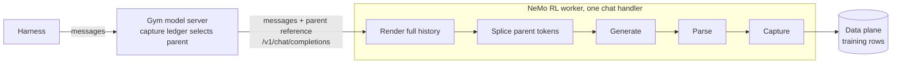
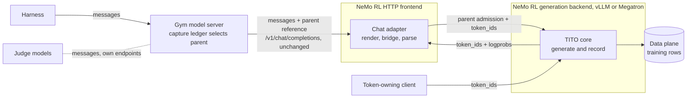
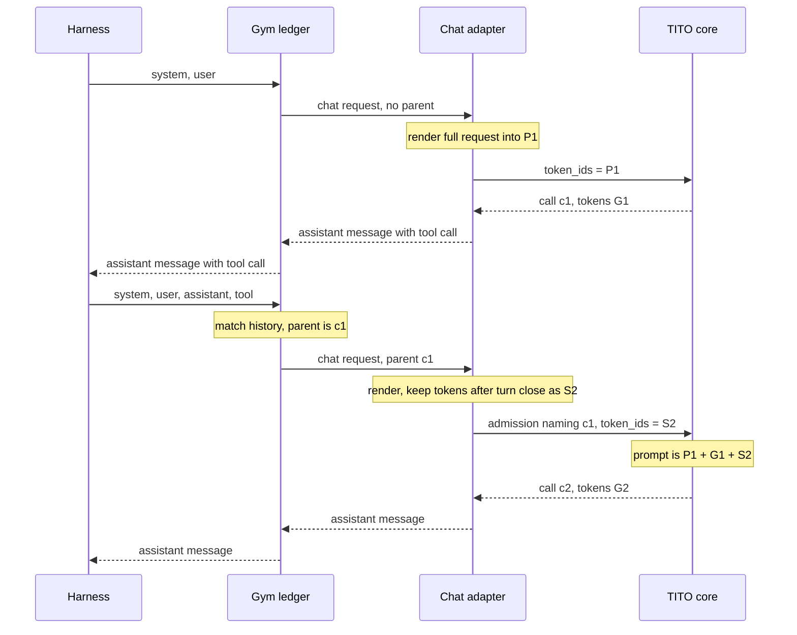
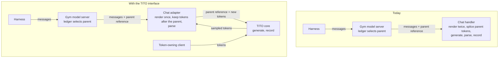

# Token-In/Token-Out (TITO) Inference Interface

Status: the vLLM backend implements the core route, the chat adapter, and startup qualification behind `vllm_cfg.tito_interface` (off by default), and the Megatron backend takes token-in/token-out calls through its completions route; see the [guide](../guides/tito-interface.md) and [Implementation status](#implementation-status). No matching rule in Gym was changed.

## Summary

- NeMo RL serves rollouts through a message-in/message-out interface (`/v1/chat/completions`). Rendering, prefix reuse, generation, parsing, and token capture all happen inside one request handler.
- This design makes **token-in/token-out the inference contract of NeMo RL** and moves everything that deals with messages into an explicit **chat adapter** in front of it.
- Messages stay where they are needed: agent harnesses, tool execution, and judge models keep using chat requests.
- The adapter is built from off-the-shelf parts: the tokenizer's own Jinja chat template for rendering and vLLM's parsers for the response. No per-model renderer is written by hand.
- The existing chat path stays as it is and remains the default until the new path is qualified.

## Requirements

These came out of the discussion that started this work. The right-hand column says where each one is addressed.

| Requirement | Where addressed |
| --- | --- |
| Provide TITO, and keep the existing message path | [Compatibility and rollout](#compatibility-and-rollout) |
| Do not make users re-implement tokenization or templates per model | [Chat adapter](#chat-adapter), [Qualification](#qualification) |
| Keep using the model's own Jinja chat template, including unusual ones | [Chat adapter](#chat-adapter) |
| Decide what must be TITO and what stays as messages (tool calls, judge models) | [Where the boundary is](#where-the-boundary-is) |

## Terms

| Term | Meaning |
| --- | --- |
| Token shift | The engine is conditioned on tokens that differ from the ones the model generated earlier in the same rollout. |
| TITO | A model call whose input is token IDs and whose output is token IDs. No text round trip for model-generated tokens. |
| Token capture | The existing mechanism that records each call's tokens and matches a request to the earlier call it continues ([ledger design](token-capture-ledger.md)). |
| Root | A call whose prompt is rendered entirely from text, because it is the first call or because no earlier call could be identified as its parent. |
| Parent | The earlier call in the same rollout whose prompt and generated tokens are a prefix of this call's prompt. |

## Background

### What exists today

A Gym rollout calls the policy like this:



1. Gym matches the request history against captured calls and selects a parent.
2. Gym forwards the chat request. The parent's tokens travel either inline (`required_prefix_token_ids`) or by reference to the data plane (`staging_chain`).
3. The worker renders the full history with the chat template, replaces everything up to the parent's final EOS with the parent's stored tokens (`splice_prefix_tokens`), generates, parses the output into a chat message, and records the call.

When a parent is found, this already produces a prompt without token shift.

### Why this is not a complete TITO

| Gap | Detail |
| --- | --- |
| No token contract | The only public interface accepts messages. A client that already owns the token sequence cannot submit it. |
| TITO is a side effect | Prefix reuse is an optimization inside the chat handler. Whether a call was token-in is visible only afterwards, in `finalize/token_in_rate`. |
| Silent fallback | When no parent is found the call becomes a root and the whole history is re-rendered. Nothing rejects, warns, or counts by reason. |
| Opt-in | A recipe that leaves token capture off gets no protection. |
| Entangled implementation | Rendering, splicing, parsing, and capture are patches on vLLM's chat serving class, so the behaviour cannot be tested or reused as separate pieces, and each backend re-implements it. |
| Boundary by convention | The splice finds the turn boundary by counting EOS tokens. No per-model check confirms this matches the template. |

### What other systems do

| System | Token owner | How the next prompt is built | Limitation for us |
| --- | --- | --- | --- |
| [renderers](https://github.com/PrimeIntellect-ai/renderers) | Client | Hand-written Python renderer per model family; `bridge_to_next_turn` appends only new messages | About 30 hand-written renderers that mirror the Jinja templates. The generic fallback cannot bridge and re-renders the full history. |
| vLLM 0.33 | Client | `/v1/chat/completions/render` → `/inference/v1/generate` → `/v1/chat/completions/derender` | Stateless. Each render is a full render, so it has no notion of a parent and does not prevent token shift by itself. |
| Miles | Session server | Stored prefix plus rendered suffix, matched by session ID and message prefix | Same parent-matching problem as ours. |
| verl | In-process agent loop | Loop appends tokens itself | Requires the agent to run inside the trainer; HTTP harnesses are not covered. |

vLLM 0.33.0 is the version NeMo RL pins. Its token-in/token-out routes live in `vllm/entrypoints/scale_out/` and were confirmed by reading the v0.33.0 source; they have not been exercised inside the NeMo RL worker yet.

## Goals and non-goals

Goals:

1. A token-in/token-out inference contract that every NeMo RL generation backend implements.
2. Model-generated tokens are never re-tokenized within a rollout. Where this cannot hold, the call is a root for a recorded reason and the reason is counted.
3. No hand-written chat template logic. Supporting a new model family needs configuration and a passing qualification run, not a renderer.
4. The existing chat path keeps working unchanged and stays selectable.

Non-goals:

- Changing what harnesses send. They keep sending chat requests and never see token IDs.
- Changing how judge or other auxiliary models are called. They use their own endpoints and tokenizers.
- A new receipt schema, reward policy, or training-row format.

## Design

### Where the boundary is



Compared with the diagram under [What exists today](#what-exists-today), the single chat handler is split in two. Everything to the left of the adapter is unchanged.

| Layer | Speaks | Owns |
| --- | --- | --- |
| TITO core (NeMo RL) | Token IDs only | Generation, logprobs, the token record of each call |
| Chat adapter | Messages on one side, token IDs on the other | Chat template, turn bridging, response parsing, parent matching |
| Harness, tools, judges | Messages | Unchanged |

NeMo RL mandates TITO at the core. Messages exist only in the adapter and above it. This answers which parts are TITO and which are not: tool calls are executed from parsed text, and judges tokenize with their own tokenizer, so both stay on the message side.

### TITO core contract

One endpoint per generation backend, with the same schema.

Request:

| Field | Meaning |
| --- | --- |
| `token_ids` | Tokens to append after the parent, or the full prompt when there is no parent. |
| `ng_capture` | Optional. Gym's capture admission, as on the chat route today. A `token_in` admission names the parent call and where its tokens are staged; a `text` admission starts a root. Without it the call is not recorded. |
| sampling parameters | Temperature, top-p, top-k, maximum tokens, seed. Checked against the sampling profiles as on the chat route. |

Response: `call_id`, generated `token_ids`, `logprobs`, `finish_reason`, `stop_reason`, the prompt length, and where capture staged the call.

The parent reference is the capture admission and not a new field, because the admission already carries the parent call ID, the parent's length, and the location of its tokens.

The engine prompt is

```
prompt(parent) ‖ generated(parent) ‖ token_ids
```

Invariants the core enforces:

1. The prompt is used exactly as submitted. The core does not render, truncate, or re-tokenize.
2. A parent whose tokens are unavailable, or differ in length from the admission, is an error. The core never substitutes a text render.
3. The recorded prompt of a call is the token sequence the engine consumed, so training rows need no further proof of what was sampled.

Passing the parent by reference keeps the request size proportional to the new turn instead of the whole history. It matches how `staging_chain` already keeps large token arrays in the data plane. A client without a parent sends the full prompt in `token_ids`, which is the shape of vLLM's `GenerateRequest`.

On the vLLM backend the route is `POST /v1/tito/generate`; see the [guide](../guides/tito-interface.md).

### Chat adapter

The adapter turns one chat request into one core call and one chat response. It has three stateless steps and one stateful step.

**Render (root calls).** Apply the tokenizer's chat template to the full message list. This is the same template and tokenizer the existing path uses.

**Bridge (continuation calls).** Build only the tokens that follow the parent:

1. Render the full history with the chat template.
2. Count the turn-close tokens in the parent's tokens, and find the same turn close in the rendered sequence.
3. Take the tokens after it as the suffix and submit them with the parent's admission.

Counting turn closes instead of comparing positions keeps the cut in place when the template rewrites earlier turns, for example by dropping their reasoning. A parent that ended without a turn close, because generation hit its token limit, gets the template's close as the first suffix token.

This uses the unmodified template, so it works for any model family whose turns end in a special token. The turn-close tokens are the configured stop tokens and the tokenizer's and generation config's EOS, the same set the existing splice uses; nothing is configured per family. Tokens after a special token do not depend on the text before it, so the suffix is identical to what an incremental renderer would produce.

The existing splice locates the same turn close by rendering the history a second time without the appended messages. The bridge needs one rendering per call.

**Parse.** Convert generated tokens into a chat message with vLLM's reasoning and tool-call parsers, as the existing path does.

**Parent matching (stateful).** The Gym capture ledger stays the owner of which earlier call a request continues. It is unchanged except for the root-policy refinements below.

### Example: two turns

Turn 1. The harness sends `[system, user]`.

| Step | Who | What happens |
| --- | --- | --- |
| 1 | Adapter | No parent. Renders the full request with the chat template into tokens `P1`. |
| 2 | Core | Receives `{ng_capture: root admission, token_ids: P1}`. Generates `G1`, records the call as `c1`. |
| 3 | Adapter | Parses `G1` into an assistant message with a tool call and returns it to the harness. |

Turn 2. The harness runs the tool and sends `[system, user, assistant(tool call), tool]`.

| Step | Who | What happens |
| --- | --- | --- |
| 1 | Ledger | Matches the history to `c1` and selects it as the parent. |
| 2 | Adapter | Renders the full history, finds the turn-close token of the last assistant turn, and keeps only the tokens after it: `S2` (the tool message and the assistant opener). |
| 3 | Core | Receives `{ng_capture: admission naming c1, token_ids: S2}`. The engine prompt is `P1 ‖ G1 ‖ S2`. Generates `G2`, records `c2`. |
| 4 | Adapter | Parses `G2` and returns it. |



`G1` reaches the engine in turn 2 as the tokens the model sampled. The assistant text the harness sent back is used only for matching.

### Qualification

A chat template is qualified once, at server startup, by replaying a fixed set of conversations and requiring that the bridged tokens:

1. contain the appended messages in order and nothing from the history,
2. do not depend on what the parent generated, and
3. start with the template's turn close when the parent ended without one.

A template that fails qualification stops the server from starting with the TITO path enabled. This replaces boundary detection by convention with a checked property. The fixed conversations are shared with the startup qualification written for PR #5128.

A fourth property, that rendering a message and parsing it back returns the original message, is not checked yet.

### Failure semantics

| Situation | Behaviour |
| --- | --- |
| No parent because this is the first call | Root. |
| Tools or template arguments changed | Root, counted. The context really changed. |
| History rewritten or compacted by the harness | Root, counted. Rejected instead when `vllm_cfg.tito_reject_root_reasons` lists the reason; the same switch covers every root reason except `first_call`. |
| Several candidate parents with identical token sequences | Use any of them. |
| Several candidate parents with different token sequences | Root, counted. |
| Appended items include harness-authored non-user messages | Bridge them; the parent's tokens are still valid. |
| Parent selected but the turn-close token is not found | Error. This indicates a qualification gap, not a harness behaviour. |
| Core receives an admission whose parent tokens are unavailable or of the wrong length | Error. |

Two situations cannot be removed by any design that accepts text histories: a rewritten history and changed render options. They are measured, and a recipe can choose to fail on them.

### Observability

| Metric | Purpose |
| --- | --- |
| `finalize/root_reason_<reason>_count` | Which reasons produce roots. |
| `finalize/rerooted_tokens` | Total length of the roots that are not a first call. Each of them re-rendered its history from text, so this bounds how many tokens could have shifted. It counts every token of those calls, not only model-generated ones. |
| Qualification result | A template that fails stops the server at startup with the failed property. |

A threshold on the root rate, excluding `first_call`, is the acceptance signal for a recipe and can gate CI.

### Compatibility and rollout

- The existing chat path and its configuration are untouched. The TITO path is selected by configuration and is off by default.
- Both paths share the capture ledger, the data plane, and the training-row format, so a recipe can switch between them without other changes.
- Once the TITO path is qualified for a recipe's model family, the chat endpoint can be served by the adapter, and the patched chat handler retired for that family.

### Where the adapter runs

| Option | For | Against |
| --- | --- | --- |
| In the NeMo RL HTTP frontend processes (recommended first step) | Tokenizer, template, and parsers are already loaded there; no new dependency in Gym; frontends already scale horizontally | Rendering cost stays on the inference nodes |
| In the Gym model server | Inference nodes handle tokens only | Gym needs the tokenizer and vLLM's parsers, pinned to the same version as the engine |

The core contract is the same in both cases, so this choice can change later without touching the backends.

### Relation to PR #5128

PR #5128 adds an incremental renderer for Qwen3 inside the existing chat handler. In this design it becomes an optional optimization of the bridge step: it avoids the full render per turn for families that have a qualified suffix renderer. It is not required for correctness and should not be merged in its current position. Until it is folded into the bridge, `vllm_cfg.tito_model` and `vllm_cfg.tito_interface` cannot both be set.

## What changes and what does not



The harness and Gym are the same in both. The one chat handler becomes an adapter and a core, and a client that already holds tokens can call the core directly.

| Aspect | Today | This design |
| --- | --- | --- |
| Public interface | `/v1/chat/completions` only | A token-only core endpoint is added; the chat endpoint stays |
| Status of TITO | An optimization inside the chat handler, visible only afterwards | The contract of the inference layer; the core does not accept text |
| Code structure | Render, splice, generate, parse, and capture in one patched vLLM handler | Two layers: core (generate and record) and adapter (render, bridge, parse, match) |
| Parent not found | Silent full re-render, one aggregate rate | A defined behaviour per reason, counted per reason |
| Invalid parent reference | Falls back to a text render | Error |
| Turn boundary | Found by counting EOS, not checked per model | Checked per model family at startup |
| Recipe without token capture | No protection | The TITO path always records tokens |
| Client that owns its tokens | Must send messages | Calls the core directly; no token shift by construction |
| Backends | vLLM and Megatron each implement their own handling | Both implement one core contract and share the adapter |
| Metrics | `finalize/token_in_rate` | Root reasons, shifted-token counts, qualification results |

Unchanged:

- What harnesses and Gym send: chat messages.
- Parent matching: the Gym capture ledger.
- The data plane and the training-row format.
- The chat template, tokenizer, and parsers.
- The existing path, which stays the default.

## Expected effect on token shift

When a parent is found, the existing path already produces a prompt without token shift, and this design produces the same tokens. The design does not by itself lower token shift in that case.

It removes token shift directly in three situations:

- recipes that run without token capture,
- calls where the splice boundary does not line up after message conversion,
- calls where the appended items include non-user messages written by the harness.

It cannot remove token shift caused by a harness that rewrites or compacts history, or by changed tools and template arguments.

How large each situation is has not been measured. Phase 0 exists to measure it, and the benefit of Phases 1 to 3 should be judged against those numbers.

The value of the design is therefore: a contract where there was a side effect, token shift that is measured and can be gated, and one place to add backends, model families, and token-owning clients.

## Phases

| Phase | Scope | Acceptance | Status |
| --- | --- | --- | --- |
| 0 | Root-reason counts and re-rooted token counts on the existing path | Distribution measured on the SWE recipe. This sizes the benefit of every later phase. | Metrics implemented. Measured on 16 SWE rollouts of two tasks; see [SWE smoke](#swe-smoke). |
| 1 | TITO core endpoint on the vLLM backend; capture reads from it | A client submitting tokens directly reproduces the same training rows as the chat path on a fixed rollout. | Implemented. Checked on one two-turn conversation and by training rows built from the route in a unit test. |
| 2 | Chat adapter with render, bridge, parse, and startup qualification for Qwen3 | Token-identical prompts to the existing splice path on the SWE recipe; existing path still passes. | Implemented. Token-identical on test conversations. The SWE smoke ran two steps with identical root statistics in the first step; prompts were not compared token by token there. |
| 3 | Root policy changes chosen from Phase 0 data; rejection mode; more model families | Agreed root-rate threshold met. | Rejection mode implemented (`vllm_cfg.tito_reject_root_reasons`). No matching-rule change made: in 299 measured calls no root had a reason that a rule change would recover. The rules live in Gym. |
| 4 | Megatron inference backend implements the core contract | Same metrics and thresholds. | Implemented: the core contract on the existing `/v1/completions` route and the bridge on the chat route. Checked against a Megatron inference server, not on a Gym recipe. See [Megatron backend](#megatron-backend). |

## Implementation status

| Piece | Where |
| --- | --- |
| Request and response schema, bridge, qualification | `nemo_rl/models/generation/tito.py` |
| Core route `POST /v1/tito/generate` and parent resolution | `nemo_rl/models/generation/vllm/tito_route.py` |
| Chat adapter, startup qualification, route registration | `nemo_rl/models/generation/vllm/vllm_worker_async.py` |
| Configuration key `vllm_cfg.tito_interface` and its checks | `nemo_rl/models/generation/vllm/config.py` |
| `finalize/rerooted_tokens` | `nemo_rl/experience/rollout_reassembler.py` |

What has been verified:

| Check | Result |
| --- | --- |
| Bridge against the existing splice, Qwen3-0.6B tokenizer: parents that end on `<|im_end|>`, on `<|endoftext|>`, and without a turn close; four kinds of appended messages; thinking on and off | Token-identical in all 24 cases |
| Qualification | Accepts the Qwen3 template; rejects three templates built to violate one property each |
| Real vLLM 0.33.0 server, two H100 GPUs, Qwen3-0.6B: a two-turn chat keeps the first turn's sampled tokens in the second prompt | Passed |
| Same server: the second prompt submitted to the core route returns the same tokens and log probabilities as the chat route | Passed |
| Same server: the existing merged-prefix test with the interface on and off | Same expected tokens on both paths |
| Core route with Gym's capture: a root call and its continuation linearize into one training row | Tokens, loss mask, and log probabilities as expected |
| Megatron inference server, two H100 GPUs, Qwen3-0.6B: a completions call that sends only the tokens after its parent, with the parent named by its staged record | The staged record shows the engine consumed the parent followed by the submitted tokens |
| Same server: a two-turn chat with the splice and with the bridge | Both stage the same tokens after the parent |
| Prompt construction on CPU, Qwen3-0.6B tokenizer, prefixes of 677, 5157, and 20517 tokens, 30 alternating measurements each | The bridge is 1.9 times as fast as the splice at every length, with identical tokens. Rollout throughput is not measured. |

### SWE smoke

Two GRPO steps of the SWE-bench Verified smoke recipe (Qwen3-0.6B, one prompt, two generations per prompt, seed 42), once with the interface off and once with it on. Both runs finished without a bridge error.

| Step | Arm | Calls | Token-in | `first_call` roots | `no_prefix_match` roots | `finalize/rerooted_tokens` |
| --- | --- | --- | --- | --- | --- | --- |
| 1 | Off | 10 | 6 | 2 | 2 | 11504 |
| 1 | On | 10 | 6 | 2 | 2 | 11504 |
| 2 | Off | 2 | 0 | 2 | 0 | 0 |
| 2 | On | 9 | 7 | 2 | 0 | 0 |

The first step is the same in both arms, as expected when the two paths build the same prompts. The second step differs in how many calls the agent made, which this sample cannot attribute to the interface: sampling is not deterministic across runs and each step has two rollouts. The loss and gradient norm were zero in both arms, so the smoke shows that data flows through training and nothing about learning.

A longer run with the interface on, eight steps and sixteen rollouts on the same two tasks, finished without a bridge error or a poisoned rollout:

| Arm | Calls | Token-in | `first_call` roots | `no_prefix_match` roots | Other root reasons | `finalize/rerooted_tokens` | Rollout time |
| --- | --- | --- | --- | --- | --- | --- | --- |
| On | 299 | 276 (92.3%) | 16 | 7 (2.3%) | 0 | 53224 | 691 s |
| Off | 154 | 135 (87.7%) | 16 | 3 (1.9%) | 0 | 21681 | 659 s |

The same eight steps were then run with the interface off. The two arms made different numbers of calls, so their totals are not comparable. Rollout time is not either: a step took about 70 seconds with two or three calls in both arms, which is sandbox startup and patch verification. The closest matched steps are one with 105 calls in 133.4 seconds with the interface off and one with 103 calls in 132.5 seconds with it on. These runs show no rollout-throughput difference between the paths, and they are too few to bound one.

The only root reason other than `first_call` was `no_prefix_match`, which no design that accepts text histories can recover. `ambiguous_candidate`, `non_user_suffix`, `render_options_changed`, and `worker_rooted` did not occur, so these runs give no reason to change the matching rules. They cover two tasks, one agent harness, and a 0.6B model; a different harness can produce a different distribution.

### Megatron backend

The Megatron-LM text generation server already takes token prompts: `POST /v1/completions` accepts `prompt` as a list of token IDs, forwards `offload_params` to NeMo RL's prompt preparer, and returns `prompt_token_ids`, `generation_token_ids`, and `generation_log_probs`. That route is the core on this backend, so nothing has to change in Megatron-LM.

| Call | Request |
| --- | --- |
| Not recorded | `prompt` is the full prompt. |
| Root | `prompt` is the full prompt; `offload_params.ng_capture` is a `text` admission. |
| Continuation | `prompt` is the tokens after the parent; `offload_params.ng_capture` is a `token_in` admission; `offload_params.ng_tito_append` is `true`. |

For a continuation, `TQMegatronPromptPreparer.prepare_prompt` resolves the parent's tokens and prepends them. Recording through `TQMegatronTokenStager` is unchanged.

The Megatron chat route uses the shared bridge instead of the splice when `mcore_generation_config.tito_interface` is true. It is off by default.

Limits on this backend:

- Verified with three tests against a Megatron inference server with Qwen3-0.6B, and not on a Gym recipe. The SWE smoke cannot run on this backend with this model: the pinned Megatron-LM has tool-call parsers for the Qwen3-Coder and Nemotron formats only, so Qwen3-0.6B's tool calls are not parsed and a rollout has no second turn.
- The chat template is qualified when token capture is set up, with the tokenizer's EOS and the configured stop tokens as turn closes. The endpoint sends its own EOS set with each request, which is not compared with the qualified one.
- The sampling-profile check and `tito_reject_root_reasons` are not applied to this backend.

What the first implementation leaves out:

- Media prompts, routed experts, sampler top-k capture, and generation-prefix cuts. Enabling the interface together with any of them fails at startup.
- The parse round-trip qualification property.
- The incremental suffix renderer of PR #5128 as a bridge optimization.
- Streaming on the core route.

## Open decisions

Each decision is still open. The recommendation is the author's proposal for review.

### 1. Adapter placement

Options: the NeMo RL HTTP frontend first, or the Gym model server from the start.

**Recommendation: the NeMo RL frontend first.**

- The tokenizer, the chat template, and vLLM's parsers are already loaded there. In Gym they would have to be pinned to the engine's version, and a mismatch would change parsing without an error.
- Parent tokens already live in the NeMo RL data plane (`staging_chain`), so bridging next to them avoids moving large token arrays to Gym and back.
- The core contract is the same for both placements, so the adapter can move to Gym later without touching the backends. Moving in the other direction means removing dependencies from Gym.

The core still accepts tokens only, so this placement keeps TITO mandatory in NeMo RL.

### 2. Endpoint shape

Options: mount vLLM's `/inference/v1/generate` schema with a `parent_call_id` extension, or define a NeMo RL schema shared with Megatron.

**Recommendation: a NeMo RL schema, with field names aligned to vLLM's `GenerateRequest` where they overlap.** The first implementation follows it, and uses the capture admission as the parent reference instead of a separate `parent_call_id` field.

- The Megatron backend is not vLLM and should not have to imitate another project's interface.
- vLLM's token routes have moved between releases, so a contract tied to them would change with every upgrade.
- `parent_call_id` and `ng_capture` are extensions in either case.
- Shared names for `token_ids` and the sampling parameters keep the shim thin for clients that already call vLLM's endpoint.

### 3. Rewritten history

Options: start a root and count it by default, or reject the request by default.

**Recommendation: root and count by default; rejection as an opt-in mode.**

- Context compaction is normal in long rollouts. Rejecting by default would fail those rollouts.
- A root's training row is still self-consistent: the recorded prompt is what the engine consumed. The cost is conditioning quality and a prompt-cache miss, not incorrect data.
- It matches the existing path, so metrics from both paths are directly comparable.
- Rejection mode serves CI checks of a harness and experiments that require zero token shift.

### 4. Default path

Question: when the TITO path becomes the default for multi-turn Gym recipes.

**Recommendation: switch per model family, when all of the following hold. No calendar date.**

1. The family passes startup qualification.
2. Prompts are token-identical to the existing splice path on the SWE recipe.
3. The root rate is not higher than on the existing path.
4. Rollout throughput does not regress.
5. The path has been available as an option for at least one release without new failures.

The existing path must be kept, so changing the default is the last step and needs data. Qualification is per family, so the default is per family too.

## Questions from review

**Gym calls `/v1/chat/completions` today. Does Gym have to change?**

Not on the request path, with the recommended placement. The adapter runs in the NeMo RL frontend and serves the same `/v1/chat/completions` URL with the same request and response, so Gym keeps calling it. The token-only endpoint sits behind the adapter. The only Gym changes are the optional refinements to parent matching listed under [Failure semantics](#failure-semantics). If the adapter later moves into Gym, Gym would call the core endpoint, and that would be a Gym change.

**Does Gym tokenize on its own? If it does, is this still TITO?**

On the token capture path Gym never runs a tokenizer. The ledger selects a parent by comparing digests of message content. Tokens are produced and kept by the worker: with external staging Gym carries only references to them, and in the inline mode it carries back tokens that the engine returned.

TITO is a property of the engine prompt: tokens the model generated are not turned into text and tokenized again. Two Gym features touch tokenization and neither affects that property here:

- Gym asks the engine's `/tokenize` endpoint for prompt lengths. This is a count and does not change the engine prompt.
- `use_completions_api` with `render_chat_template` renders a prompt string inside Gym. That mode is already rejected together with token capture and is not part of this design.

**The token capture path is the one being maintained. Does this design support it?**

Yes. The design is built on it. The TITO path is the token capture path with one step replaced: rendering and splicing inside the chat handler become the adapter and the core. The ledger, admission, data-plane staging, receipts, and training rows are reused. Paths that do not use token capture are not extended.

## Not yet verified

- No root-reason distribution has been measured at a useful sample size, so the share of token shift this design removes is unknown.
- The interface has run 16 SWE rollouts of two tasks with one agent harness. No rollout-throughput difference was seen, on a sample too small to bound one, and the root-reason distribution of other harnesses and tasks is unknown.
- Only the Qwen3 template has been qualified. Qualification is what establishes the bridge for any other template.
- The bridge assumes every turn-close token ends a turn. A recipe whose `stop_token_ids` include a token that the template also emits inside a turn is not supported, and qualification does not detect it.
- vLLM's own render, generate, and derender routes were read in the v0.33.0 source. The implementation calls the engine directly and does not use them.
