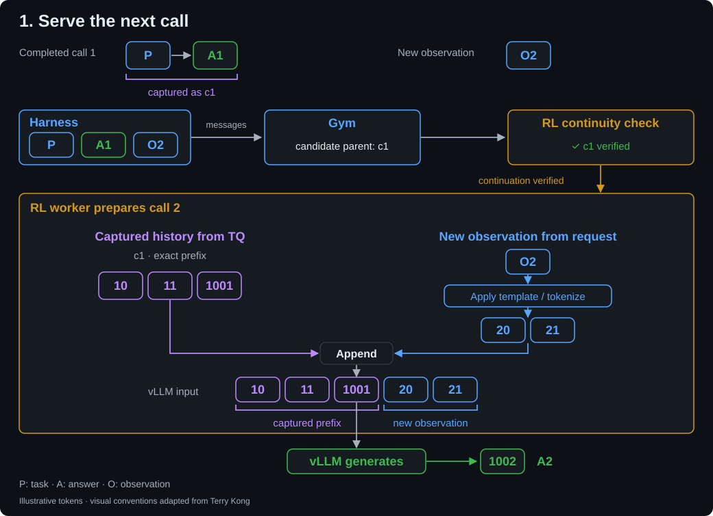
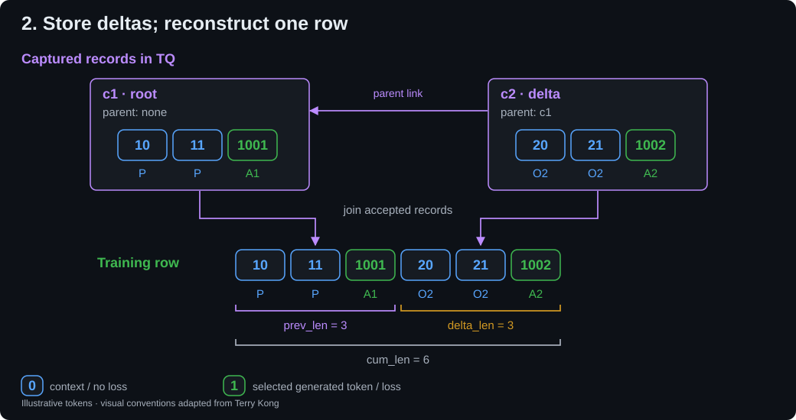
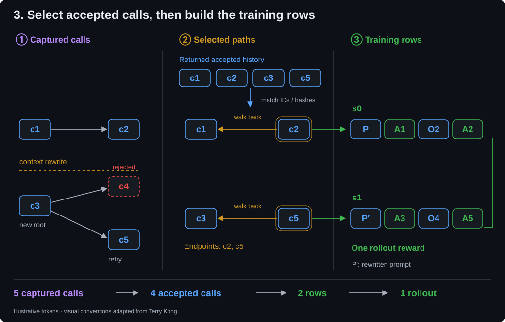

# Context compaction with framework-owned training rows

This opt-in SingleController GRPO path lets a harness rewrite its semantic history while NeMo-RL owns the resulting training rows. It builds on the ordinary worker token/media capture path. It does not patch upstream vLLM.

The underlying mechanism is **forest training**: selected captured calls become
training paths with one reward and advantage per logical rollout. Compaction is
one use case; branches and independent context roots use the same reconstruction.
The walkthrough below uses the default `returned_history` selection policy.

The editable SVG figures below are adapted from Terry Kong’s review illustrations: [data flow](https://terrykong.github.io/gh-pages-poc/terryk/pr-4124-data-flow.html), [calls to rows](https://terrykong.github.io/gh-pages-poc/terryk/pr-4124-calls-to-rows.html), [compaction guards](https://terrykong.github.io/gh-pages-poc/terryk/pr-4124-dropped-group.html), and [batch size](https://terrykong.github.io/gh-pages-poc/terryk/pr-4124-cc-batch-size.html). The reference figures retain his layout and visual conventions, updated for the implementation described here; the three introductory figures expand the same example step by step. Token IDs and row counts in the figures are illustrative.

## Ownership and request flow

The walkthrough follows one rollout from its second model call through storage and final reconstruction. `P` is the initial task, `A1` and `A2` are generated answers, and `O2` is the observation supplied before call 2. `c1`, `c2`, and so on identify captured model calls. TransferQueue (TQ) stores their tensors.

### 1. Serving the next call

Call 1 has already answered the task. The harness supplies the chosen messages for call 2; Gym proposes a predecessor, and RL verifies that it can reuse the predecessor’s exact tokens.



The result is answer A2 generated from the verified historical tokens plus the new observation. This text-only example leaves media out for clarity; the image-processing and retained-media checks are described below.

### 2. Storing the captured contribution

Call 2 has finished. Its record points to call 1 and stores only the new observation and answer. TQ holds the tensors; Gym’s ledger records identities and the inherited (`prev_len`), new (`delta_len`), and total (`cum_len`) token counts shown by the brackets.



If both calls are accepted, their two records reconstruct one training row. The mask in the illustration shows token loss eligibility; rejected calls and invalid rollouts do not become trainable merely because they were captured. Actual captures also include generated logprobs and any required routes/media.

### 3. Selecting and reconstructing training rows

Now the harness rewrites its next context before call 3, then rejects call 4 and accepts retry call 5 with the same observation O4. Its returned accepted history still includes the accepted calls from before compaction.



RL selects calls using the returned history, finds endpoints in that selected graph, and reconstructs two rows. Those rows belong to one logical rollout with one reward and advantage. The rewritten prompt is conditioning context, not a newly generated span eligible for loss in call 3.

### Detailed ownership and validation rules

The Gym integration accepts ordinary rollout output through shared capture. A harness retains its semantic message/image history, applies its own compaction policy, and sends its chosen context through the supported Responses or Chat capture route. Responses clients may request buffered SSE: Gym captures one non-streaming upstream response before emitting its events; incremental engine streaming remains unsupported. It does not supply tokens, segment IDs, TQ parent decisions, or a processed-image arena. The included `simple_agent_with_compaction` uses a recency policy; another harness can choose a different policy.

1. Gym's existing capture middleware assigns the attempt/call identity. The native client sends no parent header. Shared capture matches the current request against existing source-prefix evidence, including an older accepted call after a rejected attempt. It prefers the longest compatible prefix, uses echoed native identities to disambiguate equal matches, and rejects unresolved ambiguity. Gym sends a **candidate** only for a matched prefix followed by user/tool observations, and checks effective render options after conversion and server overrides. Otherwise it sends a parentless root. Candidates explicitly state whether matching needed null/empty assistant tool-content equivalence. Capture atomically records a unique call intent before inference; independent calls within an open attempt may overlap.
2. RL's `decide_capture_input` verifies the converted-message boundary and qualifies the actual renderer if Gym needed null/empty tool-content equivalence. It restores the candidate's exact captured tokens only when these checks pass; unsupported boundaries or renderers start a fresh root. Gym owns source matching, including exposed reasoning even if conversion later removes it. Missing required evidence remains an error; it is not a proven rewrite. Both direct roots and candidates retain framework safety checks and replay metadata.
3. The existing RL vLLM renderer processes all supplied media, resolves any serving prefix from TQ, applies the ordinary token splice, and checks/remaps every retained media occurrence. It captures the actual tokens, generated logprobs, routes, and processed pixels.
4. **A continuation stores a parent-linked delta.** RL commits the verified predecessor using the existing `token_in` record shape. The initial request, each context rewrite, and a complete request whose continuation shape cannot be spliced use a parentless `text` root. `candidate` is admission-only; missing evidence and retained-media mismatches still fail explicitly. Framework capture requires paired Gym/worker revisions supporting the explicit source-match proof; an older candidate without that proof is rejected rather than assumed exact. Persisted staging rows keep their existing schema.
5. Gym accepts the worker-selected root or admitted predecessor, validates the returned coordinates, and records exposed output identities/content fingerprints and completion metadata centrally. The harness returns its ordinary rollout output and verifier reward; it defines no segments and need not return `LogicalCCResult`.
6. RL's shared Gym ingestion identifies accepted whole generations from that ordinary output, then combines the selection with the complete attempt receipt. It validates selected ancestry and builds paths backward from endpoints in the selected forest. A selected call with only discarded children is still a selected endpoint. Twenty calls without compaction produce one trace; one compaction after turn 10 produces two. Twenty staged call records remain small deltas within those chains. Sequential interleaving can resume an earlier chain without creating an extra trace.
7. Every selected generated span contributes loss exactly once across the owner's traces. Shared ancestors remain exact context in every path, but only the first deterministic path owns their loss and action counts. Added observations, summaries and quoted answers have zero loss. Existing logical-owner GRPO supplies one reward/advantage per rollout, independent of segment count, and excludes execution padding. The advantage stage validates complete owners, computes one advantage per owner, and broadcasts it to their physical rows; whole-prompt-group sharding preserves that calculation. Agent-specific reward attribution is separate work, not a property inferred from a path or leaf.



The endpoints belong to the selected graph. Rejected calls contribute no loss; shared selected ancestors remain context in every path but contribute loss only once.

Without a rewrite, the four accepted calls form one continuous chain and one training row. With this rewrite, the two rows keep their own exact conditioning. They still belong to one logical rollout with one reward.

Forest finalization separately authenticates each call's occurrence metadata against its existing extras commitment. It checks media-presence/frame flags, ordered spans entirely inside the new prompt tokens, exact token IDs, per-occurrence H/W, and video frame counts before publication. One bad selected segment invalidates the whole logical rollout. The worker authenticates retained descriptors before using their offsets as well. This reuses the capture descriptors and shared integrity helpers; it does not add a new media store or authenticate pixel contents cryptographically.

The common Gym path accepts `response.output`, ordered `responses`, transition snapshots, or existing `ng_trajectory.turns[].model_calls` references. Native response/item identities constrain whole-generation content matching; synthetic exporter IDs are not treated as native capture identities. Reasoning and function calls are included. Existing trajectory references can select calls directly when no output is supplied; when both are supplied, they must agree. Missing, contradictory, duplicated, or ambiguous evidence raises an error; items within each captured generation must retain their order. RL does not fall back to selecting a graph leaf for this path.

Compaction of the next model input must not erase accepted history from the returned training output. Missing calls inside a selected continuation chain are detected because the predecessor must also be selected. A completely omitted independent chain cannot always be distinguished from a rejected call using capture alone. Capture records what ran, not what the harness accepted. Thus this implementation does not promise compatibility with every exporter: it requires complete accepted history or references and a supported capture route. Stock OpenCode is not qualified by tests of a custom fork. Concurrent capture and shared selected ancestors are supported within one capture owner. Manifest completion order does not constrain selection. The scored terminal must belong to the selection but need not be its last member. Multiple-session aggregation and live multi-agent harnesses still need separate qualification.

`RolloutSelection` is internal to RL's reconstruction; it is not a new object required from Gym harnesses. The current capture protocol types remain in the shared Gym staging package; moving that package is not part of this ownership change.

The small non-Gym adapter test translates an independent episode's action IDs and score into `RolloutSelection` plus an attempt receipt, then exercises actual finalization and cleanup. It supplies no segment IDs or Gym `LogicalCCResult`. This proves the local adapter contract; it does not qualify another harness's HTTP transport or capture gateway.

## Images and TQ

Suppose call 1 sees image A, call 2 sees retained A plus new B, and a policy rewrite makes call 3 see only B. The harness sends A on call 2 because A remains in its semantic history; it does not ask vLLM to fetch raw A from TQ. Normal vLLM processing produces that call's pixels. TQ supplies historical exact tokens and media descriptors when a serving splice is requested.

The staged records contain A for call 1, only new B for continuing call 2, and B in full for rewritten call 3. Finalization publishes two traces: calls 1–2 with A+B, and call 3 with B. Training uses captured processor outputs through the foundation `PackedTensor` path. No special image preprocessing for forest training or `MediaArena` is needed.

Retained geometry includes patch dimensions, token count, placeholder coordinates and embedding spans. RL also compares the current retained processor tensors to existing TQ media bundles before omitting them from a delta. Geometry, token or pixel changes on a continuation fail explicitly before inference; they do not silently create additional segments. A genuine rewrite captures its current geometry and pixels in the new root.

Within a context, each continuation stores only its new token/media delta. A rewrite starts a new root and captures its complete current input, so content retained across a rewrite can appear in both segments. Repeated full per-call storage is not the production baseline.

## Measurement and lifecycle

Each completed call stores one `ReplaySummary`: normalization version, source-item count, ordered source digest, and render-option digest. Gym hashes the corresponding prefix of the next request, checks observation suffix roles, and compares effective render options. RL verifies the converted assistant boundary and any required renderer equivalence before reusing captured tokens. Reasoning, image references, item order, and qualified tool-argument normalization retain their existing semantics.

Candidate admission reconstructs staging ancestry from existing call parent links. The framework-owned route does not persist the full ancestor-key list on every call. Durable metadata therefore grows approximately linearly with call count. Full current-request item comparisons, manifest traversal, transient ancestor lists, and historical-media validation reads still have history-dependent cost; this change does not make total rollout processing linear. Ordinary capture keeps its existing lookup-chain representation.

`/context/{attempt}/measure` uses the same Responses conversion, candidate admission, RL preprocessing and splice decision as generation. It returns a count and an explicit feature acknowledgement, never tokens. It creates no call intent, staged record, or capture acknowledgement. Model/template/processor configuration must remain fixed during an attempt.

Staging wire models use `capture_key` for the current capture attempt. Restored calls use
`source_capture_key` for their earlier staging owner. Gym and RL must upgrade together; logical
rollout IDs and the storage-key and digest formats stay unchanged.

The existing ledger tracks exact attempted call IDs. A missing worker acknowledgement remains pending, even if the HTTP request has ended, because the worker may still have written or be writing. After the agent returns, RL closes new admissions under the ledger lock, then waits up to 300 seconds for already-admitted calls without recorded failures to resolve. A recorded failure ends the wait for that call without acknowledging its writes. If capture remains incomplete, RL masks that entire logical rollout, including any partial history; a first-call failure needs no accepted-response witness. Healthy siblings can still train. A group with no valid input layout is dropped. Pending calls are excluded from immediate cleanup, and their possible late writes remain isolated under the original attempt ID until staging-partition teardown. They cannot become a parent or be reused by a fresh attempt. Repeated ambiguous failures can therefore retain staging storage until teardown.



This figure describes the native recency client. Other harnesses choose their own compaction policies. The uncaught guard-rejection path shown here is a current limitation, not a recommended recovery policy.

Set `async_rl.rollout_failure.nemo_gym.rollout_timeout_s` as a backstop for a hung prompt-group stream; it is not a per-model-call deadline or an acknowledgement that the remote engine stopped. A timeout or transport failure that prevents an agent result drops the prompt group. Forest training follows the existing drop budgets and `async_rl.rollout_failure.min_step_batch_fraction`: a permitted drop can reduce the number of complete prompt groups in a step. Each retained group still requires all logical siblings and their segments. Falling below the configured fraction, or retaining no groups, stops training; the controller logs `dropped_prompt_groups`. Loss normalization uses the retained valid tokens, with one optimizer step and unchanged configured global batch size. Forest training also does not redispatch failed groups because selected-response metadata is request-local; retry support is tracked in [#4557](https://github.com/NVIDIA-NeMo/RL/issues/4557). This differs from masking an invalid sibling while retaining the complete group, which is supported. Data-integrity errors still raise, and operator cancellation still propagates.

Completed attempt receipts retain unselected records for cleanup. Before publication, the fixed selection determines exact canonical row and padding IDs. A lost canonical-write acknowledgement preserves source staging; the controller owns the exact publication cleanup keys. Foreign scope and invalid trainable selection fail before publication.

`select_response` may reject a definite completed response and resample within `max_response_retries` and `max_model_calls`. The client retries the same semantic request; rejected output never enters its history or selected-action result. Shared candidate inference can recover the earlier accepted prefix without a client parent hint. Gym roots a rewritten request; RL can additionally root a candidate whose converted boundary or renderer is unsupported. Measurement uses the same candidate inference without writing an intent. Unresolved candidate ambiguity fails before generation. Transport/read ambiguity closes the client and is never retried automatically.

## Configuration and supported scope

Enable `token_capture.enabled: true` and `token_capture.forest_training: true` on the SingleController GRPO configuration. The former `token_capture.context_compaction` key is rejected with a migration message; rename it while keeping its value. For the included example, select Gym's `simple_agent_with_compaction` and configure its `context_history` policy/guards. RL sets Gym's internal `parent_resolution: source_history` with external `vllm_worker` staging and `rebuild_response: false`.

`token_capture.selection_policy` controls training membership:

- `returned_history` (default) matches ordinary returned history or call references
  to capture records. It preserves the existing evidence requirements and excludes
  calls absent from that history.
- `all_captured` includes recorded calls across abandoned retries and independent
  branches. Unscored leaves with `failed` or `unknown` status, or an `incomplete`
  status with a non-length finish reason such as `content_filter`, are excluded.
  These calls remain selected if they have children or are the scored call, so
  completion checks can mask the rollout. Missing required completion metadata
  remains an error. Length-limited calls remain eligible, subject to the existing
  logical-rollout `overlong_filtering` policy. This policy does not require the
  full execution history, but still requires an attributable scored
  terminal through `terminal_response_id` or the
  returned response's identity/content. Capture order is not a terminal witness.
  For `A → B` and `A → C`, both branches train; it does not choose the latest
  sibling. Shared `A` contributes loss once, and both rows share the rollout's
  reward and advantage.

Both policies reuse capture validation, completion checks, forest reconstruction,
and once-only loss ownership for shared ancestors. Pending calls, lost capture
evidence, and failed selected executions still mask the logical rollout. A failure
record does not acknowledge a pending worker's writes or transfer them to cleanup.
Failed parents and failed scored calls remain invalid. Neither policy infers
agent roles. `all_captured` requires `forest_training: true`; it does not enable
per-agent rewards or remove the execution restrictions below.

A cancellation recorded as `request_finished_without_staged_coordinates` does
not mask the rollout when the call already has a committed capture, no calls
remain pending, and the failed call is outside the selected calls. A failure on
a selected call, a missing capture, or any other capture-failure reason still
masks the rollout. This exception does not add calls to training.

Custom policies use the same setting, for example
`selection_policy: my_harness.training:select_calls`. The module must be importable
in both the controller and Gym actor environments. Policy resolution happens during
configuration validation, so an unknown name, missing import, or non-callable target
fails before rollout.

The synchronous function takes `(records, result)`: this attempt's `list[CallRecord]`
and the ordinary harness result dictionary. It returns
`(selected_records, terminal_response_id)`. Return a nonempty list of unique,
unchanged records from the supplied capture and the served `response_id` of the
scored call within that list. Selection order determines root/path priority;
captured parents still determine reconstruction. The interface permits `None` as
the terminal type, but a trainable selection must identify its scored response;
the adapter rejects a missing terminal rather than guessing one. Custom selectors
own membership and reward attribution, not segment definitions. They use the same
completion checks, failure masking, and reconstruction as built-ins. Non-default
policies require `forest_training: true`.

Every selected continuation must also have its captured parent selected. If
returned history or a custom policy omits a required parent, only that logical
rollout is masked with `selection_not_closed`; omitted calls are not added to
training. `finalize/selection_not_closed_rollouts` counts these outcomes. Capture
records remain available for cleanup, and healthy siblings can still train.

For a SingleController configuration that otherwise supports Gym token capture, set these overrides together:

```yaml
token_capture:
  enabled: true
  forest_training: true
  selection_policy: returned_history
  defer_routed_experts_to_policy: false
policy:
  megatron_cfg:
    enabled: true
  automodel_cfg:
    enabled: false
  sequence_packing:
    enabled: false
  dynamic_batching:
    enabled: false
grpo:
  calculate_advantages_on_gpu: false
loss_fn:
  token_level_loss: true
  sequence_level_importance_ratios: false
async_rl:
  rollout_failure:
    min_step_batch_fraction: 1  # Optional floor; drop budgets must also permit losses.
```

Checkpointing and rollout snapshots work as for any [Single-Controller run](./single-controller.md#checkpointing-and-replay-recovery). Forest recovery requires schema 5 with saved forest-mode and execution-padding metadata. Schema 4 contains the renamed capture receipts but no forest selection. Checkpoints from earlier experimental context-compaction builds without the current schema and metadata cannot be resumed; there is no migration. Resume rejects changes to forest mode or the execution row multiple used to pad saved groups.

The learner must use non-interleaved Megatron with fixed batches or ordinary sequence packing (`policy.sequence_packing.enabled: true`). Fixed-batch train and logprob microbatch sizes must be positive integers; packed execution uses the existing token-budget bin planner. Dynamic batching remains unsupported. Setup checks the actual loaded model before any rollout runs: dense models pass; MoE models must use supported dropless per-token routing without auxiliary losses or capacity limits. Router-bias updates are allowed, but execution-padding and borrowed inputs can still contribute to expert-load counts and affect subsequent bias updates. Artificial-input exclusion is tracked separately in [#4519](https://github.com/NVIDIA-NeMo/RL/pull/4519); it is not included here. Model-specific router-mask restrictions still apply.



`g` labels the prompt group, `r` a rollout within that group, and `s` a reconstructed training segment (physical row) within that rollout. For example, `g1·r0·s1` is the second segment of rollout `r0` in prompt group `g1`.

The figure illustrates fixed-batch padding, computed per prompt group using data-parallel size and compatible microbatch sizes. With packing, the row count only needs to be divisible by the data-parallel size; the existing packer balances the resulting bins. Logical rewards and advantages remain per rollout; padding has no reward vote or loss. Packing preserves separate attention contexts for the rows and does not share prefix computation. Model-specific packing restrictions still apply.

Optional `grpo.advantage_clip_low` and `grpo.advantage_clip_high` clamp each
logical rollout's advantage before it is broadcast to its rows. Filtered owners
and execution padding retain zero advantages, even when zero lies outside the
configured clipping interval.

Optional `grpo.seq_logprob_error_threshold` thresholds the mean multiplicative
absolute probability error across all uniquely owned generated tokens in a logical
rollout. Each token has equal weight, so splitting the same generations into more
segments does not change the decision. If the pooled error exceeds the threshold,
all rows of that rollout are excluded from loss. The shared
`grpo.masked_reward_policy` controls baseline participation: `exclude` also removes
the rollout's reward; `include` retains it once, regardless of segment count.
Use `exclude` to retain the earlier forest-training baseline behavior.
Replayed prefix tokens and execution padding do not participate;
with top-k/top-p filtering enabled, unsupported negative-infinity tokens are also
excluded from this diagnostic. With the threshold unset, errors are diagnostic
only. Sequence-error metrics remain per physical row, so a retained segment can
have error above the threshold when its rollout's pooled error is below it.
The masked-sequence count includes every row excluded by the rollout decision.

Optional `token_capture.min_valid_fraction_per_group` compares the fraction of
verified logical rollouts with the configured minimum. Each rollout counts once,
regardless of segment count, and execution padding is excluded. A group below the
minimum is discarded and the controller seeks a replacement within its existing
replacement budget. The default, `None`, disables this group-level filter.

Batch cardinality and advantages count logical rollouts, not physical rows. The environment-filtered metric also counts each flagged rollout once, excluding padding. If any selected generation stops for a length limit, the entire rollout is marked truncated; `grpo.overlong_filtering` then excludes all of its rows. This differs from checking only whether the final physical row reaches the sequence limit. Reward shaping, reward penalties, and message-level advantage overrides remain unsupported for forest training. Future length penalties must use the rollout's total generated tokens across all rows, preserving one reward per logical rollout.

Captured-rollout length metrics are emitted after tensor verification, with one
observation per logical rollout. `gen_tokens_per_sample` sums uniquely owned
generated tokens across its rows; `max_gen_tokens_per_turn` is the largest actual
model generation, and `total_tokens_per_sample` is its longest verified context
chain. Rewritten input, shared-prefix copies, and execution padding do not count
as generated output. Environment masking does not erase verified generations;
unverifiable owners contribute zero. These are generation statistics before
learner-side filtering, not counts of tokens ultimately used in the loss.

The implementation supports concurrent capture through Responses and Chat, bounded resampling of definite responses, ordinary text/images supported by the foundation processor path, token-level GRPO, and direct route assembly. It retains existing forest-training guards on deferred route assembly, incompatible objectives, message-level advantage overrides and non-unit dataset loss multipliers. Buffered Responses SSE is supported through a non-streaming upstream call. Incremental engine streaming, provider-managed conversation state, assistant prefill, and engine prompt truncation are rejected. Ordinary capture keeps its existing path with the option disabled.

Both repositories must use the paired capture schema v3 revision, including the `ReplaySummary` representation on this route. Earlier experimental v3 ledgers that persisted `ReplayContext.items` are rejected, as are prior v2 staged checkpoints; there is no automatic migration of those older capture formats. Source normalization and token/media digest versions are unchanged by the summary representation.

## Validation

CPU tests cover checkpoint/retry selection persistence, staged-write custody, replay restoration, scripted context rewrites, captured-call selection, forest reconstruction, exact-once loss ownership, media commitments, invalid owners, padding, and sharded logical advantages. They use synthetic generations and in-memory storage. An order-sensitive recurrent-model oracle checks loss and gradients against independently recorded per-call inputs. These tests do not establish distributed model or processor numerical agreement.

The functional test is `tests/functional/grpo_async_gym_single_controller_context_compaction.sh`. It reuses the ordinary SingleController/Gym launcher with Qwen3-0.6B and the existing BrowseComp agent connected to the workplace tools. `keep_rounds=1` hides older tool results from subsequent model calls while the returned history retains all accepted generations. Token-budget resets and the progress board are disabled. The test retains the full tool set within a 16,384-token context and enables reasoning. Its checks require ten optimizer-step metric records, more valid physical rows than the eight logical rollouts in at least one step, positive reward, finalizer activity, maximum generation KL error below 0.05, and maximum token multiplicative probability error below 1.05. A run that never creates a context boundary fails the row-count check. Aggregate logprob agreement is a numerical regression signal, not proof that every tensor is identical.

A focused two-GPU run completed all ten steps: eight logical rollouts produced between eight and seventeen valid rows per step, peak TMPE was 1.02362, peak generation KL error was 0.001031, and reward reached 0.5. This qualifies the BrowseComp tool-result hiding path; it does not replace native-agent policy or multimodal validation.

The capture smoke and BrowseComp compaction test run in both Lfast and L1. They use the committed Gym revision containing the merged shared capture infrastructure from Gym #4128, with matching lockfile metadata, and do not require the optional native compaction-agent migration in Gym #3368.
