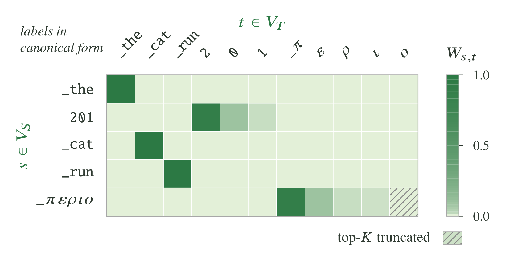
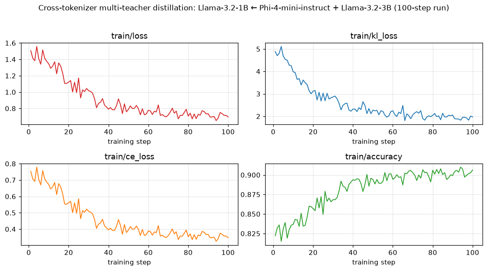
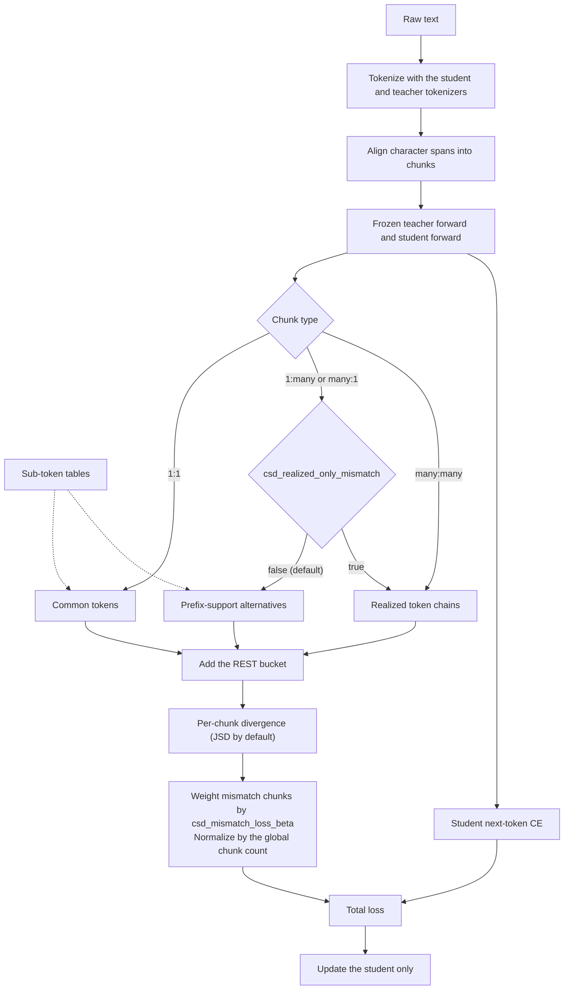

# Cross-Tokenizer Distillation

NeMo RL supports off-policy distillation between a student and a teacher that **do not share a tokenizer** — for example, distilling a Qwen3-4B teacher into a Llama-3.2-1B student. The two models split the same text into different tokens, so their next-token distributions cover different vocabularies and cannot be compared directly.

Tokenizer vocabularies overlap only partially. The table below reports the pairwise overlap (intersection divided by the smaller vocabulary, on canonical token forms) across several model tokenizers; the off-diagonal entries sit well below `1.0` — that shared-vocabulary gap is what cross-tokenizer distillation bridges.

| Model | Mistral-NeMo-Minitron-8B | Qwen3-8B-Base | Llama-3.2-1B | gemma-3-4b-it | OLMo2-8B-SuperBPE-t160k | gpt-oss-20b |
|---|---:|---:|---:|---:|---:|---:|
| Mistral-NeMo-Minitron-8B | 1.0000 | 0.5119 | 0.5525 | 0.7430 | 0.4215 | 0.7591 |
| Qwen3-8B-Base | 0.5119 | 1.0000 | 0.8481 | 0.6320 | 0.4103 | 0.6462 |
| Llama-3.2-1B | 0.5525 | 0.8481 | 1.0000 | 0.6739 | 0.4980 | 0.7977 |
| gemma-3-4b-it | 0.7430 | 0.6320 | 0.6739 | 1.0000 | 0.4918 | 0.6545 |
| OLMo2-8B-SuperBPE-t160k | 0.4215 | 0.4103 | 0.4980 | 0.4918 | 1.0000 | 0.3657 |
| gpt-oss-20b | 0.7591 | 0.6462 | 0.7977 | 0.6545 | 0.3657 | 1.0000 |

NeMo RL provides two methods:

1. **[X-Token](#x-token)** routes student logits through a precomputed **projection matrix** that maps each student token to the teacher tokens it most plausibly corresponds to, projecting the student into the teacher's vocabulary so the two distributions can be compared.
2. **[CSD](#csd-common-support-distillation)** (Common-Support Distillation) aligns the student and teacher tokenizations of the same text into chunks and compares the two models only on events that both tokenizers can express — a shared token or a shared chain of tokens — using bidirectional **sub-token tables**.

| | X-Token | CSD |
|---|---|---|
| Vocabulary artifact | Weighted projection matrix (`tools/x_token/`) | Student-to-teacher and teacher-to-student sub-token tables (`tools/csd/`) |
| Compared distribution | Student projected into the teacher vocabulary | Shared token and token-chain events, plus REST |
| Training entrypoint | `examples/run_xtoken_off_policy_distillation.py` | `examples/run_csd.py` |
| Exemplar configs | `xtoken_off_policy_distillation.yaml`, `xtoken_multiteacher_off_policy_distillation.yaml` | `csd.yaml`, `csd_multiteacher.yaml` |
| Training backends | Automodel | Automodel or Megatron, chosen per model |
| Teacher logits | Dense, over CUDA IPC | Sparse top-K (default `K=128`) or dense, over CUDA IPC |

Both methods share the off-policy trainer, the token aligner, the cross-tokenizer collator, and the colocated CUDA IPC teacher transport. The top-level `algorithm` field (`xtoken` or `csd`) selects the method, and each entrypoint loads its own exemplar.

## X-Token

X-Token handles the vocabulary mismatch by routing student logits through a precomputed projection matrix. This section explains how to:

1. Create the projection matrix from a (student, teacher) tokenizer pair.
2. Launch a distillation with the projection matrix.

### How it works

A full run has two phases. The three prep steps are *offline data prep* —
small CLI tools you run once per (student, teacher) pair — and the result is a
single `.pt` file. The final step is the actual distillation training loop.

```
                        ┌──────────────────────────────────────────────┐
                        │  Offline projection-matrix preparation       │
                        │                                              │
                        │  ┌────────────────────────────────────┐      │
  (student, teacher)    │  │ 1. minimal_projection_via_         │      │
  tokenizers       ────▶│  │    multitoken.py                   │      │
                        │  │    — multi-token mappings          │      │
                        │  └─────────────────┬──────────────────┘      │
                        │                    │                         │
                        │  ┌─────────────────▼──────────────────┐      │
                        │  │ 2. reapply_exact_map.py            │      │
                        │  │    — pin exact 1-to-1 matches      │      │
                        │  └─────────────────┬──────────────────┘      │
                        │                    │                         │
                        │  ┌─────────────────▼──────────────────┐      │
                        │  │ 3. sort_and_cut_projection_matrix  │      │
                        │  │    .py — trim to runtime top_k     │      │
                        │  └─────────────────┬──────────────────┘      │
                        └────────────────────│─────────────────────────┘
                                             │
                                             ▼  projection_matrix.pt
                        ┌────────────────────────────────────────────────────┐
                        │  4. examples/                                      │
                        │     run_xtoken_off_policy_distillation.py          │
                        │     — align student & teacher tokens, then         │
                        │       teacher forward + student forward,           │
                        │       then x-token KD loss                         │
                        └────────────────────────────────────────────────────┘
```

The projection matrix is a sparse `[V_student, top_k]` tensor that the
training-time loss multiplies against the student logits to project them into
the teacher's vocab space.



Each row of the matrix holds the weights `W_{s,t}` that distribute a student
token `s ∈ V_S` over the teacher tokens `t ∈ V_T` it corresponds to. Tokens
shared by both vocabularies map 1-to-1 (e.g., `_the`, `_cat`, `_run`), while a
student token that the teacher splits into pieces spreads its weight across
those pieces (e.g., `201` → `2`, `0`, `1`). Rows are trimmed to the runtime
`top_k` in Step 3, so low-weight tail entries are dropped (hatched cell).

### Quickstart — single command

For the typical case, `tools/x_token/build_projection_matrix.sh` chains
the prep steps with auto-derived intermediate paths:

```bash
./tools/x_token/build_projection_matrix.sh \
    --student-model meta-llama/Llama-3.2-1B \
    --teacher-model Qwen/Qwen3-4B \
    --runtime-top-k 4
```

The wrapper writes the final matrix to
`cross_tokenizer_data/projection_matrix_<student>_<teacher>_top<N>.pt`
(override with `--final-output`). Further tweaks to step 1 defaults can be configured using `--no-{scale-trick,reverse-pass,special-token-mapping}`. Run `./tools/x_token/build_projection_matrix.sh
--help` for the full list of options.

The per-step recipes below are for advanced customization (non-default
weight thresholds, hand-picked intermediate filenames, etc.).

### Backend and scope

- **Automodel only.** Set `policy.automodel_cfg.enabled=true`. The Megatron policy
  worker is not wired for cross-tokenizer distillation.
- **Teacher logits travel via CUDA IPC**, so student and teacher policies must
  be colocated on the same node. No remote-Ray transport for x-token logits.
- **One colocated GPU pool, serial execution.** All teachers and the student
  share a single `RayVirtualCluster`
  (`max_colocated_worker_groups = len(teachers) + 1`). There is no separate
  generation worker (off-policy distillation trains on a fixed dataset) and no
  colocation toggle. Each step time-slices the shared GPUs: one teacher at a
  time is onloaded, runs its forward pass, ships its logits to the student over
  CUDA IPC, then offloads; the student trains last, reading and releasing each
  teacher's IPC buffer. GPU memory therefore holds exactly one teacher's params
  *or* the student's at any instant, plus the teachers' resident IPC logit
  buffers.

```
   RayVirtualCluster — one GPU pool, shared by every worker group
   max_colocated_worker_groups = len(teachers) + 1   (no separate
   generation worker; no colocation toggle)
   Shared GPUs = cluster.gpus_per_node × cluster.num_nodes

   Worker groups, all colocated on the SAME GPUs:
     teacher_0, teacher_1, …, teacher_{N-1}, student

   Per training step — serial time-slice on those GPUs:
     teacher_0      : onload → forward → ship logits (CUDA IPC) → offload
     teacher_1      : onload → forward → ship logits (CUDA IPC) → offload
       ⋮
     teacher_{N-1}  : onload → forward → ship logits (CUDA IPC) → offload
     student        : train → read each teacher's IPC buffer → release

   At any instant: exactly ONE teacher's params OR the student's resident,
   plus the teachers' IPC logit buffers (node-local).
```

Future work will ease these requirements — we are actively working on
improving cross-tokenizer distillation support.

### Step 1 — Build multi-token mappings

Many student tokens (e.g., `"12"`) tokenize into multiple teacher tokens
(e.g., `"1"`, `"2"`). `minimal_projection_via_multitoken.py` walks the
student vocab, re-tokenizes each token with the teacher tokenizer, and adds
weighted entries to the projection. With `--enable-reverse-pass` it also
does the symmetric teacher → student walk.

```bash
uv run python -m tools.x_token.minimal_projection_via_multitoken \
    --student-model "meta-llama/Llama-3.2-1B" \
    --teacher-model "Qwen/Qwen3-4B" \
    --top-k 32 \
    --enable-scale-trick \
    --enable-reverse-pass \
    --enable-special-token-mapping
```

Output: `cross_tokenizer_data/projection_map_Llama-3.2_to_Qwen3_multitoken_top_32_double_special.pt`.

Pass `--num-examples 50` to print a sample of student→teacher mappings after
the matrix is built — useful for spot-checking that special tokens, numerals,
and punctuation map to sensible teacher tokens.

### Step 2 — Reapply exact-token map

Tokenizers built with a similar algorithm (for example, BPE) typically share
a sizable set of identical tokens — common punctuation, single ASCII
characters, and frequent subwords. `reapply_exact_map.py` pins those
overlapping tokens to 1-to-1 mappings with weight 1.0, overwriting whatever
Step 1 produced for them.

```bash
uv run python -m tools.x_token.reapply_exact_map \
    --student-model "meta-llama/Llama-3.2-1B" \
    --teacher-model "Qwen/Qwen3-4B" \
    --initial-projection-path cross_tokenizer_data/projection_map_Llama-3.2_to_Qwen3_multitoken_top_32_double_special.pt
```

Output is written next to the input as `<basename>_exact_map_remapped.pt`.

### Step 3 — Sort and trim to runtime `top_k`

We observe the projection map is very sparse — each student token maps to at most 4–5
teacher tokens. This step sorts each row by weight, trims to the chosen
runtime `top_k`, and stores the result as a sparse `[V_student, top_k]`
representation (per-row indices plus weights). That sparse format avoids materializing a computationally
expensive dense projection matrix of size `[student_vocab, teacher_vocab]` during distillation.

```bash
uv run python -m tools.x_token.sort_and_cut_projection_matrix \
    --initial-projection-path cross_tokenizer_data/projection_map_Llama-3.2_to_Qwen3_multitoken_top_32_double_special_exact_map_remapped.pt \
    --top_k 4 \
    --output_path cross_tokenizer_data/projection_matrix_llama_qwen_top4.pt
```

### Step 4 — Launch x-token distillation

The training entrypoint is `examples/run_xtoken_off_policy_distillation.py` with the
exemplar config at `examples/configs/xtoken_off_policy_distillation.yaml`. The exemplar
defaults to Llama-3.2-1B (student) ← Qwen3-4B (teacher) and the P-KL loss
mode. For data it points `data.train.data_files` at the ungated, CC-BY-4.0
NVIDIA **Nemotron-Pretraining-Specialized-v1.1** corpus
(`Nemotron-Pretraining-Formal-Logic` subset) by dataset id + `data.train.subset`,
so the recipe runs out of the box with no auth or extra setup (and from the HF
cache under `HF_HUB_OFFLINE=1`). The `projection_matrix_path` below
points at the `cross_tokenizer_data/` directory that Steps 1–3 create, so run
those first (or the `build_projection_matrix.sh` wrapper). Override paths via
Hydra CLI:

```bash
uv run python examples/run_xtoken_off_policy_distillation.py \
    --config examples/configs/xtoken_off_policy_distillation.yaml \
    teachers.0.aligner.projection_matrix_path=cross_tokenizer_data/projection_matrix_llama_qwen_top4.pt \
    cluster.gpus_per_node=8 \
    cluster.num_nodes=1
```

The exemplar config keeps each teacher's `aligner.projection_matrix_path` as
`null`, so the projection matrix must always be supplied at the CLI (per
teacher, e.g. `teachers.0.aligner.projection_matrix_path=...`) — this keeps the
config reusable across (student, teacher) pairs. `data.train.data_files` and `data.train.subset`
already point at the default NVIDIA corpus described above; override them only
to train on your own `.arrow`/`.parquet`/`.json`/`.txt` corpus. Set both, since a
file path requires `subset` to be null:
`data.train.data_files=/path/glob/*.arrow data.train.subset=null`.

#### Text and chat batches

Both exemplar configs declare a typed top-level `collator` block:

```yaml
collator:
  mode: text
  include_thinking_in_loss: false
  native_thinking_alignment: false
  kd_alignment_regions: null
  num_packed_rows: 1
```

For conversation data, set `collator.mode=chat` and use `chat_kd_processor` with
raw `messages` or `conversation` data. Each model applies its own chat template
to the full conversation, but training supervises **only the final assistant
turn**. Earlier messages remain context and do not contribute training targets.
Every chat row must end with an assistant message. CE, same-tokenizer KD, and
teacher scoring include the final assistant content and its retained end-of-turn
token; earlier turns, role headers, and padding are excluded. Cross-tokenizer KD
aligns the final assistant content and uses a separate EOT pair when both
tokenizations retain the terminator. This applies to both ordinary and native
chat alignment; raw-text training is unchanged.

Each chat row can supply `message_loss_mask`, a list containing one binary
integer per message. Only assistant turns may have a value of `1`, and the final
assistant message must be selected (`1`). Earlier mask entries never enable
training on history: earlier messages are context only, even when their mask
entry is `1`. Omitting the mask selects the final assistant turn for training.
The OpenAI adapter prepends a zero when it inserts a system message.

The configuration class supplies defaults. Packing multiple examples per row
remains unsupported; keep `num_packed_rows=1`. Text tokenization uses
`add_special_tokens=False`. Chat
rows exceeding either the student's or any teacher's context limit are rejected
instead of independently truncating their conversations.

#### Native reasoning and tool conversations

Native alignment supports the Nano/Qwen ChatML layouts with explicit reasoning,
answer, tool-call, and end-of-turn regions. Literal ChatML turn delimiters inside
source content or schemas are rejected as ambiguous; embedded tool/think markup
inside tool arguments is supported. Other layouts fail with an error;
the Llama text exemplars are not native-chat recipes. Enable it explicitly:

```yaml
collator:
  mode: chat
  include_thinking_in_loss: true
  native_thinking_alignment: true
  kd_alignment_regions: [reasoning, close, answer, eot]
  num_packed_rows: 1
```

Each row can supply `tools`. Set `use_preserving_dataset: true` for JSONL tool
data to retain heterogeneous argument objects without Arrow adding null fields.

The final assistant turn supervises reasoning text (when
`include_thinking_in_loss` is true), the closing `</think>`, answers, tool payloads,
and EOT. Opening thinking scaffolds, formatting-only tokens, schemas,
user/system/tool-result text, earlier turns, and padding
are excluded. `kd_alignment_regions` further restricts cross-tokenizer KD without
changing CE or same-tokenizer KD masks. Prose and each tool call align separately;
permitted Boolean/null spelling differences retain CE but omit the unequal piece
from exact-text KD. Missing or transformed required content fails explicitly.
An empty or whitespace-only final assistant turn is rejected; tool-only final
turns are supported. Supervising a separate `reasoning_content` field requires native
alignment. Ordinary chat supports reasoning embedded in `content` only when the
chat template renders that content verbatim. For Qwen-style templates that extract
inline `<think>...</think>` into a separate reasoning block, including the stock
Qwen3 template and `qwen3_history.jinja`, set
`collator.native_thinking_alignment=true`. Ordinary chat rejects requests to
supervise a separate reasoning field without native alignment.

Qwen3-4B's stock template drops historical reasoning when a later user turn
follows it. To retain that reasoning as context, apply the maintained override to
**each Qwen tokenizer** used by the collator (both `policy.tokenizer` and the
appropriate `teachers[i].tokenizer`):

```yaml
tokenizer:
  name: Qwen/Qwen3-4B
  tokenizer_kwargs:
    revision: 1cfa9a7208912126459214e8b04321603b3df60c
  chat_template: examples/chat_templates/qwen3_history.jinja
  chat_template_kwargs:
    enable_thinking: true
    preserve_thinking: true
    truncate_history_thinking: false
```

The template accepts explicit `reasoning_content` and leading inline
`<think>...</think>` content. An explicit `truncate_history_thinking` wins:
`false` retains history and `true` uses stock history truncation. When absent,
`preserve_thinking=true` enables retention; otherwise stock behavior applies.
`enable_thinking` preserves Qwen3's generation-prompt behavior, including its
empty thinking block when false; it does not delete supplied reasoning. Training
renders with `add_generation_prompt=False`. Native training requires the final
turn's supervised reasoning to be retained and rejects a template that silently
drops it. Historical reasoning follows the template's context-retention policy
and does not contribute loss.

The override adds explicit history-retention controls to the pinned Qwen3-4B
template while preserving its tool serialization and generation behavior. The shared offset matcher compares literal decoded strings; whitespace
differences are unequal. Native Unicode repair is separate and requires both
NFC-normalized decodings to equal the original source region. Ordinary chat uses
one canonical nonempty content key on both sides for the final assistant turn.
Content tokens that also absorb surrounding whitespace retain CE supervision;
their full decoded strings still determine exact-match correctness.

The [`xtoken_off_policy_distillation.sh`](../../tests/functional/xtoken_off_policy_distillation.sh)
functional test covers raw text. The standalone
[`xtoken_native_chat.sh`](../../tests/functional/xtoken_native_chat.sh) functional
test covers native chat and is registered separately in the fast and full CI
suites. Its
[`chat configuration`](../../examples/configs/xtoken_native_chat.yaml)
uses a SmolLM2-135M-Instruct student and Qwen3-1.7B teacher with distinct
tokenizer vocabularies and token boundaries. Both use the history-preserving
ChatML override so the test retains reasoning, tool calls, and end-of-turn
supervision. The script reads the checked-in multi-turn arithmetic
[`JSONL fixture`](../../tests/functional/test_data/xtoken_native_chat.jsonl), builds
its projection matrix, and checks that three training steps produce finite
losses. It owns its experiment directory and logs, so it can run independently:

```bash
bash tests/functional/xtoken_native_chat.sh
```

The chat scenario is functional coverage, not a nightly convergence benchmark.
DP alignment, native student-only SFT, sequence packing, and backend/loss changes
are outside this port.

#### Loss-mode knobs

`loss_fn` has two flags that pick between three behaviors:

| `gold_loss` | `xtoken_loss` | Behavior |
|---|---|---|
| `false` | (inert) | **P-KL** — full-vocab teacher logits; the loss derives a microbatch-global top-k inside, projects the student into teacher vocab via the projection matrix, and chunk-averages KL on the top-k subset. CE term is added. |
| `true` | `false` | **Gold loss** — split the vocab into an *exact-token-mapped* common set (KL) and an *uncommon* tail (sorted L1). |
| `true` | `true`  | **H-KL (gold + xtoken)** — same as gold, but relax the exact-map threshold to `>= 0.6` and allow multi-token projections to count as exact maps via a collision-replacement rule. |

Other relevant fields:

- `loss_fn.temperature` — softmax temperature applied symmetrically to student and teacher logits before KL.
- `loss_fn.vocab_topk` — microbatch-global top-k size for the P-KL path and for same-tokenizer teachers, whatever `gold_loss` is (the all-same-tokenizer `averaged_logits` path uses the full vocab).
- `loss_fn.uncommon_topk` — cap on the L1 uncommon-tail sort in the gold path (defaults to 8192).
- `loss_fn.reverse_kl` — compute `KL(student || teacher)` instead of `KL(teacher || student)`.

### Results — 100-step multi-teacher run

```bash
uv run python examples/run_xtoken_off_policy_distillation.py \
    --config examples/configs/xtoken_multiteacher_off_policy_distillation.yaml \
    teachers.0.aligner.projection_matrix_path=cross_tokenizer_data/projection_matrix_llama_phi-mini_top4.pt \
    cluster.gpus_per_node=8 \
    cluster.num_nodes=1
```

This run distills a `meta-llama/Llama-3.2-1B` student from two teachers at
once: `microsoft/Phi-4-mini-instruct` (a cross-tokenizer teacher, projected
through its projection matrix) and `meta-llama/Llama-3.2-3B` (which shares the
student's tokenizer, so it contributes a direct top-K KL (`loss_fn.vocab_topk`)
with no projection). The per-teacher objectives are summed (`loss_fn.kd_loss_mode=sum`).
Config: global batch 96, micro-batch 1, sequence
length 2048, 100 steps, 2 nodes (8 GPUs each), on the default
Nemotron-Pretraining-Specialized-v1.1 / Formal-Logic corpus. The distillation
objective converges and the student tracks both teachers more closely over
training:



- **Loss** falls from ≈1.51 to ≈0.70.
- **KL loss** (summed over both teachers) falls from ≈4.89 to ≈1.97. Almost
  all of it comes from the cross-tokenizer Phi-4-mini teacher (≈4.75 → ≈1.76);
  the same-tokenizer Llama-3.2-3B teacher's direct KL is already small and
  stays there (≈0.14 → ≈0.21).
- **CE loss** falls from ≈0.75 to ≈0.35.
- **Top-1 accuracy** rises from ≈0.82 to ≈0.91.

#### Downstream evaluation

Benchmark scores of the distilled student against the undistilled
`meta-llama/Llama-3.2-1B` base model:

| Task | Base Llama-3.2-1B | Distilled |
|---|---|---|
| MMLU | 32.05 | 40.24 |
| GSM8K | 5.69 | 5.76 |

#### Throughput and memory

Measured on the same run (per training step, micro-batch 1, sequence length
2048, with the two teachers forwarded serially):

| Metric | Value |
|---|---|
| Mean step time | 6.65 s (min 6.22 s) |
| Teacher forward (both teachers) | 4.94 s mean — the dominant per-step cost |
| Training throughput | ≈29.5k valid tokens/s (196,512 tokens/step ÷ mean step time) |

Each teacher's full-vocab logits stay on-node: the producer publishes a
rank-level `[B_r, T_t, V_t]` bf16 tray and hands the student a CUDA IPC handle
to it, so teacher logits never cross the network even with two teachers in
play.

## CSD (Common-Support Distillation)

CSD compares the two models only on events that both tokenizers can express. A **REST** category holds the remaining probability mass, so each comparison stays a proper distribution.

The shared events come from two static **sub-token tables** (support tables) built once per (student, teacher) tokenizer pair: a student-to-teacher table and a teacher-to-student table. Each table maps a source token to the complete chain of destination tokens that spells the same text.

This section distills a `Qwen/Qwen3-4B` teacher into a `meta-llama/Llama-3.2-1B` student and explains how to:

1. Build and validate the sub-token tables for a (student, teacher) tokenizer pair.
2. Launch CSD distillation with the tables.

### How CSD works

A full run has two phases. The three preparation steps run once per (student, teacher) pair on CPU — they load tokenizers only, never model weights — and produce two `.pt` files. The final step is the distillation training loop.

```
                        ┌──────────────────────────────────────────────┐
                        │  Offline sub-token table preparation (CPU)   │
                        │                                              │
                        │  ┌────────────────────────────────────┐      │
  (student, teacher)    │  │ 1. build_subtoks_table.py          │      │
  tokenizers       ────▶│  │    — student → teacher chains      │      │
                        │  └─────────────────┬──────────────────┘      │
                        │                    │                         │
                        │  ┌─────────────────▼──────────────────┐      │
                        │  │ 2. build_subtoks_table.py          │      │
                        │  │    — teacher → student chains      │      │
                        │  └─────────────────┬──────────────────┘      │
                        │                    │                         │
                        │  ┌─────────────────▼──────────────────┐      │
                        │  │ 3. validate_subtoks_tables.py      │      │
                        │  │    — check both against tokenizers │      │
                        │  └─────────────────┬──────────────────┘      │
                        └────────────────────│─────────────────────────┘
                                             │
                                             ▼  student_to_teacher.pt
                                                teacher_to_student.pt
                        ┌────────────────────────────────────────────────────┐
                        │  4. examples/run_csd.py                            │
                        │     — align student & teacher tokens, then         │
                        │       teacher forward + student forward,           │
                        │       then CSD loss + student CE                   │
                        └────────────────────────────────────────────────────┘
```

In every training step, the collator tokenizes each text with both tokenizers and aligns their character spans into chunks. A chunk covers `M` student tokens and `N` teacher tokens that spell the same text. The teacher runs a frozen forward pass and sends its logits to the student over CUDA IPC; the student then computes the CSD loss on each chunk together with its own next-token cross-entropy (CE). Only the student is updated.



Each chunk type compares a different set of events:

| Chunk (student `M` × teacher `N` tokens) | Compared events (default) | With `csd_realized_only_mismatch: true` |
|---|---|---|
| 1:1 | Common tokens — vocabulary entries that map one-to-one between the tokenizers — plus REST | Same |
| 1:many | Student tokens whose teacher chain has length `N` and shares the realized teacher prefix, plus REST. The teacher scores an alternative as the realized-prefix chain log-probability plus the alternative's final-token log-probability | Realized chains plus REST |
| many:1 | Mirror of 1:many, using the teacher-to-student table | Realized chains plus REST |
| many:many | Realized student chain against realized teacher chain, plus REST | Same |

With sparse teacher transport, the teacher sends its top-K logits per row together with the exact full-vocabulary log-normalizer, so REST holds the true remaining probability mass: top-K is not a renormalization over K tokens. The realized label always stays in the compared support, and the alternatives are limited to the teacher's top-K.

The KD term for teacher `i` is

```
KD_i = T² × (Σ 1:1 chunk losses + csd_mismatch_loss_beta × Σ mismatch chunk losses) / (valid chunks in the global batch)
```

and the total loss is `kl_loss_weight × KD + ce_loss_scale × CE`. With `dynamic_loss_scaling: true` (the exemplar), the KD term is instead rescaled to the detached CE magnitude, `sg(|CE| / |KD|) × KD + CE`, and both weights are ignored. A teacher configured without tables shares the student's tokenizer: it skips alignment and contributes a top-`vocab_topk` KL on the shared vocabulary.

### CSD backend and scope

- **Automodel or Megatron, per model.** The student and each teacher choose their backend independently through `automodel_cfg.enabled` or `megatron_cfg.enabled`. The exemplar runs both models on Megatron (TP1/CP1/PP1) on one node with eight GPUs and offloads the student after each step.
- **Teacher logits travel via CUDA IPC**, so the student and teachers are colocated on the same node. On more than one node, every teacher matches the student's DP size and TP × CP × PP group size, and each group fits inside one node.
- **One colocated GPU pool, serial execution.** As with X-Token, the teachers and the student time-share one GPU pool within each step; see the [X-Token backend notes](#backend-and-scope).

Each cross-tokenizer teacher sends its logits in one of two forms:

- **Sparse** (`loss_fn.teacher_topk_ipc_k > 0`, default `128`): for each teacher row, the top-K logits, the exact log-normalizer, and the realized teacher labels the loss needs.
- **Dense** (`teacher_topk_ipc_k: 0`): the full-vocabulary logits.

Same-tokenizer teachers always send dense logits. Sparse and dense transport optimize different objectives: with sparse transport, the KD compares each teacher row's top-K tokens plus REST instead of the full vocabulary.

A Megatron student evaluates cross-tokenizer KD **owner-local** when the run allows it: each context-parallel (CP) rank keeps its own share of the student logits, evaluates the chunks whose final student predictor row it holds, and reads only the teacher rows those chunks need. Otherwise the loss is evaluated **replicated**: every CP rank rebuilds its contiguous sequence window of the student and teacher logits.

| Student | Cross-tokenizer teacher | `teacher_topk_ipc_k` | Teacher transport | KD evaluation |
|---|---|---|---|---|
| Megatron, owner-local eligible | Megatron | `> 0` | Sparse rows of each teacher CP shard | Owner-local |
| Megatron, owner-local eligible | Megatron or Automodel | `0` | Dense | Owner-local |
| Megatron, not eligible | Megatron or Automodel | `0` | Dense | Replicated |
| Automodel | Automodel | `> 0` | Sparse | Replicated |
| Automodel | Megatron or Automodel | `0` | Dense | Replicated |

Setup rejects the remaining combinations and prints which evaluation a run uses and why; set `teacher_topk_ipc_k: 0` for those runs. Owner-local evaluation requires:

- a Megatron student with `pipeline_model_parallel_size: 1`, no sequence packing, and no dynamic batching;
- `kd_loss_mode: sum` with static teacher weights (`sum_weights_metric: null`);
- `csd_pure_alm: false` and a `csd_loss_fn` other than `bce`; `csd_last_pos_loss_fn: bce` only with `csd_realized_only_mismatch: true`;
- with sparse transport, `teacher_topk_ipc_keep_realized: true` (or realized-only mismatch), Megatron cross-tokenizer teachers, and a teacher `make_sequence_length_divisible_by` that is a multiple of `2 × CP` (and of TP when the teacher uses sequence parallelism).

Under owner-local evaluation the student logits are never gathered across CP; only per-row scalars and the selected token values cross ranks. `csd_selected_row_chunk_size` and `csd_support_chunk_batch_size` bound the temporary memory of this evaluation without changing the loss.

### Step 1 — Build the student-to-teacher table

`build_subtoks_table.py` builds one direction per call. The forward table has student token IDs as rows and teacher token IDs as entries:

```bash
uv run python -m tools.csd.build_subtoks_table \
    --source-tokenizer meta-llama/Llama-3.2-1B \
    --destination-tokenizer Qwen/Qwen3-4B \
    --max-subtokens 8 \
    --output cross_tokenizer_data/csd/student_to_teacher.pt
```

Each `.pt` file stores, for every source token, the complete destination chain:

| Key | Meaning |
|---|---|
| `subtoks` | Integer tensor `[V_src, N_max]` of destination token IDs; unused entries are `-1` |
| `lengths` | Integer vector of chain lengths; `0` marks an unmapped source token |
| `V_src`, `V_dst`, `N_max` | Vocabulary sizes (`len(tokenizer)`, including added tokens) and the chain-length limit |
| `src`, `dst` | Source and destination tokenizer identifiers |
| `source_fingerprint`, `destination_fingerprint` | SHA-256 fingerprints of each tokenizer's backend and special-token roles |

For example, if source token `42` is `playing` and the destination tokenizer spells it as `play` (`7`) + `ing` (`9`), then with `--max-subtokens 8`:

```text
lengths[42] = 2
subtoks[42] = [7, 9, -1, -1, -1, -1, -1, -1]
```

These IDs are illustrative. A token shared by both vocabularies has a length-one chain, and the length-one chains of the forward table form the common-token map when `loss_fn.common_indices_from_subtoks: true` (the exemplar). The tables describe vocabulary events only; training still tokenizes each text with both tokenizers and aligns the actual spans.

The builder creates the output directory. Use `--source-revision` and `--destination-revision` to pin tokenizer revisions, and `--overwrite` to replace an existing file.

### Step 2 — Build the teacher-to-student table

Reverse the tokenizer order to build the reverse table, which has teacher token IDs as rows and student token IDs as entries:

```bash
uv run python -m tools.csd.build_subtoks_table \
    --source-tokenizer Qwen/Qwen3-4B \
    --destination-tokenizer meta-llama/Llama-3.2-1B \
    --max-subtokens 8 \
    --output cross_tokenizer_data/csd/teacher_to_student.pt
```

The two directions are separate decompositions: a forward chain is not necessarily inverted by a single reverse row. The 1:many chunks use the forward table and the many:1 chunks use the reverse table.

The builder maps each source token as follows:

- **Special tokens** map by **role** — BOS, EOS, PAD, UNK, SEP, CLS and MASK — even when their spellings differ. When roles do not decide, identical special-token spellings map only if their roles do not conflict. Any other special token stays unmapped; it never decomposes into ordinary text.
- **Ordinary tokens** first use an exact surface match. Otherwise, the token is decoded and re-encoded with the destination tokenizer; for byte-level BPE pairs, the result must keep the original byte surface, and BPE on that surface preserves incomplete UTF-8 fragments. Chains that contain a destination special token or a U+FFFD replacement character are rejected.
- **Long chains** — longer than `--max-subtokens` (default `8`) — stay unmapped and are never truncated. Raise the limit to keep longer decompositions; tables grow accordingly.

The builder and validator support fast tokenizers with a **BPE model and a ByteLevel decoder**, including the example pair. Metaspace (SentencePiece), WordPiece and other decoder families are rejected, because decoding one token in isolation can change whitespace or word markers.

### Step 3 — Validate both tables

Check both tables against the exact student and teacher tokenizers before allocating GPUs:

```bash
uv run python -m tools.csd.validate_subtoks_tables \
    --student-tokenizer meta-llama/Llama-3.2-1B \
    --teacher-tokenizer Qwen/Qwen3-4B \
    --student-to-teacher cross_tokenizer_data/csd/student_to_teacher.pt \
    --teacher-to-student cross_tokenizer_data/csd/teacher_to_student.pt
```

Pass `--student-revision` and `--teacher-revision` when the tables were built with pinned revisions. The validator checks tokenizer fingerprints, tensor shapes and dtypes, destination ID ranges, padding, special-token roles, and every mapped event, and exits with an error on an inconsistent table. Training does not re-check the tables against the runtime tokenizers, so validate every table pair and rebuild both directions whenever either tokenizer changes.

To inspect the mapping coverage of a pair:

```bash
uv run python - <<'PY'
import torch

for name in ("student_to_teacher", "teacher_to_student"):
    table = torch.load(f"cross_tokenizer_data/csd/{name}.pt", weights_only=True)
    lengths = table["lengths"]
    print(
        f"{name}: shape={tuple(table['subtoks'].shape)} "
        f"mapped={int((lengths > 0).sum())} unmapped={int((lengths == 0).sum())} "
        f"direct={int((lengths == 1).sum())} chains={int((lengths > 1).sum())}"
    )
PY
```

Some unmapped rows are expected, for example a BOS token with no counterpart role in the other tokenizer.

### Step 4 — Launch CSD distillation

The training entrypoint is `examples/run_csd.py`, which loads the exemplar `examples/configs/csd.yaml` by default. The exemplar distills `Qwen/Qwen3-4B` into `meta-llama/Llama-3.2-1B` on the ungated, CC-BY-4.0 **Nemotron-Pretraining-Specialized-v1.1** corpus (`Nemotron-Pretraining-Formal-Logic` subset), and its table paths already point at the files written in Steps 1 and 2:

```bash
uv run python examples/run_csd.py \
    cluster.gpus_per_node=8 \
    cluster.num_nodes=1
```

The table settings in the exemplar are:

```yaml
algorithm: csd
loss_fn:
  common_indices_from_subtoks: true
teachers:
  - model_name: Qwen/Qwen3-4B
    tokenizer:
      name: Qwen/Qwen3-4B
    aligner:
      projection_matrix_path: null
      student_to_teacher_table_path: cross_tokenizer_data/csd/student_to_teacher.pt
      teacher_to_student_table_path: cross_tokenizer_data/csd/teacher_to_student.pt
```

For tables stored elsewhere, override `teachers.0.aligner.student_to_teacher_table_path` and `teachers.0.aligner.teacher_to_student_table_path`. The table files must be readable at those paths on every training worker. Models and tables stay paired: to change the student, override both `policy.model_name` and `policy.tokenizer.name`; to change a teacher, override both `teachers.0.model_name` and `teachers.0.tokenizer.name`; and in either case rebuild and revalidate both tables.

To train on your own corpus, set `data.train.data_files` to a file, glob, or dataset identifier and `data.train.text_key` to its text column; for a file or glob, also set `data.train.subset=null`. Supported local formats include `.arrow`, `.parquet`, `.json`, `.jsonl` and `.txt`. In text mode (`collator.mode: text`), a row that does not fit every model's sequence limit is clipped to the longest text prefix that fits all of them, so the student and every teacher still see the same text. For conversational data, see [Text and chat batches](#text-and-chat-batches); CSD chat mode supervises only the final assistant turn: CE and KD both use that turn's content and end-of-turn token, and template markers such as the role header are not supervised.

Checkpoints are saved in the student backend's format; convert a Megatron checkpoint to Hugging Face format with the command in [Evaluation](../about/evaluation.md).

#### Loss knobs

| Field | Purpose |
|---|---|
| `csd_loss_fn` | Divergence on 1:1 chunks: `kl`, `jsd` (default) or `bce` |
| `csd_last_pos_loss_fn` | Divergence on mismatch chunks; `null` inherits `csd_loss_fn` |
| `csd_jsd_beta` | JSD mixture coefficient: `0` is forward KL, `1` is reverse KL, `0.5` (default) is symmetric |
| `csd_mismatch_loss_beta` | Weight of each 1:many, many:1 and many:many chunk relative to a 1:1 chunk (default `5.0`) |
| `csd_realized_only_mismatch` | Score 1:many and many:1 chunks by their realized chains against REST instead of prefix-support alternatives |
| `csd_pure_alm` | Score every chunk, including 1:1, by its realized token or chain against REST |
| `csd_noise_filter_topk` | Skip a chunk when a realized teacher label falls outside the teacher's top-k at its predictor (`0` disables) |
| `kl_chunk_shift` | Predict each non-initial chunk from the position one step earlier (default `true`) |
| `teacher_topk_ipc_k` | Teacher logits sent per row: top-K with exact normalization (default `128`), or `0` for dense full-vocabulary logits |
| `temperature`, `reverse_kl` | Softmax temperature for both models; reverse KL for the `kl` divergence |
| `dynamic_loss_scaling`, `kl_loss_weight`, `ce_loss_scale` | KD/CE combination; the weights apply only when `dynamic_loss_scaling: false` |
| `vocab_topk` | Top-K vocabulary for same-tokenizer teachers |

#### Multiple teachers

Cross-tokenizer and same-tokenizer teachers can be mixed in the `teachers` list; `kd_loss_mode` combines their KD terms:

| `kd_loss_mode` | Behavior |
|---|---|
| `sum` | `Σ_i w_i × KD_i` with static weights `teachers[i].weight`, or with `sum_weights_metric` (`ce`, `entropy`, `max_prob`) for weights `softmax(alpha × score)` |
| `averaged_logits` | One full-vocabulary KL against the weighted average of teacher logits when every teacher is same-tokenizer; otherwise a static weighted sum |
| `select_teacher` | Per microbatch, only the teacher with the lowest next-token CE on its own tokens |

`select_teacher` and `sum_weights_metric` need dense transport (`teacher_topk_ipc_k: 0`).

`examples/configs/csd_multiteacher.yaml` pairs a cross-tokenizer `microsoft/Phi-4-mini-instruct` teacher with a same-tokenizer `meta-llama/Llama-3.2-3B` teacher. Build and validate a Llama-3.2-1B / Phi-4-mini-instruct table pair (Steps 1–3) at their own paths and pass them as overrides:

```bash
uv run python examples/run_csd.py \
    --config examples/configs/csd_multiteacher.yaml \
    teachers.0.aligner.student_to_teacher_table_path=cross_tokenizer_data/csd/phi4mini/student_to_teacher.pt \
    teachers.0.aligner.teacher_to_student_table_path=cross_tokenizer_data/csd/phi4mini/teacher_to_student.pt
```

#### Optional: lockstep sequence packing

CSD can pack sequences when the student and every teacher pack the **same samples into the same bins**, each with its own tokenization. Enable it on every side:

```bash
uv run python examples/run_csd.py \
    loss_fn.teacher_topk_ipc_k=0 \
    policy.sequence_packing.enabled=true \
    policy.sequence_packing.algorithm=lockstep_first_fit_decreasing \
    teachers.0.sequence_packing.enabled=true \
    teachers.0.sequence_packing.algorithm=lockstep_first_fit_decreasing
```

Lockstep packing uses dense transport, `kd_loss_mode: sum` with static weights, micro-batch size 1, and equal DP sizes on every side; setup validation rejects other combinations before any worker starts. The [lockstep packing design](../design-docs/csd-lockstep-sequence-packing.md) lists the full support matrix.

<!-- Results: training curves and downstream evaluation to be added. -->

## Where files live

| Stage | Tool | Default output |
|---|---|---|
| Build multi-token | `tools/x_token/minimal_projection_via_multitoken.py` | `<output_dir>/projection_map_<student>_to_<teacher>_multitoken_top_<N>_double[_special].pt` |
| Reapply exact map | `tools/x_token/reapply_exact_map.py` | `<input>_exact_map_remapped.pt` |
| Sort and trim | `tools/x_token/sort_and_cut_projection_matrix.py` | `<input_dir>/<basename>_top_<N>_sorted[_preservelast].pt` (or `--output_path`) |
| Train (X-Token) | `examples/run_xtoken_off_policy_distillation.py` | per the run's `logger.log_dir` and `checkpointing.checkpoint_dir` |
| Build student-to-teacher table | `tools/csd/build_subtoks_table.py` | `--output` (exemplar: `cross_tokenizer_data/csd/student_to_teacher.pt`) |
| Build teacher-to-student table | `tools/csd/build_subtoks_table.py` | `--output` (exemplar: `cross_tokenizer_data/csd/teacher_to_student.pt`) |
| Validate | `tools/csd/validate_subtoks_tables.py` | None; exits non-zero on an inconsistent table |
| Train (CSD) | `examples/run_csd.py` | Per the run's `logger.log_dir` and `checkpointing.checkpoint_dir` |

The nightly CSD suites (`tests/test_suites/llm/csd-*.sh`) build both tables in the experiment directory before training and pass their paths as overrides; they are a working reference for scripted preparation.

## Related

Listed in the order they run during a training step:

- Config exemplars: [`examples/configs/xtoken_off_policy_distillation.yaml`](../../examples/configs/xtoken_off_policy_distillation.yaml), [`examples/configs/csd.yaml`](../../examples/configs/csd.yaml) and [`examples/configs/csd_multiteacher.yaml`](../../examples/configs/csd_multiteacher.yaml)
- Trainer module: `nemo_rl/algorithms/xtoken_off_policy_distillation.py`
- KD data processor: `nemo_rl/data/processors.py::kd_data_processor`
- Cross-tokenizer collators: `nemo_rl/data/cross_tokenizer/cross_tokenizer_collate.py::CrossTokenizerCollator` and its CSD subclass `nemo_rl/data/cross_tokenizer/csd_collate.py::CSDCrossTokenizerCollator`
- Token alignment: `nemo_rl/algorithms/x_token/token_aligner.py::TokenAligner`
- Loss implementations: `nemo_rl/algorithms/loss/loss_functions.py::CrossTokenizerDistillationLossFn` (X-Token) and `nemo_rl/algorithms/loss/csd.py::CSDLossFn` (CSD)
- CSD lockstep packing: [design doc](../design-docs/csd-lockstep-sequence-packing.md) and `nemo_rl/algorithms/loss/csd_packing.py`
