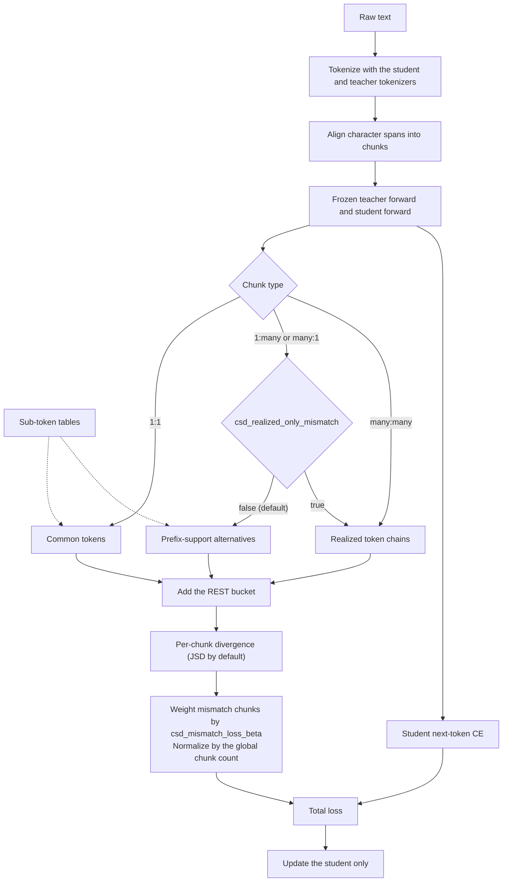

# Cross-Tokenizer Distillation with CSD

NeMo RL supports off-policy distillation between a student and a teacher that **do not share a tokenizer** through two methods: [X-Token](xtoken-off-policy-distillation.md), which projects the student into the teacher's vocabulary through a weighted projection matrix, and **Common-Support Distillation (CSD)**, described in this guide. CSD aligns the student and teacher tokenizations of the same text into chunks and compares the two models only on events that both tokenizers can express — a shared token or a shared chain of tokens. A **REST** category holds the remaining probability mass, so each comparison stays a proper distribution.

The shared events come from two static **sub-token tables** (support tables) built once per (student, teacher) tokenizer pair: a student-to-teacher table and a teacher-to-student table. Each table maps a source token to the complete chain of destination tokens that spells the same text.

| | X-Token | CSD |
|---|---|---|
| Vocabulary artifact | Weighted projection matrix (`tools/x_token/`) | Student-to-teacher and teacher-to-student sub-token tables (`tools/csd/`) |
| Compared distribution | Student projected into the teacher vocabulary | Shared token and token-chain events, plus REST |
| Training entrypoint | `examples/run_xtoken_off_policy_distillation.py` | `examples/run_csd.py` |
| Exemplar configs | `xtoken_off_policy_distillation.yaml`, `xtoken_multiteacher_off_policy_distillation.yaml` | `csd.yaml`, `csd_multiteacher.yaml` |
| Training backends | Automodel | Automodel or Megatron, chosen per model |
| Teacher logits | Dense, over CUDA IPC | Sparse top-K (default `K=128`) or dense, over CUDA IPC |

Both methods share the off-policy trainer, the token aligner, the cross-tokenizer collator, and the colocated CUDA IPC teacher transport. The top-level `algorithm` field (`xtoken` or `csd`) selects the method, and each entrypoint loads its own exemplar.

This guide distills a `Qwen/Qwen3-4B` teacher into a `meta-llama/Llama-3.2-1B` student and explains how to:

1. Build and validate the sub-token tables for a (student, teacher) tokenizer pair.
2. Launch CSD distillation with the tables.

## How it works

A full run has two phases. The three preparation steps run once per (student, teacher) pair on CPU — they load tokenizers only, never model weights — and produce two `.pt` files. The final step is the distillation training loop.

```
                        ┌──────────────────────────────────────────────┐
                        │  Offline sub-token table preparation (CPU)   │
                        │                                              │
                        │  ┌────────────────────────────────────┐      │
  (student, teacher)    │  │ 1. build_subtoks_table.py          │      │
  tokenizers       ────▶│  │    — student → teacher chains      │      │
                        │  └─────────────────┬──────────────────┘      │
                        │                    │                         │
                        │  ┌─────────────────▼──────────────────┐      │
                        │  │ 2. build_subtoks_table.py          │      │
                        │  │    — teacher → student chains      │      │
                        │  └─────────────────┬──────────────────┘      │
                        │                    │                         │
                        │  ┌─────────────────▼──────────────────┐      │
                        │  │ 3. validate_subtoks_tables.py      │      │
                        │  │    — check both against tokenizers │      │
                        │  └─────────────────┬──────────────────┘      │
                        └────────────────────│─────────────────────────┘
                                             │
                                             ▼  student_to_teacher.pt
                                                teacher_to_student.pt
                        ┌────────────────────────────────────────────────────┐
                        │  4. examples/run_csd.py                            │
                        │     — align student & teacher tokens, then         │
                        │       teacher forward + student forward,           │
                        │       then CSD loss + student CE                   │
                        └────────────────────────────────────────────────────┘
```

In every training step, the collator tokenizes each text with both tokenizers and aligns their character spans into chunks. A chunk covers `M` student tokens and `N` teacher tokens that spell the same text. The teacher runs a frozen forward pass and sends its logits to the student over CUDA IPC; the student then computes the CSD loss on each chunk together with its own next-token cross-entropy (CE). Only the student is updated.



Each chunk type compares a different set of events:

| Chunk (student `M` × teacher `N` tokens) | Compared events (default) | With `csd_realized_only_mismatch: true` |
|---|---|---|
| 1:1 | Common tokens — vocabulary entries that map one-to-one between the tokenizers — plus REST | Same |
| 1:many | Student tokens whose teacher chain has length `N` and shares the realized teacher prefix, plus REST. The teacher scores an alternative as the realized-prefix chain log-probability plus the alternative's final-token log-probability | Realized chains plus REST |
| many:1 | Mirror of 1:many, using the teacher-to-student table | Realized chains plus REST |
| many:many | Realized student chain against realized teacher chain, plus REST | Same |

With sparse teacher transport, the teacher sends its top-K logits per row together with the exact full-vocabulary log-normalizer, so REST holds the true remaining probability mass: top-K is not a renormalization over K tokens. The realized label always stays in the compared support, and the alternatives are limited to the teacher's top-K.

The KD term for teacher `i` is

```
KD_i = T² × (Σ 1:1 chunk losses + csd_mismatch_loss_beta × Σ mismatch chunk losses) / (valid chunks in the global batch)
```

and the total loss is `kl_loss_weight × KD + ce_loss_scale × CE`. With `dynamic_loss_scaling: true` (the exemplar), the KD term is instead rescaled to the detached CE magnitude, `sg(|CE| / |KD|) × KD + CE`, and both weights are ignored. A teacher configured without tables shares the student's tokenizer: it skips alignment and contributes a top-`vocab_topk` KL on the shared vocabulary.

## Backend and scope

- **Automodel or Megatron, per model.** The student and each teacher choose their backend independently through `automodel_cfg.enabled` or `megatron_cfg.enabled`. The exemplar runs both models on Megatron (TP1/CP1/PP1) on one node with eight GPUs and offloads the student after each step.
- **Teacher logits travel via CUDA IPC**, so the student and teachers are colocated on the same node. On more than one node, every teacher matches the student's DP size and TP × CP × PP group size, and each group fits inside one node.
- **One colocated GPU pool, serial execution.** As with X-Token, the teachers and the student time-share one GPU pool within each step; see the [X-Token backend notes](xtoken-off-policy-distillation.md#backend-and-scope).

Each cross-tokenizer teacher sends its logits in one of two forms:

- **Sparse** (`loss_fn.teacher_topk_ipc_k > 0`, default `128`): for each teacher row, the top-K logits, the exact log-normalizer, and the realized teacher labels the loss needs.
- **Dense** (`teacher_topk_ipc_k: 0`): the full-vocabulary logits.

Same-tokenizer teachers always send dense logits. Sparse and dense transport optimize different objectives: with sparse transport, the KD compares each teacher row's top-K tokens plus REST instead of the full vocabulary.

A Megatron student evaluates cross-tokenizer KD **owner-local** when the run allows it: each context-parallel (CP) rank keeps its own share of the student logits, evaluates the chunks whose final student predictor row it holds, and reads only the teacher rows those chunks need. Otherwise the loss is evaluated **replicated**: every CP rank rebuilds its contiguous sequence window of the student and teacher logits.

| Student | Cross-tokenizer teacher | `teacher_topk_ipc_k` | Teacher transport | KD evaluation |
|---|---|---|---|---|
| Megatron, owner-local eligible | Megatron | `> 0` | Sparse rows of each teacher CP shard | Owner-local |
| Megatron, owner-local eligible | Megatron or Automodel | `0` | Dense | Owner-local |
| Megatron, not eligible | Megatron or Automodel | `0` | Dense | Replicated |
| Automodel | Automodel | `> 0` | Sparse | Replicated |
| Automodel | Megatron or Automodel | `0` | Dense | Replicated |

Setup rejects the remaining combinations and prints which evaluation a run uses and why; set `teacher_topk_ipc_k: 0` for those runs. Owner-local evaluation requires:

- a Megatron student with `pipeline_model_parallel_size: 1`, no sequence packing, and no dynamic batching;
- `kd_loss_mode: sum` with static teacher weights (`sum_weights_metric: null`);
- `csd_pure_alm: false` and a `csd_loss_fn` other than `bce`; `csd_last_pos_loss_fn: bce` only with `csd_realized_only_mismatch: true`;
- with sparse transport, `teacher_topk_ipc_keep_realized: true` (or realized-only mismatch), Megatron cross-tokenizer teachers, and a teacher `make_sequence_length_divisible_by` that is a multiple of `2 × CP` (and of TP when the teacher uses sequence parallelism).

Under owner-local evaluation the student logits are never gathered across CP; only per-row scalars and the selected token values cross ranks. `csd_selected_row_chunk_size` and `csd_support_chunk_batch_size` bound the temporary memory of this evaluation without changing the loss.

## Step 1 — Build the student-to-teacher table

`build_subtoks_table.py` builds one direction per call. The forward table has student token IDs as rows and teacher token IDs as entries:

```bash
uv run python -m tools.csd.build_subtoks_table \
    --source-tokenizer meta-llama/Llama-3.2-1B \
    --destination-tokenizer Qwen/Qwen3-4B \
    --max-subtokens 8 \
    --output cross_tokenizer_data/csd/student_to_teacher.pt
```

Each `.pt` file stores, for every source token, the complete destination chain:

| Key | Meaning |
|---|---|
| `subtoks` | Integer tensor `[V_src, N_max]` of destination token IDs; unused entries are `-1` |
| `lengths` | Integer vector of chain lengths; `0` marks an unmapped source token |
| `V_src`, `V_dst`, `N_max` | Vocabulary sizes (`len(tokenizer)`, including added tokens) and the chain-length limit |
| `src`, `dst` | Source and destination tokenizer identifiers |
| `source_fingerprint`, `destination_fingerprint` | SHA-256 fingerprints of each tokenizer's backend and special-token roles |

For example, if source token `42` is `playing` and the destination tokenizer spells it as `play` (`7`) + `ing` (`9`), then with `--max-subtokens 8`:

```text
lengths[42] = 2
subtoks[42] = [7, 9, -1, -1, -1, -1, -1, -1]
```

These IDs are illustrative. A token shared by both vocabularies has a length-one chain, and the length-one chains of the forward table form the common-token map when `loss_fn.common_indices_from_subtoks: true` (the exemplar). The tables describe vocabulary events only; training still tokenizes each text with both tokenizers and aligns the actual spans.

The builder creates the output directory. Use `--source-revision` and `--destination-revision` to pin tokenizer revisions, and `--overwrite` to replace an existing file.

## Step 2 — Build the teacher-to-student table

Reverse the tokenizer order to build the reverse table, which has teacher token IDs as rows and student token IDs as entries:

```bash
uv run python -m tools.csd.build_subtoks_table \
    --source-tokenizer Qwen/Qwen3-4B \
    --destination-tokenizer meta-llama/Llama-3.2-1B \
    --max-subtokens 8 \
    --output cross_tokenizer_data/csd/teacher_to_student.pt
```

The two directions are separate decompositions: a forward chain is not necessarily inverted by a single reverse row. The 1:many chunks use the forward table and the many:1 chunks use the reverse table.

The builder maps each source token as follows:

- **Special tokens** map by **role** — BOS, EOS, PAD, UNK, SEP, CLS and MASK — even when their spellings differ. When roles do not decide, identical special-token spellings map only if their roles do not conflict. Any other special token stays unmapped; it never decomposes into ordinary text.
- **Ordinary tokens** first use an exact surface match. Otherwise, the token is decoded and re-encoded with the destination tokenizer; for byte-level BPE pairs, the result must keep the original byte surface, and BPE on that surface preserves incomplete UTF-8 fragments. Chains that contain a destination special token or a U+FFFD replacement character are rejected.
- **Long chains** — longer than `--max-subtokens` (default `8`) — stay unmapped and are never truncated. Raise the limit to keep longer decompositions; tables grow accordingly.

The builder and validator support fast tokenizers with a **BPE model and a ByteLevel decoder**, including the example pair. Metaspace (SentencePiece), WordPiece and other decoder families are rejected, because decoding one token in isolation can change whitespace or word markers.

## Step 3 — Validate both tables

Check both tables against the exact student and teacher tokenizers before allocating GPUs:

```bash
uv run python -m tools.csd.validate_subtoks_tables \
    --student-tokenizer meta-llama/Llama-3.2-1B \
    --teacher-tokenizer Qwen/Qwen3-4B \
    --student-to-teacher cross_tokenizer_data/csd/student_to_teacher.pt \
    --teacher-to-student cross_tokenizer_data/csd/teacher_to_student.pt
```

Pass `--student-revision` and `--teacher-revision` when the tables were built with pinned revisions. The validator checks tokenizer fingerprints, tensor shapes and dtypes, destination ID ranges, padding, special-token roles, and every mapped event, and exits with an error on an inconsistent table. Training does not re-check the tables against the runtime tokenizers, so validate every table pair and rebuild both directions whenever either tokenizer changes. Tables are loaded with `torch.load(weights_only=False)`; use only trusted files.

To inspect the mapping coverage of a pair:

```bash
uv run python - <<'PY'
import torch

for name in ("student_to_teacher", "teacher_to_student"):
    table = torch.load(f"cross_tokenizer_data/csd/{name}.pt", weights_only=True)
    lengths = table["lengths"]
    print(
        f"{name}: shape={tuple(table['subtoks'].shape)} "
        f"mapped={int((lengths > 0).sum())} unmapped={int((lengths == 0).sum())} "
        f"direct={int((lengths == 1).sum())} chains={int((lengths > 1).sum())}"
    )
PY
```

Some unmapped rows are expected, for example a BOS token with no counterpart role in the other tokenizer.

## Step 4 — Launch CSD distillation

The training entrypoint is `examples/run_csd.py`, which loads the exemplar `examples/configs/csd.yaml` by default. The exemplar distills `Qwen/Qwen3-4B` into `meta-llama/Llama-3.2-1B` on the ungated, CC-BY-4.0 **Nemotron-Pretraining-Specialized-v1.1** corpus (`Nemotron-Pretraining-Formal-Logic` subset), and its table paths already point at the files written in Steps 1 and 2:

```bash
uv run python examples/run_csd.py \
    cluster.gpus_per_node=8 \
    cluster.num_nodes=1
```

The table settings in the exemplar are:

```yaml
algorithm: csd
loss_fn:
  common_indices_from_subtoks: true
teachers:
  - model_name: Qwen/Qwen3-4B
    tokenizer:
      name: Qwen/Qwen3-4B
    aligner:
      projection_matrix_path: null
      student_to_teacher_table_path: cross_tokenizer_data/csd/student_to_teacher.pt
      teacher_to_student_table_path: cross_tokenizer_data/csd/teacher_to_student.pt
```

For tables stored elsewhere, override `teachers.0.aligner.student_to_teacher_table_path` and `teachers.0.aligner.teacher_to_student_table_path`. The table files must be readable at those paths on every training worker. Models and tables stay paired: to change the student, override both `policy.model_name` and `policy.tokenizer.name`; to change a teacher, override both `teachers.0.model_name` and `teachers.0.tokenizer.name`; and in either case rebuild and revalidate both tables.

To train on your own corpus, set `data.train.data_files` to a file, glob, or dataset identifier and `data.train.text_key` to its text column; for a file or glob, also set `data.train.subset=null`. Supported local formats include `.arrow`, `.parquet`, `.json`, `.jsonl` and `.txt`. In text mode (`collator.mode: text`), a row that does not fit every model's sequence limit is clipped to the longest text prefix that fits all of them, so the student and every teacher still see the same text. For conversational data, see the X-Token guide's [text and chat batches](xtoken-off-policy-distillation.md#text-and-chat-batches); CSD chat mode supervises only the final assistant turn: CE and KD both use that turn's content and end-of-turn token, and template markers such as the role header are not supervised.

Checkpoints are saved in the student backend's format; convert a Megatron checkpoint to Hugging Face format with the command in [Evaluation](../about/evaluation.md).

### Loss knobs

| Field | Purpose |
|---|---|
| `csd_loss_fn` | Divergence on 1:1 chunks: `kl`, `jsd` (default) or `bce` |
| `csd_last_pos_loss_fn` | Divergence on mismatch chunks; `null` inherits `csd_loss_fn` |
| `csd_jsd_beta` | JSD mixture coefficient: `0` is forward KL, `1` is reverse KL, `0.5` (default) is symmetric |
| `csd_mismatch_loss_beta` | Weight of each 1:many, many:1 and many:many chunk relative to a 1:1 chunk (default `5.0`) |
| `csd_realized_only_mismatch` | Score 1:many and many:1 chunks by their realized chains against REST instead of prefix-support alternatives |
| `csd_pure_alm` | Score every chunk, including 1:1, by its realized token or chain against REST |
| `csd_noise_filter_topk` | Skip a chunk when a realized teacher label falls outside the teacher's top-k at its predictor (`0` disables) |
| `kl_chunk_shift` | Predict each non-initial chunk from the position one step earlier (default `true`) |
| `teacher_topk_ipc_k` | Teacher logits sent per row: top-K with exact normalization (default `128`), or `0` for dense full-vocabulary logits |
| `temperature`, `reverse_kl` | Softmax temperature for both models; reverse KL for the `kl` divergence |
| `dynamic_loss_scaling`, `kl_loss_weight`, `ce_loss_scale` | KD/CE combination; the weights apply only when `dynamic_loss_scaling: false` |
| `vocab_topk` | Top-K vocabulary for same-tokenizer teachers |

### Multiple teachers

Cross-tokenizer and same-tokenizer teachers can be mixed in the `teachers` list; `kd_loss_mode` combines their KD terms:

| `kd_loss_mode` | Behavior |
|---|---|
| `sum` | `Σ_i w_i × KD_i` with static weights `teachers[i].weight`, or with `sum_weights_metric` (`ce`, `entropy`, `max_prob`) for weights `softmax(alpha × score)` |
| `averaged_logits` | One full-vocabulary KL against the weighted average of teacher logits when every teacher is same-tokenizer; otherwise a static weighted sum |
| `select_teacher` | Per microbatch, only the teacher with the lowest next-token CE on its own tokens |

`select_teacher` and `sum_weights_metric` need dense transport (`teacher_topk_ipc_k: 0`).

`examples/configs/csd_multiteacher.yaml` pairs a cross-tokenizer `microsoft/Phi-4-mini-instruct` teacher with a same-tokenizer `meta-llama/Llama-3.2-3B` teacher. Build and validate a Llama-3.2-1B / Phi-4-mini-instruct table pair (Steps 1–3) at their own paths and pass them as overrides:

```bash
uv run python examples/run_csd.py \
    --config examples/configs/csd_multiteacher.yaml \
    teachers.0.aligner.student_to_teacher_table_path=cross_tokenizer_data/csd/phi4mini/student_to_teacher.pt \
    teachers.0.aligner.teacher_to_student_table_path=cross_tokenizer_data/csd/phi4mini/teacher_to_student.pt
```

### Optional: lockstep sequence packing

CSD can pack sequences when the student and every teacher pack the **same samples into the same bins**, each with its own tokenization. Enable it on every side:

```bash
uv run python examples/run_csd.py \
    loss_fn.teacher_topk_ipc_k=0 \
    policy.sequence_packing.enabled=true \
    policy.sequence_packing.algorithm=lockstep_first_fit_decreasing \
    teachers.0.sequence_packing.enabled=true \
    teachers.0.sequence_packing.algorithm=lockstep_first_fit_decreasing
```

Lockstep packing uses dense transport, `kd_loss_mode: sum` with static weights, micro-batch size 1, and equal DP sizes on every side; setup validation rejects other combinations before any worker starts. The [lockstep packing design](../design-docs/csd-lockstep-sequence-packing.md) lists the full support matrix.

<!-- Results: training curves and downstream evaluation to be added. -->

## Where files live

| Stage | Tool | Default output |
|---|---|---|
| Build student-to-teacher table | `tools/csd/build_subtoks_table.py` | `--output` (exemplar: `cross_tokenizer_data/csd/student_to_teacher.pt`) |
| Build teacher-to-student table | `tools/csd/build_subtoks_table.py` | `--output` (exemplar: `cross_tokenizer_data/csd/teacher_to_student.pt`) |
| Validate | `tools/csd/validate_subtoks_tables.py` | None; exits non-zero on an inconsistent table |
| Train | `examples/run_csd.py` | Per the run's `logger.log_dir` and `checkpointing.checkpoint_dir` |

The nightly CSD suites (`tests/test_suites/llm/csd-*.sh`) build both tables in the experiment directory before training and pass their paths as overrides; they are a working reference for scripted preparation.

## Related

Listed in the order they run during a training step:

- Config exemplars: [`examples/configs/csd.yaml`](../../examples/configs/csd.yaml) and [`examples/configs/csd_multiteacher.yaml`](../../examples/configs/csd_multiteacher.yaml)
- Trainer module: `nemo_rl/algorithms/xtoken_off_policy_distillation.py`
- KD data processor: `nemo_rl/data/processors.py::kd_data_processor`
- Cross-tokenizer collator: `nemo_rl/data/cross_tokenizer/csd_collate.py::CSDCrossTokenizerCollator`
- Token alignment: `nemo_rl/algorithms/x_token/token_aligner.py::TokenAligner`
- Loss implementation: `nemo_rl/algorithms/loss/csd.py::CSDLossFn`
- Lockstep packing: [design doc](../design-docs/csd-lockstep-sequence-packing.md) and `nemo_rl/algorithms/loss/csd_packing.py`
