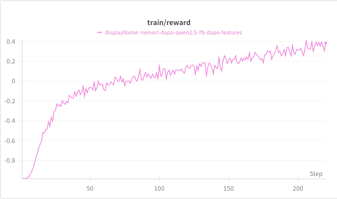
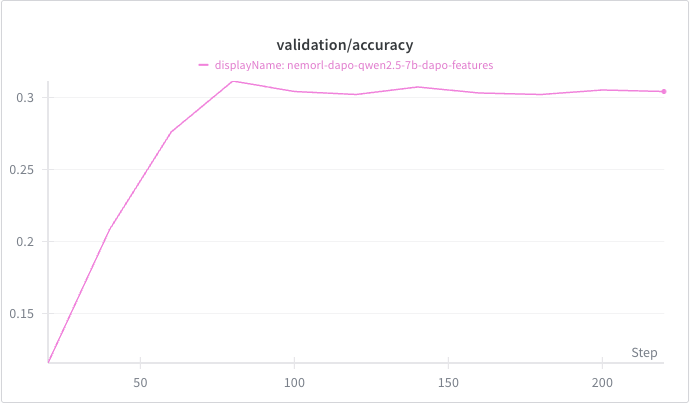

# An in-depth Walkthrough of DAPO in NeMo RL

This guide covers the [Decoupled Clip and Dynamic Sampling Policy Optimization (DAPO)](https://arxiv.org/pdf/2503.14476) implementation in NeMo RL.

DAPO introduces four key improvements over Group Relative Policy Optimization (GRPO):
1. **Clip-Higher**, which promotes the diversity of the system and avoids entropy collapse
2. **Dynamic Sampling**, which improves training efficiency and stability
3. **Token-Level Policy Gradient Loss**, which is critical in long-CoT RL scenarios
4. **Overlong Reward Shaping**, which reduces reward noise and stabilizes training

This document focuses on DAPO-specific features: Dynamic Sampling and Overlong Reward Shaping. For foundational concepts on GRPO including data handling, policy training, generation, and loss functions, see the [NeMo RL GRPO Guide](grpo.md).


## Quickstart: Launch a DAPO Run

To get started quickly, use the example configuration [examples/configs/recipes/llm/dapo-qwen2.5-7b.v2.yaml](../../examples/configs/recipes/llm/dapo-qwen2.5-7b.v2.yaml). You can launch this using the same script as GRPO:

```bash
uv run examples/run_grpo.py --config examples/configs/recipes/llm/dapo-qwen2.5-7b.v2.yaml {overrides}
```

**Reminder**: Don't forget to set your HF_HOME, WANDB_API_KEY, and HF_DATASETS_CACHE (if needed). You'll need to do a `hf auth login` as well for LLaMA models.

## Dynamic Sampling

Standard GRPO trains on all generated responses, even when they have identical rewards (zero gradient signal) within a prompt group of generations. Dynamic sampling filters to keep only groups with diverse rewards (`std > 0`), and accumulates them across batches until reaching the target batch size. Dynamic sampling can be enabled by setting `use_dynamic_sampling=True` in your configuration. For implementation details, see the [`dynamic_sampling`](../../nemo_rl/algorithms/grpo.py) function. The single-controller path supports it too, by resampling a substitute for each filtered group instead of accumulating batches; see [Dynamic sampling](single-controller.md#dynamic-sampling) for its requirements.

**Algorithm**: For each training step:

1. Sample `batch_multiplier × num_prompts_per_step` prompts from the dataset. The default value of `batch_multiplier` is 1.
2. Generate `num_generations_per_prompt` responses per prompt and compute rewards.
3. Compute the baseline and standard deviation for each prompt group.
4. Filter prompt groups where `std > 0`.
5. Store these prompts in a cache until reaching the target training batch size of `num_prompts_per_step × num_generations_per_prompt` samples.
6. Samples are accumulated until the maximum number of allowed batches (`dynamic_sampling_max_gen_batches`) is reached. If the cache still does not meet the target rollout batch size at that point, an error is raised. To resolve this, consider adjusting parameters such as `num_prompts_per_step` or `num_generations_per_prompt` to increase sample diversity, or revisit the complexity of your data.
7. Perform training on the collected samples with nonzero standard deviation

### About batch_multiplier

`batch_multiplier` (a float ≥ 1.0) controls the initial prompt pool size by sampling `batch_multiplier × num_prompts_per_step` prompts before dynamic sampling. Higher values increase memory and compute requirements, while very low values (e.g., 1.0) may slow the cache accumulation of prompt groups with nonzero standard deviation. The optimal value depends on the dataset, model capacity, and overall training setup.  When **dynamic sampling** is enabled, we also log two additional metrics:

 * `dynamic_sampling_num_gen_batches`: The number of generation rounds required to produce `num_prompts_per_step * num_generations_per_prompt` samples with a nonzero standard deviation. If this number remains consistently high across iterations, try increasing the `batch_multiplier`. The maximum allowed value for this parameter is determined by `dynamic_sampling_max_gen_batches`.
 * `dynamic_sampling_num_discarded_valid_samples`: The number of samples with a nonzero standard deviation that are discarded because the total exceeds `num_prompts_per_step * num_generations_per_prompt`. If this value is frequently high (e.g., above `0.5 * num_prompts_per_step * num_generations_per_prompt`) and `dynamic_sampling_num_gen_batches` is consistently 1, it suggests that a large fraction of the dataset is being discarded unnecessarily. To improve data efficiency, consider decreasing the `batch_multiplier`.

## Reward Shaping

DAPO introduces an overlong reward shaping mechanism to reduce reward noise and stabilize training. This approach penalizes responses that exceed a specified length threshold, helping to prevent the model from generating excessively long outputs while maintaining solution quality.

The response length is the total number of tokens over all generated assistant turns in a sample. For multi-turn rollouts (tool use, NeMo Gym agents, `max_rollout_turns > 1`), every generated assistant turn counts toward `max_response_length`. Assistant turns in the original prompt history, including empty placeholders, and user, environment, and tool turns do not count. Generated turns are identified by their `generation_logprobs` before missing logprobs are filled for training. For a single-turn rollout this is the length of the one generated assistant response.

For a detailed explanation of the overlong reward shaping mechanism, please refer to Section 3.4 of the [DAPO paper](https://arxiv.org/pdf/2503.14476). For implementation details, see the [`apply_reward_shaping`](../../nemo_rl/algorithms/reward_functions.py) function.

### Severe text looping diagnostics

NeMo Gym can assess severe repetition in assistant and reasoning text before token rebuilding removes the returned response. This diagnostic uses Gym's shared text classifier in one persistent spawned process per Gym actor, within the actor's existing CPU reservation. For loop-only reward shaping, enable assessment and the shaping stage, and leave the existing length settings unset:

```yaml
env:
  should_use_nemo_gym: true
  nemo_gym:
    assess_looping: true
grpo:
  reward_shaping:
    enabled: true
    zero_looping_rewards: true
    stop_properly_penalty_coef: null
    overlong_buffer_length: null
    overlong_buffer_penalty: null
    max_response_length: null
```

| Setting | Type and default | Behavior |
| --- | --- | --- |
| `env.nemo_gym.assess_looping` | Boolean, `false` | Assess returned assistant/reasoning text. Disabled runs create no diagnostic worker and do not scan text. |
| `grpo.reward_shaping.enabled` | Boolean, `false` | Master switch for the configured length penalties and loop zeroing. |
| `grpo.reward_shaping.zero_looping_rewards` | Boolean, `false` | Zero learning rewards for confirmed loops after other configured reward adjustments. Requires the master switch and assessment on every Gym shard. |

PPO uses the same settings under `ppo.reward_shaping`. For metrics only, enable assessment and leave both reward-shaping switches off. Loop zeroing with either the master switch or assessment off is rejected at startup. When inheriting a recipe, explicitly clear any existing length settings as shown above to select loop-only shaping. Configure either the truncation coefficient or all three DAPO parameters to add a length penalty.

Rows retain `is_looping` and `reasons` through normal results, recovery contexts and metadata tags. Classic GRPO training JSONL includes these fields under `metadata` and records the original grades in `verifier_rewards` alongside the training objective's `rewards`. Synchronous PPO uses the same shaping settings but does not provide this JSONL writer; asynchronous PPO does not support Gym. When restoring replay batches written before these fields existed, looping labels remain unassessed and unavailable original verifier grades are written as JSON `null`. Those completed outputs remain in the assessment-coverage denominator. `true` means a severe text witness, `false` means the supported checks completed, and `null` means unassessed, including unreadable text, work-limit exhaustion or unavailable process execution. Incomplete or length-limited responses remain assessable when their text is readable.

Training reports `looping/rate = flagged / assessed` when any output was assessed and `looping/coverage = assessed / completed`. The population includes completed outputs before dynamic sampling, including retained masked outputs, independently of verifier grade. The accompanying `looping/*_total` counts pool groups with unequal denominators. Execution padding and failed requests contribute no completed output.

SingleController omits looping ratios for restored steps whose complete pre-filter counts were not checkpointed and logs the affected step range. Reporting resumes on the next fully observed step; saved row labels still control objective zeroing throughout recovery.

When the shaping stage is enabled, the safeguard zeroes learning rewards only for known boolean `true` rows; false and unknown labels retain their existing reward adjustments. Raw verifier observations, published validation scores and sample/token masks retain their existing behavior.

Dynamic sampling keeps its existing raw/unshaped reward signal, so enabling loop zeroing does not change which groups it retains. Learning baselines and advantage normalization use the adjusted rewards of the retained rows. For example, verifier grades `[1, 0, 1, 0]` with a confirmed loop in the first row produce learning rewards `[0, 0, 1, 0]`, while the verifier grades and DS input remain `[1, 0, 1, 0]`. A raw-uniform group such as `[1, 1, 1, 1]` is still filtered out when dynamic sampling is enabled, even if one row loops.

## Configuration

```yaml
grpo:
  use_dynamic_sampling: true  # Enable DAPO dynamic sampling
  num_prompts_per_step: 512   # Target number of prompts per training step
  num_generations_per_prompt: 16  # Generations per prompt
  batch_multiplier: 3    # Dataloader batch size = batch_multiplier × num_prompts_per_step
  dynamic_sampling_max_gen_batches: 10     # Maximum number of batches to be used for accumulating non-zero std prompts
  reward_scaling:
    enabled: true
    source_min: 0.0
    source_max: 1.0
    target_min: -1.0
    target_max: 1.0
  
  reward_shaping:
    enabled: true
    overlong_buffer_length: 4096     # Threshold before penalties apply (paper uses 4096)
    overlong_buffer_penalty: 1.0     # Penalty per excess token
    max_response_length: 20480       # Hard maximum generation length
```

**Key Parameters:**
- **`use_dynamic_sampling`**: When enabled, activates DAPO's dynamic sampling algorithm to filter and accumulate prompt groups with nonzero standard deviation
- **`batch_multiplier`**: Factor that scales the initial prompt pool size for sampling.
- **`dynamic_sampling_max_gen_batches`**: Maximum number of batches to be used for accumulating nonzero standard deviation prompts.
- **`reward_scaling`**: When enabled, clamps each reward in the batch to [source_min, source_max] and linearly rescales it to [target_min, target_max]. Defaults: source_min=0.0, source_max=1.0, target_min=0.0, target_max=1.0.
- **`reward_shaping`**: When enabled, applies the overlong penalty mechanism described in the Reward Shaping section above. Responses whose total generated assistant-turn length exceeds `max_response_length - overlong_buffer_length` receive penalties proportional to their excess length, helping to reduce reward noise and stabilize training.

> [!NOTE]
> When dynamic sampling is enabled, `reward` is the average reward of the prompts the step trains on (those with std > 0), so it can stay flat while the policy improves. Monitor `unfiltered_reward`, the average reward before filtering, to track progress. On the `run_grpo.py` loops it covers only the first `num_prompts_per_step * num_generations_per_prompt` generated rows of the step (the whole first generation batch when `batch_multiplier` is 1); the SingleController averages every generated group.

> [!NOTE]
> **Clip-Higher** and **Token-Level Policy Gradient Loss** are already supported in NeMo RL and can be configured through the `loss_fn` section of your experiment config:
> - Set `ratio_clip_max` to enable Clip-Higher (e.g., `ratio_clip_max: 0.28`)
> - Set `normalization: global_token_mean` to enable Token-Level Policy Gradient Loss (see [Loss Normalization](grpo.md#loss-normalization) for what this changes and the tradeoff against sequence-level normalization)
> 
> See the full [DAPO example config](../../examples/configs/recipes/llm/dapo-qwen2.5-7b.v2.yaml) for reference.

## Example Training Results
Using the [DAPO example config](../../examples/configs/recipes/llm/dapo-qwen2.5-7b.v2.yaml), you can expect to see intermediate plots such as the training reward curve and validation accuracy on AIME24 for Qwen/Qwen2.5-Math-7B. These plots serve as reference outputs to help verify reproducibility. They are not intended to reflect the best accuracy that can be achieved using DAPO for this model.




## References

- **DAPO Paper**: [Decoupled Clip and Dynamic Sampling Policy Optimization](https://arxiv.org/pdf/2503.14476)
- **GRPO Paper**: [Group Relative Policy Optimization](https://arxiv.org/abs/2402.03300)
- **[NeMo RL GRPO Guide](grpo.md)**
