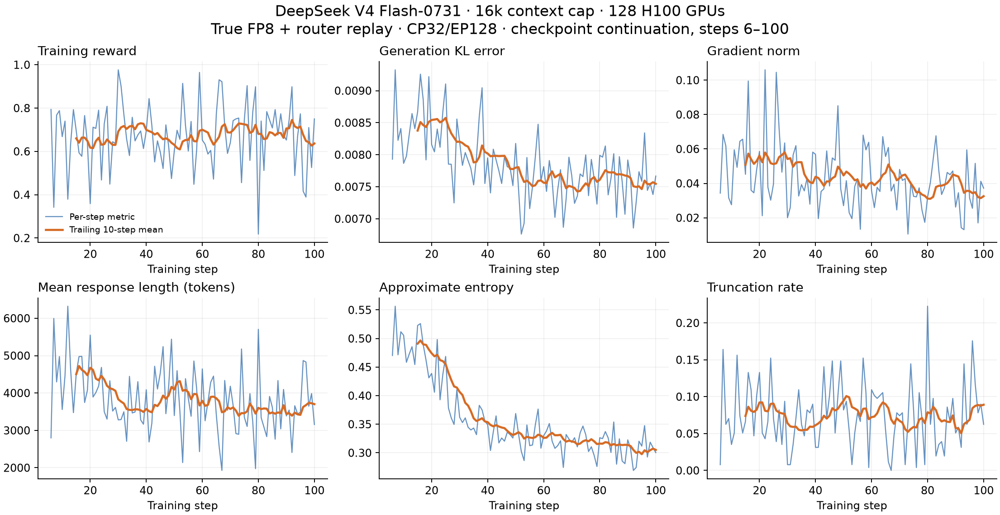

# DeepSeek V4 Support

This guide describes the current state of DeepSeek V4 support in NeMo-RL: what
works today, how to reproduce a reference run, the limitations you should expect,
and what we are working on next.

> [!IMPORTANT]
> **Status: Functional Ready.** DeepSeek V4 Flash-0731 is runnable end-to-end
> with the **AutoModel (DTensor)** training backend and **vLLM** generation.
> The reference recipe uses true FP8 training and router replay, with Expert
> Parallelism and Context Parallelism validated together at a **16k** sequence
> length on **16 H100 nodes (128 GPUs)**. A checkpoint-resumed GRPO run reached
> step 109 with stable training metrics.

## Support Status

We track model support in two stages:

| Stage | Meaning |
| --- | --- |
| **Functional Ready** | Runnable end-to-end and numerically validated with an initial training run. |
| **Long-run convergence validated** | Trains stably over a full-length run with a healthy, reproducible reward curve. |

DeepSeek V4 Flash-0731 on the **AutoModel** backend is **Functional Ready**, with
more than 100 CP32 training updates recorded at a 16k context budget. Generation
KL remained stable and gradients remained finite throughout the recorded run.

**Reading the curves:** the meaningful result here is stable, non-diverging
training at 16k, not a large reward climb.

## What's Supported

| Model | Training backend | Parallelism | Training precision | Inference backend | Status |
| --- | --- | --- | --- | --- | --- |
| `deepseek-ai/DeepSeek-V4-Flash-0731` | AutoModel (DTensor) | EP128 + CP32 | True FP8 | vLLM (FP8) | Functional Ready (16k, 100+ updates) |

Current scope and limitations:

- **Training backend**: [NeMo AutoModel](https://github.com/NVIDIA-NeMo/Automodel).
- **Parallelism**: Expert Parallelism and Context Parallelism, validated together
  at a 16,384-token sequence budget on 128 H100 GPUs. CP and EP coexist on the
  same device mesh; their sizes are not multiplicative.
- **Inference backend**: [vLLM](https://github.com/vllm-project/vllm) with TP8.
- **Precision**: Transformer Engine FP8 linear and expert compute on the training
  side, with FP8 generation in vLLM. Parameters and operations that require
  higher precision retain it.

## How to Run

### 1. Build the environment

Build a container from this branch so the pinned dependencies and AutoModel
submodule are included in the worker environments:

```bash
git checkout dsv4-fp8-r3
git submodule update --init --recursive
```

See [Docker Containers](../../../docker.md) for building the image and
[Dependency Management](../../../design-docs/dependency-management.md) for how
worker environments are resolved. The recipe uses PyTorch 2.13.0, Transformer
Engine 2.18.0, vLLM 0.29.0, and the DeepEP revision pinned by this branch.

### 2. Reference recipes

**AutoModel (Expert + Context Parallel), 16k** — `DeepSeek-V4-Flash-0731`,
validated on **16× H100 nodes (128 GPUs)**:

[`examples/configs/recipes/llm/grpo-deepseek-v4-flash-0731-16n8g-automodel-cp32ep128-fp8-long.yaml`](../../../../examples/configs/recipes/llm/grpo-deepseek-v4-flash-0731-16n8g-automodel-cp32ep128-fp8-long.yaml)

The recipe trains on DAPO Math (`DAPOMath17K`). Key settings:

- Training: true FP8, `expert_parallel_size: 128`,
  `context_parallel_size: 32`, and sequence length **16384**.
- Context budget: up to 1,024 prompt tokens and 15,360 response tokens.
- Train/inference alignment: Transformer Engine block FP8 training, FP8
  generation with power-of-two scales, and expert router replay.
- Attention: DSV4 TileLang sparse attention on the training side and
  `FLASHMLA_SPARSE_DSV4` in vLLM.
- Batch: 32 prompts with 8 generations each, for a global batch of 256.
- Thinking is enabled with `reasoning_effort: low`; MTP is disabled.

### 3. Launch

DeepSeek V4 Flash uses the standard GRPO entrypoint. Set the usual environment
variables and launch with the reference config:

```bash
export HF_HOME=<your-hf-cache>
export HF_DATASETS_CACHE=<your-datasets-cache>
export WANDB_API_KEY=<your-wandb-key>

uv run examples/run_grpo.py \
  --config examples/configs/recipes/llm/grpo-deepseek-v4-flash-0731-16n8g-automodel-cp32ep128-fp8-long.yaml
```

For multi-node setup, follow the standard NeMo-RL
[cluster instructions](../../../cluster.md) and the [GRPO guide](../../grpo.md).

### Reference training curves

**AutoModel + Context Parallel (16k)** — produced with DeepSeek-V4-Flash-0731
on DAPO Math, using 16× H100 nodes, true FP8 training, and router replay.
The checkpoint-resumed run reached step 109; the curves below show the CP32
portion from steps 6–100. Blue lines are per-step metrics and orange lines are
trailing 10-step means.



Generation KL averaged 0.00786, with its first and last ten-step means at
0.00838 and 0.00755. Gradients remained finite, including the subsequent nine
updates through step 109. These results demonstrate training stability at the
16k context budget; sample lengths vary within that budget.

## Known Issues

- The 16k recipe has demonstrated training stability, but a reproducible reward
  improvement and full convergence have not yet been established.
