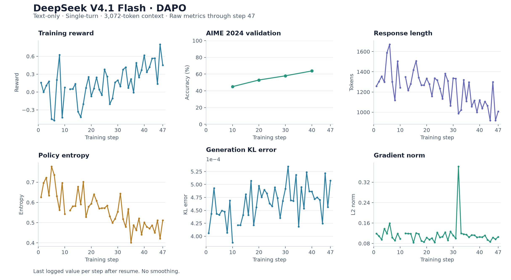

# DeepSeek V4.1 Flash

This guide describes text-only DAPO training of DeepSeek V4.1 Flash through the
GRPO entry point, using AutoModel for training and vLLM for generation.

> [!IMPORTANT]
> **Early access.** Text-only, single-turn training has undergone short-run
> stability validation for approximately 50 steps at a 3K-token context length
> (3,072 tokens). This does not establish long-run convergence or performance
> across other configurations. Use the pinned dependencies and review
> [Known Limitations](#known-limitations) before changing the recipe.

## Support Status

| Model | Training backend | Training parallelism | Generation backend | Status |
| --- | --- | --- | --- | --- |
| DeepSeek V4.1 Flash | AutoModel / FSDP2 | TP1 + CP1 + EP | vLLM with TP + EP | Functionally Ready |

## Supported Scope

- **Algorithm and data**: DAPO through GRPO, with `DAPOMath17K` training data
  and `DAPOMathAIME2024Deduplicated` validation data.
- **Training**: BF16 compute with FP32 master parameters, activation
  checkpointing, TileLang attention and the Torch expert dispatcher.
- **Memory management**: FSDP CPU parameter offload, frozen host Engram tables
  and `BF16CPUAdamW` with BF16 moment storage and FP32 update arithmetic.
- **Generation**: Colocated vLLM with BF16 dense/expert weights, native MXFP8
  Engram tables and MXFP8 compressed KV. Router replay preserves rollout expert
  selections during training and logprob recomputation.
- **Inputs**: Text-only, with thinking mode disabled by the reference recipe.

The recipe YAML is the source of truth for resource counts, parallelism,
sequence lengths, batch sizes, evaluation and checkpoint settings.

## How to Run

### 1. Prepare the Environment and Checkpoint

This early-access support requires the
[`deepseek-v4.1-support` branch](https://github.com/NVIDIA-NeMo/RL/tree/deepseek-v4.1-support).
Switch to that branch before initializing submodules or installing dependencies.
For a clone of `NVIDIA-NeMo/RL` with the upstream repository named `origin`,
run from the repository root:

```bash
git fetch origin deepseek-v4.1-support
git switch deepseek-v4.1-support
git merge --ff-only origin/deepseek-v4.1-support
git submodule update --init --recursive
uv sync --locked
```

Use the dependency lock and AutoModel submodule pinned by this branch.
If `origin` points to a fork, use your upstream remote in the fetch and merge
commands, and create a local tracking branch from it on the first checkout.

For distributed execution, use a matching CUDA environment on every node.
See [Installation](../../../about/installation.md),
[Dependency Management](../../../design-docs/dependency-management.md) and
[Cluster Setup](../../../cluster.md) for environment and launch setup.

Provide a local DeepSeek V4.1 Flash checkpoint containing its original config,
tokenizer, safetensors index and weight shards:

```bash
export DS41_FULL_CHECKPOINT=/path/to/verified/full-checkpoint
export HF_HOME=/path/to/shared-huggingface-cache
```

The checkpoint must be accessible at the same path on every training and
generation node. Keep the original Engram weight and scale bytes immutable:
the host lookup and rollout initialization both use this source.
Make the configured DAPO/AIME datasets available through the shared cache or
dataset download access. Configure W&B externally, or disable it at launch.

### 2. Choose the Reference Recipe

| Model | Algorithm | Deployment | Recipe |
| --- | --- | --- | --- |
| DeepSeek V4.1 Flash | DAPO | Colocated AutoModel + vLLM | [Streaming CPU Adam recipe](../../../../examples/configs/recipes/llm/dapo-deepseek-v4.1-12n4g-fsdp2tp1-ep48-colocated-stream-adam.yaml) |
| DeepSeek V4.1 Flash | DAPO | Colocated AutoModel + vLLM, 8 × 8 H100 | [H100 CPU-AdamW recipe](../../../../examples/configs/recipes/llm/dapo-deepseek-v4.1-8n8g-fsdp2tp1-ep64-colocated-cpu-adamw.yaml) |
| DeepSeek V4.1 Flash | DAPO | Colocated AutoModel + vLLM, 16 × 8 H100 | [H100 16-node recipe](../../../../examples/configs/recipes/llm/dapo-deepseek-v4.1-16n8g-fsdp2tp1-ep128-colocated-cpu-adamw.yaml) |

Provision resources matching the YAML. Training and generation share devices;
review both parallel layouts before changing resource counts.

### 3. Launch

From the repository root in the prepared distributed environment:

```bash
bash examples/run_deepseek_v41_stream_adam.sh logger.wandb_enabled=false
```

The launcher accepts ordinary configuration overrides. The equivalent direct
entry point is:

```bash
uv run examples/run_grpo.py \
  --config examples/configs/recipes/llm/dapo-deepseek-v4.1-12n4g-fsdp2tp1-ep48-colocated-stream-adam.yaml \
  logger.wandb_enabled=false
```

See the [DAPO guide](../../dapo.md) and [GRPO guide](../../grpo.md) for algorithm
settings. The launcher does not allocate nodes or start the cluster for you.

## Important Recipe Settings

- **Frozen Engram**: `policy.hf_config_overrides.text_config.engram_host_checkpoint`
  and `policy.generation.vllm_cfg.frozen_engram_checkpoint` resolve to the same
  checkpoint. Only the lookup table is frozen; Engram projections and gates
  remain trainable. Selected rows are decoded on CPU and transferred to GPU.
  The table is excluded from trainer refit payloads.
- **Streaming optimizer**: `policy.dtensor_cfg.cpu_offload: true` is required by
  `BF16CPUAdamW`. Selecting this optimizer enables GPU gradient accumulation,
  scaling and clipping, followed by chunked CPU updates. Separate gradient
  offload, norm and streaming environment switches are not required.
- **Router replay**: `policy.router_replay.enabled: true` records vLLM expert IDs
  and reuses them for logprob and training forwards, including checkpoint
  recomputation. Router scores and mixing weights are recomputed and remain
  differentiable. Keep TP1, CP1 and sequence packing disabled for this path.
- **Generation precision**: Keep BF16 rollout, `expert_dtype: bf16` and the
  rollout `quantization_config: null` override together. This does not remove
  the original checkpoint's quantization metadata on the training side.
  Engram and compressed KV retain their MXFP8 representation.
- **Refit and sleep**: Keep `refit_with_reload_api: false`. CPU parameters are
  staged individually for colocated IPC refit. With `sleep_level: 2`, vLLM
  discards weights; the synchronous GRPO loop marks generation stale after
  rollout or validation so the next generation first refits the policy.
- **Checkpoint restore**: Training checkpoints contain model parameters and
  optimizer state, but not the external frozen Engram table. Restore requires
  the same table source and compatible optimizer shard layout.

## H100

The reference recipe is sized for 4-GPU nodes with ≈ 186 GB per GPU (12 × 4, EP48,
vLLM TP8/EP8, `BF16CPUAdamW`). On 8 × H100-80GB nodes with 2 TB of host memory the
same algorithm settings run with four layout changes, provided by
`dapo-deepseek-v4.1-8n8g-fsdp2tp1-ep64-colocated-cpu-adamw.yaml` (and a 16-node
variant, EP128, `train_global_batch_size: 256`):

| Setting | 12 × 4 recipe | H100 recipes | Why |
| --- | --- | --- | --- |
| vLLM `expert_parallel_size` | 8 (= TP, no data parallel) | 64 / 128 (vLLM DP8 / DP16 × TP8, one instance) | BF16 experts need ≥ 1 TiB of HBM per instance; vLLM's V4.1 `o_proj` caps TP at `o_groups = 8`, so the experts must be spread over data-parallel ranks |
| vLLM `async_scheduling` | vLLM default (on) | `false` | with EP > TP the engines share the expert all-to-all; async scheduling deadlocks the group when the first engine finishes its prompts (vllm-project/vllm#43547) |
| `backend.dispatcher` | `torch` | `hybridep` | the `torch` dispatcher's all-gather/all-reduce buffer grows with the EP size (≈ 13 GiB at EP64, 44 GiB at EP128 per micro-batch) |
| `policy.optimizer` | `BF16CPUAdamW` | `torch.optim.AdamW` | the streaming path keeps the reduced FP32 gradient shards on the GPU until the step (34.5 GB per rank at EP64); plain AdamW on the CPU-offloaded parameters reduces to host memory — ≈ 35 GB more host memory per rank, FP32 moments, 6.6 TB checkpoints |

Also changed: `gpu_memory_utilization` 0.70 (8 nodes) / 0.65 (16 nodes) — the KV
budget is large (≈ 1.8 M tokens) and the policy side's resident HybridEP/NCCL
buffers must fit next to vLLM across sleep/wake; `max_num_seqs: 24` so each engine
serves its prompts in one wave; `save_period: 10` with `metric_name: null`
(recency-based retention of one 6.6 TB checkpoint).

Measured on 8 × 8 H100 (recipe as above, GBS 192): 491–830 s per step
(generation 250–350 s, training 120–320 s, log-probs 70–150 s), generation-KL
error 0.0005, host memory ≈ 1.2 TB per node steady and 1.5 TB peak,
checkpoint save 121–175 s, validation 444–532 s. Over 50 steps the AIME-2024
validation accuracy went 0.4375 → 0.4542 → 0.5458 → 0.6000 → 0.6333 (steps 10–50),
the same trajectory as the 12 × 4 reference curve above. 16 × 8: 646–814 s per step
at GBS 256.

Notes for H100 clusters:

- DeepEP (`dispatcher: deepep`) times out in the first multi-node dispatch on the
  pinned DeepEP commit with NVSHMEM 3.7.2 (#4027); use HybridEP.
- HybridEP sizes its buffer from the first micro-batch and reallocates for larger
  ones; multi-node reallocation re-creates the DOCA queue pairs and is slow. Keep the
  micro-batch token cap (`train_mb_tokens` / `logprob_mb_tokens`) fixed; a
  configurable pre-size is proposed in NVIDIA-NeMo/Automodel.
- First-use JIT compilation (HybridEP, TileLang) on cold nodes can hold ranks apart
  for several minutes; if the default 10-minute NCCL timeout is hit during the first
  step, raise the process-group timeout.
- vLLM CUDA graphs without Inductor (`vllm_cfg.enforce_eager: false`,
  `vllm_kwargs.compilation_config.backend: eager`) cut generation to 112–116 s per
  step and the step to 419–579 s with unchanged generation-KL error; the recipes keep
  `enforce_eager: true` for comparability with the reference curve.

## Reference Training Curves

The following panels show raw, unsmoothed W&B metrics through training step 47
for the text-only, single-turn recipe with a 3,072-token context limit.
They illustrate short-run behavior rather than long-run convergence.



For repeated training steps after resume, the last logged value is shown.
Validation markers show the recorded evaluation points only.

## Known Limitations

- Validation is limited to text-only, single-turn short runs of approximately
  50 steps at a 3K-token context length. Multi-turn training, longer contexts
  and long-run stability have not been established by this validation.
- This guide covers text-only AutoModel training with synchronous, colocated
  vLLM generation. It does not establish support for Megatron training,
  SGLang generation, multimodal inputs or other deployment layouts.
- AutoModel router replay currently rejects sequence packing, training TP/CP
  greater than one and a separate reference policy.
- Frozen host Engram requires BF16 rollout and does not support full-model FP8
  layerwise reload. Changing the table source during training is unsupported.
- The streaming gradient path depends on a checked PyTorch FSDP internal hook.
  Unsupported source layouts fail explicitly; upgrading Torch or AutoModel
  requires compatibility validation.
- BF16 moment storage changes optimizer rounding relative to FP32-state AdamW.
  CPU updates also introduce host-memory and transfer costs; no general
  throughput claim is made for this configuration.
- Optimizer restore checks dtype, shape and distributed layout. The optimizer's
  loader does not itself provide resharding across different layouts.
- The H100 recipes were validated for 50 steps (8 × 8) and 5 steps (16 × 8) on one
  InfiniBand cluster; they use `torch.optim.AdamW` with FP32 moments, so their
  optimizer rounding differs from the `BF16CPUAdamW` reference and their checkpoints
  are 6.6 TB instead of 4.1 TB.
