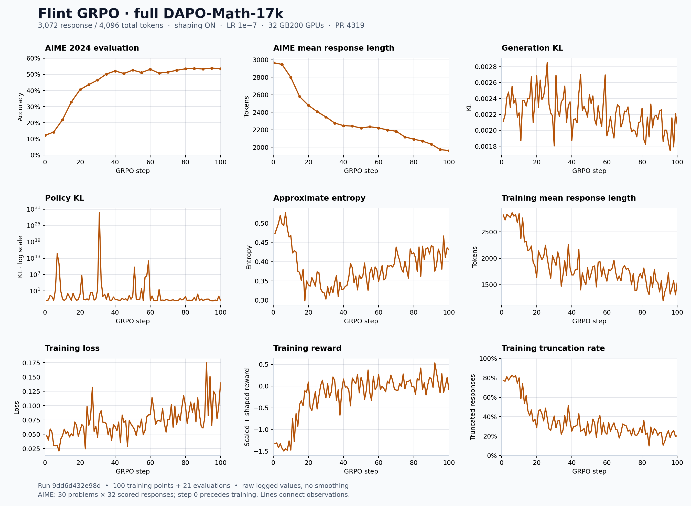

# Flint GRPO with AutoModel and SGLang

This guide covers the native 49-layer Flint model with NeMo AutoModel training
and SGLang generation on GB200. The reference recipe trains on the full
DAPO-Math-17k split for 100 GRPO steps with reward shaping, a learning rate of
`1e-7`, and the FlashInfer PR 4319 backport.

> [!IMPORTANT]
> This is an early-access integration. The native Flint AutoModel implementation,
> Flint SGLang model package, original weights, and validated runtime artifacts
> require separate access. This branch contains the NeMo RL integration and
> external fixes; a stock NeMo RL image or `uv sync --extra sglang` does not
> reproduce the runtime below.

## Support Status

| Stage | Evidence |
| --- | --- |
| Functionally ready | Four-layer and full 49-layer training, policy refit, checkpoint save, and optimizer resume were exercised on the native runtime. |
| Reference training completed | [Run `9dd6d432e98d`](https://forge.coreweave.com/wandb/nvidia/Flint%20GRPO/runs/9dd6d432e98d) completed 100 GRPO steps, with 21 AIME evaluations. |
| Broader convergence validation | Multiple seeds, other hardware, other precision modes, and longer runs are not established by this result. |

The run began from original weights. It was extended from 50 to 100 steps and
continued across allocation windows using training checkpoints. The plot below
shows the complete experiment, rather than a single scheduler job.

## What's Supported

| Capability | Reference configuration |
| --- | --- |
| Modality / algorithm | Text, GRPO with DAPO-style clipping and overlong reward shaping |
| Training | Native AutoModel; FSDP, context parallelism 2, tensor parallelism 1, expert parallelism 1; activation checkpointing |
| Generation | SGLang/Miles; FA4 attention; `flashinfer_trtllm_routed` MoE runner |
| Placement | Colocated training and generation; 8 nodes × 4 GB200 GPUs = 32 GPUs |
| Serving replicas | 32 TP1 engines, up to 8 concurrent requests per engine; round-robin routing |
| Precision | FP32 training parameters with BF16 mixed precision; model-declared FP32 head/sinks preserved during training; BF16 serving with an FP32 LM head |
| Sequence limits | 3,072 response tokens, 4,096 total tokens, up to 1,024 prompt tokens |
| Unsupported claims | No full-logits parity claim; no general hardware or checkpoint-format portability claim |

## Build Environment

The validated runtime uses three Python environments so training and serving
can use different Transformers versions. Its package names still report
FlashInfer `0.6.16.post1` after the backport: a version string alone does not
prove PR 4319 is loaded.

| Component | Reference pin |
| --- | --- |
| Python / PyTorch | Python 3.13.14 / `torch==2.11.0+cu130` |
| Ray | `2.58.0` in all three profiles |
| AutoModel | `d7cdb35446e2f44f232f0005a4bb5ecda3ce85c6`, plus the sink-checkpoint patch |
| Transformers | `5.18.0` in driver/training; `5.12.1` in serving |
| Transformer Engine | `2.19.0` in training |
| SGLang/Miles | `3003d70f680d41c59d1b7acbf65cb47795dfd19e` (`0.5.17.dev30+g3003d70f6`) |
| FlashInfer | Python/cubin `0.6.16.post1`; JIT cache `0.6.16.post1+cu130`; rebuilt SM100 MoE library with [PR 4319](https://github.com/flashinfer-ai/flashinfer/pull/4319) |
| Base runtime artifact | `flint-nemorl-terry-20261019-arm64-native-01.sqsh` |

The [stack manifest](../../../../integrations/flint/runtime/stack.json) records
the exact source and binary checksums. The [integration directory](../../../../integrations/flint/README.md)
contains the AutoModel sink-checkpoint, SGLang refit, hybrid-KV offload,
FA4 learned-sink, and FlashInfer patches. The image installer also adds the
managed router's `router_policy` compatibility alias.

### Assemble the runtime layer

The [runtime Dockerfile](../../../../integrations/flint/runtime/Dockerfile) adds
this checkout and the reviewed fixes to an OCI import of the validated Flint
base image. It is an overlay build, not a build from a public generic CUDA image.
Prepare these private inputs under the ignored `.flint-build/` directory:

| Build input | Required content |
| --- | --- |
| `.flint-build/flint-sglang/src/flint_sglang/` | The validated native plugin, including refit support; source hashes must match `stack.json`. The existing `sglang-flint-refit.patch` records the changes to the original plugin. |
| `.flint-build/flashinfer-pr4319/` | The validated bundle: `manifest.json`, rebuilt `fused_moe_trtllm_sm100.so`, patched CUDA source, build receipt, and validation receipt. |
| `FLINT_BASE_IMAGE` | A locally available OCI image imported from the validated Flint SQSH, containing `/opt/flint/bin/python-{driver,training,sglang}` and the native AutoModel tree. |

```bash
# Run from the repository root on the Linux AArch64 build host.
export FLINT_BASE_IMAGE=your-registry/flint-native-01:validated
docker build --platform linux/arm64 \
  --build-arg FLINT_BASE_IMAGE="$FLINT_BASE_IMAGE" \
  -f integrations/flint/runtime/Dockerfile \
  -t flint-grpo:pr4319 .
```

The installer rejects unrecognized source versions, checks the private plugin
hashes and validation receipts, and installs both the patched source and the
compiled MoE library. The build verifies package and binary pins without
initializing CUDA. Before training, run this inside every GPU container:

```bash
export FLINT_FLASHINFER_RECEIPT_DIR=/flint-run/evidence/flashinfer
/opt/flint/bin/python-sglang integrations/flint/runtime/tools/verify_runtime.py \
  --manifest-sha256 "$FLINT_FLASHINFER_MANIFEST_SHA256" \
  --receipt-dir "$FLINT_FLASHINFER_RECEIPT_DIR" --load
```

This checks the actual library mapped into the process, including its inode and
SHA256. The serving wrapper repeats the checks in workers and spawned children.
The approved bundle passed 480 synthetic/reference calls with PDL enabled, 480
with PDL disabled, an 8-call memory-checker case, and a full-model engine check.
A rebuilt binary needs its own validation; copying a success receipt from
another binary is rejected.

The overlay installer and worker guards have CPU regression coverage. The new
Docker packaging has not itself been rebuilt or trained on GPUs; the training
result uses the original image plus equivalent runtime overlays.

## Get Weights and Data

Obtain the original Flint checkpoint through the model's access process and
mount it read-only at `/flint-model` on every node. Its native architecture must
be registered as `FlintForCausalLM`. The default AutoModel submodule in a generic
NeMo RL checkout is insufficient; the native implementation is maintained in
the separate [AutoModel integration](https://github.com/snowmanwwg/Automodel-private-20261017/pull/1).

Use a shared, writable `/flint-run` for logs, caches, and checkpoints. Stage the
reference dataset snapshots before an offline run:

| Dataset | Reference revision | Stored split |
| --- | --- | --- |
| `BytedTsinghua-SIA/DAPO-Math-17k` | `65877096c24ffa7abc4e4fa5edb95cf3413a5674` | 1,791,700 rows, including repeated prompts |
| `BytedTsinghua-SIA/AIME-2024` | `aa49075e24ad594b79fdf0bdcefa735c2181be67` | 960 rows: 30 problems × 32 |

The recipe uses the full DAPO dataset, not either of the mini datasets. The
dataset wrappers load the named Hugging Face datasets; they do not enforce a
revision argument. For exact reproduction, populate and verify the cache with
the revisions above and use `HF_DATASETS_OFFLINE=1` and `HF_HUB_OFFLINE=1`.

## Example Recipes

| Recipe | Purpose |
| --- | --- |
| [Four-layer smoke](../../../../examples/configs/recipes/llm/grpo-flint-4layer-1n4g-automodel-sglang-quick.yaml) | Small proxy for initial integration checks. |
| [49-layer smoke](../../../../examples/configs/recipes/llm/grpo-flint-49layer-1n4g-automodel-sglang-actckpt-quick.yaml) | Two short steps on the full model; requires the smoke arithmetic data. |
| [Full DAPO, 3,072 tokens, LR 1e-7](../../../../examples/configs/recipes/llm/grpo-flint-49layer-8n4g-dapo-3072-shaping-lr1e-7.yaml) | The 100-step reference experiment below. |

### Reference recipe settings

| Setting | Value |
| --- | --- |
| Rollout batch | 32 prompts × 8 responses = 256 trajectories per GRPO step |
| Training batch | Global 128, microbatch 1; two optimizer updates per GRPO step |
| Optimizer | AdamW, LR `1e-7`, weight decay `0.1`, betas `(0.9, 0.95)` |
| Schedule | 10 GRPO steps of linear warmup, then constant; scheduler advances once per GRPO step |
| Rewards | Scaling to target minimum `-1`; overlong shaping enabled, buffer 512 tokens |
| Sampling | Temperature 1, top-p 1; dynamic sampling and overlong filtering disabled |
| Loss | Reference KL coefficient 0; truncated importance sampling ratio 2; upper clip 0.28, dual clip 10 |
| Validation | Before training, every 5 steps, and at the end; all 960 AIME rows in one queue, one generation per row |
| Validation length | Same 3,072 response / 4,096 total limits as training; this is not the separate 16K evaluation experiment |
| Checkpointing | Every 5 steps; retain two; save before the three-hour loop deadline |
| Stopping | 100 steps, maximum 1,000 epochs; the step limit is reached first |

### Launch

Run the same image and mounts on all eight nodes. Start a Ray cluster using the
driver profile (`/opt/flint/bin/python-driver -m ray.scripts.scripts start`),
advertise all four GPUs per node, and use the same environment on the head and
workers. The NeMo RL [cluster guide](../../../cluster.md) covers allocation and
Ray startup. On dual-socket hosts, make both sockets' CPUs available to the
container and retain soft preferred-memory placement; strict single-socket
memory binding caused host-memory exhaustion in earlier experiments.

On the head node, after all 32 GPUs have joined:

```bash
cd /opt/flint/RL
# Choose a new ID for a fresh experiment; retain it only for that experiment's resumes.
export WANDB_RUN_ID=your-new-flint-run-id
export WANDB_BASE_URL=https://forge.coreweave.com
export FLINT_FLASHINFER_RECEIPT_DIR=/flint-run/evidence/flashinfer
export FLINT_TRITON_CACHE_BASE=/flint-run/cache/triton
export HF_HOME=/flint-run/cache/huggingface
# Supply W&B credentials through your normal secret mechanism.
/opt/flint/bin/python-driver integrations/flint/runtime/tools/launch_grpo.py \
  --config examples/configs/recipes/llm/grpo-flint-49layer-8n4g-dapo-3072-shaping-lr1e-7.yaml
```

The launcher registers the native model before loading its configuration and
routes training, rollout control, and serving to their respective Python
profiles. It applies `CUDA_LAUNCH_BLOCKING=1` only to serving, matching the
reference launch. It does not submit successor jobs. When the checkpoint
deadline ends a window, resume with the same checkpoint directory and W&B ID
under a new allocation; use an empty directory and a new ID for a fresh run.

## Reference Results

The [completed W&B run](https://forge.coreweave.com/wandb/nvidia/Flint%20GRPO/runs/9dd6d432e98d)
contains 100 training points and 21 validation points. The figure reproduces the
nine metrics in `flint-qwen-chart-report-20261028.html` for this run alone.



| Measurement | Initial | Final |
| --- | --- | --- |
| AIME 2024 mean accuracy | 12.19% at step 0 | 53.54% at step 100 |
| AIME mean response length | 2,968 tokens at step 0 | 1,961 tokens at step 100 |
| Training mean response length | 2,819 tokens at step 1 | 1,537 tokens at step 100 |
| Training truncation | 77.34% at step 1 | 20.31% at step 100 |

The highest logged AIME score is **53.85% at step 95**. AIME accuracy is the
mean over the 960 scored responses, not pass@32. Step 0 is before optimization
but already uses this recipe's generation settings, including its length cap.

All values are raw and unsmoothed, indexed by `nemo_rl/step`. Policy KL uses a
logarithmic axis and retains its large outliers. The two KL panels are the
logged generation/training log-probability discrepancy diagnostics, not a
nonzero reference-policy KL loss. Reward includes scaling and the overlong
penalty, so it can be below `-1` and is not an accuracy measure.

Download the [SVG](results/9dd6d432e98d-nine-panels.svg) or
[selected metric data](results/9dd6d432e98d.json). Rebuild the figure with:

```bash
uv run docs/guides/models/flint/results/plot.py
```

## Known Issues and Scope

- PR 4319 addresses the BF16 MoE intermediate-buffer allocation failure on
  SM100. Host OOM, distributed-worker failures, and filesystem exhaustion are
  different failure classes and are not fixed by that kernel patch.
- Native model code, weights, and compiled runtime artifacts are separate
  dependencies. The branch does not vendor the private model source trees.
- The original runtime includes dependency-metadata exceptions. A generic
  dependency resolver can replace the validated serving stack with incompatible
  packages; preserve the three isolated profiles and their pins.
- Full-logits parity, exhaustive optimizer-state equality, and convergence
  across seeds remain unverified. The large policy-KL outliers are retained as
  diagnostic evidence rather than hidden by the plot.
