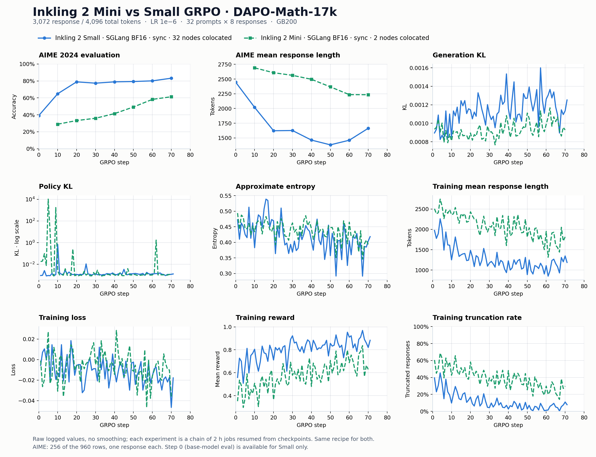
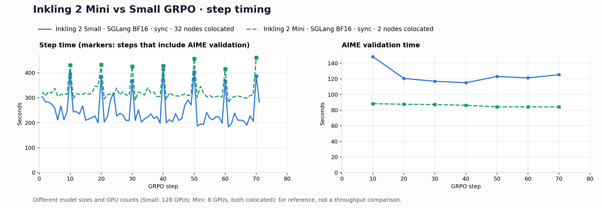

# Inkling 2 Mini GRPO with AutoModel

This guide covers GRPO for Inkling 2 Mini, a looped MoE (24 stored layers,
128 routed experts, about 27B parameters) with NeMo AutoModel training and
synchronous SGLang BF16 generation on 2 GB200 nodes. Layers 6–17 form a core
block that runs three times per forward pass, so the 24 stored layers apply 48
times. The checkpoint's `model_type` is `inkling2_loop`, with a `loop_config`
(`core_start` 6, `core_end` 18, `num_passes` 3, `gate_rank` 64).

Mini uses the same recipe settings as [Inkling 2 Small](inkling2-small.md), and
the plots below overlay both SGLang BF16 synchronous experiments. Recipes are in
this branch.

> [!IMPORTANT]
> This is an early-access integration. Mini training needs the looped-Inkling2
> AutoModel support in
> [HuiyingLi/Automodel-day0#13](https://github.com/HuiyingLi/Automodel-day0/pull/13),
> which is not in this branch's AutoModel submodule, and Mini serving needs the
> SGLang source that ships with the checkpoint (`sglang.zip`), which is not the
> `sglang` extra pinned here. Both are mounted over a prebuilt container; see
> [Build Environment](#build-environment).

## Support Status

| Stage | Evidence |
| --- | --- |
| Functionally ready | 3-step smoke test on 1 node; full 24-layer training, dummy-load first refit, timed checkpoint save, and optimizer resume across four 2 h allocation windows. |
| Reference training completed | 70 GRPO steps and 7 AIME evaluations with SGLang BF16 sync on 2 GB200 nodes. |
| Broader convergence validation | Multiple seeds, longer runs, other hardware, and a controlled comparison with Inkling 2 Small are not established by these results. |

The experiment began from the original weights and continued across four 2 h
allocation windows using training checkpoints. Unlike the Small experiments, it
has no step-0 base-model evaluation.

## What's Supported

| Capability | SGLang BF16, sync |
| --- | --- |
| Modality / algorithm | Text, GRPO |
| Training | AutoModel; FSDP2, EP8 across both nodes with the torch dispatcher; activation checkpointing |
| Generation | SGLang, FA4 attention, two TP4 / EP4 engines (one per node) |
| Placement | Colocated; 2 nodes × 4 GB200 GPUs = 8 GPUs |
| Serving precision | BF16 experts (`quantization.scheme: bf16`); refit is a BF16 copy |
| Training precision | BF16 parameters; the FP32 attention-residual queries, cross-pass queries, and router bias stay FP32 through refit |
| Sequence limits | 3,072 response tokens, 4,096 total tokens, up to 1,024 prompt tokens |

## Build Environment

| Component | Requirement |
| --- | --- |
| Container | The Inkling 2 Small SGLang BF16 container: NeMo RL, AutoModel, and a pre-release Inkling2 SGLang source drop with `torch==2.14.1`, `sglang-kernel==0.4.9`, FlashInfer `0.7.0.post1`, Transformers `5.19.0`. Mini's SGLang drop pins the same versions, so no new image is needed. |
| AutoModel | [HuiyingLi/Automodel-day0#13](https://github.com/HuiyingLi/Automodel-day0/pull/13) (branch `huiyingl/feat/inkling2-loop`), mounted with `AM_OVERRIDE` pointing at its `nemo_automodel` directory. This branch's submodule pin is unchanged. |
| SGLang | The `sglang.zip` in the Mini checkpoint, staged by [`tools/inkling2/stage_mini_sglang.py`](../../../../tools/inkling2/stage_mini_sglang.py) and mounted with `SGLANG_OVERRIDE` |
| Hardware | GB200; the reference run used 2 nodes |

Stage Mini's SGLang once, then mount it:

```bash
python tools/inkling2/stage_mini_sglang.py <mini-release>/sglang.zip <staged-sglang-dir>
```

Staging unpacks `python/sglang`, writes the `sglang/_version.py` that a source
checkout lacks, and relaxes one config check. Mini's `Inkling2Config` raised
`Looped Inkling2 checkpoints use model_type inkling2_loop…` when Transformers
built a bare `Inkling2Config()` (no `text_config`, so no `loop_config`) to print a
repr, which killed SGLang at startup. The staged copy validates only an explicit
`text_config`. This is a bug in the SGLang drop and should be fixed there.

## Get Weights and Data

Obtain the original Inkling 2 Mini checkpoint through the model's access
process. The release stores routed experts packed (NVFP4 / MXFP8). Mini needs
only one lightweight view:

| View | Contents | Recipe field |
| --- | --- | --- |
| Release directory itself | AutoModel loads it directly with `dequantize_base_checkpoint: true`, which decodes the packed experts into BF16 training weights, so no text-only view is needed | `policy.model_name` |
| SGLang BF16 view | `hf_quant_config.json` listing the experts as BF16 ([`tools/inkling2/make_sglang_bf16_view.py`](../../../../tools/inkling2/make_sglang_bf16_view.py)). SGLang starts with `load_format: dummy` and the first refit supplies every weight | `policy.generation.sglang_cfg.model_path` |

Mount the release directory itself in the container at the same path, so the
view's symlinks resolve. The recipes use `/path/to/...` placeholders.

| Dataset | Use |
| --- | --- |
| `DAPOMath17K` | Training (5% held out by the dataset split) |
| `DAPOMathAIME2024` | Validation: 256 of the 960 rows (30 problems × 32), one response per row |

## Example Recipes

| Recipe | Purpose |
| --- | --- |
| [1-node smoke](../../../../examples/configs/recipes/llm/grpo-inkling2-mini-smoke-1n4g-automodel-sglang.yaml) | 3 steps, 8 prompts × 4 responses, 1,024 total tokens, OpenMathInstruct-2, no validation or checkpoint. Checks the policy load, the first refit, and train/serve logprob agreement before a long run. |
| [2-node GB200](../../../../examples/configs/recipes/llm/grpo-inkling2-mini-2n4g-automodel-sglang.yaml) | The SGLang BF16 sync reference experiment below. |

Both recipes inherit the settings of the
[Inkling 2 Small base recipe](../../../../examples/configs/recipes/llm/grpo-inkling2-8n4g-automodel-sglang.yaml).

### Reference recipe settings

| Setting | SGLang BF16, sync |
| --- | --- |
| Rollout batch | 32 prompts × 8 responses = 256 trajectories per step |
| Training batch | Global 256, microbatch 1 |
| Optimizer | `torch.optim.AdamW`, LR `1e-6`, weight decay `0.1`, betas `(0.9, 0.95)` |
| Schedule | 5 steps of linear warmup (from 1% of LR), then constant |
| Loss | Reference KL 0; clip 0.2 / 0.28; truncated importance sampling ratio 2; sequence-level loss |
| Sampling | Temperature 1, top-p 1 |
| Validation | Every 10 steps; no step-0 evaluation |
| Checkpointing | Saved at 1 h 50 min, before each 2 h job's time limit, and resumed by the next job |

### Launch

[`tools/inkling2/launch_slurm.sh`](../../../../tools/inkling2/launch_slurm.sh)
submits one self-ending job through `ray.sub`. The `mini` mode runs the 2-node
recipe and `mini-smoke` runs the 1-node smoke test:

```bash
ACCOUNT=<slurm-account> CONTAINER=<nemo-rl-image.sqsh> WORKDIR=<shared-dir> \
SECRETS_FILE=<file exporting WANDB_API_KEY> \
QOS_OVERRIDE=<qos> TIME_OVERRIDE=02:00:00 \
AM_OVERRIDE=<automodel-pr13>/nemo_automodel SGLANG_OVERRIDE=<staged-sglang-dir> \
DATA_MOUNTS=<release-dir>:<release-dir> \
EXTRA_OVERRIDES='checkpointing.enabled=true policy.model_name=<mini-release> policy.generation.sglang_cfg.model_path=<sglang-bf16-view>' \
bash tools/inkling2/launch_slurm.sh mini
```

Each job saves a checkpoint at the job time limit minus `SAVE_MARGIN_MIN`
(default 10 minutes) and exits. Rerun the same command to continue: the mode
keeps checkpoints in `$WORKDIR/checkpoints/mini` and resumes from the latest one.

## Reference Results

The experiment is in the W&B project
[`nvidia/GRPO Inkling`](https://wandb.ai/nvidia/GRPO%20Inkling). Each 2 h job
logged a separate run (named `…mini-1n4g…`, from before the recipe was renamed to
2 nodes):

| Experiment | W&B runs (in order) |
| --- | --- |
| Inkling 2 Mini, SGLang BF16, sync | [`o9a09uon`](https://wandb.ai/nvidia/GRPO%20Inkling/runs/o9a09uon) (1–18), [`mzbiffl5`](https://wandb.ai/nvidia/GRPO%20Inkling/runs/mzbiffl5) (19–35), [`ut8wcjr4`](https://wandb.ai/nvidia/GRPO%20Inkling/runs/ut8wcjr4) (36–52), [`ylcel63d`](https://wandb.ai/nvidia/GRPO%20Inkling/runs/ylcel63d) (53–70) |

The Small SGLang BF16 sync runs are listed in the
[Small guide](inkling2-small.md#reference-results). The figure overlays Mini on
that experiment using the same nine metrics. **Blue, solid: Inkling 2 Small. Green,
dashed: Inkling 2 Mini.**



| Measurement | Inkling 2 Small | Inkling 2 Mini |
| --- | --- | --- |
| AIME 2024 accuracy, step 0 (base model) | 39.06% | not evaluated |
| AIME 2024 accuracy, step 10 | 64.84% | 28.91% |
| AIME 2024 accuracy, step 20 | 78.91% | 33.20% |
| AIME 2024 accuracy, step 40 | 78.91% | 41.41% |
| AIME 2024 accuracy, step 70 (last evaluation) | **83.20%** | **61.33%** |
| AIME mean response length, step 70 | 1,664 tokens | 2,234 tokens |
| Training reward, mean of last 10 steps | 0.868 | 0.689 |
| Training truncation, step 1 → mean of last 10 steps | 39.45% → 6.4% | 60.55% → 25.7% |
| Generation KL, median | 0.0011 | 0.0009 |
| Step time, median (including validation steps) | 224 s on 128 GPUs | 312 s on 8 GPUs |

Mini starts well below Small and keeps improving through step 70: its AIME
accuracy rises from 29% at step 10 to 61% at step 70, still climbing at the last
evaluation, while Small plateaus near 79–83% after step 20. Mini's responses
start longer and truncate more often (61% of step-1 responses hit the
3,072-token limit, 26% in the last 10 steps), so a larger share of its early
reward signal is lost to truncation. With a 0/1 math-verify reward, training reward equals
training accuracy on the sampled prompts.

How to read the comparison:

- **Not a controlled comparison.** The two models differ in size, depth, and
  training layout (Small: 128 GPUs, EP64 with HybridEP; Mini: 8 GPUs, EP8 with the
  torch dispatcher). The recipe settings (data, batch, LR, loss, sequence limits)
  are the same, so the curves compare how the models learn from the same task,
  not their step time.
- **No base-model reference for Mini.** Mini's first evaluation is after 10
  training steps, so the step-10 gap to Small includes ten steps of training
  that Small's step 0 does not.
- **Generation KL** is the logged generation/training log-probability
  discrepancy, not a reference-policy KL loss. Mini's stays below 0.0012
  throughout.
- **Policy KL** uses a logarithmic axis and keeps its outliers. Mini has large
  spikes at steps 5 (about 10⁴), 6, 9 (about 10³), and 62 (about 2), and a
  smaller one at step 18 (0.26); Small has one at step 10. After the early
  spikes Mini's policy KL settles near 10⁻³. The cause of the spikes has not been
  isolated, and training reward and AIME accuracy kept improving through them.
- **Step time** is measured on different GPU counts; it is reported for
  reference, not as a throughput comparison. See [Step Timing](#step-timing).

### Step Timing



| Median step time | Inkling 2 Small | Inkling 2 Mini |
| --- | --- | --- |
| Steps without validation | 221 s | 311 s |
| Steps with AIME validation (every 10th) | 387 s | 431 s |
| AIME validation alone | 121 s (115–148 s) | 86 s (84–88 s) |

Mini's steps without validation are slower than Small's because it trains and
generates on 8 GPUs instead of 128. Its AIME validation is faster: 8 GPUs serve
256 prompts from two engines, but the model is far smaller.
Validation adds about 120 s to a Mini step.

All values are raw and unsmoothed, indexed by `nemo_rl/step`. Download the
[SVG](results/inkling2-mini-vs-small-nine-panels.svg), the
[step-timing SVG](results/inkling2-mini-vs-small-step-time.svg), or the
[selected metric data](results/inkling2-mini-vs-small.json). Rebuild both figures with:

```bash
uv run docs/guides/models/inkling/results/plot_mini_vs_small.py
```

The data file merges the Small reference rows with the Mini W&B runs;
[`build_mini_vs_small_data.py`](results/build_mini_vs_small_data.py) rebuilds it
from a dump of the W&B runs.

## Known Issues and Scope

- **EP4 across 2 nodes fails.** With `expert_parallel_size: 4` on 2 nodes the
  first backward pass raised `aten.split_with_sizes.default invocation index 1
  encountered during backward but not found in storage`, an activation-checkpoint
  recompute mismatch against FSDP's all-gather. The suspected cause is the
  experts being FSDP-sharded over an extra data-parallel dimension; it has not
  been confirmed. EP8 across both nodes works, so the recipe uses it. The 1-node
  smoke recipe uses EP4.
- **Mini's SGLang needs a config patch** (see [Build Environment](#build-environment)),
  because the shipped `Inkling2Config` rejects the default-constructed config
  that Transformers builds.
- **Refit dtype.** Mini adds FP32 cross-pass queries
  (`middle_cycle_cross_pass_queries`, `middle_cycle_cross_pass_kv_queries`) that
  refit must send as FP32, like the attention-residual queries and router bias;
  sending them as BF16 fails the refit's dtype check.
- **Pins differ from the Small branch.** This branch's `sglang` extra tracks
  sgl-project/sglang#50186 (`sglang-kernel==0.4.11`), and its AutoModel submodule
  tracks AutoModel main; Mini ran on the container's SGLang drop and AutoModel PR
  13 mounted over it. The exact dependency set pinned in this branch has not
  completed a Mini run.
- **Transformer Engine.** AutoModel PR 13 asks for Transformer Engine ≥ 2.19; the
  container has 2.18, and the reference run worked with it.
- **Synchronous checkpoints.** Inkling2 checkpoints are saved synchronously, as
  for Small.
- **Inkling2 refit through this branch supports BF16 serving only.** Requesting
  checkpoint-precision export raises an error. Mini was not run with vLLM or
  quantized serving.
- Convergence across seeds, longer runs, and other hardware remain unverified.
