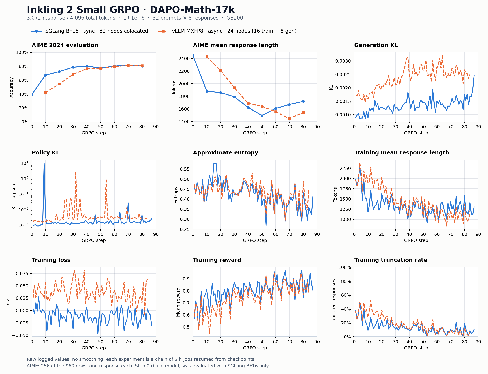

# Inkling 2 Small GRPO with AutoModel

This guide covers GRPO for Inkling 2 Small, a 48-layer MoE with 384 routed
experts, with NeMo AutoModel training on GB200. Two reference experiments are
reported side by side:

- **SGLang BF16, synchronous.** Colocated training and SGLang generation that
  serves BF16 experts.
- **vLLM MXFP8, asynchronous.** Non-colocated training and vLLM generation that
  serves MXFP8 experts, with async GRPO.

Recipes for both modes are in this branch.

> [!IMPORTANT]
> This is an early-access integration. Inkling 2 Small SGLang support comes from
> the open [sgl-project/sglang#50186](https://github.com/sgl-project/sglang/pull/50186),
> and vLLM support from [vllm-project/vllm#67325](https://github.com/vllm-project/vllm/pull/67325).
> Neither is in a tagged release. SGLang serving needs the `sglang` extra pinned
> here; vLLM serving needs a container whose vLLM includes vllm-project/vllm#67325.

## Support Status

| Stage | Evidence |
| --- | --- |
| Functionally ready | Proxy (8 layers, 96 experts) and full 48-layer training, chunked expert refit, timed checkpoint save, and optimizer resume across 2 h allocation windows. |
| Reference training completed | SGLang BF16 sync: 87 GRPO steps and 9 AIME evaluations. vLLM MXFP8 async: 84 GRPO steps and 8 AIME evaluations. |
| Broader convergence validation | Multiple seeds, other hardware, longer runs, and a controlled comparison of the two modes are not established by these results. |

Both experiments began from the original weights and continued across 2 h
allocation windows using training checkpoints. The plot below shows each
complete experiment rather than a single scheduler job.

## What's Supported

| Capability | SGLang BF16, sync | vLLM MXFP8, async |
| --- | --- | --- |
| Modality / algorithm | Text, GRPO | Text, async GRPO (trajectory age ≤ 1 step, in-flight weight updates) |
| Training | AutoModel; FSDP2, EP64 with the HybridEP dispatcher in 16-node rack segments; activation checkpointing | AutoModel; FSDP2, EP64 with the torch dispatcher |
| Generation | SGLang, FA4 attention, TP8 / EP8 engines (2 nodes per engine) | vLLM, TP8 engines with experts sharded over TP (2 nodes per engine, 4 engines) |
| Placement | Colocated; 32 nodes × 4 GB200 GPUs = 128 GPUs | Non-colocated; 16 training + 8 generation nodes × 4 GB200 GPUs = 96 GPUs |
| Serving precision | BF16 experts (`quantization.scheme: bf16`); refit is a BF16 copy | MXFP8 experts; refit quantizes the BF16 training weights to MXFP8 |
| Training precision | BF16 parameters; FP32 attention-residual queries and router bias kept FP32 through refit | BF16 parameters with FP32 master weights |
| Sequence limits | 3,072 response tokens, 4,096 total tokens, up to 1,024 prompt tokens | Same |

## Build Environment

| Component | Requirement |
| --- | --- |
| AutoModel | `NVIDIA-NeMo/Automodel` main with native Inkling2 training and HybridEP ([NVIDIA-NeMo/Automodel#4755](https://github.com/NVIDIA-NeMo/Automodel/pull/4755)); this branch's submodule |
| SGLang | [sgl-project/sglang#50186](https://github.com/sgl-project/sglang/pull/50186), `torch==2.14.1`, `sglang-kernel==0.4.11`, FlashInfer `0.7.4` (the `sglang` extra) |
| vLLM | A build with [vllm-project/vllm#67325](https://github.com/vllm-project/vllm/pull/67325), which serves Inkling2 routed experts as NVFP4 or MXFP8 only; refit quantizes the BF16 experts to MXFP8 ([`inkling2_mxfp8_refit.py`](../../../../nemo_rl/models/generation/vllm/inkling2_mxfp8_refit.py)) |
| Transformers | `5.18.0` for AutoModel training; `5.19.0` for SGLang serving |
| Hardware | GB200 NVL72; the 32-node recipe needs Slurm `--segment=16` so each 64-GPU EP group stays inside one rack |

Building SGLang from source runs `cargo` to discover its Rust extensions; set
`SGLANG_BUILD_RUST_EXTS=none` where Rust is unavailable (also needed for
`uv lock`).

## Get Weights and Data

Obtain the original Inkling 2 Small checkpoint through the model's access
process. The release stores routed experts packed (NVFP4 in layers 0–39, MXFP8
in 40–47). The SGLang BF16 recipes read two lightweight views of it (metadata
files plus symlinks to the release weights):

| View | Contents | Recipe field |
| --- | --- | --- |
| AutoModel text-only view | `config.json` carrying `quantization_config`, so AutoModel decodes the packed experts into BF16 training weights | `policy.model_name` |
| SGLang BF16 view | `hf_quant_config.json` listing the experts as BF16 ([`tools/inkling2/make_sglang_bf16_view.py`](../../../../tools/inkling2/make_sglang_bf16_view.py)). SGLang starts with `load_format: dummy` and the first refit supplies every weight | `policy.generation.sglang_cfg.model_path` |

The vLLM MXFP8 recipes use their own pair of views, built by
[`tools/inkling2/make_vllm_mxfp8_views.py`](../../../../tools/inkling2/make_vllm_mxfp8_views.py):
a vLLM view (`policy.generation.model_name`) that marks every layer's experts
MXFP8, and an AutoModel text-only view (`policy.model_name`).

Mount the release directory itself in the container at the same path, so the
symlinks resolve. The recipes use `/path/to/...` placeholders for the views.

| Dataset | Use |
| --- | --- |
| `DAPOMath17K` | Training (5% held out by the dataset split) |
| `DAPOMathAIME2024` | Validation: 256 of the 960 rows (30 problems × 32), one response per row |

## Example Recipes

| Recipe | Purpose |
| --- | --- |
| [1-node proxy](../../../../examples/configs/recipes/llm/grpo-inkling2-proxy-1n4g-automodel-sglang.yaml) | Real-format proxy (8 layers, 96 experts; [`make_proxy.py`](../../../../tools/inkling2/make_proxy.py)) for plumbing and train/serve logprob checks. |
| [4-node proxy](../../../../examples/configs/recipes/llm/grpo-inkling2-proxy-4n4g-gb200-automodel-sglang.yaml) | Proxy with the full run's engine shape (2-node TP8/EP8 engines, chunked refit). |
| [8-node GB300 base](../../../../examples/configs/recipes/llm/grpo-inkling2-8n4g-automodel-sglang.yaml) | Base settings shared by the GB200 recipes. |
| [16-node GB200](../../../../examples/configs/recipes/llm/grpo-inkling2-16n4g-gb200-automodel-sglang.yaml) | Does not fit: SGLang runs out of memory resuming its weights next to the policy shard. |
| [32-node GB200](../../../../examples/configs/recipes/llm/grpo-inkling2-32n4g-gb200-automodel-sglang.yaml) | The SGLang BF16 sync reference experiment below. |
| [vLLM tiny 1-node](../../../../examples/configs/recipes/llm/grpo-inkling2-tiny-1n4g-automodel-vllm-mxfp8.yaml) | vLLM MXFP8 pipeline smoke test on a tiny random-weight checkpoint ([`make_tiny_mxfp8_view.py`](../../../../tools/inkling2/make_tiny_mxfp8_view.py)). |
| [vLLM 16-node GB200](../../../../examples/configs/recipes/llm/grpo-inkling2-16n4g-automodel-vllm-mxfp8.yaml) | vLLM MXFP8, colocated; base for the async recipe. |
| [vLLM 24-node GB200 async](../../../../examples/configs/recipes/llm/grpo-inkling2-24n4g-automodel-vllm-mxfp8-async.yaml) | The vLLM MXFP8 async reference experiment below (16 training + 8 generation nodes). |

### Reference recipe settings

| Setting | SGLang BF16, sync | vLLM MXFP8, async |
| --- | --- | --- |
| Rollout batch | 32 prompts × 8 responses = 256 trajectories per step | Same |
| Training batch | Global 256, microbatch 1 | Same |
| Optimizer | `torch.optim.AdamW`, LR `1e-6`, weight decay `0.1`, betas `(0.9, 0.95)` | Transformer Engine `FusedAdam`, same LR / decay / betas; BF16 moments, FP32 master weights |
| Schedule | 5 steps of linear warmup (from 1% of LR), then constant | Same |
| Loss | Reference KL 0; clip 0.2 / 0.28; truncated importance sampling ratio 2; sequence-level loss | Reference KL 0; clip 0.2 / 0.28; truncated importance sampling ratio 5; token-level loss |
| Sampling | Temperature 1, top-p 1 | Same |
| Validation | Every 10 steps; step 0 evaluated separately before training | Every 10 steps |
| Checkpointing | Saved before each job's time limit and resumed by the next job | Same |

### Launch

[`tools/inkling2/launch_slurm.sh`](../../../../tools/inkling2/launch_slurm.sh)
submits one self-ending job through `ray.sub`. It mounts this checkout's
`nemo_rl` and AutoModel trees into the container, requests 16-node segments for
`full32`, and sets `checkpointing.checkpoint_must_save_by` to the job time limit
minus `SAVE_MARGIN_MIN` (default 10 minutes):

```bash
ACCOUNT=<slurm-account> CONTAINER=<nemo-rl-image.sqsh> WORKDIR=<shared-dir> \
SECRETS_FILE=<file exporting WANDB_API_KEY> \
QOS_OVERRIDE=<qos> TIME_OVERRIDE=02:00:00 \
DATA_MOUNTS=<release-dir>:<release-dir> \
EXTRA_OVERRIDES='policy.model_name=<automodel-view> policy.generation.sglang_cfg.model_path=<sglang-bf16-view>' \
bash tools/inkling2/launch_slurm.sh full32
```

Use `vllm-async` instead of `full32` for the vLLM MXFP8 async recipe, with a
container that includes vllm-project/vllm#67325 and
`policy.generation.model_name=<vllm-mxfp8-view>` in `EXTRA_OVERRIDES`. Rerun
the same command to continue: each mode keeps checkpoints in
`$WORKDIR/checkpoints/<mode>` and resumes from the latest one.

## Reference Results

Both experiments are in the W&B project
[`nvidia/GRPO Inkling`](https://forge.coreweave.com/wandb/nvidia/GRPO%20Inkling).
Each 2 h job logged a separate run:

| Experiment | W&B runs (in order) |
| --- | --- |
| SGLang BF16, sync | [`ehmcmnug`](https://forge.coreweave.com/wandb/nvidia/GRPO%20Inkling/runs/ehmcmnug) (step-0 eval), [`1gl23wkh`](https://forge.coreweave.com/wandb/nvidia/GRPO%20Inkling/runs/1gl23wkh) (1–17), [`u1uvgoww`](https://forge.coreweave.com/wandb/nvidia/GRPO%20Inkling/runs/u1uvgoww) (18–40), [`ai60m9ku`](https://forge.coreweave.com/wandb/nvidia/GRPO%20Inkling/runs/ai60m9ku) (41–64), [`m1y9ip39`](https://forge.coreweave.com/wandb/nvidia/GRPO%20Inkling/runs/m1y9ip39) (65–87) |
| vLLM MXFP8, async | [`uk530hix`](https://forge.coreweave.com/wandb/nvidia/GRPO%20Inkling/runs/uk530hix) (1–18), [`d80ps72r`](https://forge.coreweave.com/wandb/nvidia/GRPO%20Inkling/runs/d80ps72r) (19–41), [`yfkayhu1`](https://forge.coreweave.com/wandb/nvidia/GRPO%20Inkling/runs/yfkayhu1) (42–64), [`28de0sqt`](https://forge.coreweave.com/wandb/nvidia/GRPO%20Inkling/runs/28de0sqt) (65–84) |

The figure overlays both experiments on the same nine metrics used for other
model guides. **Blue, solid: SGLang BF16, sync. Orange, dashed: vLLM MXFP8, async.**



| Measurement | SGLang BF16, sync | vLLM MXFP8, async |
| --- | --- | --- |
| AIME 2024 accuracy, first evaluation | 39.06% at step 0 (base model) | 42.19% at step 10 |
| AIME 2024 accuracy, step 40 | 80.08% | 76.56% |
| AIME 2024 accuracy, best | **82.03% at step 70** | **81.25% at step 70** |
| AIME 2024 accuracy, step 80 | 80.08% | 80.86% |
| AIME mean response length, step 80 | 1,718 tokens | 1,541 tokens |
| Training reward, mean of last 10 steps | 0.863 | 0.838 |
| Training truncation, step 1 → mean of last 10 steps | 37.50% → 7.2% | 36.72% → 5.3% |
| Generation KL, median | 0.0013 | 0.0024 |
| Step time, median (including validation steps) | 237 s on 128 GPUs | 214 s on 96 GPUs |

Both experiments reach about 80% AIME accuracy by step 40–70 and then plateau.
The synchronous run improves faster early (67% vs 42% at step 10); by step 50
the curves overlap. With a 0/1 math-verify reward, training reward equals
training accuracy on the sampled prompts.

How to read the comparison:

- **Not a controlled comparison.** Besides serving precision and sync/async,
  the experiments differ in optimizer (AdamW vs FusedAdam), loss normalization
  (sequence- vs token-level), truncated-importance-sampling ratio (2 vs 5), MoE
  dispatcher (HybridEP vs torch), and GPU count and placement (128 colocated vs
  96 split 64/32). Training loss is therefore not comparable across the two
  lines.
- **Step 0 exists for SGLang BF16 only.** It was evaluated by a separate
  validation-only job on the base model; the vLLM MXFP8 line starts at step 10.
- **Generation KL** is the logged generation/training log-probability
  discrepancy, not a reference-policy KL loss. It is higher for MXFP8 serving,
  as expected from serving quantized experts while training in BF16, and also
  includes the async one-step trajectory age.
- **Policy KL** uses a logarithmic axis and keeps its outliers (a step-9 spike
  in the sync run, spikes near steps 32 and 54 in the async run).
- **Step time** is measured on different GPU counts and placements; it is
  reported for reference, not as a throughput comparison.

All values are raw and unsmoothed, indexed by `nemo_rl/step`. Download the
[SVG](results/inkling2-small-nine-panels.svg) or the
[selected metric data](results/inkling2-small.json). Rebuild the figure with:

```bash
uv run docs/guides/models/inkling/results/plot.py
```

## Known Issues and Scope

- **16 nodes does not fit** the SGLang BF16 colocated layout: SGLang resumes
  about 140 GB/GPU of BF16 weights next to the policy shard and dispatch
  buffers. Use the 32-node recipe.
- **EP128 with HybridEP crosses racks** on 32 GB200 nodes, and HybridEP's
  inter-rack RDMA path failed. The 32-node recipe uses EP64 inside 16-node rack
  segments, with experts sharded two ways across the segments.
- **Asynchronous checkpoint staging** failed for Inkling2 (`copy_() on an
  invalid python storage`), so Inkling2 checkpoints are saved synchronously
  (about 70 s for the 6.5 TB weights + optimizer checkpoint).
- **Inkling2 refit through this branch supports BF16 serving only.** Requesting
  checkpoint-precision export raises an error.
- **SGLang and vLLM support are unmerged PRs.** The `sglang` pin in this branch
  tracks sgl-project/sglang#50186 and needs updating once it merges; vLLM
  serving relies on a container built with vllm-project/vllm#67325.
- **The reference experiments ran on an earlier software stack.** The SGLang
  BF16 run used an earlier AutoModel snapshot (the PR 4755 head) and an earlier
  Inkling2 SGLang build, mounted over the same container. The exact dependency
  set pinned in this branch has not yet completed a reference run.
- Convergence across seeds, longer runs, and other hardware remain unverified.
