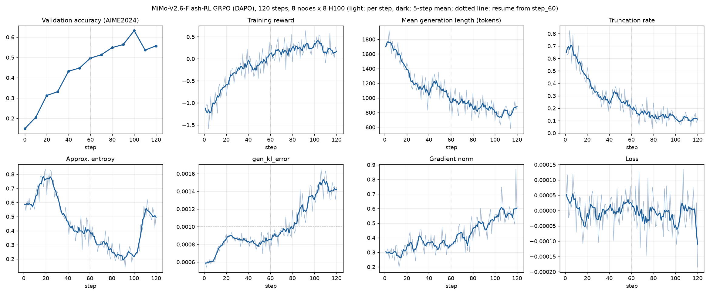

# MiMo-V2.6-Flash-RL

This guide describes GRPO (DAPO recipe) training of `XiaomiMiMo/MiMo-V2.6-Flash-RL` with the AutoModel training backend and BF16 vLLM generation.

> [!IMPORTANT]
> **Status: Functionally Ready (early access).** The reference recipe ran 120 steps with 8 nodes of 8 H100 GPUs, a 3,072-token maximum total sequence length and no crashes. Over those steps validation accuracy rose from 0.149 to 0.557, but `gen_kl_error` drifted upward from 0.0006 to 0.0014 (see [Reference Results](#reference-results)), so long-run convergence has not been established. Support currently lives on development branches; see [Build the Environment](#build-the-environment).

MiMo-V2.6-Flash-RL is a 310B-parameter mixture-of-experts model with 15B active parameters (48 layers, 256 routed experts with top-8 routing, hybrid full and sliding-window attention). The released checkpoint stores attention and dense MLP weights in block-FP8 and routed experts in MXFP4. This recipe loads that checkpoint as is, trains in BF16, and rolls out in BF16.

## Support Status

| Level | Meaning | MiMo-V2.6-Flash-RL |
| --- | --- | --- |
| Functionally Ready | A proxy run and a full-model run complete end to end (generation, refit, training, checkpoint save and resume) with `gen_kl_error` near 1e-3 | Reached |
| Long-Run Convergence Validated | `gen_kl_error` stays near 1e-3 without an upward trend for 100+ steps, with no crash | Not reached: no crash in 120 steps, but `gen_kl_error` rose over the last 50 steps |

## What's Supported

| Model | Modality | Training backend | Training parallelism | Inference engine | Precision |
| --- | --- | --- | --- | --- | --- |
| `XiaomiMiMo/MiMo-V2.6-Flash-RL` | Text (vision and audio towers are loaded by the trainer but not used) | AutoModel | EP64, CP1, activation checkpointing | vLLM (TP16 with expert parallel, two nodes per engine) | BF16 training and BF16 rollout, colocated |

Validated scope:

- **Algorithm**: DAPO-style GRPO on `DAPOMath17K`, validated on `DAPOMathAIME2024`.
- **Batch**: 32 prompts x 8 generations (256 samples) per step, dynamic sampling off.
- **Sequence length**: up to 1,024 prompt tokens and 2,048 new tokens, 3,072 in total.
- **Allocation**: 8 nodes x 8 H100 80GB, colocated training and generation.
- **Router replay (R3)**: on (`policy.router_replay.enabled: true`).
- **Steps**: 120 steps, run as two Slurm jobs; the second resumed from the step-60 checkpoint.
- **MTP**: disabled (`num_nextn_predict_layers: 0`).

## Build the Environment

Support is not on `main` yet. Check out the support branch and initialize its submodules:

- NeMo-RL branch `mimo-v26-flash-support`, based on NeMo-RL `main` at `5939fa538`. It carries the 10 commits of the open NeMo-RL PR #5129, which bumps AutoModel to 41f9262 (0.8.0, transformers 5.18.0) and brings MiMo-V2.6 support (AutoModel PR #3992 and the sliding-window fix #4343), plus the changes listed below.
- AutoModel branch `rl/mimo-v26-support`, which is upstream commit `41f926247` plus one commit that saves Transformer Engine `FusedAdam` state in its stored dtypes. Without it, the first checkpoint save OOMs in `FusedAdam.state_dict`.
- vLLM 0.33.0, as pinned by NeMo-RL `main`; it already contains the MiMo-V2 model classes.

NeMo-RL changes on the branch beyond PR #5129:

- `grpo.py`: `policy.generation.vllm_kwargs.hf_overrides` is merged on top of `policy.hf_config_overrides` instead of being replaced by it.
- `vllm_backend.py`: when vLLM runs the text-only `MiMoV2ForCausalLM`, refit skips the `visual.`, `audio_encoder.` and `speech_embeddings.` weights held by the trainer.

```bash
git clone <support-branch-url> nemo-rl && cd nemo-rl
git checkout mimo-v26-flash-support
git submodule update --init --recursive
```

For multi-node runs, build the virtual environments once before launching, and do not force a rebuild on every node (`NRL_FORCE_REBUILD_VENVS=false`). See [Dependency Management](../../../design-docs/dependency-management.md) for the lock and cache settings.

## Get the Weights

The recipe uses `XiaomiMiMo/MiMo-V2.6-Flash-RL` (166 GiB in the released format). The validated revision is `f657ba2f`. Download it to a path visible from every node and override the path at launch:

```bash
hf download XiaomiMiMo/MiMo-V2.6-Flash-RL --local-dir <model-dir>
# then add to the launch command: policy.model_name=<model-dir>
```

Keep the released `config.json`. The recipe changes what vLLM sees through `hf_overrides` (BF16, split QKV, no vision or audio config); the trainer reads the released config.

## Example Recipes

| Validated sequence length | Training parallelism | Rollout parallelism | `max_new_tokens` | Recipe |
| --- | --- | --- | --- | --- |
| 3,072 | EP64, CP1 | vLLM TP16 + EP, BF16 | 2,048 | [`dapo-mimo-v2.6-flash-8n8g-automodel-ep64.yaml`](../../../../examples/configs/recipes/llm/dapo-mimo-v2.6-flash-8n8g-automodel-ep64.yaml) |

## Choose a Recipe

There is one recipe. Comparisons with other allocations, longer sequence lengths and other rollout precisions have not been run.

## Launch

From the repository root in an allocation of 8 nodes with 8 GPUs each:

```bash
uv run examples/run_grpo.py \
  --config examples/configs/recipes/llm/dapo-mimo-v2.6-flash-8n8g-automodel-ep64.yaml \
  policy.model_name=<model-dir> \
  grpo.max_num_steps=120 \
  checkpointing.save_optimizer=true
```

Notes:

- Match `cluster.num_nodes` to the Slurm allocation. The recipe assumes 8 nodes: EP64 for training, and four two-node vLLM engines.
- Each checkpoint with optimizer state is about 2.3 TB. The recipe keeps the two newest (`keep_top_k: 2`) and saves every 10 steps. `checkpointing.checkpoint_must_save_by` is set for 4-hour Slurm jobs, so a job stops with a final checkpoint and a chained job resumes from it.
- Over the 120 steps the mean step time was 206 seconds (median 184 seconds), of which about 100 seconds is the weight refit to vLLM.

## Important Recipe Settings

- `policy.dequantize_base_checkpoint: true` makes AutoModel dequantize the released FP8 and MXFP4 weights to BF16 on load.
- `policy.hf_config_overrides.num_nextn_predict_layers: 0` drops the MTP layers.
- `policy.generation.vllm_kwargs.hf_overrides` makes vLLM build a BF16, split-QKV, text-only model: `quantization_config: {}` (an empty dict; `null` does not turn quantization off), `attention_projection_layout: split`, `vision_config: null`, `audio_config: null`. vLLM starts from dummy weights and receives the real ones at each refit. Without the `vision_config: null` override, vLLM selects its multimodal wrapper for this checkpoint.
- `policy.router_replay.enabled: true` replays vLLM's expert choices during training. It requires CP1 and no sequence packing.
- The optimizer is Transformer Engine `FusedAdam` with BF16 parameters, FP32 master values stored as remainders and BF16 moments. The default AdamW keeps FP32 parameters and runs out of memory during refit.
- `lr: 1e-6` with a 10-step linear warmup; the recipe does not tune training quality.
- The backend uses `attn: te`, `experts: torch_mm`, `dispatcher: hybridep`, `gate_precision: float32`; `PYTORCH_CUDA_ALLOC_CONF=expandable_segments:True` is set for the training workers.
- Generation uses vLLM CUDA graphs (`enforce_eager: false`) and prefix caching.

## Reference Results

The curves below come from the 120-step run described under [What's Supported](#what-s-supported). Values in the text are means over steps 1 to 10 (start) and 111 to 120 (end) unless stated otherwise.



- **Validation accuracy** (960 AIME2024 samples, every 10 steps): 0.149 at step 0, 0.497 at step 60, 0.632 at step 100 (the maximum), 0.537 at step 110 and 0.557 at step 120.
- **Training reward**: from -1.11 to 0.19.
- **Generation length**: the mean training generation length fell from 1,711 to 815 tokens and the truncation rate from 0.66 to 0.11. Part of the early gain is the model learning to finish inside the 2,048-token limit.
- **Entropy**: approximate entropy (10-step means) rose from 0.58 to about 0.74 over steps 11 to 30, fell to about 0.23 over steps 81 to 100, and recovered to 0.52 over steps 111 to 120.
- **`gen_kl_error`**: 0.0006 at the start, 0.0008 to 0.0009 for steps 20 to 70, and 0.0014 over steps 111 to 120 (per-step maximum 0.0017). It stays within the order of 1e-3, but over steps 71 to 120 it rises steadily (10-step means 0.0010, 0.0011, 0.0013, 0.0015, 0.0014). Gradient norm also rose, from 0.30 to 0.58.
- **Policy-side KL**: `policy_kl_error` normally tracks `gen_kl_error` but has isolated single-step spikes above 0.005 at steps 54 (0.156), 64, 88, 102, 103, 112 and 116 (0.089). `gen_kl_error` showed no spikes at those steps.
- **Weight refit**: 93 to 104 seconds per refit, with no failures in 120 steps.

## Known Limitations

- **`gen_kl_error` trend**: it rose from about 0.0009 to about 0.0014 over steps 71 to 120. Whether it keeps rising or levels off beyond step 120 has not been measured, and the cause has not been investigated.
- **Sequence length**: only 3,072 tokens in total (2,048 new tokens) are validated. Responses are often truncated early in training; longer contexts and thinking-mode generation have not been validated.
- **Precision**: rollout is BF16 and training is BF16 without quantization-aware training. FP8 or MXFP4 rollout is not validated, and the trained BF16 weights are not re-quantized to the released format.
- **Parallel layouts**: only the layout above is validated. Context parallelism greater than 1 with router replay, pipeline parallelism and sequence packing are not validated. vLLM rejects router replay (returned routed experts) with pipeline parallelism.
- **MTP and multimodal**: MTP heads are not trained or used; vision and audio towers are loaded by the trainer but not trained for or used in this recipe.
- **Weight refit** takes about 100 seconds per step in this layout, a sizeable part of the step time.
- **Checkpoints** with optimizer state are about 2.3 TB each.
- **Development branches**: support depends on AutoModel and NeMo-RL changes that are not yet in upstream releases (see [Build the Environment](#build-the-environment)).
