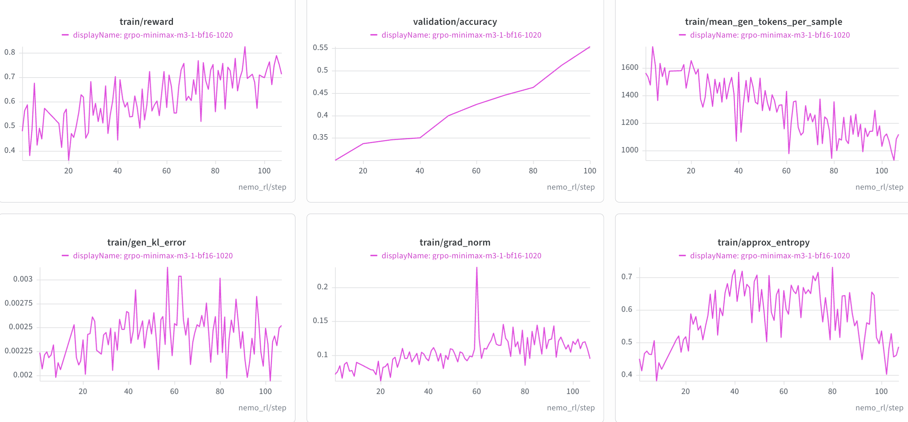

# MiniMax-M3.1

This guide describes GRPO training of MiniMax-M3.1 with the AutoModel training backend and vLLM generation.

> [!IMPORTANT]
> **Status: Functionally Ready (BF16).** The reference recipe has been validated with a non-colocated GRPO run using CP2 and EP128 on a 32-node allocation, reaching step 100 with periodic validation. Long-run convergence has not been established. see [Known Limitations](#known-limitations).

## Support Status


| Model                          | Training backend | Validated training parallelism | Generation backend           | Status             |
| ------------------------------ | ---------------- | ------------------------------ | ---------------------------- | ------------------ |
| `MiniMaxAI/MiniMax-M3.1-Flash` | AutoModel        | CP2 + EP128                    | vLLM with TP16 + EP16 (BF16) | Functionally Ready |


## Validated Scope

- **Model**: `[MiniMaxAI/MiniMax-M3.1-Flash](https://huggingface.co/MiniMaxAI/MiniMax-M3.1-Flash)` (60 layers).
- **Algorithm**: GRPO with `DAPOMath17K` for training and
`DAPOMathAIME2024` for validation (240 validation samples).
- **Training backend**: AutoModel with BF16 training.
- **Training parallelism**: CP2 and EP128.
- **Generation backend**: vLLM with TP16, EP16, and BF16 weights.
- **Sequence length**: Up to 2,048 prompt tokens and 2,048 new tokens, for a  
maximum total sequence length of 4,096.
- **Deployment**: Non-colocated training and generation, with 16 nodes  
allocated to vLLM generation.

Recipe YAML files under `examples/configs/recipes/` are the source of truth for
resource, parallelism, dataset, and checkpointing settings.

## How to Run


### 1. Build the Environment

MiniMax-M3.1 requires AutoModel and vLLM sources that are not yet in the
published NeMo-RL containers. Clone those sources into the `3rdparty` paths
used by NeMo-RL's editable installs.

Sources:

- AutoModel: `<automodel-repo-url>` at `<automodel-branch-or-commit>` — MiniMax-M3.1
  checkpoint and processor support.
- vLLM: `<vllm-repo-url>` at `<vllm-branch-or-commit>` — MiniMax-M3.1 support.

From the NeMo-RL repository root, run:

```bash
mkdir -p 3rdparty/Automodel-workspace 3rdparty/vLLM-workspace

git clone <automodel-repo-url> \
  3rdparty/Automodel-workspace/Automodel
git -C 3rdparty/Automodel-workspace/Automodel checkout <automodel-branch-or-commit>

git clone <vllm-repo-url> \
  3rdparty/vLLM-workspace/vllm
git -C 3rdparty/vLLM-workspace/vllm checkout <vllm-branch-or-commit>
```

Published NeMo-RL containers do not yet include the full MiniMax-M3.1 runtime
environment. Force a rebuild of the per-worker `uv` virtual environments at
launch time so that Ray workers pick up the local AutoModel and vLLM sources:

```bash
export NRL_FORCE_REBUILD_VENVS=true
```

For container and worker environment details, see
[Dependency Management](../../../design-docs/dependency-management.md) and the
[installation guide](../../../about/installation.md).

The recipe uses the
[`MiniMaxAI/MiniMax-M3.1-Flash`](https://huggingface.co/MiniMaxAI/MiniMax-M3.1-Flash)
checkpoint and the DAPO Math training and validation datasets from Hugging
Face. Set `HF_HOME` to a cache visible from every node:

```bash
export HF_HOME=<path-to-shared-huggingface-cache>
export WANDB_API_KEY=<your-wandb-api-key>
```


### 2. Choose the Reference Recipe


| Model        | Algorithm | Backend   | Scale | Recipe                                                                                                                                                                  |
| ------------ | --------- | --------- | ----- | ----------------------------------------------------------------------------------------------------------------------------------------------------------------------- |
| MiniMax-M3.1 | GRPO      | AutoModel | 32n8g | `[grpo-minimax-m3-1-32n8g-automodel-cp2ep128-noncolocated.yaml](../../../../examples/configs/recipes/llm/grpo-minimax-m3-1-32n8g-automodel-cp2ep128-noncolocated.yaml)` |


### 3. Launch

From the repository root in a 32-node allocation with 8 GPUs per node, launch
the standard GRPO entry point:

```bash
uv run examples/run_grpo.py \
  --config examples/configs/recipes/llm/grpo-minimax-m3-1-32n8g-automodel-cp2ep128-noncolocated.yaml
```

See the [GRPO guide](../../grpo.md) for algorithm and common configuration details and [Cluster Setup](../../../cluster.md) for multi-node launch setup. Before changing the node count, review the training and generation parallel dimensions and the separate generation allocation.

## Important Recipe Settings

- `policy.hf_config_overrides.quantization_config: null` drops the checkpoint's  
quantization metadata so AutoModel and vLLM load BF16 weights.
- `policy.offload_optimizer_for_logprob: true` enables optimizer offloading
for log-probability computation.
- `policy.make_sequence_length_divisible_by: 128` and  
`policy.dynamic_batching.sequence_length_round: 128` keep each CP2 rank  
aligned to HybridEP's 64-token chunks. Dynamic batching is enabled; sequence  
packing is disabled.
- `policy.generation.vllm_kwargs.language_model_only: true` selects
language-model-only generation. The AutoModel freeze configuration freezes
the vision and audio towers.
- Eager execution (`enforce_eager: true`) remains part of the validated
generation configuration.


## Reference Training Curves

The following curves were produced with the reference CP2/EP128 configuration
on the 32-node allocation described above. 



## Known Limitations

- **Sequence length**: The validated configuration uses CP2 and EP128 with a
4,096-token maximum total sequence length. Longer sequences have not been
validated.
- **FP8 generation**: An FP8 vLLM variant (`precision: fp8`, TP8, EP16) has been  
attempted but it is not part of the validated scope.
- MTP is disabled in the reference configuration.
- Long-run convergence has not been established for this recipe.

