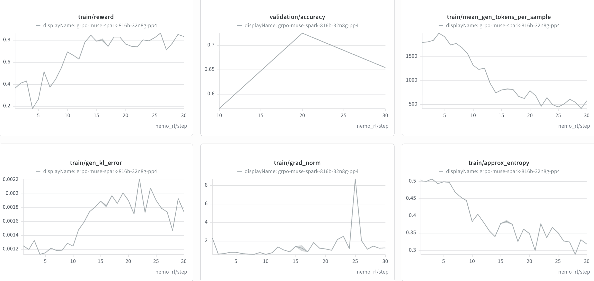

# Muse Spark

This guide describes GRPO training of Muse-Spark-Open-816B-A42B with the
AutoModel training backend and BF16 vLLM generation.

> [!IMPORTANT]
> **Status: Functionally Ready.** The reference configuration has been
> validated with a colocated GRPO run using PP4 and EP64 on a 32-node H100
> allocation. Long-run convergence has not been established; see
> [Known Limitations](#known-limitations) for validation coverage.

## Support Status

| Model | Training backend | Validated training parallelism | Generation backend | Status |
| --- | --- | --- | --- | --- |
| `meta-models/Muse-Spark-Open-816B-A42B` | AutoModel | PP4 + EP64 (DP64) | vLLM with TP8 + PP8 + EP8 | Functionally Ready |

## Validated Scope

- **Model**: `meta-models/Muse-Spark-Open-816B-A42B`, a sparse
  mixture-of-experts vision-and-audio-language model. Only the language model
  is trained and served; the vision and audio towers are frozen and skipped by
  vLLM.
- **Algorithm**: GRPO with `DAPOMath17K` for training and
  `DAPOMathAIME2024` for validation.
- **Training backend**: AutoModel with BF16 training, activation checkpointing,
  SDPA attention, `torch_mm` grouped experts, and the HybridEP expert
  dispatcher.
- **Training parallelism**: PP4 with the `1f1b` schedule and EP64 on 256 GPUs,
  leaving a data-parallel size of 64. CP is 1.
- **Generation backend**: vLLM with TP8 (within a node), PP8 (across nodes),
  EP8, and BF16 weights. Each engine spans 64 GPUs, giving four engines on 256
  GPUs.
- **Sequence length**: Up to 1,024 prompt tokens plus up to 2,048 response
  tokens, for a maximum total sequence length of 3,072.
- **Reference allocation**: 32 nodes with 8 H100 GPUs per node.
- **Deployment**: Colocated training and generation on the same GPUs.

## How to Run

### 1. Prepare the Environment

Muse Spark requires newer dependencies than the default NeMo RL environment:

- **Transformers 5.20 or later**, which ships the `muse_spark` architecture
  natively. The driver and vLLM workers need it to load the model config.
- **vLLM built from source** at the revision pinned in `pyproject.toml`, since
  no released vLLM wheel includes the Muse Spark model. Build it against the
  same torch version as the policy workers:

  ```bash
  VLLM_VERSION_OVERRIDE=<version-in-pyproject> TORCH_CUDA_ARCH_LIST=<arch> uv sync --extra vllm
  ```

  The source build needs `libdw-dev` and `libelf-dev` in addition to the CUDA
  toolkit.
- **AutoModel** at the submodule revision recorded by this checkout:

  ```bash
  git submodule update --init --recursive
  ```

For a multi-node run, use a container built from the same checkout so its
backend-specific worker environments match the lockfile. See the
[installation guide](../../../about/installation.md) and
[Dependency Management](../../../design-docs/dependency-management.md) for
container and development setup details.

The BF16 checkpoint is roughly 1.5 TiB. Download it to a filesystem visible from
every node, and set `HF_HOME` to a shared cache for the DAPO Math datasets:

```bash
export HF_HOME=<path-to-shared-huggingface-cache>
export WANDB_API_KEY=<your-wandb-api-key>
```

The reference configuration enables W&B logging. If W&B is not configured,
pass `logger.wandb_enabled=false` when launching.

### 2. Choose the Reference Configuration

| Model | Algorithm | Backend | Scale | Config |
| --- | --- | --- | --- | --- |
| Muse-Spark-Open-816B-A42B | GRPO | AutoModel | 32n8g | [`grpo-muse-spark-816b-32n8g-pp4.yaml`](../../../../exp/grpo-muse-spark-816b-32n8g-pp4.yaml) |

### 3. Launch

From the repository root in a 32-node allocation with 8 GPUs per node, launch
the standard GRPO entry point and point `policy.model_name` at the checkpoint:

```bash
uv run examples/run_grpo.py \
  --config exp/grpo-muse-spark-816b-32n8g-pp4.yaml \
  policy.model_name=<path-to-Muse-Spark-Open-816B-A42B>
```

See the [GRPO guide](../../grpo.md) for algorithm and common configuration
details and [Cluster Setup](../../../cluster.md) for multi-node launch setup.
Before changing the node count, review the training and generation parallel
dimensions instead of changing `cluster.num_nodes` alone.

## Important Recipe Settings

### Training

- `policy.automodel_cfg.pipeline_parallel_size: 4` and
  `policy.automodel_cfg.expert_parallel_size: 64` select the training layout.
  See [AutoModel Pipeline Parallelism](../../../design-docs/automodel-pipeline-parallel.md)
  for how PP composes with EP and FSDP.
- `policy.automodel_cfg.pipeline.microbatches_per_step: 8` matches the batch
  shape: 512 samples per step over DP64 gives 8 samples per DP rank, i.e. 8
  micro-batches of one sample, so each optimizer update is one schedule call
  with no padding. The `1f1b` schedule requires at least
  `pipeline_parallel_size` micro-batches.
- `policy.automodel_cfg.defer_fsdp_grad_sync: false` must be set explicitly
  under PP. It reduce-scatters gradients after every micro-batch, which keeps
  the memory profile of the non-PP path.
- `moe_parallelizer.reshard_after_forward: true` keeps parameters sharded
  between forward and backward; there is no headroom for unsharded copies.
- `policy.refit_buffer_size_gb: 1` fixes the refit staging buffer size. The
  default (30% of free memory) stays allocated while a 16 GiB grouped-expert
  tensor is gathered, which runs out of memory during refit.
- The optimizer is Transformer Engine `FusedAdam` with `master_weights: true`,
  `store_param_remainders: true`, and BF16 first- and second-moment states.
  `policy.offload_optimizer_for_logprob: true` offloads it during
  log-probability computation.
- `grpo.skip_reference_policy_logprobs_calculation: true` skips the reference
  model forward pass, since `loss_fn.reference_policy_kl_penalty` is 0.
- Truncated importance sampling (`truncated_importance_sampling_type: tis`,
  ratio 2) corrects the remaining train/generation mismatch.
- Sequence packing and dynamic batching are disabled.

### Generation

- A vLLM engine needs at least 64 GPUs. At 64 GPUs the BF16 weights take about
  24 GiB per GPU; at 16 GPUs they take about 95 GiB per GPU and run out of
  memory while vLLM builds the MoE weights.
- The 64 GPUs come from TP8 x PP8, not from vLLM data parallelism or a larger
  TP:
  - Muse Spark's BF16 MoE path on Hopper requires vLLM DP1 and PCP1, so
    `expert_parallel_size` must equal `tensor_parallel_size`.
  - TP must divide the 16 KV heads, so TP is at most 16.
- `async_engine: true` is required because NeMo RL only supports vLLM PP > 1
  with the async engine.
- `VLLM_ALLREDUCE_USE_FLASHINFER: "0"` disables FlashInfer all-reduce. Its
  first-forward JIT compile takes minutes per node and, at 32 nodes, exceeds
  vLLM's default execute-model timeout. TP8 stays within a node, so the
  prebuilt all-reduce backends are sufficient.
- `VLLM_EXECUTE_MODEL_TIMEOUT_SECONDS: "3600"` leaves headroom for other
  first-call kernel compiles (Triton MoE configs and FlashInfer JIT kernels).
- `policy.generation.vllm_kwargs.language_model_only: true` serves only the
  language model. The AutoModel freeze configuration freezes the vision and
  audio towers to match.
- `gpu_memory_utilization: 0.5` and `enforce_eager: true` are part of the
  validated configuration.

### Router Output Multiplier

vLLM folds Muse Spark's router `output_multiplier` into the router weight once,
when the weights are first loaded. NeMo RL re-arms this fold before each refit
so that refitted (unfolded) router weights are scaled correctly. Without it, the
router weights end up `sqrt(32)` times too large after the first refit, and the
generation KL error rises from about `1e-3` to about `0.25`.

## Reference Training Curves

The following curves were produced with the reference PP4/EP64 configuration on
the 32-node H100 allocation described above. They show training reward,
validation accuracy, mean generated tokens per sample, generation KL error,
gradient norm, and approximate entropy over the first 30 steps.

- Training reward rises from about 0.36 to about 0.8 by step 14 and stays
  between about 0.7 and 0.85 afterwards.
- AIME 2024 validation accuracy, evaluated every 10 steps, is about 0.57 at
  step 10, 0.72 at step 20, and 0.65 at step 30.
- Mean response length drops from about 1,800 to about 500 tokens, and
  approximate entropy falls from about 0.5 to about 0.32.
- Generation KL error stays below about `2.2e-3`.
- Gradient norm stays mostly below 2.5, with one spike to about 8.7 at step 25
  that recovers at the next step.



## Known Limitations

- **Short validation run**: The curves cover 30 training steps with three
  validation points. Long-run convergence has not been established.
- **Hardware and deployment coverage**: Only colocated training and generation
  on H100 GPUs have been tested. Non-colocated deployments and Blackwell GPUs
  have not been validated.
- **Multimodal training**: Only the language model is trained. The vision and
  audio towers are frozen and are not served by vLLM.
- **Sequence length**: The validated configuration uses a 3,072-token maximum
  total sequence length. Longer sequences, CP, and sequence packing have not
  been validated.
- **Megatron backend**: Training with the Megatron backend is not covered by
  this guide.
