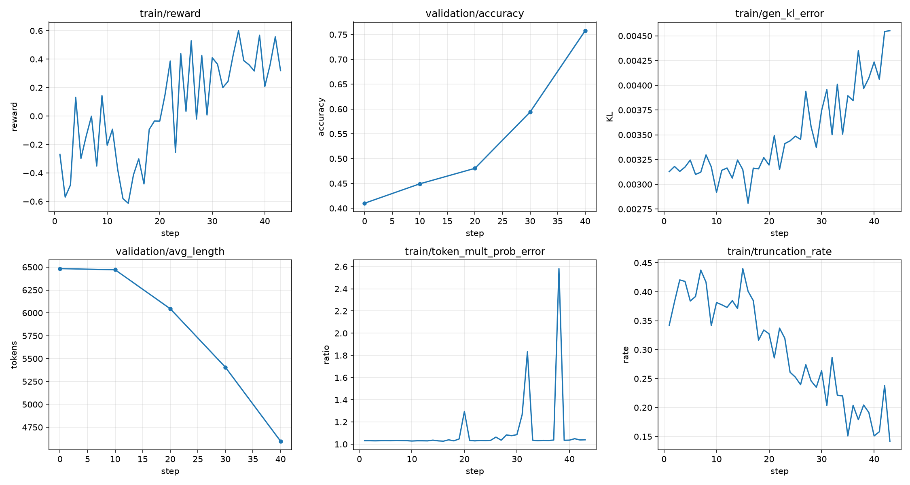
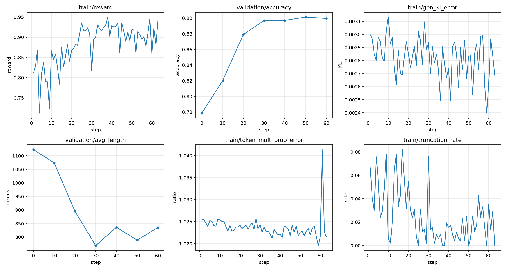
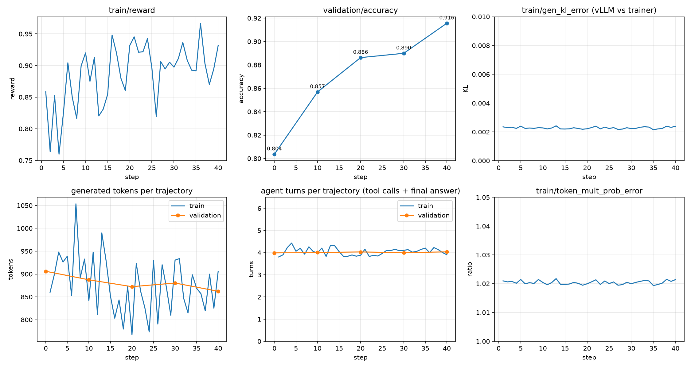

# Nemotron 3.5 Super VL

This page collects NeMo RL guidance for text and image post-training of
Nemotron 3.5 Super VL (`NemotronH_Omni_Reasoning_V3`), a hybrid Mamba +
Attention MoE model with 512 routed experts (22 active) and a RADIO vision
tower, on the Automodel backend. Use it to launch the text DAPO, image GRPO and
NeMo Gym agentic (tool-use) recipes and understand the settings that are
specific to this model.

## What's Supported

| Model | Modality | Training backend | Parallelism | Inference | Precision |
| --- | --- | --- | --- | --- | --- |
| Nemotron 3.5 Super VL (120B-A12B) | LLM (text) | Automodel | FSDP2 + EP | vLLM | BF16 compute, FP32 master |
| Nemotron 3.5 Super VL (120B-A12B) | VLM (image) | Automodel | FSDP2 + EP | vLLM | BF16 compute, FP32 master |
| Nemotron 3.5 Super VL (120B-A12B) | Agentic tool use (NeMo Gym, text) | Automodel | FSDP2 + EP + CP | vLLM (async, non-colocated) | BF16 compute, FP32 master |

Notes:

- **Training** runs on the Automodel backend with FSDP2 over all
  parameters and expert parallelism (HybridEP dispatcher) for the routed
  experts.
- **Generation** uses the pinned stock vLLM, which registers
  `NemotronH_Omni_Reasoning_V3` and loads the checkpoint's RADIO weights from
  disk (`load_format=auto`). The policy is refit from the trainer every step.
- The DAPO recipe drives the model text-only: the tokenizer path (no processor)
  is used, so the Automodel worker runs with `is_vlm=false` and vLLM never
  receives images. The image GRPO recipe uses the checkpoint's processor and
  sends CLEVR images through vLLM; which towers train is controlled by
  `automodel_kwargs.freeze_config`.

## Environment

Use the standard NeMo RL environment described in the
[installation guide](../../../about/installation.md). The Automodel submodule
pinned on `main` (`r0.6.0` at `b916107a5` or later) registers
`NemotronH_Omni_Reasoning_V3` and includes the fixes these recipes depend on
(Automodel [#3874](https://github.com/NVIDIA-NeMo/Automodel/pull/3874) and
[#4211](https://github.com/NVIDIA-NeMo/Automodel/pull/4211)); the stock vLLM
pin registers the same architecture for generation. No custom source checkouts
or manual builds are needed. For container and worker-venv details, see
[Dependency Management](../../../design-docs/dependency-management.md).

All recipes train
[`nvidia/NVIDIA-Nemotron-3.5-Super-VL-120B-A12B-BF16`](https://huggingface.co/nvidia/NVIDIA-Nemotron-3.5-Super-VL-120B-A12B-BF16):
the text recipe on the DAPO-Math-17K training set with AIME-2024 validation,
the image recipe on CLEVR-CoGenT (trainA / valA), and the agentic recipe on the
NeMo Gym `workplace_assistant` tasks, all from Hugging Face. Set `HF_HOME` to a
cache visible from every node:

```bash
export HF_HOME=<path-to-shared-huggingface-cache>
export WANDB_API_KEY=<your-wandb-api-key>
```

The recipes enable W&B logging; pass `logger.wandb_enabled=false` if W&B is not
configured.

## Example Recipes

### Single-answer multimodal coding through NeMo Gym

The internal Gym `mm_coding_training` component supports Chart2Code, MMSVG
Img2SVG/Text2SVG, Image2Struct LaTeX and Design2Code. The recipe
[`mm_coding_single.yaml`](../../../../examples/nemo_gym/nemotron-3.5-super-vl/mm_coding_single.yaml)
inherits the Super Automodel/vLLM setup and replaces the task, data and Gym
bindings. Its default limit is **three optimizer updates**. The recovery helper
then targets a fourth update in a fresh process. This acceptance test is not a
production training budget or a claim of improved benchmark performance. It uses 8 training and
8 generation nodes, 4 GPUs per node, as inherited from the agentic recipe.
No jobs are started by preparing or resolving it.

Install the internal Gym contribution in the runtime used by the driver and
Gym server workers. Its component and config must be visible from every node;
a stock public Gym checkout alone does not supply the internal component.
Configure the remote sandbox provider and quality judge on the trusted Gym
side, following that component's README. Do not put judge or registry keys in
training rows, model requests or candidate sandboxes.

Source-owned acquisition and split conversion remain upstream. Adapt prepared
`nemo-rl-mm-coding` task records with:

```bash
uv run examples/nemo_gym/nemotron-3.5-super-vl/prepare_mm_coding_single.py \
  --input /approved/source/train-tasks.jsonl --output /shared/coding/train.jsonl \
  --reference-root /shared/coding/assets --split train --max-output-tokens 8192
```

For an existing source Gym JSONL envelope, add `--input-format legacy-row`.
This reads the original task metadata and rebuilds the agent-facing input; it
does not reuse old harness instructions or completions. Run the adapter
separately for an approved validation split. The adapter preserves
prompt text and image bytes, puts reference source only in verifier metadata,
rejects duplicate task IDs and refuses to overwrite an existing dataset. It
does not prove that a caller-labeled split is free of held-out evaluation data.

Before allocating GPUs, run the runtime check in the driver and every actor
interpreter (Gym and generation included):

```bash
python examples/nemo_gym/nemotron-3.5-super-vl/check_mm_coding_runtime.py
# For multi or mixed, match the adapter's mode and optional harness subset:
python examples/nemo_gym/nemotron-3.5-super-vl/check_mm_coding_runtime.py --mode multi
```

The current NeMo RL Gym submodule pin predates the submitted Gym package layout
and public session/sandbox-lending APIs. Merely adding the resources config does not update actor
interpreters: default actor commands use `uv run --locked`. Install the submitted
internal Gym revision and its dependencies into each deployment-owned runtime,
and configure the deployment to retain those environments. The existing
`NEMO_RL_VENV_DIR` selects the deployment-owned per-actor venv cache. Prebuild
those venvs with `nemo_rl/utils/prefetch_venvs.py`, install the reviewed Gym
revision into every Gym-dependent actor venv and the driver, and run
`uv pip check --python <actor-venv>/bin/python` plus this preflight under each
interpreter. Retain the exact dependency reports. Use a new cache directory
for this experiment; do not modify another run's cached environments. Leave
`NRL_FORCE_REBUILD_VENVS` unset so the already-provisioned per-actor venvs are
reused. A dependency conflict must be resolved in the runtime packaging rather
than hidden with a skipped dependency check. Do not use the stock
Gym pin or assume `NEMO_GYM_EXTRA_ROOTS` alone upgrades core APIs. A supported
runtime packaging/pin update and real actor startup are merge gates for this
draft. The check verifies API/component discovery only, not model kernels,
credentials, network reachability, token capture or optimizer correctness.

OpenCode multi/mixed additionally requires Gym's harness-note token-capture
support ([Gym #5833](https://github.com/NVIDIA-NeMo/Gym/pull/5833), or the merged
successor). OpenCode can append its own assistant step-limit note or lowercase
a tool name; a Gym revision without the fix can lose the model-call parent and
mask the rollout. The mode-aware preflight refuses the missing module before
GPU allocation. The default migration path is single + OpenCode multi/mixed;
Codex/Hermes require the separate experimental Gym adapter extensions and
`mm_coding_multi_experimental.yaml` or `mm_coding_mixed_experimental.yaml`.
Select them explicitly with `--harnesses codex hermes`; OpenCode remains the
default. Their file-based vision protocol and SDK hook are experimental.
See the Gym component’s `experimental-harnesses.md` for limits and provenance. Module discovery is a prerequisite, not proof
that a rollout's tokens, images and logprobs were captured correctly.

Set `MM_CODING_TRAIN_DATA` and `MM_CODING_VALIDATION_DATA` to the adapted files,
and `MM_CODING_REFERENCE_ROOT` to their shared reference root. Both data paths
are required; the recipe never falls back to the synthetic examples or an
evaluation test set. Then launch through `examples/run_grpo_single_controller.py`
with `--config examples/nemo_gym/nemotron-3.5-super-vl/mm_coding_single.yaml`.

These coding recipes enable the existing SingleController token-capture path
and native data-plane checkpointing. Typed multi-turn environment results do
not contain a legacy terminal response; they require captured model-call tokens
and images. The legacy `run_grpo_nemo_gym.py` entrypoint does not support that
capture path. Recovery uses the existing `sibling` boundary; this does not claim
in-flight typed-episode turn recovery.

Captured still images use the native Automodel `NemotronOmni` dynamic-resolution
forward. The learner restores the packed patches to padded pixels without
resizing or changing pixel values, and keeps each image's native dimensions.
This path requires TP=CP=1, sequence packing/parallelism disabled, and the custom
model (`force_hf` disabled). Native video requires Megatron. Geometry, image-token
counts and selective media masks that the native forward cannot represent fail
explicitly before a forward; they do not fall back to text-only training.

After provisioning the role environments, run
`bash tests/functional/mm_coding_super35_train_resume.sh mixed -- <Hydra overrides>`
inside an approved GPU allocation. Set `MM_CODING_ACCEPTANCE_ROOT` to a new
output directory and supply the **matching mode's** train/validation files.
The helper runs three updates, exits, and starts a separate process targeting
step four with the same optimizer, checkpoint root and data. Override
`MM_CODING_SAVE_STEPS` for a different test duration. It does not submit jobs.
Set `MM_CODING_CHECKPOINT_ROOT` to use separate checkpoint storage; logs remain
under `MM_CODING_ACCEPTANCE_ROOT`. Both paths must be new: the helper rejects
existing checkpoint directories, including empty directories and dangling links,
so the first phase cannot resume an earlier test.
Pass resource overrides explicitly: the inherited production recipe requests
16 nodes, including eight generation nodes. Successful process exits and
checkpoint directories are preliminary; inspect the retained native restore,
optimizer, token/image/logprob and data-cursor evidence before accepting recovery.

The recipe uses learner TP1/CP1 without packing or sequence parallelism, keeps
the model's image processor and raw vLLM logprobs, and masks invalid Gym
measurements. `policy.is_vlm: true` selects processor loading in the training
entrypoint, including for mixed batches that also contain text-only tasks.
Existing NeMo RL model support is reused; the trainer, optimizer
and GRPO loss are unchanged. The compatible Gym runtime described above must
still be provisioned and validated.
Renderer/judge failures are excluded; measured model execution failures remain
eligible zero rewards. The quality reward is distinct from official evaluation
metrics, whose EFB configurations remain separate.

Use `--mode multi` for stock OpenCode sessions per task, or
`--mode mixed` for the source task-family single/multi proportions. `--seed`
and `--epoch` freeze routing when preparing the file, before GRPO siblings are
expanded. The model-visible task prompt is preserved; multi adds workspace and
preview instructions. Private grading metadata stays outside model input.
Use the matching [`mm_coding_multi.yaml`](../../../../examples/nemo_gym/nemotron-3.5-super-vl/mm_coding_multi.yaml)
or [`mm_coding_mixed.yaml`](../../../../examples/nemo_gym/nemotron-3.5-super-vl/mm_coding_mixed.yaml)
recipe. All three recipes share the learner, optimizer and reward settings. Multi and
mixed permit up to 32 images per request instead of the single-answer cap of
2, so retained reference/preview observations do not fail after two images. The
16384-token context and adapter/model-server request limits still apply.
The Gym deployment also needs PR #5719 (public lifecycle and `LentSandboxes`)
and the typed catalog-row validator follow-up, or their merged successors.
Use the exact reviewed dependency SHAs, not an unpinned moving branch. OpenCode
must be preinstalled in the remote image; supply pinned ripgrep and plugin
bundles through the resource owner's runtime files before sandbox activation.
The task network is `model_only`, so runtime downloads during an episode fail.
Only the policy model is externally advertised; agent, head and judge stay on
loopback. Preserve these boundaries in actor deployments.

Multi rows route typed tasksets to Gym's existing sandboxed harnesses; single
rows use the `single_agent_turn_legacy` simple-agent relay. This contribution does not port the
experimental V2 asynchronous controller or change GRPO loss/optimizer behavior.

The acceptance recipe prepares three GRPO steps and saves optimizer state at
each step. This configuration does not establish that those steps or recovery
have run on the submitted source.

The source experiments passed two-step Super acceptance on a different pinned
runtime and checkpoint. The recipe selects the documented public Super 3.5 VL
BF16 model; the historical row90 Base result is not a new GPU acceptance for
this recipe. Record exact source/model/image pins, real smoke rollouts and any
new training/recovery results with the draft before advancing it to merge.

Automodel training with vLLM generation. The text and image recipes colocate
generation with training; the agentic recipe runs async GRPO with generation on
its own node pool. The recipe YAMLs are the source of truth.

| Algo | Data | Seq | Train EP / CP | vLLM TP/EP | `max_new_tokens` | Nodes | Recipe |
|---|---|---|---|---|---|---|---|
| DAPO (text) | DAPO-Math-17K / AIME-2024 | 9216 | 4 / 1 | 4 / 4 | 8192 | 16 x 4 GPUs (colocated) | [`dapo-nemotron3.5-super-vl-120BA12B-16n4g-automodel.yaml`](../../../../examples/configs/recipes/llm/dapo-nemotron3.5-super-vl-120BA12B-16n4g-automodel.yaml) |
| GRPO (image) | CLEVR-CoGenT | 8192 | 4 / 1 | 4 / 4 | 4096 | 16 x 4 GPUs (colocated) | [`vlm_grpo-nemotron3.5-super-vl-120BA12B-clevr-16n4g-automodel.yaml`](../../../../examples/configs/recipes/vlm/vlm_grpo-nemotron3.5-super-vl-120BA12B-clevr-16n4g-automodel.yaml) |
| Async GRPO (agentic, NeMo Gym) | `workplace_assistant` | 16384 | 4 / 2 | 4 / 4 | 8192 | 8 train + 8 gen x 4 GPUs | [`workplace_assistant_automodel.yaml`](../../../../examples/nemo_gym/nemotron-3.5-super-vl/workplace_assistant_automodel.yaml) |

All three recipes use 16 x 4-GPU GB200 nodes: train `expert_parallel_size: 4`
and vLLM `tensor_parallel_size: 4` / `expert_parallel_size: 4` (one vLLM engine
per node). See [Parallelism](#parallelism) for why EP must stay within a node.

The image recipe mirrors the Nano Omni CLEVR recipe
(`vlm_grpo-nemotron-omni-30ba3b-clevr-1n8g-automodel-ep8.v2.yaml`): image
placeholder tokens are `bad_words`, `limit_mm_per_prompt.image: 2`,
`mm_processor_cache_gb: 0`, the Nemotron Omni CLEVR prompt, and
`train_global_batch_size: 64` (a multiple of the 64-way data parallelism).

The text recipe mirrors the Nemotron 3.5 Lightning DAPO recipe: dynamic sampling
(`batch_multiplier: 3`), Clip-Higher (`ratio_clip_max: 0.28`), overlong
filtering and soft overlong reward shaping, `reference_policy_kl_penalty: 0`,
FusedAdam with FP32 master weights, activation checkpointing, and
`moe_parallelizer.ignore_router_for_ac: true` (required with activation
checkpointing on this MoE: the BF16 router top-k is nondeterministic on
recompute).

The agentic recipe is described in
[NeMo Gym agentic recipe](#nemo-gym-agentic-recipe) below.

### Model-specific settings

These are set in the recipes and are required for this model:

| Setting | Value | Why |
|---|---|---|
| `policy.hf_config_overrides.num_nextn_predict_layers` | `0` | The checkpoint ships one MTP layer (`mtp.*` tensors). AutoModel builds it by default; this drops it on the training side. Keep `generation.vllm_kwargs.speculative_config` unset for the same reason. |
| `policy.generation.vllm_kwargs.skip_mm_profiling` | `true` | Skip vLLM's multimodal profiling pass and its encoder-cache reservation. The text recipe never sends images; the image recipe's CLEVR inputs (at most two small images per prompt) run without the profiling-based reservation. |
| `policy.generation.vllm_kwargs.mm_processor_cache_gb` | `0` | Drop vLLM's default 4 GiB host-side multimodal processor cache; host memory is the tight resource for these recipes. |
| `policy.generation.vllm_kwargs.limit_mm_per_prompt.image` | `1` (text) / `2` (image) | vLLM sizes the encoder budget from this limit, and an unset modality defaults to 999 images per prompt. |
| `policy.generation.bad_words` (image recipe) | `<image>`, ``, `</img>`, `<so_embedding>`, `<so_start>`, `<so_end>` | Keep the policy from emitting image placeholder tokens in its responses. |
| `policy.generation.vllm_kwargs.mamba_ssm_cache_dtype` | `float32` | Matches the checkpoint's `mamba_ssm_cache_dtype`. |
| `policy.generation.vllm_cfg.skip_tokenizer_init` | (automatic) / `false` | vLLM's multimodal encoder budget calls the tokenizer during engine init for this architecture. `NemotronH_Omni_Reasoning_V3` is listed in `TOKENIZER_REQUIRED_ARCHITECTURES`, so NeMo RL keeps the tokenizer regardless of the text-only default; the image recipe inherits `false` from `vlm_grpo_3B.yaml` and the agentic recipe sets it explicitly (the Gym HTTP server needs the tokenizer). |
| `policy.automodel_cfg.automodel_kwargs.force_hf` | unset | The custom AutoModel implementation and its state-dict adapter are required for EP and per-tensor refit. |
| `policy.automodel_cfg.env_vars.PYTORCH_CUDA_ALLOC_CONF` | unset | With `expandable_segments:True` PyTorch exports CUDA IPC handles as file descriptors fetched via `pidfd_getfd`; on clusters where that syscall path is unavailable the colocated trainer-to-vLLM refit fails with `pidfd_getfd: Bad file descriptor`. The default allocator uses legacy `cudaIpcMemHandle` sharing. |

### Parallelism

- **Training EP stays within a node.** All three recipes use `expert_parallel_size: 4`
  on 4-GPU GB200 nodes with the HybridEP dispatcher
  (`policy.automodel_cfg.automodel_kwargs.backend.dispatcher: hybridep`), whose
  kernels require the per-rank token count to be a multiple of 64
  (`make_sequence_length_divisible_by: 64` in the colocated recipes, `256` with
  CP2 in the agentic recipe). The DeepEP dispatcher also
  works at EP=4 but its V1 `Buffer` API assumes an expert-parallel group of up to
  8 ranks is intranode; EP=8 on 4-GPU nodes fails with
  `CUDA error ... deep_ep.cpp 'invalid resource handle'`.
- **vLLM TP and EP live on the same GPUs.** `expert_parallel_size ==
  tensor_parallel_size` runs one engine per node with dense layers TP-sharded
  and experts EP-sharded (`enable_expert_parallel`). Set both to the GPUs per
  node.
- FSDP2 shards all parameters (including experts) over the full world, so
  persistent memory per GPU does not depend on EP; EP only changes the
  transient unsharded expert weights and all-to-all traffic.

### NeMo Gym agentic recipe

`examples/nemo_gym/nemotron-3.5-super-vl/workplace_assistant_automodel.yaml`
trains the model on the NeMo Gym `workplace_assistant` environment: multi-step
tool use (up to six tool calls and one final answer per task) against simulated
calendar, e-mail, document and project databases, with no code sandbox. It is
text-only and runs **async GRPO with non-colocated generation**: training and
vLLM live on separate node pools and weights are refit through an NCCL
collective every step.

| Setting | Value |
|---|---:|
| Base recipe | `examples/nemo_gym/grpo_workplace_assistant_nemotron_nano_v2_9b.yaml` (task, data layout, GRPO/loss settings) |
| Rollouts per step | 64 prompts x 16 generations (global batch size 1,024) |
| Maximum sequence length | 16,384 tokens (8,192 generated) |
| Training | Automodel FSDP2, EP=4, CP=2, `moe_parallelizer.reshard_after_forward: true`, activation checkpointing, 8 nodes |
| Generation | vLLM TP=4 / EP=4, one engine per node, 8 nodes; `qwen3_coder` tool parser, `nemotron_v3` reasoning parser, prefix caching off |
| Async GRPO | `max_trajectory_age_steps: 1`, in-flight weight updates, on-policy KL approximation + truncated importance sampling |
| Optimizer | TransformerEngine `FusedAdam`, lr 1e-6, wd 0.1, FP32 master weights |
| Validation | full validation set (545 tasks) at start and every 10 steps |

Settings specific to this recipe, on top of the model-specific settings above:

| Setting | Value | Why |
|---|---|---|
| `policy.automodel_cfg.context_parallel_size` | `2` | At 16K context the 120B trainer on 32 GPUs is memory-bound; CP2 gives the headroom the backward needs. |
| `policy.automodel_cfg.moe_parallelizer.reshard_after_forward` | `true` | Automodel keeps every block's gathered weights resident through the backward by default; re-sharding after each forward is what fits the optimizer states on 184 GB GPUs (same as the Nemotron 3 Super 120B automodel recipe). |
| `policy.make_sequence_length_divisible_by` | `256` | HybridEP's kernels are specialised on the per-rank token count and require it to be a multiple of their 64-token chunk; with CP2 each rank sees half the padded sequence, so the padding multiple must be a multiple of 64 x CP = 128 (256 is used). |
| `policy.generation.vllm_cfg.enable_prefix_caching` | `false` | Multi-step tool-use trajectories re-prefill the growing conversation every agent step; with prefix caching on, the cached Mamba state of the earlier steps made `token_mult_prob_error` jump from 1.02 to 1.45. |
| `policy.generation.vllm_kwargs.max_num_batched_tokens` | `16384` | vLLM's default 2,048-token chunked-prefill budget throttles the repeated 4-20K-token prefills of the agent loop. |
| `env.nemo_gym.policy_model...uses_reasoning_parser` / `enable_thinking` | `true` | The checkpoint thinks before every tool call; Gym needs the reasoning parser on to strip `<think>` blocks from the tool-call messages. |

#### Data

The environment's tasks are published as
[`nvidia/Nemotron-RL-agent-workplace_assistant`](https://huggingface.co/datasets/nvidia/Nemotron-RL-agent-workplace_assistant)
(`train.jsonl`, 1,255 tasks; `validation.jsonl`, 545 tasks):

```bash
uvx --from huggingface-hub hf download nvidia/Nemotron-RL-agent-workplace_assistant \
  --repo-type dataset --local-dir $DATA_DIR/workplace_assistant
```

## Launch

The text and image recipes default to 16 nodes x 4 GPUs; the agentic recipe to
8 training + 8 generation nodes (`cluster.num_nodes` is the sum,
`policy.generation.colocated.resources.num_nodes` the generation share). The NeMo
Gym venvs for the `workplace_assistant` resource server are built on first launch,
or prebaked into the container as in the
[Nemotron 3.5 Lightning guide](nemotron-3.5-lightning.md#container) with
`--build-arg NEMO_GYM_PREFETCH_CONFIGS="examples/nemo_gym/nemotron-3.5-super-vl/workplace_assistant_automodel.yaml"`.

```bash
# Text DAPO (DAPO-Math-17K / AIME-2024)
uv run examples/run_grpo.py \
  --config examples/configs/recipes/llm/dapo-nemotron3.5-super-vl-120BA12B-16n4g-automodel.yaml

# Image GRPO (CLEVR-CoGenT)
uv run examples/run_vlm_grpo.py \
  --config examples/configs/recipes/vlm/vlm_grpo-nemotron3.5-super-vl-120BA12B-clevr-16n4g-automodel.yaml

# Agentic GRPO (NeMo Gym workplace_assistant)
uv run examples/nemo_gym/run_grpo_nemo_gym.py \
  --config examples/nemo_gym/nemotron-3.5-super-vl/workplace_assistant_automodel.yaml \
  data.train.data_path=$DATA_DIR/workplace_assistant/train.jsonl \
  data.validation.data_path=$DATA_DIR/workplace_assistant/validation.jsonl
```

For launching on a multi-node Slurm or Kubernetes cluster, see the
[cluster guide](../../../cluster.md); keep `cluster.num_nodes` and
`cluster.gpus_per_node` in step with the allocation. Interrupted runs resume
automatically from the latest checkpoint in `checkpointing.checkpoint_dir`.
See the [GRPO guide](../../grpo.md) for the algorithm and common configuration
details.

## Reference Results

### Training curves

The runs use the recipe defaults (16 x 4-GPU GB200 nodes, train EP4, vLLM
TP4/EP4) with the Automodel backend: colocated vLLM generation for the text and
image recipes, async non-colocated generation for the agentic recipe. All were
chained as 4-hour Slurm jobs that resume from the latest checkpoint. Curves are
wandb exports; the x axis is the training step.

**Text DAPO, DAPO-Math-17K / AIME-2024** — 43 steps, `max_new_tokens: 8192`,
starting from `nvidia/NVIDIA-Nemotron-3.5-Super-VL-120B-A12B-BF16`.



AIME-2024 validation accuracy climbs from 0.41 at step 0 to **0.76 at step 40**
(0.45 at step 10, 0.48 at step 20, 0.59 at step 30) while the mean validation
response length falls from ~6,450 to ~4,600 tokens and `truncation_rate` drops
from ~0.40 to ~0.15: the policy gets both more accurate and more concise.
Training reward rises from a noisy -0.6 to -0.1 band to 0.2-0.6 after step 20.
`gen_kl_error` drifts slowly from ~0.003 to ~0.0045 as the policy sharpens, the
same order as the drift documented for other models; the isolated
`token_mult_prob_error` spikes (steps 20, 32, 38) are single-step outliers and
`token_mult_prob_error` returns to ~1.03 on the next step. The chain ran as five
4-hour Slurm jobs that resumed from the latest checkpoint.

**Image GRPO, CLEVR-CoGenT** — 63 steps, `max_new_tokens: 4096`, starting from
`nvidia/NVIDIA-Nemotron-3.5-Super-VL-120B-A12B-BF16`.



CLEVR-CoGenT (valA, 256 samples) accuracy rises from 0.78 at step 0 to **0.90
at step 50** (0.82 at step 10, 0.88 at step 20, 0.90 at steps 30 and 40, 0.90
at step 60) while the mean validation response length falls from ~1,120 to a
minimum of ~770 tokens at step 30 and settles around 800-840 afterwards.
Training reward moves from a 0.71-0.87 band in the first ten
steps to 0.86-0.95 after step 30. `gen_kl_error` stays flat at 0.0024-0.0031,
`token_mult_prob_error` at 1.02-1.04 and `truncation_rate` below 0.09 and
mostly under 0.03 after step 20: trainer and vLLM stay in agreement across
every refit. Steps take ~8 minutes (16 to 20 minutes when the batch retries
generation); the chain ran as three 4-hour Slurm jobs that resumed from the
latest checkpoint (steps 21 and 43).

**Agentic GRPO, NeMo Gym `workplace_assistant`** — 40 steps, async non-colocated
generation on 8 training + 8 generation nodes, starting from
`nvidia/NVIDIA-Nemotron-3.5-Super-VL-120B-A12B-BF16`.



Validation accuracy on the 545 held-out tasks rises from 0.80 at step 0 to
**0.92 at step 40** (0.86 at step 10, 0.89 at steps 20 and 30) while the mean
validation response length falls from ~910 to ~860 generated tokens. Training
reward moves from a 0.76-0.92 band in the first ten steps to 0.82-0.97 after
step 20. The number of agent turns per trajectory (tool calls plus the final
answer) stays at 4.0 on both train and validation: the policy learns to call
the right tools with the right arguments rather than to call more or fewer of
them. `gen_kl_error` stays flat at 0.0022-0.0024 and `token_mult_prob_error` at
1.02 across every refit. Steps take ~5.5 minutes (rollout and training
overlap); the run was two 4-hour Slurm jobs that resumed from the latest
checkpoint (step 32).
