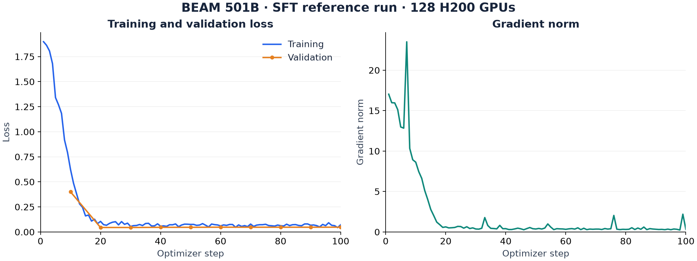
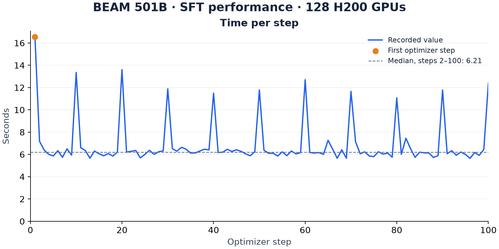
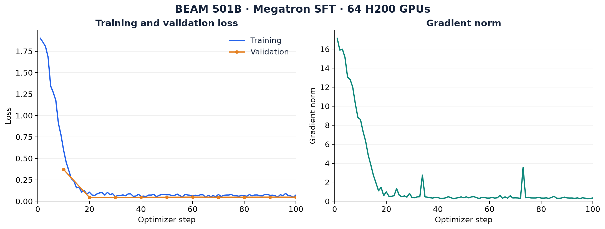
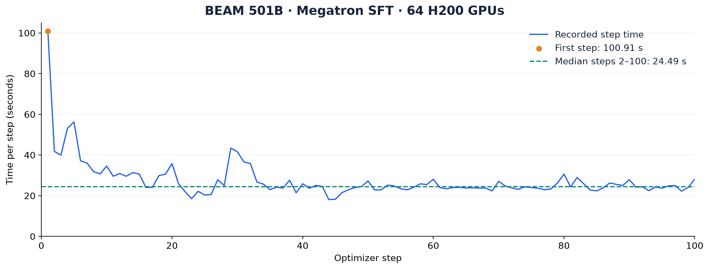
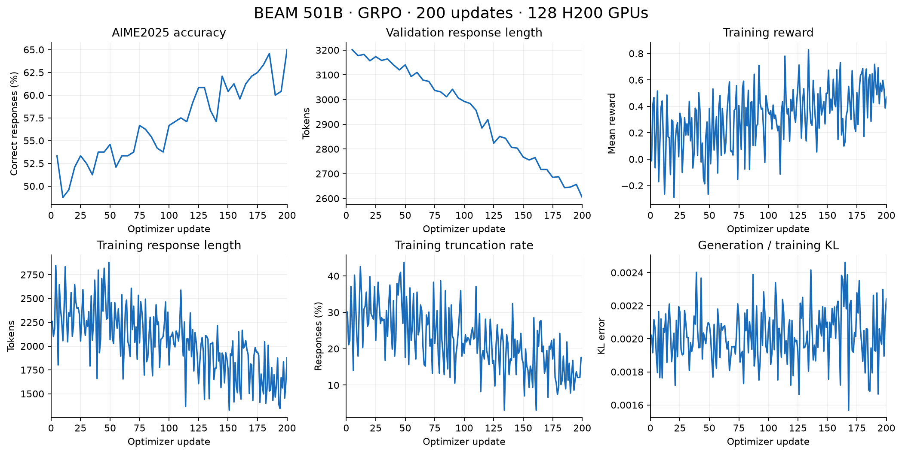
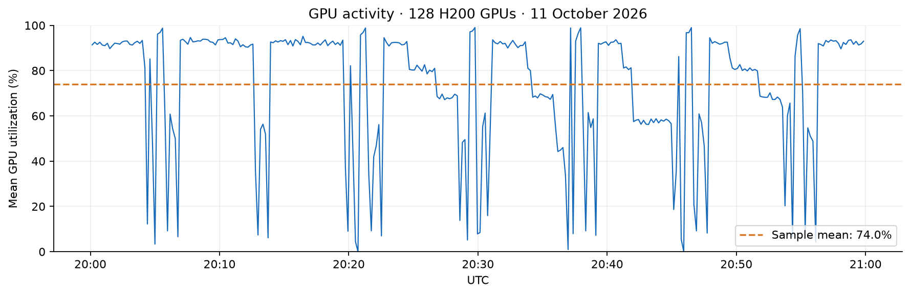
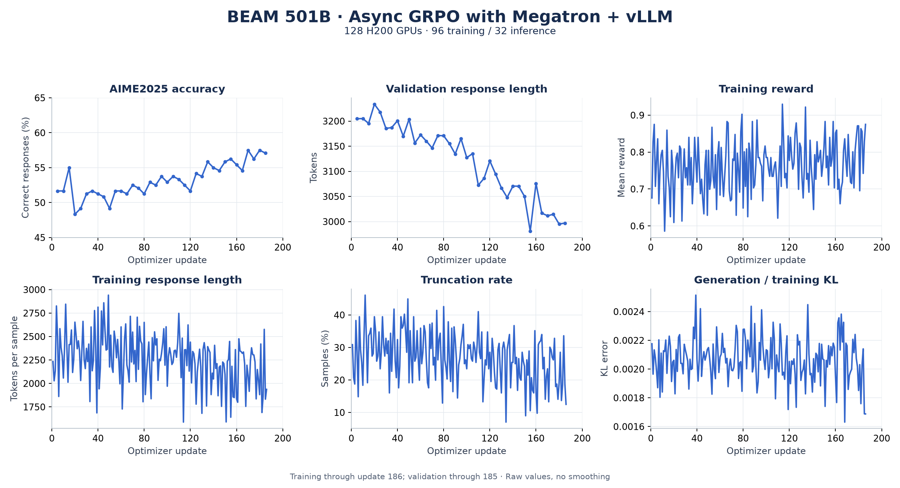
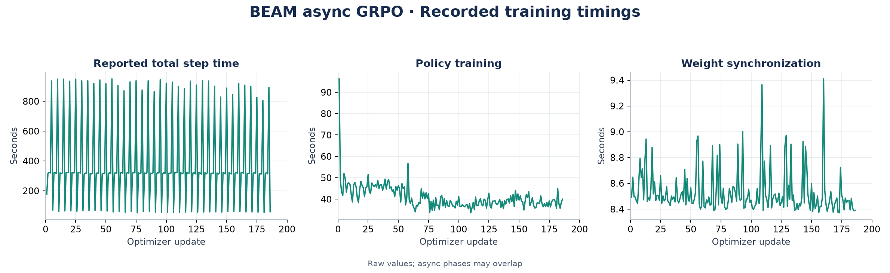

# BEAM

This guide describes training recipes for BEAM.

## Support Status

| Model | Algorithm | Training backend | Inference backend | Colocated | Validated training parallelism | Scale |
| --- | --- | --- | --- | --- | --- | --- |
| BEAM 501B | SFT | AutoModel (FSDP2) | N/A | N/A | TP1 + CP1 + EP128 | 16 nodes × 8 H200 GPUs |
| BEAM 501B | SFT | Megatron Bridge | N/A | N/A | TP2 + PP1 + CP1 + EP64, ETP1 | 8 nodes × 8 H200 GPUs |
| BEAM 501B | GRPO | AutoModel (FSDP2) | SGLang (TP16) | Yes | TP1 + CP1 + EP128 | 16 nodes × 8 H200 GPUs |
| BEAM 501B | GRPO | AutoModel (FSDP2) | SGLang (TP16) | Yes | TP1 + CP1 + EP64 | 8 nodes × 8 B300 GPUs |
| BEAM 501B | GRPO (async) | Megatron Bridge | vLLM (2 × TP16) | No | TP2 + PP3 + CP1 + EP32, ETP1 | 16 nodes × 8 H200 GPUs |

The async GRPO configuration uses 12 nodes for training and 4 for inference.
The recorded run reached update 186 of 200 in the
recorded snapshot; full-run validation was still in progress.

## SFT Validated Scope

- **Dataset**: SQuAD, using the training and validation splits.
- **Precision**: BF16 mixed-precision computation with FP32 persistent parameters
  and AdamW states; the native implementation preserves FP32 router computation.
- **Parallelism**: FSDP2 with EP128, TP1 and CP1, with activation checkpointing.
- **Batch size**: 128 globally, with a microbatch of 1 per GPU.
- **Sequence length**: 512 tokens.
- **Schedule**: 100 optimizer steps, validation every 10 steps on one batch.
- **Tokenization**: The checkpoint's chat template, without additional BOS/EOS tokens.

Recipe YAML files are the source of truth for training and resource settings.

## How to Run SFT

### Prepare the Environment

This branch pins the BEAM dependencies in `.gitmodules`, `pyproject.toml`, and
`uv.lock`. Initialize the sources before building:

```bash
git submodule update --init --recursive
uv lock --check
```

| Dependency | Pinned source revision |
| --- | --- |
| AutoModel | `reflection-oss/automodel@8bc07340559e8dca78650c2e3f7b8055bad7243e` |
| Transformers | `huggingface/new-model-addition-reflection@8ff92cc164e93fd8461cb0c2b65b7a3a68051575` |
| Megatron Bridge | `reflection-oss/Megatron-Bridge@31591deba7cdb95d2ba01754b464a296b6eeb5a4` |
| NVIDIA Resiliency Extension | `NVIDIA/nvidia-resiliency-ext@ebf0352a82ca5699148ea10bec2b8eedd121e382` |
| Megatron Core | `07147d6942dfd4e6d1566b64bb1730f478a1bc32` (nested Bridge submodule) |

The Transformers source override supplies BEAM registration to both the driver
and worker virtual environments. Tokenizers is pinned to `0.23.1` for this
Transformers revision; other model families are not validated by the BEAM runs.

Build on a Linux CUDA host using the repository Dockerfile:

```bash
docker buildx build --load --build-context nemo-rl=. -f docker/Dockerfile \
  --build-arg SKIP_VLLM_BUILD=1 \
  --build-arg SKIP_SGLANG_BUILD=1 \
  --build-arg SKIP_TRTLLM_BUILD=1 \
  --tag nemo-rl:beam .
```

Provide a BEAM checkpoint in Hugging Face format, including configuration and
tokenizer files, at the same path on every worker.

### Set Up the Ray Cluster

Start Ray on all nodes before running a recipe, using the same BEAM image on
the head and workers. Use `nemo-rl:beam` for SFT, `nemo-rl:beam-grpo` for
synchronous GRPO, or `nemo-rl:beam-grpo-async` for asynchronous GRPO, built with
the commands in the corresponding recipe sections.

- **Slurm:** Follow the [Slurm cluster instructions](../../../cluster.md#use-slurm-for-batched-and-interactive-jobs)
  with `CONTAINER` set to the recipe's BEAM image in a registry accessible to
  the cluster, or its exported SquashFS image. `ray.sub` starts Ray on the
  allocated nodes. Set the node count to match the recipe and use the generated
  attach script for an interactive session on the head node.
- **Kubernetes:** Follow the infrastructure prerequisites and
  [Ray cluster configuration](../../../cluster.md#phase-2-ray-cluster-configuration).
  Skip that guide's generic image build step, which builds upstream `main`.
  Push the recipe's BEAM image to a registry accessible to the cluster and set
  both the head and worker container images to that reference. Adjust the
  worker replica count and GPU resources to match the recipe.

Run the training commands from the repository root inside the Ray head
container once all required GPU nodes have joined the cluster.

### Reference Recipe

| Model | Algorithm | Backend | Scale | Recipe |
| --- | --- | --- | --- | --- |
| BEAM 501B | SFT | AutoModel | 16n8g | [SFT recipe](../../../../examples/configs/recipes/llm/sft-beam-501b-16n8g-fsdp2ep128-automodel.yaml) |

Start the [Ray cluster](#set-up-the-ray-cluster) with `nemo-rl:beam` on 16 nodes
with 8 H200 GPUs each, then run from the repository root on the head node:

```bash
export BEAM_CHECKPOINT=/path/to/beam-hf-checkpoint
uv run examples/run_sft.py \
  --config examples/configs/recipes/llm/sft-beam-501b-16n8g-fsdp2ep128-automodel.yaml
```

The corresponding [integration test](../../../../tests/test_suites/llm/sft-beam-501b-16n8g-fsdp2ep128-automodel.sh)
runs 20 steps and checks completion, final validation, and finite losses and
gradient norms.

## SFT Reference Results

### Training curves

**SFT, FSDP2 + EP128** — 100 optimizer steps on 16 nodes × 8 H200 GPUs,
using SQuAD with a global batch size of 128 and a sequence length of 512.



Training and validation loss decrease rapidly during the first 20 steps, ending
at **0.0715** and **0.0478**, respectively. The recorded gradient norm settles
below 1 for most subsequent steps, with occasional isolated peaks.

Curves show the recorded TensorBoard values without smoothing. Both panels use
linear vertical axes. Validation was recorded every 10 steps on one batch.

### Time per step



Step times use linear axes and unsmoothed TensorBoard values. The first optimizer
step is highlighted separately; the dashed line shows the median over steps
2–100 (6.21 seconds). Timings include periodic validation but exclude model
loading before the first optimizer step.

### Summary metrics

The 100-step reference run on 128 H200 GPUs reported:

| Metric | Result |
| --- | ---: |
| Final training loss | 0.0715 |
| Final validation loss | 0.0478 |
| Mean sampled GPU utilization | 70.1% |
| Mean sampled GPU memory | 67.2 GiB |
| Maximum sampled GPU memory | 80.8 GiB |

## Megatron Bridge SFT

The [64-H200 recipe](../../../../examples/configs/recipes/llm/sft-beam-501b-8n8g-tp2ep64-megatron-cpuoffload.yaml)
uses TP2, EP64, expert TP1, sequence parallelism, activation checkpointing,
and 50% optimizer CPU offload. It inherits the same SQuAD data, global batch
of 128, microbatch of 1, sequence length of 512, and 100-step schedule.
BF16 is explicit for HF conversion; router computation remains FP32.
The hybrid optimizer uses FP32 master parameters and optimizer states.

### Launch

Start the [Ray cluster](#set-up-the-ray-cluster) with `nemo-rl:beam` on 8 nodes
with 8 H200 GPUs each, then run from the repository root on the head node:

```bash
export BEAM_CHECKPOINT=/path/to/beam-hf-checkpoint
export NRL_MEGATRON_CHECKPOINT_DIR=/shared/writable/megatron-cache
uv run --locked --extra mcore python examples/run_sft.py \
  --config examples/configs/recipes/llm/sft-beam-501b-8n8g-tp2ep64-megatron-cpuoffload.yaml
```

### Validation results

Reference run:
100/100 optimizer steps completed successfully on 64 H200 GPUs, including
periodic validation. Final training loss was **0.0716** and final validation
loss was **0.0473**. Validation uses one batch every 10 steps.

### Recorded training curves





Plots use the archived TensorBoard scalars without smoothing, with linear axes.
Validation is measured on one batch every 10 steps. Step times include periodic
validation but exclude model loading before the first optimizer step. The first
step took **100.91 seconds**; the median over steps 2–100 was **24.49 seconds**.

## GRPO Recipe

The [GRPO recipe](../../../../examples/configs/recipes/llm/grpo-beam-501b-16n8g-fsdp2ep128-automodel-sglang.yaml)
configures synchronous math training on the same 16-node, 128-H200 scale.
It inherits from `grpo_math_1B_sglang.yaml`. The YAML is the source of truth;
the SFT integration test above does not validate this GRPO path.

The current recipe enables SGLang CUDA graphs and overlap scheduling
(`disable_cuda_graph: false`, `disable_overlap_schedule: false`).

### Training and Generation

| Setting | Value |
| --- | --- |
| Training backend | AutoModel / FSDP2, EP128, TP1, CP1 |
| Generation backend | Colocated SGLang, TP16 (eight 16-GPU engines) |
| Training budget | 200 optimizer updates |
| Rollout batch | 32 prompts × 8 responses = 256 responses |
| Global / micro / log-probability batch | 256 / 1 / 1 |
| Input / response / total token limits | 1,024 / 4,096 / 5,120 |
| Optimizer | AdamW, constant learning rate `1e-6`, weight decay `0` |
| Reward processing | Scaling enabled with target minimum `-1`; overlong buffer 819 tokens |
| Loss | Ratio clipping `0.2` / `0.28`, `ratio_clip_c=10`, TIS correction ratio `2` |
| Reference-policy KL penalty | `0.0` |
| Checkpoint saving | Disabled |

### Data and Evaluation

The built-in `DAPOMath17K` and `AIME2025` loaders download and format the
training and validation datasets automatically. No manual preparation is needed.

Evaluation runs every five updates, starting at update 5, with eight responses
per AIME2025 problem (30 problems, 240 responses). Accuracy is the percentage
of responses marked correct by `hf_math_verify`.

### Environment Requirements

Use the dependencies pinned by this branch and the common environment setup
[above](#prepare-the-environment). GRPO additionally pins
`radixark/sglang-reflection-oss@90c70a5a4927d055f68065f01d8bb55ad885c620`,
SGLang Kernel `0.4.7`, Torch `2.13.0`, FlashInfer `0.6.18`, and TileLang `0.1.12`.

```bash
docker buildx build --load --build-context nemo-rl=. -f docker/Dockerfile \
  --build-arg SKIP_VLLM_BUILD=1 \
  --build-arg SKIP_TRTLLM_BUILD=1 \
  --tag nemo-rl:beam-grpo .
```

### Launch

Start the [Ray cluster](#set-up-the-ray-cluster) with `nemo-rl:beam-grpo` on
16 nodes with 8 H200 GPUs each, then run from the repository root on the head node:

```bash
export BEAM_CHECKPOINT=/path/to/initial/beam-hf-checkpoint
export BEAM_LOG_DIR=/path/to/local/experiment/logs  # optional

python examples/run_grpo.py \
  --config examples/configs/recipes/llm/grpo-beam-501b-16n8g-fsdp2ep128-automodel-sglang.yaml
```

W&B logging and GPU monitoring are enabled; configure W&B authentication in the
execution environment. If `BEAM_LOG_DIR` is unset, logs are written under
`/tmp/grpo-beam-501b-16n8g-fsdp2ep128-automodel-sglang`. Preserve logs and validation
outputs before releasing ephemeral workers.

### Async GRPO with Megatron and vLLM

The [async GRPO recipe](../../../../examples/configs/recipes/llm/grpo-beam-501b-16n8g-tp2pp3ep32-megatron-vllm-async.yaml)
uses 16 nodes with 8 GPUs each: 96 GPUs for Megatron training (TP2, PP3, EP32)
and 32 GPUs for vLLM inference (two TP16 engines). Half of the optimizer is
offloaded to CPU, and activation checkpointing is enabled.
The pipeline stages contain 36/34/34 hybrid sublayers. Flash attention is enabled;
dynamic batching is disabled because it currently requires PP1.

It preserves the synchronous recipe's datasets, 200 updates, batch of 32 prompts
with 8 responses each, 1,024-token input limit, 4,096-token response limit,
learning rate, loss settings, and validation schedule. Reward scaling and the
overlong-response penalty are disabled because the async training path does not
support them. Weight updates wait for generation to quiesce.

Use BEAM-compatible dependencies, including [Megatron Bridge PR #4](https://github.com/reflection-oss/Megatron-Bridge/pull/4)
and the [vLLM fork in Inferact/lin PR #64](https://github.com/Inferact/lin/pull/64).
Pin vLLM to commit `ed2c0e0a38e69865176f2ad4b1a17e3aea2d5d1a` from that fork;
a stock vLLM wheel is not the dependency used for this async recipe.

Build the async image from this branch on a Linux CUDA host after initializing
the submodules. The standard dependency sync builds the pinned vLLM fork and
includes the Megatron training environment.

```bash
git submodule update --init --recursive
docker buildx build --load --build-context nemo-rl=. -f docker/Dockerfile \
  --build-arg SKIP_SGLANG_BUILD=1 \
  --build-arg SKIP_TRTLLM_BUILD=1 \
  --tag nemo-rl:beam-grpo-async .
```

Leave `SKIP_VLLM_BUILD` unset. `BUILD_CUSTOM_VLLM` is not required.

Start the [Ray cluster](#set-up-the-ray-cluster) with `nemo-rl:beam-grpo-async`
on 16 nodes with 8 H200 GPUs each. From the repository root on the head node,
with the same `BEAM_CHECKPOINT` and `BEAM_LOG_DIR` variables set as above, run:

```bash
uv run --extra vllm examples/run_grpo.py \
  --config examples/configs/recipes/llm/grpo-beam-501b-16n8g-tp2pp3ep32-megatron-vllm-async.yaml
```

### GRPO Reference Results

The reference experiment completed 200 optimizer updates and its final
AIME2025 evaluation using 128 H200 GPUs.
The recorded metrics are shown below.



| Evaluation update | Correct responses | Accuracy |
| --- | ---: | ---: |
| 5 (first evaluation) | 128 / 240 | 53.33% |
| 185 | 155 / 240 | 64.58% |
| 190 | 144 / 240 | 60.00% |
| 195 | 145 / 240 | 60.42% |
| 200 (final, best) | 156 / 240 | 65.00% |

The final accuracy is **65.00%**, up **11.67 percentage points** from the first
recorded evaluation at update 5. Mean validation response length decreases
from **3,201** to **2,604 tokens**. Accuracy counts individual correct responses
out of 240; it is not pass@8. There is no initialization evaluation. Repeated
sampling on the same 30 problems does not establish generalization to unseen
problems. All curves show recorded values without smoothing.

Final training loss is **0.0641**, reward **0.4705**, and generation/training
KL error **0.00224**. The reference-policy KL penalty remains zero.

### GRPO Performance

Generation is the longest measured phase: median **363 s**, compared with
**60 s** for generation preparation/refitting, **43 s** for policy training,
**19 s** for training preparation, and **14 s** for policy/reference log
probabilities. Median reported total step time is **511 s**, and median
validation time is **364 s**. These are separate phase medians, not an additive
profile. The observed cadence including periodic evaluation is about
**10 minutes per update**, excluding initial loading.



Over the recorded one-hour window, the arithmetic mean of **307** recorded
samples is **74.0%**. Each sample averages all **128 GPUs**, using W&B
`ray/node.*.gpu.*.util` telemetry. Training, generation, and validation share
these GPUs. The unsmoothed curve measures GPU activity, not FLOPs utilization;
it does not isolate optimizer computation.

### Async GRPO Training Curves

The async GRPO run uses 128 H200 GPUs: 96 for Megatron training and 32 for vLLM inference.
The figures below are a snapshot of an ongoing
run, with training metrics through update **186** of the configured 200 and
validation through update **185**. These are intermediate results.



| Evaluation update | Correct responses | Accuracy |
| --- | ---: | ---: |
| 5 (first evaluation) | 124 / 240 | 51.67% |
| 170 (first best) | 138 / 240 | 57.50% |
| 180 (tied best) | 138 / 240 | 57.50% |
| 185 (latest in snapshot) | 137 / 240 | 57.08% |

Evaluation uses eight responses for each of the 30 AIME2025 problems.
Accuracy is the fraction of correct responses out of 240, not pass@8.
Mean validation response length changes from **3,205** tokens at update 5
to **2,997** at update 185. At update 186, training reward is **0.875**,
mean generated response length is **1,937 tokens**, truncation rate is
**12.5%**, and generation/training KL error is **0.00169**.



The timing panels show the recorded `timing/train/total_step_time`,
`timing/train/policy_training`, and `timing/train/weight_sync` metrics.
Async phases can overlap, so these curves are not an additive runtime profile.
All panels use `nemo_rl/step` as the x-axis, without smoothing; repeated records
for the same metric and update use the latest exported value. Missing values
are omitted. Repeated evaluation on these 30 problems does not establish
performance on unseen problems.

### GRPO on 64 B300 GPUs

The [B300 recipe](../../../../examples/configs/recipes/llm/grpo-beam-501b-8n8g-b300-fsdp2ep64-automodel-sglang.yaml)
supports 8 nodes × 8 B300 GPUs with AutoModel FSDP2 (EP64, TP1, CP1)
and four colocated SGLang TP16 engines. Decode CUDA graphs and overlap
scheduling are enabled. Generation and policy training run sequentially on
the same GPUs. Batch sizes, token limits, optimizer settings, and evaluation
protocol match the GRPO recipe above.

Use the same environment and dataset preparation, then launch with:

```bash
uv run examples/run_grpo.py \
  --config examples/configs/recipes/llm/grpo-beam-501b-8n8g-b300-fsdp2ep64-automodel-sglang.yaml
```

The 10-update B300 benchmark completed successfully. TensorBoard measurements:

| Metric | Observed time |
| --- | ---: |
| First full GRPO step | 650.6 s (10 min 51 s) |
| Median full GRPO step, updates 2–9 excluding evaluation update 5 | 601.7 s (10 min 02 s) |
| Range for those non-evaluation steps | 381.9–640.4 s |
| Median inference / rollout-generation phase, updates 2–10 | 92.5 s |
| Median policy-training phase, updates 2–10 | 50.8 s |
| Update 5, including evaluation | 988.1 s (16 min 28 s) |

Full-step time includes rollout generation, weight synchronization, log
probabilities, preparation, and the policy update; it excludes initial model
loading. The policy-training phase is only the optimizer-training portion,
not the full GRPO iteration. These measurements depend on generated response lengths and shared-cluster
conditions. AIME2025 accuracy
at updates 5 and 10 was **51.25% (123/240 responses)**.
