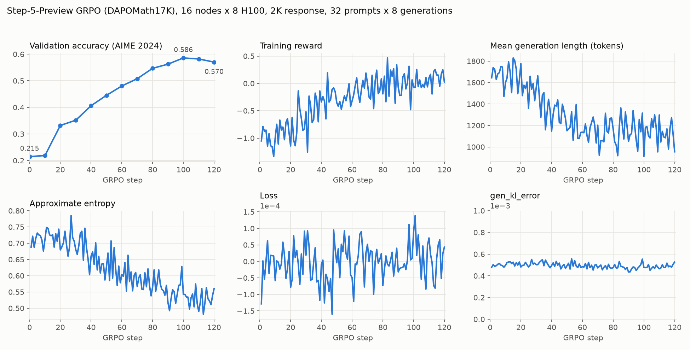

# Step-5-Preview

This guide describes GRPO (DAPO-style) training of Step-5-Preview, a 600B-parameter
mixture-of-experts model with 27B active parameters, with the AutoModel training backend and
BF16 vLLM generation.

> [!IMPORTANT]
> **Early access. Status: Functionally Ready.** The reference recipe was validated with one
> 120-step GRPO run on 16 nodes with 8 H100 80GB GPUs each, at a 3,072-token maximum
> sequence length (1,024 prompt + 2,048 response tokens). AIME 2024 validation accuracy rose from
> 0.215 to 0.586. The run has not been repeated and was not run to full length; see
> [Known Issues](#known-issues).

## Support Status

| Level | Meaning | Step-5-Preview |
| --- | --- | --- |
| Functionally Ready | the full model trains for 100+ steps without a crash, `gen_kl_error` stays around 1e-3 or below with no upward trend, and reward and validation accuracy improve | **Reached** (120 steps) |
| Long-Run Convergence Validated | a full-length run with a healthy, reproduced reward curve | Not yet |

## What's Supported

| Model | Modality | Training backend | Training parallelism | Inference engine | Precision |
| --- | --- | --- | --- | --- | --- |
| `stepfun-ai/Step-5-Preview-BF16` | text (math) | AutoModel (FSDP2) | EP32, FSDP over 128 GPUs, activation checkpointing | vLLM, colocated, 4 engines of TP8 x EP32 | BF16 weights; FusedAdam with BF16 moments |

- **Algorithm**: GRPO with DAPO settings (dynamic sampling, overlong reward shaping, asymmetric
  ratio clipping, truncated importance sampling) on `DAPOMath17K`; validation on
  `DAPOMathAIME2024`.
- **Router replay (R3)** is on: vLLM returns the routed experts of every generated token and
  training replays them.
- **MTP** heads are disabled (`num_nextn_predict_layers: 0`); RL does not train them and
  speculative decoding is out of scope.
- The vision tower is loaded but not exercised: training and validation data are text only.

## Build the Environment

Step-5-Preview needs newer AutoModel and vLLM than NeMo RL `main` pins.

| Component | Version |
| --- | --- |
| NeMo RL | the [`step5-support` branch](https://github.com/NVIDIA-NeMo/RL/tree/step5-support) |
| AutoModel | submodule at commit `c77d621` on the [`rl/step5-support` branch](https://github.com/NVIDIA-NeMo/Automodel/tree/rl/step5-support): AutoModel `main` at `3b355ab` plus two Step5 fixes for RL (router replay through `moe_overrides`; decoder compute dtype from the FSDP `param_dtype`) |
| vLLM | `main` commit `0e7ce459` wheel: Step5 support ([vllm#61727](https://github.com/vllm-project/vllm/pull/61727)) and the CSA tail-ring fix ([vllm#65153](https://github.com/vllm-project/vllm/pull/65153)); no release has both yet |
| PyTorch / Transformers | torch 2.14.0, transformers 5.18.0 (both training and generation, required for colocated refit) |

```bash
git clone -b step5-support https://github.com/NVIDIA-NeMo/RL.git
cd RL
git submodule update --init --recursive
```

Build the container or the worker virtual environments as described in
[Dependency Management](../../../design-docs/dependency-management.md). On multi-node jobs that
build the environments at startup, set:

```bash
export NRL_FORCE_REBUILD_VENVS=true   # first run on a new checkout; false afterwards
export UV_LOCK_TIMEOUT=3600           # nodes wait for the one that holds the uv lock
```

## Get the Weights

The recipe uses the Hugging Face checkpoint `stepfun-ai/Step-5-Preview-BF16` (about 1.2 TB).
Download it to storage visible from every node and point the recipe at the local copy:

```bash
policy.model_name=<path-to>/Step-5-Preview-BF16 \
policy.tokenizer.name=<path-to>/Step-5-Preview-BF16
```

Set `HF_HOME` to a shared cache for the datasets, and `WANDB_API_KEY` if W&B logging stays
enabled (`logger.wandb_enabled=false` turns it off).

## Example Recipes

| Max sequence length | Training parallelism | Rollout parallelism | `max_new_tokens` | Nodes | Recipe |
| --- | --- | --- | --- | --- | --- |
| 3,072 (1,024 + 2,048) | EP32 + FSDP, 128 GPUs | vLLM TP8 x EP32, 4 engines, colocated | 2,048 | 16 x 8 H100 80GB | [`grpo-step5-preview-dapo-16n8g-automodel.yaml`](../../../../examples/configs/recipes/llm/grpo-step5-preview-dapo-16n8g-automodel.yaml) |

## Choose a Recipe

There is one validated recipe. Step-5-Preview has 352 routed experts, and expert parallelism must
divide both 352 and the number of training GPUs; on 128 GPUs only EP32 works (11 experts per
rank). A different node count needs a different expert-parallel size and has not been validated.
Longer responses (for example 8K) have not been run at full scale; see [Known Issues](#known-issues).

Settings in the recipe that exist for this model:

- `policy.optimizer`: Transformer Engine `FusedAdam` with `master_weights`,
  `store_param_remainders` and BF16 moments, as in AutoModel's Step5 SFT recipe (10 bytes of
  training state per parameter). It is what lets the 600B model train on 16 H100 nodes.
- `policy.automodel_cfg.moe_parallelizer.reshard_after_forward: true`: without it, every layer
  stays unsharded after the log-probability pass and the run runs out of GPU memory.
- `policy.generation.vllm_cfg.gpu_memory_utilization: 0.70`: at 0.75, GPU memory peaked at
  78.9 of 79.1 GiB around the weight refit.
- `policy.generation.vllm_cfg.enable_prefix_caching: true`: required by vLLM's router-replay
  connector in this vLLM version.
- `policy.scheduler`: 10-step linear warmup to `lr: 1e-6` (reached at step 11), then constant.
- `checkpointing.keep_top_k: 1` and `metric_name: null`: a checkpoint is about 4.4 TB, so only
  the latest is kept.

## Launch

From the repository root, in a 16-node allocation with 8 GPUs per node (see
[Cluster Setup](../../../cluster.md)):

```bash
uv run examples/run_grpo.py \
  --config examples/configs/recipes/llm/grpo-step5-preview-dapo-16n8g-automodel.yaml \
  policy.model_name=<path-to>/Step-5-Preview-BF16 \
  policy.tokenizer.name=<path-to>/Step-5-Preview-BF16 \
  cluster.num_nodes=16 cluster.gpus_per_node=8
```

`cluster.num_nodes` must match the Slurm allocation. A step takes about 6.5 minutes (median of
70 steps, range 4 to 10 minutes), so a 4-hour job covers about 30 steps including startup,
validation every 10 steps, and a checkpoint every 5 steps. For longer runs, chain jobs that resume
from the latest checkpoint.

## Reference Results

The curves below come from the validated run: 120 steps of the recipe above on 16 nodes x 8 H100
80GB, 32 prompts x 8 generations per step, starting from the released checkpoint. The run was
resumed from checkpoints four times; steps 21 to 120 ran on the final code.

- **Validation accuracy** (AIME 2024, 32 samples per problem): 0.215 at step 0, 0.332 at step 20,
  0.445 at step 50, 0.586 at step 100, 0.570 at step 120.
- **Training reward**: mean of steps 1 to 10 was -1.03; mean of steps 111 to 120 was 0.11.
- **Mean generation length**: from about 1,670 tokens (steps 1 to 10) to about 1,100 tokens
  (steps 111 to 120); the share of responses truncated at 2,048 tokens fell from 62% to 20%.
- **Approximate entropy**: from 0.71 to 0.53 (same step windows).
- **`gen_kl_error`**: between 4.4e-4 and 5.6e-4 at every step, with no trend.
- **Gradient norm**: 0.15 to 0.65, with one value of 0.91 at step 16.



## Known Issues

- **Validated scope**: one 120-step run at a 3,072-token maximum sequence length on 16 H100
  nodes. Longer sequences, other node counts and expert-parallel sizes, sequence packing, context
  parallelism, FP8 generation, and image inputs are not validated.
- **Sparse attention at long context**: below 4,104 tokens, the model's compressed sparse attention
  keeps all history, so the full-scale run never dropped history. The sparse path was exercised
  only on a reduced 8-layer model at 8,192 tokens.
- **Plateau**: validation accuracy was flat from step 100 to 120 (0.586, 0.582, 0.570) while
  entropy kept falling. Longer runs may need changes (for example longer responses) that have not
  been tested.
- **Branch-only dependency changes**: the `step5-support` branch moves to torch 2.14 and excludes
  `flash-attn` 2, `mamba-ssm`, `causal-conv1d` and `nv-grouped-gemm`, which do not build on torch
  2.14. On this branch, Mamba-based models and FA2 sequence packing do not work, and Nemotron Super
  Omni VL rollouts skip a vLLM source patch for the final vision LayerNorm.
- **Metrics**: the driver's FLOPs tracker does not recognize the `step5_vl` config, so runs report
  no FLOPs or MFU.
- **Profiling**: NeMo RL's deferred Nsight capture does not reach vLLM's tensor-parallel workers
  under this vLLM version's Ray executor.
- **Checkpoint format**: optimizer checkpoints store the BF16 Adam moments as BF16 (no FP32
  copies). Checkpoints written by earlier versions of this branch, with FP32 moments, still load.
