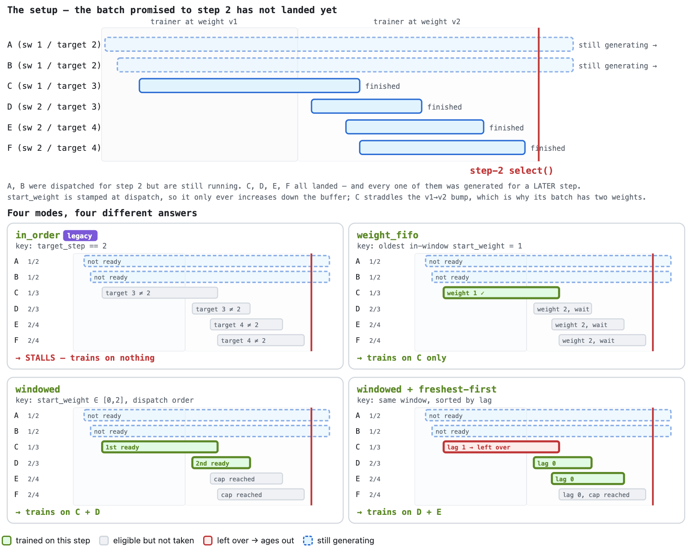
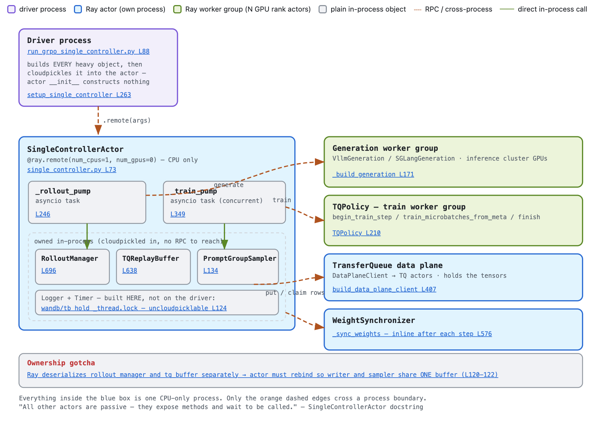

# 使用单控制器训练（异步 GRPO 和 PPO）

:::{warning}
单控制器（Single-Controller）路径是一项 **Beta 功能**，目前仍在积极开发中。API 和配置接口尚不稳定，可能会在不另行通知的情况下发生变化。欢迎提交问题和反馈：[github.com/NVIDIA-NeMo/RL/issues](https://github.com/NVIDIA-NeMo/RL/issues)。
:::

单控制器（SC）路径是另一种异步 GRPO 和 PPO 运行时。它将 rollout（轨迹生成）和策略训练作为两个独立的*循环（pump）*运行，由一个 Ray actor（`SingleControllerActor`）协调，底层共用 TransferQueue（TQ）数据平面。与 [async-grpo.md](./async-grpo.md) 中的旧版异步 GRPO 相比，SC 将每个提示的 rollout 与每个训练步的批次边界解耦：生产者以组为粒度将已完成的 rollout 推入 `TQReplayBuffer`，由可插拔的 `StalenessSampler` 决定训练器在每一步使用哪些组。

## 配置单控制器路径

SC 路径通过专用入口启动：

```bash
uv run examples/run_grpo_single_controller.py --config <your-sc.yaml>
```

`run_grpo_single_controller.py` 的配置加载方式与 `run_grpo.py` 相同，可使用相同的 YAML 文件，但它还要求一些旧版路径不需要的设置。默认 GRPO 示例位于 [examples/configs/grpo_math_1B_megatron_single_controller.yaml](../../examples/configs/grpo_math_1B_megatron_single_controller.yaml)，PPO 示例位于 [examples/configs/ppo_math_1B_megatron_single_controller.yaml](../../examples/configs/ppo_math_1B_megatron_single_controller.yaml)。

### 必需设置

1. **启用 TransferQueue 数据平面**（必需，否则入口会拒绝启动）：
   ```yaml
     data_plane:
       enabled: true
   ```
2. **选择生成后端**。使用 vLLM 时，**禁用同置推理**（除 Megatron 外，所有后端的初始化流程都会拒绝 `colocated.enabled: true`），并启用异步引擎（SC 通过 `RolloutManager.generate_and_push` 驱动 rollout，该方法仅受分离部署的异步引擎支持）：
   ```yaml
     policy:
       generation:
         backend: "vllm"
         vllm_cfg:
           async_engine: true
         colocated:
           enabled: false
           resources:
             num_nodes: 1
             gpus_per_node: 4  # 推理使用的 GPU 数；其余 GPU 用于训练
   ```

     也支持 Megatron 生成，包括同置和非同置模式。它要求使用 Megatron 训练器（`policy.megatron_cfg.enabled: true`）；NeMo-Gym rollout 还要求设置 `policy.generation.mcore_generation_config.expose_http_server: true`。同置模式（`colocated.enabled: true`）还要求 `async_rl.min_groups_for_streaming_train == num_prompts_per_step`：引擎在整个训练步期间暂停运行，因此每一步都必须先组装好完整批次，再让训练占用 GPU。每个请求的超时期限（`generation_timeout_s`、`rollout_timeout_s`）不计入引擎暂停的时间：进行中的请求会被冻结，其计时器暂停，并在训练步结束、引擎唤醒后恢复计时。
     非同置示例是一个开放 OpenAI 服务端接口的 NeMo-Gym 任务，位于 [examples/nemo_gym/grpo_qwen3_0_6b_megatron_generation_single_controller.yaml](../../examples/nemo_gym/grpo_qwen3_0_6b_megatron_generation_single_controller.yaml)；同置示例位于 [examples/configs/grpo_math_1B_megatron_generation_colocated_single_controller.yaml](../../examples/configs/grpo_math_1B_megatron_generation_colocated_single_controller.yaml)：

     对于默认的非同置 vLLM 权重重载（refit），SingleController 入口使用与旧版 GRPO/PPO 相同的 vLLM 生成路径，因此可以通过以下配置选择 vLLM 原生 reload API：

     此 reload API 路径具有[权重重载](./refit.md#vllm-reload-api)中所述的相同限制。
3. **一个 RL 步 = 一个训练批次。** 每一步训练所用的批次就是整个步骤的批次（参见 [nemo_rl/algorithms/single_controller_utils/config.py](../../nemo_rl/algorithms/single_controller_utils/config.py) 中的 `validate_single_controller_config`）。一个 GRPO 步也对应一个优化器步。一个 PPO 步则在同一批次上执行 `ppo.ppo_epochs` 次 actor 更新和 `ppo.critic_ppo_epochs` 次 critic 更新。这两个次数都必须至少为 1，且可以独立配置；示例中 critic 的更新次数默认为 `${ppo.ppo_epochs}`。
   ```python
     num_prompts_per_step * num_generations_per_prompt == policy.train_global_batch_size
     num_prompts_per_step * num_generations_per_prompt == value.train_global_batch_size  # PPO
   ```
4. 只要采样器允许使用离策略数据，就必须**启用重要性采样校正**（`windowed`/`weight_fifo` 采样器的 `max_staleness_versions > 0`，或 `in_order` 的 `max_lookahead_versions > 0`）。校正方法及其推导与旧版异步 GRPO 相同，参见[为什么异步训练需要重要性采样校正](./async-grpo.md#why-importance-sampling-correction-is-required-for-async)：
   ```yaml
     loss_fn:
       use_importance_sampling_correction: true
   ```
5. **保存数据平面，以便恢复回放。** 启用单控制器检查点时，所有内置采样器都要求 `checkpointing.save_data_plane: true`，以便已完成但尚未使用的 rollout 组能够在重启后保留。原生 TQ 检查点通过同一组检查点设置同时支持 `simple` 和 `mooncake_cpu`，无需后端专用开关。多节点运行时，`checkpoint_dir` 必须位于持久化文件系统上，且所有节点都能通过相同路径访问。
   ```yaml
     checkpointing:
       enabled: true
       checkpoint_dir: /shared/checkpoints/my-run
       save_data_plane: true

     data_plane:
       enabled: true
       backend: "simple"
   ```
6. **（PPO）设置** `ppo:`**，而不是** `grpo:`——这两个算法配置块互斥，SC 会从实际存在的配置块中读取所有步骤设置。PPO 运行还需要 `value:`、`value_loss_fn:` 和 `ppo.adv_estimator.name: gae`（与旧版 PPO 使用相同的配置结构）、Megatron critic，以及 `policy.offload_optimizer_for_logprob: true`；最后这一项用于在 critic 运行期间将策略优化器移出 GPU。`ppo.policy_training_start_step: N` 提供常规的 critic 预热：前 N 步不训练策略，也不重载策略权重，但每一步都训练 critic。另一种方式是通过 `ppo.warm_start_value_checkpoint` 从其他运行的检查点初始化 critic，使新运行完全跳过在线预热，参见 [critic 热启动](./ppo.md#warm-starting-the-critic)。

## token 捕获下的奖励惩罚与推理投入整形

使用 NeMo-Gym 且设置 `token_capture.enabled: true` 时，以下现有设置的行为与未启用捕获时的 rollout 相同：

```yaml
reward_penalties:
  penalize_duplicated_reasoning: true
  penalize_empty_final_answer: true
  penalize_unwanted_tokens: true
  token_ids:
    unwanted: [12345]  # 替换为模型分词器中的 ID。
env:
  nemo_gym:
    effort_levels:
      low_weight: 1.0
      low_penalty: 1.0
      low_ub: 1000
      low_string: "<budget>"
```

管理器检查已评分的 `response.output`，并使用最后一条用户消息对原始提示分类。最终处理器使用**终端调用的生成长度**对原始奖励进行整形；如果命中任一已启用的惩罚，则将奖励设为 `0.0`，即使整形后的奖励为负数也一样。不需要的 token ID 会在所有选中的生成片段中检查，包括终端 token；提示、工具和已放弃分支中的 token 不计入。对于空答案，保留最终函数调用的例外处理。token ID、logprob 和训练掩码的现有行为不变。

两条路径共用分类逻辑、文本检查、token 成员检查和整形公式。对于低推理投入提示：

```text
term = min(1, low_weight * (1 - terminal_generation_length / low_ub))
reward = raw_reward + raw_reward * max(term, 0) + low_penalty * min(term, 0)
```

设置 `low_weight <= 0` 或将 `low_string` 设为空字符串会禁用整形。启用整形时要求 `low_ub > 0`。高推理投入提示的奖励保持不变。如果一次 900-token 的调用之后又有一次 100-token 的调用，两条路径都会使用 100 token 进行整形。

恢复机制会为每个未完成的 rollout 保存原始奖励和三项布尔检查结果，并在每个检查点中保存一份奖励设置。带版本号且经过验证的配置投影会比较当前生效的奖励规则：无关的额外配置、未启用的参数，以及不需要的 ID 的顺序或重复项，都不会阻止恢复。生效规则发生变化时，会在回放之前报错，并指出有差异的设置。已完成最终处理的行保留其保存的奖励。恢复数据结构版本 3 还会保留待处理的奖励观测和可选的 agent 日志上下文。仅支持读取当前版本的数据结构；禁用 token 捕获时保存的检查点无法在启用 token 捕获后恢复。

惩罚率和最终奖励统计使用已完成最终处理的有效行。每个训练步使用的各组中的单条最终奖励会被汇总，用于计算奖励均值、标准差、最小值、最大值、精确中位数和直方图。agent 奖励统计也使用相同的最终值。启用完整结果表日志时，agent 结果保留上下文和样本标识，并用经过整形和惩罚后的最终奖励替换原奖励。因此，待处理的检查点状态为每个有效行保留一条奖励观测，以及可选的表格数据。现有的低/高推理投入均值和精确长度中位数保持不变；`mean_reward_low` 衡量的是惩罚前、整形后的奖励。待处理统计可在恢复后保留，并且只使用一次。捕获模式仍不支持对格式错误的思考内容施加惩罚，也不支持消息级优势覆盖，初始化时会报错。

## 检查点与回放恢复

设置 `checkpointing.save_data_plane: true` 后，每个单控制器检查点包含：

- 常规的模型、数据加载器和控制器状态，以及配置要求保存时的优化器状态。
- 包含 rollout 张量载荷和 TQ 状态的原生 TQ 快照。
- 仅包含元数据的回放索引，用于描述 TQ 中存储的已完成 rollout 组。
- `rollout_recovery.pt` 所有权台账，用于描述重启后必须重新派发的未完成提示组。
- 适用时，包含为丢弃 rollout 的替换操作预留的提示的 `replacement_reserve.pt` 附属文件。
- 用于从正确位置继续调度的采样器派发位置。

TQ 快照和回放索引在同一个检查点屏障下捕获。写入快照期间，生成可以继续，但已完成组的提交和破坏性的 TQ 清理操作必须在屏障处等待。这可确保 TQ 快照和回放索引描述的是同一组数据。

恢复时，单控制器会根据训练器检查点验证 TQ 快照，恢复回放索引，并在训练恢复前，将已完成、已提交但尚未使用的组提供给采样器。

所有内置采样器均支持回放恢复：`in_order`、`weight_fifo`、`ready_first` 和 `windowed`。自定义采样器必须显式声明 `supports_buffer_checkpoint = True`，否则初始化时会发出警告，且不会恢复缓冲区中已完成的组。

### 周期性 rollout 快照

常规训练器检查点在步骤边界写入。周期性 rollout 快照可保存两个训练器检查点之间较新的 rollout 进度，包括训练循环正在积累一个流式训练步的期间：

```yaml
checkpointing:
  enabled: true
  checkpoint_dir: /shared/checkpoints/my-run
  save_data_plane: true
  save_period: 1

rollout_checkpointing:
  snapshot_attempt_interval_s: 120
  telemetry_interval_s: null
  max_consecutive_failures: 3
  keep_latest_k: 2
  restore_mode: latest
  extra_fingerprint_excluded_paths: []

token_capture:
  enabled: true
```

`snapshot_attempt_interval_s` 表示单控制器尝试创建 rollout 快照的时间间隔，不保证每个间隔都会写入快照。第 N 步之后的尝试只有在不可变的训练器检查点 `step_N` 已持久化后才能成功。因此，建议设置 `save_period: 1`，以持续覆盖每一步之后的进度；设置更大的值时，会跳过尝试，直到对应的训练器检查点存在。在第一个训练步之前，快照以初始模型和 rollout 语义配置的指纹为锚点。

`telemetry_interval_s` 控制一个按实际时间独立采样的机制，用于观测 rollout 吞吐量和检查点压力。默认值为 `null`（禁用）；设为正数，例如 `30`，即可每 30 秒输出一个样本。这不会改变检查点频率。输出字段参见[单控制器 rollout 恢复指标](../observability/metrics.md#single-controller-rollout-recovery-metrics)。

`max_consecutive_failures` 是训练中止前允许连续发生的、可重试的周期性保存失败次数。检查点尝试成功或被跳过都会重置计数；违反检查点不变量的错误仍会立即导致失败。

引导阶段（bootstrap）的指纹采用不兼容即拒绝恢复的策略：每个配置值都会影响兼容性，除非 NeMo-RL 的内置排除列表将其识别为运维配置，例如日志、集群部署位置、检查点位置、运行时端口或凭据。这意味着外部算法新增的配置默认也受到保护：配置变化会阻止引导状态恢复，避免静默混用不兼容的 rollout 状态。引导清单还存储了这一隐去凭据的兼容性标识，因此拒绝重启时能够报告确切发生变化的点分路径，而不只是显示两个不透明的摘要。

集成方可以通过 `extra_fingerprint_excluded_paths` 指定 NeMo-RL 内置配置之外、仅影响运行时的额外值：

```yaml
rollout_checkpointing:
  extra_fingerprint_excluded_paths:
    - custom_algo.observability
    - env.private_agent.runtime_endpoint
    - env.private_agent.workers.*.log_dir
```

每个点分路径都会从兼容性标识中移除该值及其所有子项。`*` 匹配一层映射或列表，`**` 匹配任意层数。
只应排除不会影响提示、生成、奖励、谱系关系或持久化 rollout 数据解释方式的值。原始运行及其重启都必须设置这些排除项。

周期性快照目前要求同时满足以下所有条件：

- `checkpointing.enabled: true` 且 `checkpointing.save_data_plane: true`。
- `data_plane.backend: simple` 或 `data_plane.backend: mooncake_cpu`，因为需要原生 TQ 保存/加载功能。
- `token_capture.enabled: true`。
- 采样器支持回放恢复，并具有训练领取（training claim）的所有权管理能力。所有内置采样器均满足要求。自定义采样器必须同时显式声明 `supports_buffer_checkpoint = True` 和 `supports_training_claims = True`。

使用 `data_plane.backend: mooncake_cpu` 时，数据平面检查点还要求 `async_rl.generation_fleet_health.restart_dead_shards: false`。初始化会拒绝自动重启分片，因为替换生成 worker 可能丢弃其拥有的 Mooncake 载荷，并留下失效的检查点 worker 句柄。这一限制同时适用于训练步骤检查点和周期性 rollout 快照；仍支持从已保存的检查点重启整个作业。运行中重启分片的支持进度见 [NVIDIA-NeMo/RL#4178](https://github.com/NVIDIA-NeMo/RL/issues/4178)。

每个训练器锚点或引导锚点都有一个 `rollout_snapshots/` 目录。已发布的 `snapshot_NNNNNN/` 包含原生 TQ 快照，以及与之匹配的回放、数据加载器、控制器、替换预留池和未完成 rollout 的元数据。`keep_latest_k` 保留最近提交的快照作为后备；恢复时绝不会选择临时目录或写入中断的目录。

设置 `restore_mode: latest` 时，启动流程会选择最新训练器锚点下最新的兼容且已提交的快照。设置为 `trainer_checkpoint` 时，会忽略较新的周期性 rollout 进度，从训练器检查点包恢复。检查点选择是只读操作：两种模式都不会删除快照。如果不存在训练器检查点，`trainer_checkpoint` 就无法安全复用已有的引导命名空间，因此启动会失败且不修改该命名空间。使用 `latest` 恢复该状态，或选择新的 `checkpoint_dir` 开始新的引导谱系。只有存在已持久化的训练器检查点后，保留策略才会移除过时的引导快照。

> **仅有引导状态时的** `trainer_checkpoint` **行为：** 引导 rollout 快照没有对应的模型或优化器检查点。因此，当存在引导状态却不存在训练器检查点时，`restore_mode: trainer_checkpoint` 会按设计报错。它不会忽略或删除该状态。请使用 `latest` 恢复，或选择新的 `checkpoint_dir` 从头开始。

:::{note}
已完成的组直接从 TQ 快照恢复。对于未完成的 token 捕获组，`rollout_recovery.default_granularity` 同时控制运行中发生故障和重启时的行为：

- `sibling` 保留每个已封存的同组生成结果，只重新派发未完成的生成任务。
- `prompt_group` 在组内任意一个生成任务未完成时，重试组内全部生成任务。

默认值为 `sibling`，可以避免重新生成已完成的内容。如果要求恢复组中的所有生成结果都来自重新派发时生效的策略权重，请使用 `prompt_group`。

`task_source_granularity_overrides` 可以利用原始 rollout 行中嵌入的 Gym `task_source` 选择恢复策略。与 `agent_ref` 不同，这一标识在 Gym 解析具体 agent、SC 为恢复组预留资源之前就已可用。如果行中已有 `agent_ref`，匹配的 `agent_granularity_overrides` 条目优先于匹配的任务来源条目，与 Gym 的具体路由优先级一致。否则，优先使用任务来源覆盖项，其次使用全局默认值。agent 映射还兼容 Gym 开始记录 `task_source` 之前整理的数据集，不过建议重新整理这些数据集。使用非默认策略需要 `token_capture.enabled: true`。任务来源和解析后的策略会持久化到 `rollout_recovery.pt`，因此恢复时不会根据修改后的配置重新解释已有组。已完成的生成任务会将其 token 保存在 token 捕获暂存区中，因此 `sibling` 会原样复用它们；重新派发的同组生成任务会从同一提示生成新样本。只有组内所有生成任务均完成后，它们才会成为训练行。
:::

如果采样器不支持回放恢复，请求的数据平面检查点会以 `shadow` 模式写入。TQ 快照会被保留，但不会写入权威回放索引，其中的行也不会恢复到训练回放缓冲区。

原生 TQ 保存/加载同时支持 `data_plane.backend: "simple"` 和 `data_plane.backend: "mooncake_cpu"`，使用现有的 `checkpointing.enabled: true` 和 `checkpointing.save_data_plane: true` 设置。保存或验证 TQ 快照期间发生的错误，会阻止不完整的检查点包成为最新可恢复检查点。

## 异步 RL 参数与采样器模式

SC 的所有异步 RL 运行时参数都位于主配置的 `async_rl:` 下。最重要的选择是 `sampler`，它定义 rollout 循环和训练循环共用的陈旧度策略：前者最多可以领先多少，后者可以使用哪些组。


### 采样器模式

通过 `sampler.name` 从五种模式中选择一种。每种模式使用各自的参数，如下所示；一种模式的参数在另一种模式下不生效：



*训练器权重版本为 2 时的同一个缓冲区（*`num_prompts_per_step=2`*，陈旧度窗口为* `[0, 2]`*）。*`windowed` *和* `weight_fifo` *根据* `start_weight`*（派发时标记）选择；*`in_order` *根据* `target_step`*（准入时标记）选择。三者通常选择相同的组，只有 rollout 乱序完成时才会出现差异，如图所示。*

| `sampler.name` | rollout 准入控制 | 训练选择 | 典型用途 |
| -------------- | ---------------- | -------- | -------- |
| `in_order` | 派发最多可领先训练器 `max_lookahead_versions` 个批次。每次派发都会标记 `target_step`。 | 使用 `target_step == current_train_weight` 的组。 | 同步模式（`max_lookahead_versions=0`），以及旧版异步训练的精确批次语义（`max_lookahead_versions>=1`）。 |
| `weight_fifo` | 与 `in_order` 相同的准入控制（前瞻量为 `max_staleness_versions`）。 | 优先取出窗口内 `start_weight` 最旧的组，等待该权重版本的批次凑齐。 | 在有限前瞻范围内严格按权重版本 FIFO。 |
| `ready_first` | 与 `weight_fifo` 相同的准入控制（前瞻量为 `max_staleness_versions`）。 | 获取任何已就绪、且生成它的策略版本不新于训练器版本的组，包括延迟完成的组。 | 按完成顺序流式处理，不淘汰陈旧组。 |
| `windowed` | 不做准入限制，持续生成 rollout，直到缓冲区填满。 | 获取 `start_weight` 位于 `[train - max_staleness_versions, train]` 内的任何已就绪组，可选择优先获取最新的组。 | 过采样流式处理；超出窗口的过旧组会被淘汰（浪费计算）。 |
| `custom` | 由导入的类决定。 | 由导入的类决定。 | `target: "module:ClassName"`，使用自定义 `PromptGroupSampler`。 |

PPO 支持 `in_order` 和 `ready_first`，既可使用整步批次，也可使用流式分块。流式处理要求 `ppo.ppo_epochs: 1`：策略跨分块累积梯度，然后更新并重载权重，之后 critic 才在组装好的完整批次上训练。对于 `ready_first`，应设置 `loss_fn.use_importance_sampling_correction: true` 和 `loss_fn.force_on_policy_ratio: false`，除非按照 [CISPO 指南](cispo.md#configuration)中的说明使用 `loss_fn.use_cispo: true` 并配合 TIS 校正。它的 `max_staleness_versions` 控制准入前瞻量，而已经准入的 rollout 仍可被选择。


### 配置 → 行为映射

随仓库提供的示例覆盖了五种模式中的三种：

| 模式 | `sampler.name` | 采样器参数 | `min_groups_for_streaming_train` | `max_buffered_rollouts` | 示例 |
| ---- | -------------- | ---------- | ------------------------------- | ---------------------- | ---- |
| 同步 / 同策略 | `in_order` | `max_lookahead_versions: 0` | `${grpo.num_prompts_per_step}` | `num_prompts_per_step × 1` | [`grpo-qwen2.5-math-1.5b-instruct-1n8g-megatron-single-controller-sync.yaml`](../../examples/configs/recipes/llm/grpo-qwen2.5-math-1.5b-instruct-1n8g-megatron-single-controller-sync.yaml) |
| 异步，批次与步骤精确对应 | `in_order` | `max_lookahead_versions: >= 1` | `x <= num_prompts_per_step` | `num_prompts_per_step × (max_lookahead_versions + 1)` | [`grpo_math_1B_megatron_single_controller.yaml`](../../examples/configs/grpo_math_1B_megatron_single_controller.yaml) |
| 流式，限制派发 | `weight_fifo` | `max_staleness_versions: >= 1` | `x <= num_prompts_per_step` | `num_prompts_per_step × (max_staleness_versions + 1)` | —（未提供） |
| 流式，就绪优先 | `ready_first` | `max_staleness_versions: >= 1` | `x <= num_prompts_per_step` | `num_prompts_per_step × (max_staleness_versions + 1)` | —（未提供） |
| 流式，过采样 | `windowed` | `max_staleness_versions: >= 1` | `x <= num_prompts_per_step` | 大于有准入限制时所需的容量（派发不受限制） | [`grpo-llama3.1-8b-instruct-2n8g-async-1off-single-controller-streaming2.yaml`](../../examples/configs/recipes/llm/grpo-llama3.1-8b-instruct-2n8g-async-1off-single-controller-streaming2.yaml) |

字段定义：

- `max_buffered_rollouts`：数据平面中已缓冲但尚未使用的 rollout 组数量的硬上限。初始化时，会根据受准入限制的采样器所需容量进行验证；值过小会导致 rollout 循环死锁，因此初始化会报错，而非静默阻塞。容量按运行期间使用的最大窗口计算，因此设置了 `warmup_lookahead_versions` 时，应以它为准，而非 `max_lookahead_versions`。
- `min_groups_for_streaming_train`：训练器派发一个分块之前等待的最少就绪组数；采样器可以选择更多组。设为 `num_prompts_per_step` 表示整批次执行；设得更小则采用流式处理。PPO 流式处理要求 `ppo.ppo_epochs: 1`：每个分块分别执行价值模型/策略模型/参考模型前向、GAE 和策略反向，之后执行一次策略优化器更新和权重重载。critic 的 `ppo.critic_ppo_epochs` 次更新每次都使用组装好的整步批次。整批次 PPO 也允许多个策略训练轮次。
- `sampler.warmup_lookahead_versions`（仅适用于 PPO 的 `in_order`）：在 `ppo.policy_training_start_step` 指定的 critic 预热期间使用的前瞻量，之后缩回 `max_lookahead_versions`。它是 SC 中与 `ppo.async_ppo.warmup_generation_lead_steps` 对应的配置。
- `num_advantage_workers`：执行优势计算阶段的 CPU Ray actor 数量。`0`（默认值）表示在控制器进程中执行；这样虽然正确，但会将整批优势计算输入保留在控制器堆内存中，并在计算期间阻塞控制器事件循环，在 Ultra 规模下阻塞时间足以错过 Ray 的 actor 存活探测。正值会把这两项开销移到专用 actor 上，这些 actor 部署在专用 Ray head 之外，避免其主机内存峰值与控制器叠加。只有 `grpo` 和 `opd` 会在池内分片：其他所有 `adv_estimator` 还需要对整个批次进行归约，而单个分片并非完整批次，因此它们只会在一个 actor 上执行一次调用，更大的池没有收益。每个阶段都会记录 `advantage stage: N row(s) over M shard(s), pool=P`，并在 `M` 为 1 时说明原因。使用 `data_plane.backend: mooncake_cpu` 时，每个 actor 都是独立的 TransferQueue 客户端，与每个 token 捕获最终处理器一样，都会挂载完整的 `global_segment_size + local_buffer_size`，因此需要在 `gpus_per_node × (segment + buffer)` 的基础上额外预算这些内存。
- `log_full_train_data`：将每个使用的样本写入日志目录中的 `train_data_step<N>.jsonl`。优势计算阶段持有未截断的张量，因此转储由该阶段所在位置写出：使用 actor 池时，每个分片分别写入自己的 `train_data_step<N>.jsonl.part-<shard>`，控制器在优化器步完成后按分片顺序合并，并在合并文件中统一分配 `idx`。因此，池必须与控制器共享文件系统：此前日志目录只供控制器使用，节点本地目录也可以，而现在不行。控制器会根据分片报告的数量检查合并后的行数；如果少了某个分片的数据，会使该步失败，而不会发布不完整的转储。JSON 序列化是主要开销，随批次大小 × 序列长度增长，因此 actor 池也会将这项开销移出控制器；各调用会回报耗时，该耗时仍计入 `train_data_dump` 计时器。此功能仅用于调试，生产运行请保持 `false`。

## 实现结构

SC 路径将异步 GRPO 循环拆分为 rollout 循环和训练循环，两者共享一个 `TQReplayBuffer`，并由 `SingleControllerActor` 协调。



*驱动进程构建所有重量级对象，并通过 cloudpickle 将它们序列化传入* `SingleControllerActor`*（一个仅使用 CPU 的 Ray actor）。*`TQReplayBuffer`*、*`RolloutManager` *和采样器都位于该 actor 内部，访问它们采用直接调用。只有生成 worker 组、*`TQPolicy` *和 TransferQueue 数据平面位于独立进程中；图中的虚线箭头才表示跨进程调用。*

### 核心组件

#### 1. `SingleControllerActor`（`nemo_rl/algorithms/single_controller.py`）

- 一个 Ray actor，以 asyncio 任务的形式并发运行 `_rollout_pump` 和 `_train_pump`。
- 接收已完整构建的 `SingleControllerActorArgs`（由驱动进程通过 cloudpickle 序列化）；actor 自身不进行构建工作，因为在嵌套 Ray actor 内运行初始化会破坏 `runtime_env` 解析。例外是 `Logger`：它在 actor 内构建，因为 wandb/TB 后端持有 cloudpickle 无法序列化的 `_thread.lock`。
- 启动时重新绑定 `self._rollout_manager._tq_buffer = self._buffer`。`rollout_manager` 和 `tq_buffer` 是参数 dataclass 中的两个独立字段，因此 Ray 会将它们反序列化为两个独立缓冲区；如果不重新绑定，写入端与采样器会看到不同副本，采样器将永远无法观察到已提交的组。
- 循环崩溃会传播到驱动进程；退出时等待进行中的 rollout 完成。

#### 2. `TQReplayBuffer`（`nemo_rl/algorithms/async_utils/replay_buffer.py`）

- 以组为粒度的回放缓冲区，使用 reserve/commit 机制管理槽位计数。
- 在 `reserve`（派发）时将 `start_weight` 标记到槽位上；`commit` 将组转为 N 行符合训练格式的张量数据，记录 `end_weight`，并将槽位置为就绪。由于槽位在预留时追加，缓冲区索引顺序即派发顺序，`start_weight` 沿缓冲区只会递增。这就是 `windowed` 和 `weight_fifo` 通常选择相同的组、只在 rollout 乱序完成时才出现差异的原因。
- 采样器在准入时为组分配 `target_step` 后，缓冲区会逐组跟踪它（供 `in_order` 使用）。

#### 3. `RolloutManager.generate_and_push`（`nemo_rl/experience/rollout_manager.py`）

- 每个提示组调用一次入口：预留缓冲区槽位，通过 `AsyncRolloutImpl` 或 `AsyncNemoGymRolloutImpl` 驱动 rollout，并携带观察到的权重版本提交。
- `env_handles` 为 rollout 实现提供每个任务的环境。

#### 4. 采样器（`nemo_rl/algorithms/async_utils/staleness_sampler.py`）

- 在 `TQReplayBuffer` 上仅执行筛选的提示组选择器。基础 `PromptGroupSampler` 协议定义了 `admit`、`select` 和 `evict`。
- 内置策略包括 `WindowedSampler`、`ReadyFirstSampler`、`WeightFifoSampler` 和 `InOrderSampler`（对应[采样器模式](#sampler-modes)表中的各行）。`custom` 模式（`CustomSamplerConfig.target`）让 `create_sampler` 通过完全限定名称（FQN）导入用户提供的类，并依据 `PromptGroupSampler` 检查其类型。

#### 5. `_rollout_pump` 和 `_train_pump`

- `_rollout_pump`：从数据加载器获取提示，调用 `sampler.admit`，派发 `RolloutManager.generate_and_push`，并遵守 `max_inflight_prompts` 指定的背压上限。
- `_train_pump`：对每个分块执行 `sampler.evict → sampler.select → _value_stage（仅 PPO）→ 策略/参考模型 logprob → _advantage_stage → TQPolicy 反向传播`。流式 PPO 使用 `begin_train_step / train_microbatches_from_meta` 跨分块累积梯度，然后执行 `finish_train_step → 策略权重重载 → _value_train_epochs（完整批次）→ dp_client.clear_samples`。

### 协调流程

1. **驱动进程初始化**：`setup_single_controller` 构建 worker 组、虚拟集群、数据平面客户端、数据加载器、`TQReplayBuffer`、`RolloutManager` 和权重同步器，并打包为 `SingleControllerActorArgs`，由入口通过 cloudpickle 序列化传入 actor。
2. **actor 启动**：`SingleControllerActor` 以 asyncio 任务的形式并发启动 `_rollout_pump` 和 `_train_pump`；两者共享同一个 `TQReplayBuffer` 和 `StalenessSampler`。
3. **rollout 循环**：`sampler.admit` 根据当前训练器版本控制派发准入（对于 `in_order`，还会返回 `target_step`）；循环随后预留缓冲区槽位，驱动 `RolloutManager.generate_and_push`，并携带观察到的 `start_weight` / `end_weight` 提交。
4. **训练循环**：`sampler.evict` 移除窗口外的组，`sampler.select` 选择下一个分块。对于 PPO，`_value_stage` 计算 critic 价值，`_advantage_stage` 计算优势。随后 TQPolicy 更新策略：整批次 PPO 执行 `ppo.ppo_epochs` 次更新，流式 PPO 则跨分块累积梯度后执行一次更新。流式 PPO 先重载更新后的策略权重，再由 `_value_train_epochs` 在组装好的完整批次上训练 critic，共 `ppo.critic_ppo_epochs` 轮。GRPO 每个 RL 步执行一个 TQPolicy 优化器步。
5. **权重同步**：每个优化器步之后，循环递增训练器版本，撤销 rollout 许可，请求生成后端暂停进行中的工作，调用权重同步器，恢复生成，并重新开放 rollout 循环以使用下一版本。vLLM 原生暂停会保留活跃请求的状态；不支持暂停的后端会发出警告，并保持原有权重重载行为。流式 PPO 在策略训练完成后、critic 模型训练开始前立即同步权重。这样，使用新策略权重生成下一批数据的过程可以与 critic 的训练轮次重叠。

   对于非同置 vLLM，冻结请求并不会暂停其端到端生成超时计时。应设置足够大的 `NRL_VLLM_ASYNC_TIMEOUT_SECONDS`，以及启用生成路由器时的 `async_rl.generation_router.backend_timeout_s`，以覆盖预期最长生成耗时与权重重载暂停时间之和，包括成员恢复和一次可能的重试。当 `async_rl.generation_fleet_health.refit_timeout_s` 为有限值时，暂停、每次传输尝试和恢复各自使用该超时值加上 60 秒宽限期；这些是独立的调用预算，并非整个权重重载过程共用一个总预算。当 `refit_timeout_s` 为 `null` 时，暂停和恢复各自仍有 360 秒预算，但集合通信传输的等待没有上限，因此无法保证最坏情况下总暂停时长为有限值。

## 与旧版异步 GRPO 的关系

[旧版异步 GRPO](./async-grpo.md)（在 `run_grpo.py` 下设置 `grpo.async_grpo.enabled: true`）和 SC 路径针对的是同一个异步训练问题，但职责划分不同：

| | 旧版异步 GRPO | 单控制器 |
| --- | --- | --- |
| 入口 | `run_grpo.py` | `run_grpo_single_controller.py` |
| 数据平面 | 直接 actor RPC | TransferQueue（要求 `data_plane.enabled: true`） |
| rollout 组批 | 整批次 `AsyncTrajectoryCollector` | 通过逐提示的 `RolloutManager.generate_and_push` 写入以组为粒度的 `TQReplayBuffer` |
| 陈旧度策略 | 单个参数（`max_trajectory_age_steps`） | 可插拔的 `StalenessSampler`（`in_order` / `weight_fifo` / `ready_first` / `windowed` / `custom`） |
| 批次边界 | 按目标权重采样 | 由采样器定义；可以将 rollout 派发与训练批次解耦（流式处理） |

### 迁移旧版异步配置

SC 从 `async_rl:` 读取异步参数，并且**要求** `grpo.async_grpo: null`（PPO 运行则为 `ppo.async_ppo: null`）。如果旧版配置块仍然存在，`run_grpo_single_controller.py` 会报错，因此迁移时应将其置空。

也不要直接沿用 `max_num_epochs: -1`。[ppo.md](./ppo.md#asynchronous-ppo) 要求旧版异步 PPO 使用该值，但 SC 没有 `-1` 这一约定：rollout 循环以 `_current_epoch < max_num_epochs` 为条件，因此任何非正值都会使训练执行零步并成功退出。初始化会拒绝此类值；请设置正的 `max_num_epochs`，并使用 `max_num_steps` 限制运行长度。

| 旧版 `grpo.async_grpo.*` / `ppo.async_ppo.*`                                   | SC 对应的 `async_rl.*`                                                                                                                                                                                                                    |
| ---------------------------------------------------------------------------- | -------------------------------------------------------------------------------------------------------------------------------------------------------------------------------------------------------------------------------------- |
| `enabled: true`                                                              | 隐式启用，SC 始终异步运行；使用 `sampler.max_lookahead_versions: 0` 获得同步语义，使用 `>= 1` 获得异步语义                                                                                                                                                          |
| `max_trajectory_age_steps: N`                                                | `sampler.name: in_order` 配合 `sampler.max_lookahead_versions: N`                                                                                                                                                                        |
| `warmup_generation_lead_steps`（PPO）                                          | `sampler.warmup_lookahead_versions`，critic 预热期间使用的前瞻量                                                                                                                                                                                  |
| `recompute_kv_cache_after_weight_updates`                                    | `recompute_kv_cache_after_weight_updates`（名称相同，两个循环中均默认为 `true`）；vLLM 原生暂停时，保留的请求会在权重重载后重新计算 KV 缓存，再次执行 prefill。设为 `false` 可保留更新前的 KV。对于 Megatron 生成，`true` 应配合 `kv_cache_management_mode: recompute`，`false` 则配合 `persist`/`offload`。 |
| `in_flight_weight_updates`                                                   | 实际上始终为 true；尚不支持等效于 `false` 的行为（等待请求排空的门控机制见 [issue #2625](https://github.com/NVIDIA-NeMo/RL/issues/2625)）                                                                                                                             |
| *（旧版无对应参数；匹配旧版整批次训练语义）*                                                      | `min_groups_for_streaming_train: ${grpo.num_prompts_per_step}`，PPO 运行则为 `${ppo.num_prompts_per_step}`                                                                                                                                  |
| *（旧版无对应参数；匹配旧版同时在途的* `max_trajectory_age + 1` *个批次）*                         | `max_inflight_prompts: num_prompts_per_step × (max_lookahead_versions + 1)`                                                                                                                                                            |
| *（旧版无对应参数；旧版缓冲区大小为* `num_prompts_per_step × max_trajectory_age_steps × 2`*）* | `max_buffered_rollouts: num_prompts_per_step × (max_lookahead_versions + 1)`（紧凑容量；各采样器的值参见[配置 → 行为映射](#config--behavior-map)）                                                                                                          |

## 已知功能缺口

SC 路径仍在积极开发中。功能缺口在 [issue #2625](https://github.com/NVIDIA-NeMo/RL/issues/2625) 中跟踪。值得关注的事项如下：

- 使用 Megatron 生成时支持多模态/VLM GRPO。设置 `policy.is_vlm: true`，参见 [CLEVR 单控制器配方](../../examples/configs/recipes/vlm/vlm_grpo-nemotron-omni-30ba3b-clevr-8n4g-megatron-single-controller-async.v1.yaml)。
- NeMo-Gym token 捕获还支持 Omni 动态分辨率图像和原生视频 rollout，可使用异步 vLLM 生成配合 Megatron 训练器，也可使用 Megatron Inference 生成，后者复用相同的媒体列和最终处理器（该后端新增的扩展前缀拼接机制见 [token 捕获台账](../design-docs/token-capture-ledger.md#multimodal-rollouts-on-megatron-inference)）。
设置 `token_capture.enabled: true` 并配置 VLM 处理器后，worker 会同时捕获推理使用的已处理媒体和每次调用新增的 token。
RL 将其拥有的张量（`imgs`、`imgs_sizes` 和可选的 `num_frames`）作为不透明附件传给 Gym 的 `complete_call_from_response`，TQ 写入端则在同一次 `put` 中将它们与 token 列一并写入。因此，`staged` 坐标会同时确认 token 和像素；写入失败会在调用时标记为 `capture_failed`。张量在传输中保留原生形状和数据类型；两个逐行标志（`media_present`、`media_has_frames`）分别标记行是否包含像素、是否为视频。启用媒体的暂存分区中，每一行都包含这些列；纯文本运行则既不注册也不读取它们。
vLLM 像素会被无损重排为打包的 patch；最终处理器读取基础列及存在性标志后，会对终端调用链中包含媒体的调用执行一次张量列批量读取，并将 `pixel_values`、`imgs_sizes` 和 `num_frames` 发布给现有 Megatron 训练器，不再对媒体重新采样或归一化。
只有新引入的媒体实例才会被暂存。vLLM 专用的 `media_spans` 额外元数据保留占位符位置和 token 哈希，用于多轮前缀替换，包括视频中由时间戳分隔的视觉 token 片段。
捕获请求使用 vLLM 的 `skip_mm_cache=True` 路径获取实际的处理器张量。vLLM 仍可复用仅包含处理器结果的缓存，因此这并不保证重新预处理。vLLM 根据虚拟提示对图像分块，所以请求文本不会改变几何布局，但同一请求中的图像共享 token 预算：预算紧张时，新增图像可能导致已保留图像重新分块，而已预热的处理器缓存可能保留一种全新处理器不会复现的几何布局。如果这改变了已保留的几何布局或占位符 token，worker 会在推理前以 HTTP 400 和错误码 `retained_media_changed` 拒绝继续请求（其他捕获时验证失败使用 `media_capture_rejected`）。Gym 当前的异常中间件会将上游错误包装为 HTTP 500，同时在响应体中保留错误码。RL 随后将其归类为基础设施 `GymTransportError`，可按配置的提示重试策略重试；它并非专门的终止性拒绝。
文本调用行在各列中使用该列自身数据类型的哨兵值，因为 TransferQueue 在所有存活行中为每个字段维持统一的数据类型。
启用媒体的行还会存储 `media_metadata_digest`，即小型、不含路由信息的额外元数据 JSON 的 SHA-256 校验和。读取源在暴露媒体描述符前会检查该值，无需读取像素或路由专家张量。校验和缺失或变化都会导致该行被拒绝。这用于检测元数据的意外损坏，与 Gym 的回执和组合的 `extras_digest` 承诺相互独立。
媒体数据包在写入前和读取后都会接受结构验证（必需张量、patch 几何布局、帧分组）；列格式错误或缺失时，会以 `invalid_media_columns` 拒绝 rollout，调用链中各部分不兼容时则使用 `media_chain_incompatible`。张量内容不计算哈希；两个后端都会根据几何布局检查保留的媒体实例，vLLM 还会额外检查占位符 token，因为只有它会报告这些 token。媒体在整个 rollout 生命周期中必须保持不变，预处理也必须具有确定性。这些检查无法覆盖形状不变的像素变化，也无法检测已存储像素值的损坏。调用行沿用现有的检查点与清理生命周期。TQ 不支持事务回滚：合并写入失败时，写入端会尽力丢弃数据，丢弃失败则记录 ERROR 日志。
Gym 和 RL 的配套改动需要同时升级。GB200 功能测试分片 `L1_Functional_Tests_GB200_Vllm_Omni_Single_Controller.sh` 对 vLLM 路径执行端到端冒烟测试（CLEVR 风格图像通过 Gym `string_match`，原生视频通过 Gym `mcqa`）；`L1_Functional_Tests_GB200_Megatron_Omni_Single_Controller.sh` 则使用相同的 CLEVR 风格图像对 Megatron Inference 路径执行冒烟测试。两者均要求 `train/finalize/media_row_rate == 1`，该指标报告由捕获媒体构建的训练行比例。
Megatron Inference 路径依赖固定版本的 Megatron-LM，要求其在卸载载荷中携带 `media_tensors`，并支持扩展前缀拼接（NVIDIA/Megatron-LM#7598）。
如果某个组中没有任何 rollout 携带媒体（混合数据集中的纯文本提示），它会使用分区固定的像素数据类型和 patch 宽度发布空媒体行，以便其键与媒体键一起用于训练数据获取。
尚不支持压缩（compaction）、混合图像/视频对话、原生音频、视频 token 剪枝、静态分块（`image_num_patches`）、其他处理器系列，以及 `token_capture.defer_routed_experts_to_policy: true`。
- 多教师同策略蒸馏（Multi-Teacher On-Policy Distillation，MOPD）支持纯文本 NeMo Gym rollout；尚不支持多模态/VLM MOPD。参见[多教师同策略蒸馏](../about/algorithms/mopd.md#running-mopd)。
- 训练后端：仅 Megatron 受到支持并经过验证；AutoModel 训练路径尚未在 SC 上测试。
- 生成后端：支持 vLLM 和 Megatron 生成（Megatron 同时支持非同置和同置模式）。原生 rollout 路径支持托管 Dynamo（`backend: dynamo`），参见[托管 Dynamo 生成](dynamo-generation.md#run-under-the-singlecontroller)。SGLang 和 TRT-LLM 尚未在 SC 上测试。
- 尚不支持验证（设置 `val_period > 0`、`val_at_start` 或 `val_at_end` 时，初始化会报错）；支持检查点。
- （PPO）rollout 丢弃预算：`async_rl.rollout_failure.max_skipped_prompts` 和 `max_consecutive_dropped_prompts` 都必须为 `0`。丢弃会缩小该步的实际批次，而 critic 按配置的 `value.train_global_batch_size` 而非实际大小进行分片，因此初始化会拒绝非零预算。GRPO 仍可使用这一容错层。
- 奖励整形与样本筛选：两个算法配置块都未实现 `reward_shaping`、`reward_scaling` 和 `use_dynamic_sampling`，因此初始化会拒绝这些设置，而不会静默跳过整形。支持环境标记的样本掩码和 `overlong_filtering`；被截断的补全通过 `sample_mask` 排除在损失之外，如果某一步的所有补全都被过滤，该步会报错而非跳过。
- `windowed` 采样器没有 `over_sampling_ratio` 上限；过量生成的组如果因变旧而超出窗口，会被淘汰，浪费 rollout 计算。
- 权重重载尚不支持等待在途请求排空的门控机制。托管 Dynamo 会在每次权重重载前暂停引擎，因为其权重更新不能与请求执行安全并行，但这并不等同于排空门控：正在运行的请求使用旧权重完成，而排队请求和多轮 rollout 的后续轮次会使用新权重。

### 完整训练数据转储

设置 `async_rl.log_full_train_data: true`，即可将每个已使用的样本流式写入日志目录中的 `train_data_step<N>.jsonl`。该功能独立于 `env.should_log_nemo_gym_responses` 和 OPD 诊断。转储会保留被掩码的样本，并包含完整 token ID、token/样本损失掩码、最终裁剪后的优势、奖励、样本 ID 与元数据、生成 logprob，以及已计算时的学生/教师 logprob。仅移除超出 `input_lengths` 的填充，不限制响应内容长度。值沿用旧版单元素批次的 JSONL 结构。分块经由 `.jsonl.partial` 文件流式写入；只有在优化器步完成后才会发布最终文件名。部分文件不能证明训练步已完成。

每步的 `timing/train/train_data_dump` 指标报告实际耗时秒数，汇总了各分块准备/写入和最终文件发布的时间。分块转储时间也计入 `advantage_calculation`，因此这些计时存在重叠。
