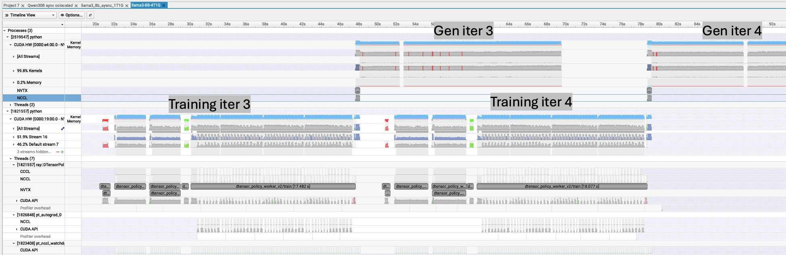

# Profile GPU with Nsys

NeMo RL supports Nsight profiling for Ray workers through environment variable pattern matching. This allows you to selectively profile specific worker types without modifying code or affecting the performance of workers that don't need profiling.

**Note**: To prevent profile files from becoming too large, consider limiting profiling to a smaller number of steps (e.g., 10 steps).

## Prerequisites

* Install NVIDIA Nsight Systems (`nsys`) on the compute nodes where workers will run. For Ubuntu installation instructions, see the [NVIDIA Nsight Systems Installation Guide](https://docs.nvidia.com/nsight-systems/InstallationGuide/index.html#package-manager-installation).

**Note: If you're using NeMo RL containers, `nsys` is already installed.**

* Ensure the workers you want to profile have GPU access

## Configure the Environment Variables

Set the `NRL_NSYS_WORKER_PATTERNS` environment variable with a comma-separated list of patterns to match worker names:

```bash
export NRL_NSYS_WORKER_PATTERNS="*policy*,*vllm*"
```

Set the `NRL_NSYS_PROFILE_STEP_RANGE` environment variable to control which training steps the profiler captures. Its
format is colon separated integers representing `start:stop`, where `start` is inclusive and `stop` is exclusive
(same as slice syntax `arr[start:stop]`). Note that the `start` is 1-indexed, so `NRL_NSYS_PROFILE_STEP_RANGE=0:10` would error.

```bash
export NRL_NSYS_PROFILE_STEP_RANGE=3:5
```

### Extra Nsys Options (Optional)

Set `NRL_NSYS_EXTRA_OPTIONS` to a JSON object to add or override nsys CLI flags on top of
the built-in defaults. Keys are the nsys flag names (without leading `--`); values are the
flag values (string, or anything Ray's nsight runtime_env accepts). User-supplied keys win
on conflict with the built-in defaults (`t`, `o`, `stop-on-exit`, `capture-range`,
`capture-range-end`, `cuda-graph-trace`).

```bash
export NRL_NSYS_EXTRA_OPTIONS='{"gpu-metrics-devices": "worker", "cuda-memory-usage": "true", "cpuctxsw": "none"}'
```

Common additions:
- `gpu-metrics-devices`: sample SM/memory utilization counters; use `"worker"` to give each profiled
  worker the metrics of its own GPU (see [GPU Metrics for Every Profiled Worker](#gpu-metrics-for-every-profiled-worker)).
- `cuda-memory-usage`: track host/device memory allocations (`"true"`).
- `cpuctxsw`: control CPU context-switch sampling (`"none"`, `"process-tree"`).

Set a key to `null` to remove a built-in default. The same options also apply to the
vLLM internal TP workers. For example, on platforms where the hardware `cuda` trace
crashes at `cudaProfilerStart`, use the software CUDA trace and drop CUDA-graph node tracing:

```bash
export NRL_NSYS_EXTRA_OPTIONS='{"t": "cuda-sw,nvtx", "cuda-graph-trace": null}'
```

Empty or unset means no extras — defaults apply unchanged. Invalid JSON or a non-object
payload raises at startup so misconfiguration surfaces immediately.

### GPU Metrics for Every Profiled Worker

nsys samples GPU hardware metrics (SM activity, memory bandwidth, clocks and more) with
`--gpu-metrics-devices`. Each GPU can be sampled by only one nsys process at a time: when two
processes ask for the same GPU, one of them records no GPU metrics, without an error. NeMo-RL
runs one nsys process per profiled worker, and most workers see every GPU of their node, so a
single value for all workers (`"all"`, `"cuda-visible"` or a fixed GPU id) makes the workers of a
node compete for the same GPUs: some reports get the metrics of several GPUs, others get none.
A single value only works when one profiled process runs per node.

To give each profiled worker the metrics of the GPU it runs on, set the flag to `"worker"`:

```bash
export NRL_NSYS_EXTRA_OPTIONS='{"gpu-metrics-devices": "worker", "cuda-memory-usage": "true"}'
```

For each profiled process, NeMo-RL replaces `"worker"` with the id of the GPU that Ray assigned
to that worker:
- Policy (training) workers sample their own GPU.
- vLLM with tensor parallel size 1: each generation worker samples its own GPU.
- vLLM with tensor parallel size > 1: each internal TP worker samples its own GPU, whichever
  pattern selected it (see the note under [Supported Workers](#supported-workers)). The outer vLLM
  worker runs no GPU work, so it samples none and cannot take a GPU away from the TP worker that
  runs on it.
- Colocated generation (vLLM shares the GPUs with the policy): only the policy workers sample.
  Their reports also cover the generation phase, which runs on the same GPUs; the vLLM reports
  carry no GPU metrics.

All other keys in `NRL_NSYS_EXTRA_OPTIONS` (for example `gpu-metrics-frequency` or
`cuda-memory-usage`) apply unchanged to the policy workers, the vLLM generation workers and the
vLLM internal TP workers. Values other than `"worker"` are passed to nsys as they are. The flag is
`gpu-metrics-devices` in current nsys releases; the deprecated spelling `gpu-metrics-device` also
accepts `"worker"`. GPU ids follow the PCI order that nsys uses when CUDA does too
(`CUDA_DEVICE_ORDER=PCI_BUS_ID`). Another nsys session that samples the same GPUs at the same
time, such as a node-level GPU-metrics sampler, still competes with the workers for them.

### Pattern Format

- Use shell-style wildcards (`*`, `?`, `[seq]`, `[!seq]`)
- Patterns are matched against worker names using `fnmatch`
- Multiple patterns are separated by commas
- Whitespace around patterns is automatically stripped
- Empty patterns are ignored

### Supported Workers

The supported worker types are:
- **AutomodelPolicyWorker**: Pattern matched against `"automodel_policy_worker"`
- **VllmGenerationWorker**: Pattern matched against `"vllm_generation_worker"`
- **VllmAsyncGenerationWorker**: Pattern matched against `"vllm_async_generation_worker"` (used when `async_engine` is `true`)
- **TrtllmAsyncGenerationWorker**: Pattern matched against `"trtllm_async_generation_worker"`

> [!NOTE]
> For the async vLLM engine with tensor parallel size > 1, both pattern styles profile every internal TP worker with deferred capture:
> - A pattern that also matches `vllm_generation_worker` (for example `*vllm*` or `*generation_worker`) sets `ray_workers_use_nsight=True`, and the `nemo_rl_nsight_inner` plugin gives each internal TP worker NeMo RL's deferred-capture config. Reports: `vllm_tp_worker_<NRL_NSYS_PROFILE_STEP_RANGE>_<PID>.nsys-rep`.
> - Matching `vllm_async_generation_worker` exactly leaves `ray_workers_use_nsight` off, and the internal TP workers inherit the nsight config of the outer `VllmAsyncGenerationWorker`. Reports: `vllm_async_generation_worker_<NRL_NSYS_PROFILE_STEP_RANGE>_<PID>.nsys-rep`, one per internal TP worker.
>
> `NRL_NSYS_EXTRA_OPTIONS`, including `"gpu-metrics-devices": "worker"`, applies to the internal TP workers either way.

## Example Usage

### Profile Only Policy Workers
```bash
NRL_NSYS_PROFILE_STEP_RANGE=2:3 NRL_NSYS_WORKER_PATTERNS="*policy*" uv run examples/run_grpo.py grpo.max_num_steps=5
```

### Profile Multiple Worker Types

```bash
NRL_NSYS_PROFILE_STEP_RANGE=1:2 NRL_NSYS_WORKER_PATTERNS="*policy*,*vllm*" uv run examples/run_grpo.py grpo.max_num_steps=5
```

### Profile Workers with Exact Names

```bash
NRL_NSYS_PROFILE_STEP_RANGE=3:10 NRL_NSYS_WORKER_PATTERNS="automodel_policy_worker,vllm_generation_worker" uv run examples/run_grpo.py grpo.max_num_steps=5
```

### Profile Megatron Workers

> [!IMPORTANT]
> To profile a Megatron worker, you should set `LD_LIBRARY_PATH` as follows, otherwise you will get errors when loading `libtransformer_engine.so`.

```bash
LD_LIBRARY_PATH="/usr/local/cuda/targets/x86_64-linux/lib:/usr/local/cuda/lib64:/usr/local/cuda/lib:/usr/local/nvidia/lib64:/usr/local/nvidia/lib:/usr/lib/x86_64-linux-gnu" \
NRL_NSYS_PROFILE_STEP_RANGE=2:3 NRL_NSYS_WORKER_PATTERNS="megatron_policy_worker,vllm_generation_worker" uv run examples/run_grpo.py --config examples/configs/grpo_math_1B_megatron.yaml grpo.max_num_steps=5
```

### Profile TensorRT-LLM Generation Workers

```bash
NRL_NSYS_PROFILE_STEP_RANGE=2:3 NRL_NSYS_WORKER_PATTERNS="trtllm_async_generation_worker" uv run examples/run_grpo.py --config examples/configs/grpo_math_1B_trtllm.yaml grpo.max_num_steps=5
```

The outer `TrtllmAsyncGenerationWorker` actor is CPU-only, so nsys wraps TensorRT-LLM's **internal** RayExecutor GPU workers instead. This is done by injecting `ray_worker_nsight_options` (with `capture-range=cudaProfilerApi`, deferred capture) into the `AsyncLLM` constructor. When `start_gpu_profiling()` is called, it broadcasts `collective_rpc("start_gpu_profiling")` to the internal GPU workers, each of which calls `torch.cuda.profiler.start()` to trigger the capture. Traces are one `.nsys-rep` per internal GPU worker (replicas × TP).

## Profile Output

When profiling is enabled, it generates the following logs and files:

1. **Logging**: You'll see log messages indicating which workers have profiling enabled:
   ```
   Nsight profiling enabled for worker 'automodel_policy_worker' (matched pattern '*policy*')
   ```

2. **Profile Files**: Each profiled worker generates a `.nsys-rep` file with naming pattern:
   ```
   automodel_policy_worker_<NRL_NSYS_PROFILE_STEP_RANGE>_<PID>.nsys-rep
   vllm_generation_worker_<NRL_NSYS_PROFILE_STEP_RANGE>_<PID>.nsys-rep
   vllm_async_generation_worker_<NRL_NSYS_PROFILE_STEP_RANGE>_<PID>.nsys-rep
   trtllm_async_generation_worker_<NRL_NSYS_PROFILE_STEP_RANGE>_<PID>.nsys-rep
   worker_process_<PID>.nsys-rep
   ```
For TensorRT-LLM, the meaningful generation profiles are the per-internal-GPU-worker files (`trtllm_async_generation_worker_<NRL_NSYS_PROFILE_STEP_RANGE>_<PID>.nsys-rep`), one per GPU (replicas × TP). If you are not using model parallelism in Vllm, you should directly refer to `vllm_generation_worker_<NRL_NSYS_PROFILE_STEP_RANGE>_<PID>.nsys-rep` for nsight reports; If you are using model parallelism, nsight is NOT applied to the outer `VllmGenerationWorker` to avoid interfering with Ray's compiled DAG. Instead, `ray_workers_use_nsight` is enabled and vLLM's default nsight config is monkey-patched to use `capture-range=cudaProfilerApi` (deferred capture). This means the internal TP workers run under nsys with near-zero overhead until `start_gpu_profiling()` triggers `cudaProfilerStart()` on each worker via `collective_rpc`. The `vllm_tp_worker_<NRL_NSYS_PROFILE_STEP_RANGE>_<PID>.nsys-rep` files are the nsight profiles from the internal TP workers. (refer to https://github.com/vllm-project/vllm/blob/7e3a8dc90670fd312ce1e0d4eba9bf11c571e3ad/vllm/executor/ray_distributed_executor.py#L136 for more information). With vLLM's v2 Ray executor (the default), the executor is built inside vLLM's EngineCore (a separate process with the async engine), so this config is installed there by the `vllm.general_plugins` entry point `nemo_rl_nsight_inner`, which is registered when NeMo RL is installed in the vLLM environment. Worker environments built before this entry point existed, such as a prebuilt container with newer NeMo RL source mounted over `/opt/nemo-rl` or existing `venvs/` on bare metal, do not load it, and the inner TP workers fall back to vLLM's default `worker_process_<PID>` profiles. Rebuild them once with `NRL_FORCE_REBUILD_VENVS=true`. If you set `VLLM_PLUGINS`, include `nemo_rl_nsight_inner`. When `NRL_NSYS_WORKER_PATTERNS` is set and the plugin cannot import vLLM's `RayExecutorV2`, vLLM startup fails with that `ImportError` instead of silently running without inner reports. Inner reports are written after the profile window ends, while the workers keep running, so keep the run going for a few steps past the window. `tests/test_suites/llm/grpo-llama3.2-1b-instruct-1n8g-megatron-nsys.sh` checks the per-worker reports end to end.

3. **File Location**: Profile files are saved in `/tmp/ray/session*/logs/nsight/` directory on each worker node. Ensure you check both `ls /tmp/ray/session_[0-9]*/logs/nsight` and `ls /tmp/ray/session_latest/logs/nsight` for the profiles, since the "latest" pointer may be stale.

**Note for SLURM users with `ray.sub`**: When using `ray.sub` on SLURM, set `RAY_LOG_SYNC_FREQUENCY=$NUM_SEC` (e.g., `RAY_LOG_SYNC_FREQUENCY=30`) to ensure that the nsight profile files get copied from the container's ephemeral filesystem (`/tmp/ray`) to the persistent directory. The head node's files will be synced to `$SLURM_JOB_ID-logs/ray`, and other nodes' files will be synced to `$SLURM_JOB_ID-logs/ray/$node_ip/` where `$node_ip` is the IP address of the node.

## Analyze Profile Files

To analyze the generated profile files, load the `.nsys-rep` files into the NVIDIA Nsight Systems desktop application, which you can download from the [NVIDIA Nsight Systems Get Started page](https://developer.nvidia.com/nsight-systems/get-started).

### How to Analyze the End-to-End RL Loop All at Once

Nsight Systems supports [multi-report view](https://docs.nvidia.com/nsight-systems/UserGuide/index.html#viewing-multiple-reports-in-the-same-timeline) functionality. If you open the profiles from different workers (e.g., `*policy_worker*.nsys-rep` and `*generation_worker*.nsys-rep`) in a single multi-report view, you can analyze the behavior of the end-to-end RL loop on the same timeline.




## How We Patched Nsight Support in Ray

Ray's Nsight profiling support had a bug where it hardcoded the Python executable path instead of using the actual Python executable from the runtime environment. This caused issues when using virtual environments or custom Python installations (`py_executables`).

### The Problem

In Ray's `nsight.py` file, the original code was:

```python
context.py_executable = " ".join(self.nsight_cmd) + " python"
```

This hardcoded `" python"` instead of correctly preserving the intended Python executable path.

### The Fix

To fix this problem, we patched the following line to preserve the original `context.py_executable`:

```python
context.py_executable = " ".join(self.nsight_cmd) + f" {context.py_executable}"
```

### Where We Applied the Patch

We applied this patch in two locations to cover different deployment scenarios:

1. **In `ray.sub` (SLURM clusters)**: The patch is applied before Ray's control plane starts up on both head and worker nodes:
   ```bash
   sed -i 's/context\.py_executable = " "\.join(self\.nsight_cmd) + " python"/context.py_executable = " ".join(self.nsight_cmd) + f" {context.py_executable}"/g' /opt/nemo_rl_venv/lib64/python*/site-packages/ray/_private/runtime_env/nsight.py
   ```

2. **In `nemo_rl/__init__.py` (Local clusters)**: The patch is applied automatically when NeMo RL is imported, making it work seamlessly for local development and testing environments.

### Why We Needed Both Locations

- **`ray.sub`**: Required for SLURM-managed clusters where Ray processes start in containers before Python imports happen. The patch must be applied at the filesystem level before Ray's control plane initializes.

- **`__init__.py`**: Required for local clusters and development environments where users start Ray clusters directly. The patch is applied when `nemo_rl` is imported, ensuring the fix is in place before any Ray processes are spawned.

This dual approach ensures that Nsight profiling works correctly regardless of how the Ray cluster is deployed.
