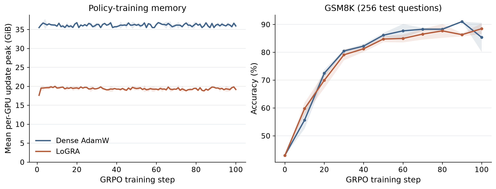
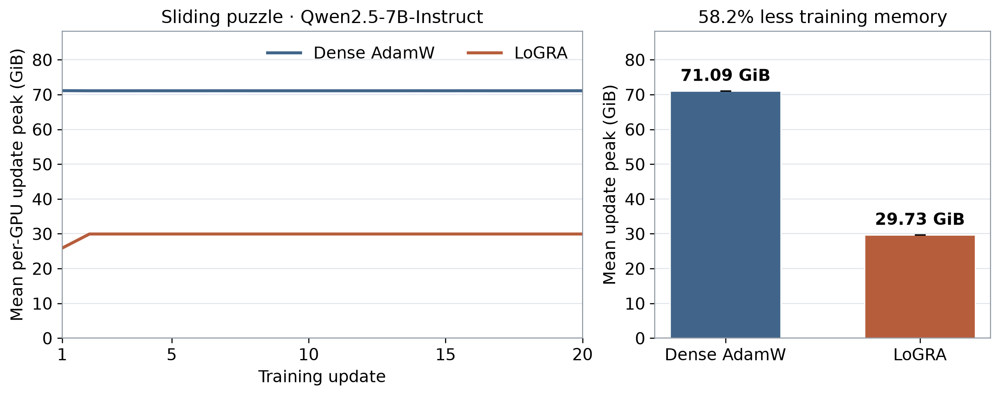
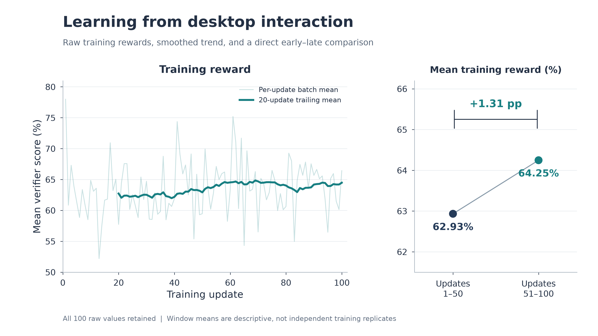
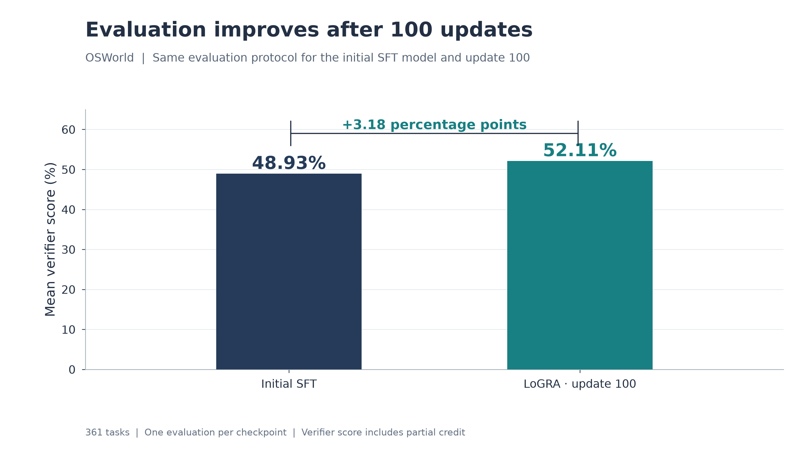

# LoGRA: low-rank gradient sketches for NeMo RL

LoGRA accumulates low-rank gradient sketches for selected weights and merges
updates into the model, without persistent adapters. All implementation lives
in `research/logra`; NeMo RL and AutoModel core code are unchanged.

| Example | Training | Optimizer | Generation |
|---|---|---|---|
| Math | Native synchronous GRPO | RowAdam; AdamW on other weights | Native vLLM |
| Sliding puzzle | Native multi-turn GRPO | RowAdam; AdamW on other weights | Native vLLM |
| OSWorld | Token REINFORCE | SGD + finite-difference KL scaling | Native vLLM HTTP |

## 1. Environment

Follow the repository's [Docker](../../docs/docker.md) and
[cluster](../../docs/cluster.md) setup. This project targets NeMo RL main
`26e2b802` and the AutoModel backend (`policy.automodel_cfg`).

```bash
# From the repository root.
git submodule update --init --recursive
cd research/logra
uv sync --locked --inexact --group test
```

The workspace requires Python 3.13.14. The measured runs used a prepared Python
3.12.3 container with PyTorch 2.13.0+cu130, Transformers 5.12.1 and vLLM 0.29.0;
the private desktop runtime has not been validated in the locked environment.
Record versions with `analysis/environment.py`. OSWorld additionally needs the
`nemo_gym` extra and external assets; see [CUA setup](docs/cua-setup.md).
Keep models, data, credentials and logs outside Git.

## 2. Math GRPO

Run from `research/logra` on eight GPUs:

```bash
# LoGRA; use fresh output directories for each run.
uv run --locked run_grpo.py --config configs/grpo_logra_7b.yaml \
  grpo.seed=42 logger.log_dir=/output/logra-s42 \
  checkpointing.checkpoint_dir=/output/logra-s42/checkpoints

# Native Dense AdamW control.
uv run --locked run_grpo.py --config configs/grpo_logra_7b.yaml \
  logra.enabled=false grpo.seed=42 logger.log_dir=/output/dense-s42 \
  checkpointing.checkpoint_dir=/output/dense-s42/checkpoints
```

Repeat with seed 43. Download weights/data in advance if compute nodes lack
network access; model and tokenizer paths can be overridden in the config.

| Setting | Dense and LoGRA |
|---|---|
| Model / data | Qwen2.5-Math-7B / GSM8K train |
| Batch / context | 16 prompts × 8 responses; microbatch 1; 2,048 tokens |
| Hardware | 8 A100 80GB: 4 training + 4 rollout GPUs |
| Precision | FP32 parameters, BF16 compute; activation checkpointing and packing |
| Schedule | LR 5e-6; 50-update warmup from 10%; weight decay 0.01 |
| Evaluation | First 256 GSM8K test questions every 10 updates; temperature/top-p 1.0/1.0 |

LoGRA uses rank 256, refreshed Rademacher projections (seed 42) and RowAdam
(`beta2=0.95`, `epsilon=1e-8`), with a second moment per output row and no first
moment. Other weights use native AdamW. Both modes use reference-policy KL
penalty 0.01; predicted-KL step control is disabled.



Two seeds × 100 updates; mean ± sample SD:

| Metric | Dense AdamW | LoGRA |
|---|---:|---:|
| Mean update peak, GiB / training GPU | 36.13 ± 0.03 | 19.36 ± 0.03 |
| Maximum update peak, GiB / training GPU | 37.28 ± 0.19 | 20.15 ± 0.03 |
| Final GSM8K subset score, % | 85.35 ± 5.25 | 88.48 ± 1.93 |

Mean update peak decreases by **46.40%**, excluding rollout GPUs. Both methods
start at 42.97%; this small evaluation does not establish performance superiority
or equivalence. The figure includes Dense seed 43's final accuracy drop.

## 3. Sliding-puzzle GRPO

The native puzzle generator supplies text boards; the model chooses moves and
earns reward 1 for solving a board. No external sandbox is needed.

[Recipe](configs/grpo_logra_sliding_puzzle.yaml): Qwen2.5-7B-Instruct; 2×2/3×3
boards with 1 or 3 shuffle moves; 8 boards × 4 trajectories per update; up to
8 turns, 96 generated tokens/turn and 2,048 total tokens. It uses two training
and two rollout GPUs, FP32 parameters, BF16 compute, activation checkpointing
and no packing or FSDP CPU parameter offload. Native optimizer offload during
refit stays enabled in both modes. LoGRA uses the math example's sketch settings;
there is no predicted-KL controller.

```bash
# Four allocated GPUs; commands run sequentially.
for seed in 42 43; do
  uv run --locked run_grpo.py --config configs/grpo_logra_sliding_puzzle.yaml \
    logra.enabled=false grpo.seed=$seed logger.log_dir=/output/puzzle/dense-s$seed
  uv run --locked run_grpo.py --config configs/grpo_logra_sliding_puzzle.yaml \
    logra.enabled=true grpo.seed=$seed logger.log_dir=/output/puzzle/logra-s$seed
done

uv run --locked analysis/export_events.py /output/puzzle --output /output/puzzle/memory.csv
uv run --locked analysis/plot_puzzle_memory.py /output/puzzle/memory.csv \
  --steps 20 --output /output/puzzle/sliding-puzzle-memory
```



Two seeds × 20 updates on four GB200 GPUs (2 training + 2 rollout):

| Method | Mean update peak / training GPU, GiB | Across-seed SD, MiB |
|---|---:|---:|
| Dense AdamW | 71.09 | 0.28 |
| LoGRA | 29.73 | 0.03 |

**58.19% less training memory.** Bars average the measured per-update PyTorch
allocation peaks over all updates and training GPUs; error bars are the sample
SD of the two seed means. Rollout memory is excluded. This short profile does
not measure convergence; its two-training-GPU layout differs from the math run.
[Vector figure](assets/sliding-puzzle-memory.pdf).

## 4. OSWorld computer use

The driver reuses **NeMo Gym's OSWorld client/runner** in desktop CPU actors,
rather than NeMo RL's generic Gym service orchestration. AgentENV hosts the
desktops; OSWorld supplies task verifiers. NeMo RL provides policy training,
vLLM serving and weight synchronization. See [CUA setup](docs/cua-setup.md) for
external model/data assets, runtime dependencies and sandbox credentials.

```bash
# From research/logra, on 4 nodes × 4 GB200 GPUs.
export OSWORLD_ROOT=/assets/osworld
export OSWORLD_CREDENTIAL_FILE=/private/sandbox.json
export CUA_OUTPUT_DIR=/output/cua-training-s43
uv run --locked --project ../.. --extra automodel --extra nemo_gym python \
  run_cua.py --config configs/cua_prod4.yaml training.max_steps=100 \
  osworld.setup_cache=/writable/osworld_setup_cache
```

Use a fresh output directory. Resume with `training.resume=/path/to/step_100`;
retain the same parallelism and CUA/OSWorld settings. Evaluations run every 50
updates and at the end; [external evaluation](docs/external-evaluation.md) is
also supported. `cua_osworld.yaml` is an older, different desktop mixture.

| Setting | ScaleCUA recipe |
|---|---|
| Model | Nemotron Omni RFC0040 iter881 SFT |
| Resources | 8 training GPUs, EP8; 8 rollout GPUs, four TP2 engines |
| Data / desktop | 815 ScaleCUA rows, 813 task IDs; `osworld-v2` |
| Collection | 128 episodes/update, 256 in flight; generation overlaps training |
| Context / sampling | 32K context; 8,192 tokens/turn; temperature/top-p 1.0/1.0 |
| Objective | Token REINFORCE; prompt EMA baseline; importance weights clipped to [0.5, 2] |
| Compression | Rank-256 refreshed Rademacher; SGD; other weights frozen |
| Step scaling | Relative proposal norm 6e-5; FD-KL budget 5e-4 → 5e-5 over 600 updates; α cap 3 |
| Checkpoints | Every 100 updates and at the end; optimizer, baseline and pending tasks included |




In the selected first 100 updates, mean training reward rises from **62.93%**
(updates 1–50) to **64.25%** (51–100); median update time is **4.81 min**.
One original-stack evaluation gives **48.93% → 52.11%** on 361 tasks
(paired gain SE: 2.41 points), using `osworld-v2`, 49,152-token context and
sampling temperature/top-p 0.5/0.9. It includes partial credit and does not
establish significance or long-horizon stability; inline evaluation differs.

Training/evaluation share 297 source task UUIDs and one identical instruction.
Removing that instruction gives **49.06% → 51.98%** on 360 tasks; this is still
not source-disjoint. Failed episodes remain in task means.

## 5. Scope and code

- `run_grpo.py`: native GRPO with math or puzzle data.
- `run_cua.py`: desktop collection, REINFORCE updates, refit and checkpoints.
- `logra/worker.py`, `compression.py`, `optimizer.py`, `row_adam.py`: sketch training.
- `logra/osworld.py`, `rollout_pool.py`, `token_capture.py`: desktop and token capture.
- `logra/cua.py`: REINFORCE, baseline, route replay and FD-KL scaling.

GRPO supports dense HF linear layers with FSDP2, TP=CP=1 and synchronous
execution. PEFT, draft co-training, quantization and CPU parameter offload are
unsupported. CUA also supports the validated attention/Mamba/MoE model with EP:
linear layers accumulate sketches directly; fused experts briefly create dense
gradients before projection. Fused Mamba `out_proj` weights remain frozen.
FD-KL control is an estimate, not a hard bound on realized KL. Pending desktops
are rerun on resume, not restored bit for bit.

## 6. Tests

```bash
uv run --locked --group test pytest tests/unit
bash tests/functional/grpo_logra.sh
bash tests/functional/sliding_puzzle_logra.sh
# External desktop/model prerequisites are required.
LOGRA_RUN_CUA_TEST=1 bash tests/functional/cua_logra.sh
```

Distributed numerical tests: `tests/functional/{fsdp,expert,cua}_equivalence.py`
(run via `uv run --locked --group test python -m torch.distributed.run`, with
2/4/4 processes respectively). They cover sketch averaging, clipping, expert
updates, routing, FD rollback and REINFORCE gradients. The full-model smoke
`tests/functional/cua_model_smoke.py --with-generation` uses synthetic screenshots
and four GPUs; add `--with-desktop` for a real desktop. A prerequisite skip is
not a successful end-to-end test.

For math plots, use `analysis/export_events.py`, `plot_comparison.py` and
`summarize_comparison.py`. Raw experiment artifacts stay outside Git.
