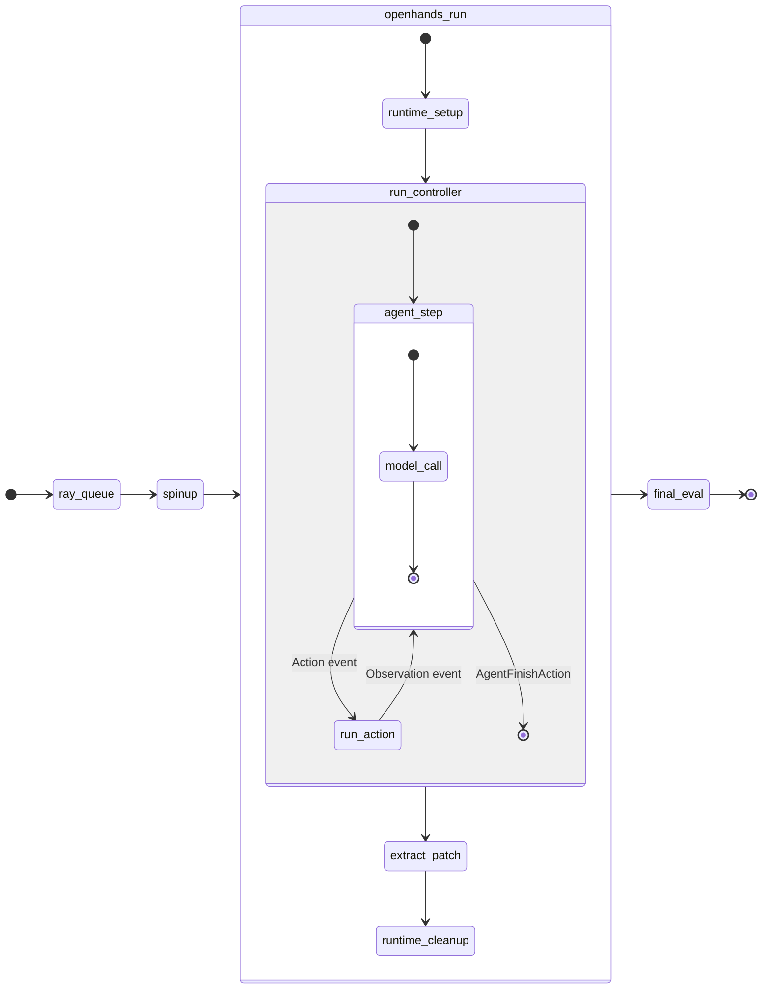

# Collect Training Timeline

> **Scope: SWE tasks.** The per-rollout half of this skill (rollout lanes,
> per-turn metrics, the `model_call` breakdown, in-flight batch size, turns and
> time shares) is for **SWE-agent tasks**: rollouts run by the NeMo Gym SWE
> agent with OpenHands. Their spans are written only by those two components.
> The trainer phases and rollout lifecycle work for any GRPO run, but a task
> that does not go through the SWE agent gets no per-rollout view.

A timeline is three kinds of Chrome-trace JSONL (one `ph: "X"` complete event
per line, epoch-microsecond `ts`, microsecond `dur`):

| File | Written by | Location |
|---|---|---|
| `training_timeline.jsonl` | NeMo-RL `Timer` (every stopped timer) | `logger.log_dir` |
| `rollout_lifecycle.jsonl` | NeMo-RL replay buffer (buffered/consumed records, async GRPO) | `logger.log_dir` |
| `timeline.jsonl`, one per rollout | NeMo Gym SWE agent and OpenHands | the rollout's dir under the Gym `results_dir` |

**Applicability.** Only the first two files exist for every GRPO run. The
per-rollout `timeline.jsonl` is written only by the NeMo Gym SWE agent and
OpenHands, and almost every rollout state (`ray_queue`, container spin-ups,
`create_runtime`, `run_controller`, `model_call`, tool actions, `extract_patch`,
`final_eval`) belongs to one of those two. A recipe that does not run through
them, such as the single-step `swe_pivot_*` environment, gets the trainer view
but no per-rollout or per-turn view. See
[references/analysis.md](references/analysis.md) for the state machines.



Gym writes everything outside `openhands_run`; OpenHands writes everything
inside it. `runtime_setup` is `create_runtime`, `connect_runtime`,
`initialize_runtime` and `prepare_instruction`. `run_action` is any OpenHands
action class (`CmdRunAction`, `FileReadAction`, `FileEditAction`, ...), each its
own `tool` span. One `model_call` can return several actions, so the two are not
one-to-one. [references/analysis.md](references/analysis.md) has the full
OpenHands event loop, checked against its code.

## Enable

1. Export `NRL_COLLECT_TIMELINE_FIELDS=1` on **every node** (for example with
   `srun --container-env`). It is the single opt-in and is off by default. The
   TRT-LLM generation servers read it at import, so setting it only in the
   driver is not enough.
2. Point `logger.log_dir` and the Gym `results_dir` at persistent, shared,
   writable storage. A relative `logger.log_dir` resolves against the driver's
   working directory, which inside a container is often not persistent.
3. The rollout side needs NeMo Gym and OpenHands support. Check for it with
   `rg -n "NEMO_GYM_TIMELINE_FPATH|nemo_gym_timeline_span" 3rdparty/Gym-workspace/Gym`.
   If it is missing, add it as described in
   [references/rollout-instrumentation.md](references/rollout-instrumentation.md).

The NeMo-RL side is already in the tree. `nemo_rl/utils/timer.py` handles
training events, and `ReplayBuffer(lifecycle_log_path=...)` handles the
lifecycle. Both generation backends emit per-request fields:
- TRT-LLM: `trtllm_http_server.py` / `trtllm_disagg_server.py` emit
  `nemo_llm_*`, plus `nemo_ctx_*` and `nemo_fe_*` under PD disaggregation.
- vLLM: the async worker's `/v1/chat/completions` emits `nemo_llm_*` from
  `RequestOutput.metrics`, and turns on `enable_prompt_tokens_details` for
  `cached_tokens`.

Both are off unless the flag is set.

## Plot

Requires `plotly`. Run it on a compute node, not a login node.

```bash
python skills/collect-training-timeline/scripts/plot_rl_timeline.py \
  --training-timeline $LOG_DIR/training_timeline.jsonl \
  --rollout-root $GYM_RESULTS_DIR \
  --output timeline.html \
  --zero-at-first-rollout --include-all-rollouts [--step N ...]
```

- `--rollout-lifecycle` defaults to `rollout_lifecycle.jsonl` beside
  `--training-timeline`.
- `--include-all-rollouts` keeps every rollout. Add `--step N` to keep every
  rollout that overlaps step N.
- Without `--include-all-rollouts`, `--max-rollouts` (default 64) and
  `--rollouts-per-step` sample lanes.
- An all-rollouts HTML of thousands of rollouts can reach hundreds of MB, so
  prefer one `--step` per file on large runs.
- Check that the rollout count shown matches the number of `timeline.jsonl`
  files found under `--rollout-root`.

## Read per-turn metrics

Each OpenHands `model_call` event (`cat: "model"`, `args.turn`) carries these
fields, copied from the live response:

| Field | Meaning |
|---|---|
| `prompt_tokens`, `decode_tokens` | `usage.prompt_tokens`, `usage.completion_tokens` |
| `cached_prompt_tokens`, `kv_cache_hit_rate` | Per-request prefix reuse; `0` is a real miss, not missing data |
| `ctx_cached_prompt_tokens`, `ctx_computed_tokens`, `ctx_first_begin`, `ctx_num_chunks` | PD disaggregation: the context (prefill) leg's reuse. Use these, not the decode leg's usage |
| `generation_replica_idx` | Zero-based DP generation replica chosen by the Gym proxy |
| `llm_arrival_ts_us`, `queued_ts_us`, `first_scheduled_ts_us`, `first_token_ts_us`, `last_token_ts_us`, `llm_response_ready_ts_us` | LLM-server milestones (epoch µs). `first_scheduled - queued` is the scheduler queue |
| `frontend_recv_ts_us`, `frontend_fwd_ts_us`, `ctx_arrival_ts_us`, `ctx_queued_ts_us`, `ctx_first_scheduled_ts_us`, `ctx_done_ts_us` | PD disaggregation frontend and context-leg milestones |
| `gym_llm_response_received_ts_us`, `gym_tokenize_duration_us`, `gym_response_ready_ts_us` | Gym model proxy boundaries |
| `openhands_response_received_ts_us`, `openhands_parse_validate_duration_us` | OpenHands client boundaries |

Common derivations:
- **Prefill hit rate under disaggregation:** token-weighted
  `Σ(prompt_tokens - ctx_computed_tokens) / Σ prompt_tokens`.
- **TPOT:** `(last_token_ts_us - first_scheduled_ts_us) / (decode_tokens - 1)`.

Only successful calls (`status: "ok"`) carry these fields.

Other events, all with `args.rollout_id` and `args.status`:
- Gym `orchestration`: `ray_queue`, `agent_container_spinup`, `openhands_run`,
  `eval_container_spinup`, `final_eval`.
- OpenHands `runtime`: `create_runtime`, `connect_runtime`,
  `initialize_runtime`, `runtime_cleanup`.
- OpenHands `agent`: `prepare_instruction`, `run_controller`, `extract_patch`.
- `tool`: one event per action, named after the action class.

## Analyze

```bash
python skills/collect-training-timeline/scripts/analyze_rollout_timeline.py \
  --rollout-root $GYM_RESULTS_DIR [--bin-seconds 10] [--output-json stats.json]
```

It reads every non-empty `timeline.jsonl` and prints:
- per trajectory: turns, `model_call` / tool / agent-loop time share, tokens,
  prefix hit rate;
- the `model_call` breakdown from OpenHands down to the engine and back, with
  each segment classed as compute, queue or plumbing;
- system in-flight counts over time: clients waiting, engine queued, engine
  running (the generation batch), prefill running, and running per replica;
- the size of the trace itself.

[references/analysis.md](references/analysis.md) lists every statistic the
timeline supports and how it is computed, and explains how to read the
`model_call` breakdown and estimate the cost of the tracing itself.

Segments that cross hosts (`client_to_frontend`, `kv_handoff`, `llm_to_gym`)
include wall-clock skew. The script reports how many came out negative; a
non-zero count means skew.

## Rules

- Tracing is best effort. Write failures are swallowed, and disabled tracing
  behaves exactly as before.
- Never record prompts, responses, token-id arrays, credentials or environment
  dumps; record IDs, phase names, status and numbers only.
- Do not recover metrics afterwards from rollout `output.jsonl`; copy them from
  the live response.
