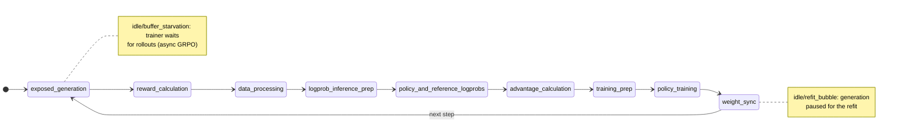
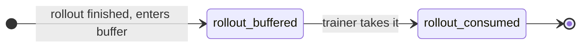
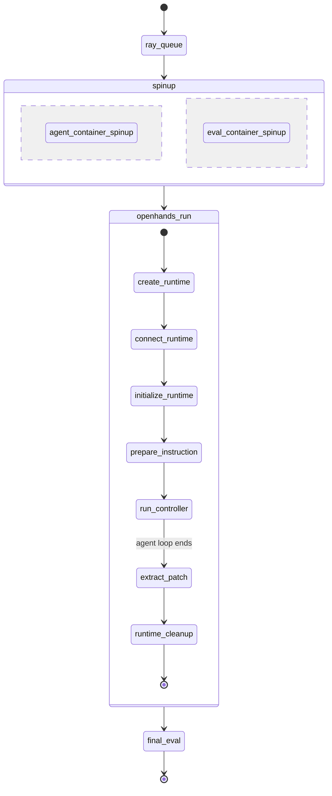
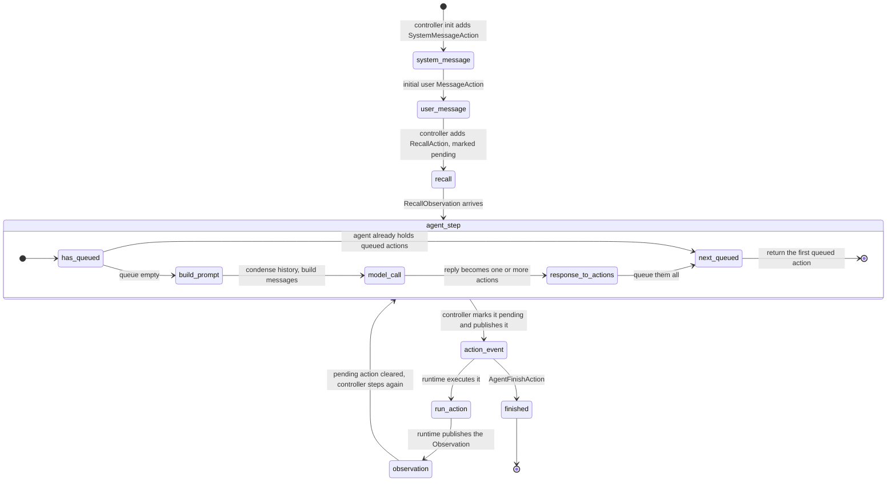

# What the timeline can tell you

Run the numbers with
`scripts/analyze_rollout_timeline.py --rollout-root $GYM_RESULTS_DIR`
(standard library only).

## Applicability

The three files do not cover the same workloads.

| File | Needs | Works for a non-SWE environment? |
|---|---|---|
| `training_timeline.jsonl` | NeMo-RL `Timer` | Yes. Any GRPO run. |
| `rollout_lifecycle.jsonl` | Async GRPO replay buffer | Yes, for async GRPO. Absent for synchronous runs. |
| per-rollout `timeline.jsonl` | NeMo Gym **SWE agent** + **OpenHands** | **No.** |

The last row is the limit to keep in mind. Every state in the per-rollout state
machine below comes from one of two writers: the Gym SWE agent
(`ray_queue`, `*_container_spinup`, `openhands_run`, `final_eval`) or
OpenHands inside the agent container (`create_runtime`, `connect_runtime`,
`initialize_runtime`, `prepare_instruction`, `run_controller`, `model_call`,
every tool action, `extract_patch`, `runtime_cleanup`). `plot_rl_timeline.py`
colours exactly these names (`ROLLOUT_COLORS`).

So a recipe that does not run through the SWE agent produces **no** rollout
lanes. Example: `grpo-qwen3-1.7b-2n4g-megatron-trtllm-disagg-swe1` uses the
single-step `swe_pivot_*` resources server, with no OpenHands container, and its
`nemo_logs/` holds only `training_timeline.jsonl` and `rollout_lifecycle.jsonl`.
That recipe still gets the trainer view, but no per-turn view.

Two further requirements:
- The Gym/OpenHands instrumentation must be present in the checkout
  (`rg NEMO_GYM_TIMELINE_FPATH 3rdparty/Gym-workspace/Gym`). Without it the SWE
  agent runs but writes no `timeline.jsonl`.
- A new agent framework needs its own writer; the plotter will not colour
  unknown names (they fall back to grey), and every statistic below that reads
  `model_call` / `run_controller` will report nothing.

## State machines

### Trainer step (any GRPO run)

Order confirmed from `training_timeline.jsonl` of a real run.

`total_step_time` spans the whole loop. `exposed_generation` is generation time
the trainer could not hide behind training.

### Rollout lifecycle (async GRPO)

`rollout_consumed.disposition` (for example `consumed_as_targeted`) says
whether it was used by the step it was generated for. The `rollout_id`
`"{prompt_idx}-{sample_idx}"` is also the id in the per-rollout files, which is
what joins them.

### One SWE rollout (Gym SWE agent + OpenHands only)

Writers: `ray_queue`, the two spin-ups, `openhands_run` and `final_eval` are
written by Gym; everything inside `openhands_run` is written by OpenHands. What
happens inside `run_controller` is the next diagram.

### Inside `run_controller`: OpenHands' event loop

Checked against OpenHands as pinned by Gym (`sdevare-nv/nv-OpenHands`, commit
`5f018005`), with the CodeAct agent. The controller, the runtime and the memory
do not call each other. Each publishes `Action` and `Observation` events to an
event stream and reacts to the events it sees.

What each part does, from the code:
- **Step trigger.** `should_step` is true after an `Observation` (except state
  changes and null observations with no cause) and after a user message. The
  step is skipped while a pending action is outstanding. The pending action is
  cleared when the `Observation` whose `cause` is its id arrives. That is why
  turns are strictly sequential.
- **`model_call`.** `NemoGymClient.model_call` is the only LLM call in the step.
  It is shared by the CodeAct, Codex, OpenCode and Terminus2 agents, so the
  span means the same thing whichever one the recipe selects.
- **One model call, several actions.** A reply can carry several tool calls.
  `response_to_actions` returns all of them and the agent queues them. The next
  steps return queued actions without calling the model. So one `model_call`
  maps to one **or more** actions, and there is no `model_call` for the later
  ones.
- **Execution.** The runtime receives every `Action`, runs it (`run_action`) and
  publishes the resulting `Observation`. A `NullObservation` is not published.
- **End.** `AgentFinishAction` makes the controller set the state to
  `FINISHED`, which ends `run_controller`. An exception, an iteration or budget
  limit, or stuck-in-loop detection also ends it.

Action spans are named after the OpenHands action class (`CmdRunAction`,
`FileReadAction`, `FileEditAction`, `FileWriteAction`, `IPythonRunCellAction`,
`TaskTrackingAction`, `AgentThinkAction`, ...). Which ones appear depends on the
agent's tool set, so treat the names as data, not a fixed list.

Startup and finish events also appear as `tool` spans. The runtime receives
every `Action`, including `SystemMessageAction`, `MessageAction`,
`RecallAction` and `AgentFinishAction`, so each gets a span of near-zero
duration even though nothing runs. At startup these spans can begin after the
first `model_call` has started, because the runtime handles them on its own
subscription, so do not read their order as causal order.

#### What each span covers

| Span | Covers | Leaves out |
|---|---|---|
| `model_call` | `NemoGymClient.model_call`: serialising the messages, the request to Gym, response parsing and validation | condensing history and building the messages (before it); `response_to_actions` (after it) |
| action (`tool`) | the runtime's handling of one `Action`: `run_action` and creating the observation | the controller publishing the action, and delivering the observation back |

The unspanned time sits between spans:
- `model_call` end to the first action span: `response_to_actions`, queueing and
  the controller publishing the action.
- action end to the next `model_call` start: publishing the observation, the
  controller's `should_step`, condensing history and building the messages. The
  message building likely grows with the history length; this is not measured.

Together these gaps are the "agent-loop remainder" in the statistics below.

#### Pairing a `model_call` with its actions

No field links them today: `model_call` carries `turn`, and an action span
carries `event_id` and `action_type`. Because the controller blocks on the
pending action, every action span between `model_call` k and `model_call` k+1
belongs to turn k. The spans in front of the first `model_call` are startup. Do
not pair by one-to-one order: a turn with several queued actions has several
action spans and one `model_call`.

The time inside `run_controller` is `Σ model_call + Σ action + the gaps above`.

### One `model_call`: where the time goes

Each milestone is a timestamp copied from the live response. Consecutive
milestones cut the span into segments that add up to the whole call.

```mermaid
stateDiagram-v2
    direction LR
    [*] --> client_to_frontend: OpenHands sends
    client_to_frontend --> frontend_route: frontend_recv
    frontend_route --> ctx_submit: ctx_arrival
    ctx_submit --> ctx_sched_queue: ctx_queued
    ctx_sched_queue --> ctx_prefill: ctx_first_scheduled
    ctx_prefill --> kv_handoff: ctx_done
    kv_handoff --> gen_submit: llm_arrival
    gen_submit --> gen_sched_queue: queued
    gen_sched_queue --> gen_first_token: first_scheduled
    gen_first_token --> decode: first_token
    decode --> response_build: last_token
    response_build --> llm_to_gym: llm_response_ready
    llm_to_gym --> gym_proxy: gym_response_received
    gym_proxy --> gym_to_openhands: gym_response_ready
    gym_to_openhands --> openhands_tail: openhands_response_received
    openhands_tail --> [*]: span end
```

The `ctx_*` and `frontend_*` states exist only under PD disaggregation. Without
it the path is `client_to_frontend` straight to `gen_submit`.

## Supporting files

Two small files, written next to `training_timeline.jsonl` when
`NRL_COLLECT_TIMELINE_FIELDS=1`, let a reader align and place the rest.

**`clock_calibration.jsonl`**: one record per live Ray host, written once by the
GRPO driver at startup.

| Field | Meaning |
|---|---|
| `reference_clock_id` | The driver's clock; every offset is relative to it |
| `host_clock_id` | The host's clock id (its host name) |
| `offset_us` | Host clock minus driver clock. A host timestamp maps to the driver clock as `ts - offset_us` |
| `uncertainty_us` | Half the network round trip of the kept sample; the offset is good to about this |
| `sample_count`, `measured_at_us`, `ray_node_id` | Round trips taken (the least uncertain is kept), when, and which node |
| `expected_ray_node_count` | Live nodes at startup, to spot a host that went unprobed |

Each record in `training_timeline.jsonl` (in `args.clock_id`) and in
`rollout_lifecycle.jsonl` (`clock_id`) names the clock that stamped it, so its
offset can be looked up. Rollout spans from OpenHands carry `args.hostname` and
are looked up by that. The offset is measured once, so it does not track drift
over a long run.

**`generation_topology.jsonl`**: one record per generation engine, written under
TRT-LLM PD disaggregation once the disagg servers are up (a backend with nothing
to report writes no file).

| Field | Meaning |
|---|---|
| `engine_index`, `replica_idx` | The engine and the DP replica it belongs to; `replica_idx` is the `generation_replica_idx` a `model_call` carries |
| `role` | `prefill` or `decode` |
| `tensor_parallel_size` | The engine's TP width |
| `host`, `port`, `ray_node_id` | Where the engine's HTTP server listens |
| `frontend_urls` | The replica's disagg frontends, replica-major |

Join `model_call.generation_replica_idx` to `replica_idx` to say which engines
and hosts served a call, and to split prefill load from decode load.

## Statistics you can derive

| Question | How | Needs |
|---|---|---|
| In-flight requests at the system level | Sweep line over `[model_call.ts, ts+dur]` | any rollout `timeline.jsonl` |
| Engine batch size (running) | Sweep line over `[first_scheduled, last_token]`, per `generation_replica_idx` | LLM milestones |
| Engine queue depth | Sweep line over `[queued, first_scheduled]` | LLM milestones |
| Prefill-leg load | Sweep line over `[ctx_first_scheduled, ctx_done]` | PD disaggregation |
| Turns per trajectory | Count of `model_call` with `status: ok` | `model_call` |
| Model-call time share | `Σ model_call.dur / run_controller.dur` | `model_call`, `run_controller` |
| Tool time share, and by action | `Σ tool.dur / run_controller.dur`, grouped by `name` | tool spans |
| Agent-loop remainder | `1 - model share - tool share` | the two above |
| Context growth | `prompt_tokens` against `turn` | `model_call` |
| Output length | `decode_tokens` per call, or per trajectory | `model_call` |
| Prefix hit rate | Token-weighted `Σ(prompt - ctx_computed) / Σ prompt` under disaggregation, else `Σ cached_prompt_tokens / Σ prompt_tokens` | `model_call` |
| TPOT | `(last_token - first_scheduled) / (decode_tokens - 1)` | LLM milestones |
| Replica balance | In-flight and token counts grouped by `generation_replica_idx` | replica index |
| Which engines and hosts served a call | Join `generation_replica_idx` to `replica_idx` | `generation_topology.jsonl` |
| Host clock offset | `offset_us` and `uncertainty_us` per host | `clock_calibration.jsonl` |
| Trainer idle share | `idle/buffer_starvation`, `idle/refit_bubble` over `total_step_time` | `training_timeline.jsonl` |
| Rollout staleness | `consumed_weight_version - generation_weight_version` | `rollout_lifecycle.jsonl` |
| Wait before a rollout is consumed | `rollout_consumed.ts - rollout_buffered.ts` | `rollout_lifecycle.jsonl` |

Cautions:
- The in-flight series counts only traced rollouts. A partial trace
  understates it. Bins at the start and end of a run include the ramp-up and
  tail, so read the p50/p95, not only the mean.
- "Running" is the span from first schedule to last token. It is a proxy for the
  engine's running batch, not the exact scheduler batch, because chunked prefill
  and preemption are not visible.
- `model_call` events with `status: error` have no milestones. They are counted
  in time shares but not in the breakdown.

## Overhead

### Between OpenHands and the engine

`analyze_rollout_timeline.py` cuts every `model_call` that carries all
milestones into the segments of the last state machine above and classes each:

| Segment | Class | What it is |
|---|---|---|
| `client_to_frontend` | plumbing | OpenHands to Gym proxy to the LLM frontend |
| `frontend_route` | plumbing | Disagg frontend: tokenize and route (disaggregation only) |
| `ctx_submit` | plumbing | Frontend to the prefill engine's queue (disaggregation only) |
| `ctx_sched_queue` | queue | Waiting for the prefill engine's scheduler |
| `ctx_prefill` | compute | Prefill-engine work |
| `kv_handoff` | plumbing | Prefill done to the decode server accepting the request |
| `gen_submit` | plumbing | Decode server accepted to engine queue |
| `gen_sched_queue` | queue | Waiting for the engine's scheduler |
| `gen_first_token` | compute | First schedule to first output token |
| `decode` | compute | First to last output token |
| `response_build` | plumbing | Last token to the full chat response |
| `llm_to_gym` | plumbing | LLM server to the Gym proxy |
| `gym_proxy` | plumbing | Gym proxy work, including any fallback `/tokenize` |
| `gym_to_openhands` | plumbing | Gym proxy to OpenHands |
| `openhands_tail` | plumbing | OpenHands parse and validate, up to the span end |

The segments add up to the whole `model_call`, so the three classes add up to
100% of it:
- **compute**: `ctx_prefill`, `gen_first_token`, `decode`. This is the engine
  doing useful work.
- **queue**: `ctx_sched_queue`, `gen_sched_queue`. Contention, which grows with
  load; it is not a fixed per-request cost.
- **plumbing**: everything else. This is the overhead between OpenHands and the
  model, and it is the part that can be removed.

How to read it:
- A rollout's time is `model_call` + tool actions + a small agent-loop
  remainder. If `model_call` dominates, tool and agent speed-ups cannot help
  much.
- Within a call, the plumbing share is an upper bound on what trimming the
  proxy chain can save. If decode dominates, faster decoding is the lever.
- Compare plumbing segments by their p95 as well as their mean; a rare slow hop
  hides in the mean.
- The Gym proxy's own cost is `gym_proxy + llm_to_gym + gym_to_openhands`;
  `gym_tokenize_duration_us` is the part of `gym_proxy` spent on the fallback
  `/tokenize` call, and is `0` when it is not used.

Cross-host segments (`client_to_frontend`, `kv_handoff`, `llm_to_gym`) are
differences of timestamps taken on different machines, so they include
wall-clock skew. The script reports how many segments came out negative; a
non-zero count means skew, and the cross-host segments are then unreliable.
`clock_calibration.jsonl` (below) measures each host's offset, but it cannot fix
these segments: the milestones carry no owning clock id.

### Of the tracing itself

Each event is one `os.open` plus one `os.write` with `O_APPEND` (see the span
writer in `rollout-instrumentation.md`). To estimate the cost for your setup:

1. Time that writer for a few thousand events with a realistic number of
   fields, on the same storage the trace will be written to. Expect tens of
   microseconds per event on local disk and a few hundred on a network
   filesystem, with rare stalls of tens of milliseconds. Record the mean and
   the worst stall.
2. Multiply by the events per rollout and compare with the rollout's
   `run_controller` duration. The script prints events and bytes per rollout.
3. Weigh the worst stall against a single `model_call`, since the write sits on
   that call's path.

This is an estimate from a microbenchmark and event counts, not an A/B
measurement. It also leaves out the server-side milestone capture, which is a
few `time.time_ns()` calls per request. To measure it for a given recipe, run it
twice, with and without `NRL_COLLECT_TIMELINE_FIELDS=1`, and compare step time.
